# Architectural & Technical Specification: `ligo`, the SPIFFE Binding Lifecycle Service

- **Document Version:** `4.0.2` (`v1alpha1` API)
- **Status:** Baseline for Spec-Driven Development (SDD)
- **Supersedes:** `4.0.1` (no migration from 3.x, Go 1.27.3, §0.5). 4.0.1 superseded `4.0.0` (the web UI moves to htmx 4, §0.6). 4.0.0 superseded `3.0.2` with a **breaking change**: sources and targets become first-class resources, target instances become platforms, and a binding links a registered source to a registered target at one of its access levels (§0.7).
- **Target Stack:** Go 1.27.3+, PostgreSQL 15+ (`pgx/v5`), DBOS Transact for Go (`dbos-transact-golang`, pinned at v1.8.0), SPIFFE/SPIRE (`go-spiffe/v2`), HashiCorp `go-plugin`, `expr-lang/expr`, `github.com/jessevdk/go-flags`, htmx 4.0 (pinned `4.0.0`, served by `ligo` itself, with the `hx-csp` extension), HashiCorp Vault or OpenBao (Transit, KV v2, Database Secrets Engine)
- **Purpose:** Complete Specification and Threat Model for Spec-Driven Development

---

## 0. Document Conventions

### 0.1 Normative language
The key words **MUST**, **MUST NOT**, **REQUIRED**, **SHALL**, **SHOULD**, **SHOULD NOT**, **MAY** are to be interpreted as described in RFC 2119 / RFC 8174.

### 0.2 Normative vs. illustrative content
- Every code block is preceded by a label: **Normative** (the implementation MUST match it exactly: DDL, Protobuf, config keys, CLI flags, wire formats) or **Illustrative** (shows intent; the prose around it is authoritative).
- Code generators MUST NOT treat illustrative code as API ground truth. Where this spec relies on behavior of third-party SDKs, the assumption is listed in **Section 12 (External API Assumptions)**. Each assumption MUST be verified against the pinned SDK version before code is generated against it.

### 0.3 Identifier scheme
| Prefix | Meaning |
| :--- | :--- |
| `ADR-nn` | Architectural decision |
| `INV-nn` | System invariant (MUST hold at all times; each MUST have at least one automated test) |
| `T-nn` | Threat (Section 9) |
| `AC-nn` | Acceptance scenario (Section 11.2) |
| `EXT-nn` | External API assumption to verify (Section 12) |
| `OI-nn` | Open issue to decide before implementing the affected component (Section 13) |
| `FW-nn` | Future work: a design option recorded for later, not part of this version (Section 13) |

### 0.4 Naming convention
The application is named **`ligo`**, Latin for "I bind". It manages four kinds of things:

| Entity | Meaning | Where it lives | Example |
| :--- | :--- | :--- | :--- |
| **Source** | The consuming end of a binding: an **identity specification** (trust domain, SVID regex, sample SPIFFE IDs) that defines which workloads it covers, plus metadata describing them | Database, managed through the API | `payments-ledger-workers`: `^spiffe://cloud\.internal/acct/fin-01/tenant/payments/sa/ledger-[0-9]+$` |
| **Target** | The resource end of a binding: one specific resource on a platform, with its **access levels** and the **network flows** needed to reach it | Database, managed through the API | The `LEDGER` schema on `oracle-prod`; the Kafka topic `payments.events` |
| **Platform** | The system that hosts targets, with its plugin wiring, privilege bounds and endpoints | `server.yaml` (read-only through the API) | The `oracle-prod` database cluster |
| **Binding** | The directional link: this source may use this target at this access level | Database, managed through the API | `payments-ledger-workers` → `ledger-schema` at `write` |

- **`ligo`** means the application: the daemon, the binary, the service (`ligo serve`).
- **Platform** replaces what 3.x called a *target instance*. In this document "target" always means a registered Target, never a system.
- **Plugin kinds.** The three stages (ADR-01) are served by three plugin kinds, named the same way in the spec, the protobuf contract (`PluginKind`, §5.9), `server.yaml` (§8.1) and the code:
  - an **IdentityProvider** (Stage 1) decides which principal represents the source: the SVID itself, a directory principal it creates, or a local principal a later stage creates. The built-ins `svid.v1`, `target-local.v1` and `delegated-dynamic.v1` are **mode markers**: they create nothing and only declare an identity mode;
  - a **PlatformProvider** (Stage 2) manages platforms: each platform is one of its instances. It is the only component that connects to the platform, and grants access on targets there;
  - a **SecretStore** (Stage 3) keeps the static credentials of a binding, or generates credentials on demand, and controls which workloads may read them.
- **Instance** means a configured instance of a plugin type (`ldap-prod`, `vault-prod`, and each platform), never a target.
- **Client** is used only in its ordinary meaning, a program connecting to a target. "Service" and "domain" are not used for entities, because both are taken in this context (SPIFFE service identities and trust domains, Kubernetes `Service`, DNS and LDAP domains).

Identifiers derived from the **application** use the `ligo` prefix:

| Namespace | Form | Example |
| :--- | :--- | :--- |
| Binary and CLI | `ligo` | `cmd/ligo/`, `ligo serve` |
| Go module | `github.com/dihedron/ligo` | `github.com/dihedron/ligo/api/gen/plugin/v1` |
| Protobuf packages | `ligo.*` | `ligo.plugin.v1`, `ligo.workload.v1alpha1` |
| Environment variables | `LIGO_*` | `LIGO_PG_APP_DSN` |
| Prometheus metrics | `ligo_*` | `ligo_workflow_duration_seconds` |
| DBOS workflow IDs | `ligo:{op}:…` | `ligo:apply:<uuid>:r2:a3` |
| PostgreSQL roles | `ligo_*` | `ligo_app`, `ligo_reader` |
| Advisory locks and `NOTIFY` channel | `ligo_*` | `ligo_sweeper`, `ligo_propagator`, `ligo_bindings_changed` |
| Cookies | `__Host-ligo_*` | `__Host-ligo_session` |
| HTTP headers | `X-Ligo-*` | `X-Ligo-Signature` |
| File system paths | `/etc/ligo`, `/usr/lib/ligo` | `/usr/lib/ligo/plugins` |
| SPIFFE paths | `/ligo/plugin/<binary>`, `/ns/sys/sa/ligo` | `spiffe://prod.internal/ns/sys/sa/ligo` |
| Vault/OpenBao objects | `ligo-*`, `kv/data/ligo/…` | `ligo-sealer`, `ligo-interstage`, `kv/data/ligo/bootstrap/oracle-prod` |
| URNs, annotations, ownership tags | `ligo` | `urn:ligo:problem:<slug>`, `x-ligo-endpoint`, `ligo:binding_id=<uuid>` |
| go-plugin handshake | `LIGO_PLUGIN` | `MagicCookieKey: "LIGO_PLUGIN"` |
| Resource API group | `ligo.dihedron.org` (a domain owned by the project) | `"apiVersion": "ligo.dihedron.org/v1alpha1"` |

Identifiers that name a **resource** use its name: the tables `sources`, `targets`, `target_access_levels`, `target_network_flows`, `bindings`, `binding_stage_state` and `binding_propagation_queue`; the types `binding_phase`, `binding_operation`, `binding_stage`; the API paths `/v1/admin/sources`, `/v1/admin/targets`, `/v1/admin/platforms`, `/v1/admin/bindings` and the workload paths `/v1/bindings` and `/v1/flows`; the Protobuf names `WorkloadBindingService`, `WorkloadBinding` and `BindingContext`; the workflows `ApplyBindingWorkflow` and `DeleteBindingWorkflow`; the error slug `binding-busy`; and the per-binding secret path `kv/data/bindings/<binding_id>`. The audit table, shared by every resource type, is `audit_log`.

PostgreSQL roles use the application prefix (`ligo_app`, `ligo_reader`, `ligo_migrator`, `ligo_dbos`) and tables use resource names, so the two can never be confused.

**Zone and scope.** The two words are never interchangeable:
- A **zone** is a technical placement (ADR-03): one SPIRE trust domain, its agent socket, and the plugin processes attached to it. Zones decide where plugins run and which SVIDs they hold. A platform belongs to one zone.
- A **governance scope** (or simply **scope**) is an organisational ownership boundary (ADR-13, §3.9), such as a cloud tenancy (`cloud/fin-01/payments`) or a data centre (`dc/corp-prod`). Every source, target and platform has an owner scope. Scopes decide who may propose, approve, see and revoke.

### 0.5 Changelog from 4.0.1 (4.0.2)
| Area | Change |
| :--- | :--- |
| Migration from 3.x (§8.3, §8.4, §8.5, §11.2) | Removed. No 3.x deployment exists, so `ligo migrate-v3`, its section, the `internal/migratev3` package and AC-80 are dropped. 4.0 is installed on an empty database. |
| Configuration (§8.1, §8.2 rule 9) | New key `secret_sealing.local_kek_file`: the 32-byte key file of the `local-kek` sealer, which must not be readable by group or others. Required with `local-kek`, which still requires `--insecure-dev`. |
| Lab (§8.3, §11.1) | The lab moves from `deploy/lab/` to `test/lab/`, as in the openstack-spiffe and lxd-spiffe projects, and is specified in `.specs/ligo-test-environment.md`. |
| Plugin handshake (§5.3 rule 1) | `ProtocolVersion: 1` instead of 2. The 4.0 plugin SDK is the first one released and no 3.x plugin exists (see the first row), so the handshake starts at 1, as `DescribeResponse.plugin_protocol_version` does. |
| Principal names (§3.8, §4.2, §5.8 rule 2, §8.1, §8.2 rule 6, Appendix B, INV-08, AC-86) | `principal_prefix` moves from plugin instance configuration to the platform. The engine computes `derived_principal_name` once, when a binding is created, and stores it in the new immutable, unique column `bindings.derived_principal_name`; plugins never apply a prefix. With a per-plugin prefix, Stage 1 and Stage 2 could name different principals, and a prefix change would orphan principals still holding grants. |
| Built-in markers (§5.8 rule 2) | `svid.v1` returns no metadata: the target already receives `source_svid_regex` and `source_trust_domain` in `BindingContext`. |
| Secret storage strategies (§3.6, §4.2, §5.6, §5.9, §8.1, §8.2 rules 3 and 10, INV-08) | The workload `auth.strategy` had no defined source. A secret store now declares the strategies it serves (`Describe.secret_store.secret_storage_strategies`, each with its identity modes; one Vault store serves `vault-static`, `vault-dynamic` and `vault-static-rotated`); a platform chooses one in `secret_store.secret_storage_strategy`; a binding snapshots it in the new immutable column `bindings.secret_storage_strategy`, which is served as `auth.secretStorageStrategy`. The target and the store receive it (`InstanceDescriptor.secret_storage_strategy`, `secret_storage_strategy`). In the workload `auth` object, `strategy`, `providerType` and `providerInstance` become `secretStorageStrategy`, `secretStoreType` and `secretStoreInstance`. `none.v1`'s output is `{}`. |
| Open issues (§13) | New OI-4: targets cannot map an X.509-SVID, whose SPIFFE ID is in the URI SAN, to a principal. |
| Plugin kind names (§0.4, ADR-01, §5.9, §8.1) | The plugin kinds are named IdentityProvider, PlatformProvider and SecretStore everywhere. `TargetProvider` becomes `PlatformProvider` (its instances are platforms; "target" names only the API resource), `SecretStoreProvider` becomes `SecretStore`, `target_providers` becomes `platform_providers`, and the built-in identity providers are **mode markers** instead of strategy markers ("strategy" names only secret storage strategies). The stage names `IDENTITY`, `TARGET`, `SECRET_STORE` and the RPCs `ValidateTarget`, `EnsureTarget`, `CleanupTarget` are unchanged. |
| Describe capabilities (§5.6, §5.9, §8.2 rule 3) | `DescribeResponse` carries its kind's capabilities in a `oneof`, so each kind declares only what applies to it: an identity provider its single `produced_identity_mode`, a platform provider its `accepted_identity_modes` and output schema, a secret store its `secret_storage_strategies` and output schema. `supported_identity_modes`, `client_output_schema_json` and `supported_secret_storage_strategies` are removed; the fields are renumbered, since nothing is released. A store-level list of identity modes would only repeat its strategies' modes, and an identity provider with several modes had no way to choose one. A capabilities case that does not match `kind` is refused at startup. |
| Plugin startup (§5.2, §5.6, §8.2 rules 1, 3 and 8, startup step 5) | Startup runs in two passes: every process is spawned and described before any is configured, so the descriptions can be checked against each other first. `Describe` MUST be static; a restarted process that describes itself differently is not used. A plugin type is declared in one section only. Rules 3 and 8 run between the passes; rule 3 enforces the §5.6 matrix through the plugins' declarations instead of type names, and fills each platform's `identity_mode` and `secret_storage_strategy`. Rule 8, and refuses a plugin whose instance configuration schema is empty or does not compile. |
| API versions (§0.4, §3, §5.9, §7, §8.3) | No 3.x API was released, so the first released versions restart at the beginning: the plugin contract is `ligo.plugin.v1` (`api/proto/plugin/v1`, Go package `pluginv1`), matching its handshake `ProtocolVersion: 1`, and the resource, workload, admin and schema versions are `v1alpha1` (`ligo.dihedron.org/v1alpha1`, `ligo.workload.v1alpha1`, `admin.v1alpha1.yaml`, `api/schemas/v1alpha1`). |
| Output validation (§5.7, INV-13) | Made precise: an output schema that is empty or does not compile is refused at startup; the size limit is checked first, then the schema with its annotated endpoints, then `declared_endpoints`; an endpoint without a port is allowed only by an `allowed_endpoints` entry without a port, since a URL scheme does not imply a default port. |
| Declining a side (§7.2.3, §7.4, §8.4) | `/reject` becomes `/decline`, in the API, the UI and the CLI (`ligo cr decline`): a side is `DECLINED`, and the request becomes `REJECTED` as a consequence. |
| External assumptions (§12) | EXT-13 verified on `go-ldap/ldap/v3` v3.4.15: `EscapeFilter` and `EscapeDN` are both available. |
| Break-glass revert (§6.3) | A revert withdraws the binding's pending change request first, as an expiry revocation does: the revert supersedes it, and a pending request would block the revert's insert (`uq_cr_one_pending_per_resource`). |
| Source pipeline errors (§7.2.3) | The source pipeline names its errors: a name in use is `422 validation-failed`, a stale `expectedRevision` `409 revision-conflict`, a pending request `409 change-request-pending`, a state change other than deprecate, reactivate or retire `409 invalid-transition`. |
| Target pipeline (§7.2.3) | `ValidateTarget` refusing a target, or returning non-canonical `privileges` or levels out of order, is `422 validation-failed`. |
| Target updates (§3.7, §7.2.3, §4.3) | A target update names its errors as the source pipeline does; its `PLATFORM` side depends on the normalized definition, the flows and the levels' `privileges`, not on the grants as written. New audit action `ACCESS_LEVEL_REACTIVATED`, for the existing `/access-levels/{level}/reactivate`. |
| Binding payload (§7.2.3) | The normalized payload of a binding change carries `requestedSpec`, the composition `ValidateBinding` returns: the apply transaction stores it without calling the plugin, and the hash covers it. `ValidateBinding` refusing, or returning privileges other than the level's, is `422 validation-failed`. |
| AC-72 (§7.2.4, ADR-14 rule 7) | The first caller is an operator, not a viewer: the catalog lists what the caller could request, so a viewer, who can request nothing, sees an empty catalog and still fetches visible targets by name. |
| DBOS (§12, EXT-01 to EXT-09) | `dbos-transact-golang` is pinned at v1.8.0, on which EXT-01 to EXT-09 were verified on the lab; the results are recorded under the assumptions table. |
| Active snapshot (§6.4 S10) | `active_spec` holds the target's `finalized_client_spec_json`, and `active_auth_config` the whole workload `auth` object of §3.6 (strategy, store type and instance, and the store's output as `config`), which the workload view serves as stored. |
| Target stack, EXT-18, EXT-19 | Go 1.27.3. The Appendix D vectors verifying EXT-18 and EXT-19 are re-run on it before the code relying on them is merged. |

The plugin contract (`v1`, unreleased) gains secret storage strategies and renames two plugin kinds and their services; the workload `auth` object renames three fields. The data model gains two columns, `bindings.derived_principal_name` and `bindings.secret_storage_strategy`. No change to the workflows.

### 0.6 Changelog from 4.0.0 (4.0.1)
| Area | Change |
| :--- | :--- |
| Web UI (§7.4, EXT-14) | The UI moves from htmx 2.x to **htmx 4.0** (released 2026-08-28), pinned to `4.0.0` and served from `ligo`'s own static files. The `htmx-config` is rewritten for htmx 4: `allowEval`, `allowScriptTags`, `selfRequestsOnly`, `historyCacheSize` and `responseHandling` no longer exist. 4xx responses are now swapped by default, so `409` and `422` fragments are directed to the form's error container with `hx-status:409`/`hx-status:422`, and `5xx` is added to `noSwap`. Requests stay same-origin (`mode: same-origin`, the htmx 4 default) and the request timeout is raised to 90 s, above the plugin RPC timeout. htmx 4 no longer stores pages in browser storage for history. Attribute inheritance is no longer implicit, so templates set every htmx attribute on the element that needs it. The CSRF header hook in `app.js` uses the htmx 4 event `htmx:config:request`. |
| Defense in depth (§7.4, T-05) | New: every `/ui/*` response carries a fresh CSP nonce, and the `hx-csp` extension strips htmx attributes from any element without the response's nonce, so injected markup cannot issue requests. Trusted Types are required (`require-trusted-types-for 'script'; trusted-types htmx`). Expression evaluation (`hx-on`, `js:` values, trigger filters) stays unused and forbidden by the CSP (no `unsafe-eval`); fragments never contain `<script>`, because htmx 4 always re-inserts scripts from swapped content. |
| Polling (§7.4) | htmx 4 has no special handling of HTTP `286` (checked in the 4.0.0 source). The binding status row stops polling by replacing itself with a fragment without `hx-trigger` once the phase is terminal, which works in any htmx version. |
| Tests (§11.2, §8.3) | New AC-82 to AC-85; the merge gate runs htmx's `upgrade-check` on the templates. |

No change to the API, the data model or the workflows.

### 0.7 Changelog from 3.0.2 (4.0.0)
| Area | Change |
| :--- | :--- |
| Resource model (ADR-15, §0.4, §3) | **Breaking change.** Sources and targets become first-class resources, managed through the API with their own change requests, revisions, audit history and lifecycle (`ACTIVE`, `DEPRECATED`, `RETIRED`). A **Source** is an identity specification (trust domain, SVID regex, sample SPIFFE IDs) with metadata; a **Target** is a specific resource on a platform, with access levels and network flows; **Platforms** replace 3.x target instances and stay in `server.yaml`. A **Binding** links one source to one target at one access level, with optional parameters and expiry, and at most one binding exists per (source, target). The free-form `spec`/`roleGrants` of 3.x is replaced by access levels reviewed once by the target and platform owners. Targets are register-only: publishing a target does not create the resource (FW-3). API version `v1alpha2`. |
| Narrowing (§3.10, Appendix D.3, INV-21) | A source's regex and an access level's grants may be changed in place only to narrow them, decided exactly: regex inclusion by a product construction over the compiled RE2 programs (reference implementation and normative vectors in Appendix D.3, tested against brute-force enumeration), privileges by set inclusion of canonical lists returned by the plugin (§5.8 rule 9). Undecided means refused. Widening means a new source or a new access level, so every new audience and every new privilege gets fresh consent. Responses include a shortest witness. |
| Governance (ADR-09, ADR-11 to ADR-14, §7.2.2, §7.2.3) | Change requests cover three resource types and carry a consent rule, `ALL` or `ANY`. Sources: one `OWNER` side. Targets: `OWNER` plus a `PLATFORM` side (the platform owner confirms publication and every change of definition, flows or grants). Bindings: `TARGET`, `SOURCE` and parties with `ALL` to create or add access; any one of `SOURCE`, `TARGET` or `PLATFORM` with `ANY` to revoke, lower the access level or bring the expiry forward, so the platform owner can contain incidents alone. All enforced by `change_request_check`. Delegation is scoped by `platforms` instead of `target_instances`. Break-glass applies to bindings and may register a source inline. |
| Propagation (§6.2.1, §6.8, INV-26) | Applying a source or target change that affects provisioning enqueues every binding using it in `binding_propagation_queue`, in the same transaction. A singleton propagator re-applies them at new revisions composed from the current source and target, narrowings first (priority 0, also during maintenance), deferring busy bindings. Resolution applies a narrowed regex immediately, before the re-apply: a workload must match both the binding's active regex and its source's current regex (INV-01). |
| Network flows (ADR-16, §3.3, §3.6, §7.1) | Targets, platforms, secret stores and `ligo` itself declare the flows workloads need, in one normative JSON schema. Effective flows per binding are computed and served to administrators, in the catalog before a binding exists, and to workloads on `GET /v1/flows` (and gRPC `GetFlows`) for the organisation's verification tool. Target flow destinations must lie within the platform's `allowed_endpoints` (INV-24). |
| Catalog and wizard (§7.2.4, §7.4) | Catalog search of targets filtered by visibility (`PRIVATE`, `LISTED`, `PUBLIC`) and by the interconnection policy; source browsing for target owners offering a binding; UI binding wizard with inline source registration (`depends_on_cr_id`); bulk revocation for containment; "who can reach this target" and "what can this source reach" views. |
| Expiry (§3.5, §6.3, INV-25) | Bindings can expire. They stop being served at `expiresAt`; the sweeper warns beforehand (`BINDING_EXPIRING`) and revokes them with a `SYSTEM_EXPIRY` change request (new kind and basis, decider `system:expiry`), also during maintenance. |
| Storage (§4) | New tables `sources`, `targets`, `target_access_levels`, `target_network_flows`, `binding_propagation_queue`; `bindings` references sources, targets and access levels with `ON DELETE RESTRICT` foreign keys and records the source and target revisions of each revision; `change_requests` gains `resource_type`, `resource_name`, `resource_id`, `consent`, `owner_scope`, `platform_scope`, `depends_on_cr_id`; `binding_audit_log` becomes `audit_log`; views join sources (current regex), exclude expired bindings and expose flows; a `sources_notify` trigger refreshes caches. The schema was loaded on PostgreSQL 16 and 29 constraint tests were run against it. Data model diagrams rewritten (§4.0). No in-place migration: `ligo migrate-v3` (§8.5). |
| Plugin contract (§5.7–§5.9) | `ligo.plugin.v2`, handshake `ProtocolVersion: 2`. `ValidateSpec` is replaced by `ValidateTarget` (definition and access levels, with an optional read-only existence check) and `ValidateBinding` (parameters, composing the requested spec); `GetUISchema` by `GetUISchemas` (definition, grants and parameters forms). New rules: register-only validation, parameters never add privilege, canonical privilege identifiers. `BindingContext` gains source, target and level fields. |
| Configuration and startup (§8.1, §8.2) | `target_providers[].instances` become `platforms`, with `target_scopes`, `network_flows`, `check_existence`, display name, description and contacts; secret stores declare `network_flows`; new `service.workload_advertise`, `bindings`, `propagation` and `regex_policy.narrowing_state_limit`; name prefixes per resource type (bindings use the source scope). Scope drift covers sources, targets and bindings; new rule 19 re-checks flows and access levels against the platforms' current bounds (`SYSTEM_PRIVILEGE_BOUND_VIOLATIONS`). |
| CLI (§8.4) | Manifests carry `kind`; `get`, `list`, `delete` and `audit list` take a resource kind; new `source`, `target`, `platform`, `catalog`, `flows` and `migrate-v3` commands. |
| Threat model (§9) | New T-32 (rogue or misleading target), T-33 (catalog disclosure), T-34 (overlapping sources), T-35 (misleading flows); new residual risks R-10 and R-11; T-02, T-11, T-12, T-17, T-25, T-28 and T-31 updated. |
| Operations and tests (§10, §11) | Propagation, expiry, privilege-bound and narrowing metrics; propagator singleton; lab gains a network verification probe and multi-owner platforms; AC-60 to AC-81 added and earlier scenarios adapted to the new model. |
| Open issues and future work (§13) | FW-1 resolved by first-class targets. FW-2 becomes consumer policies stored with targets. New FW-3 (target provisioning), FW-4 (access recertification) and OI-3 (privilege identifiers of the existing plugins). |
| Process flows (Appendix E) | E.3, E.4, E.6 and E.7 updated; new E.14 (register and narrow a source), E.15 (publish a target), E.16 (propagation), E.17 (catalog and network pre-flight check), E.18 (binding expiry). |

### 0.8 Changelog from 3.0.1 (3.0.2)
| Area | Change |
| :--- | :--- |
| Data model (§4.0) | The conceptual diagram is split into three parts and the logical diagram into two, with the logical diagrams showing keys and the main attributes only (full columns stay in §4.2), so that every diagram remains legible when printed. Content unchanged. |

A printable PDF edition is generated from this Markdown source; this file remains authoritative.

### 0.9 Changelog from 3.0.0 (3.0.1)
| Area | Change |
| :--- | :--- |
| Data model (§4.0) | New conceptual model (business entities, including those held in configuration, with definitions, relationships and cardinalities) and logical model (Mermaid entity-relationship diagrams), with a normative table of every relationship, how it is enforced (foreign key, trigger, startup check or none) and why, and the deliberate denormalizations. Checked against the DDL of §4.2. |
| Process flows (Appendix E) | New Mermaid sequence diagrams, each with a table of the information its messages carry and how that information is protected: startup, administrator authentication, create, cross-scope two-sided consent, apply workflow, workload resolution and credential retrieval, revocation and delete workflow, delegated approval, break-glass, reconciliation, sweeper recovery, notifications, maintenance. All diagrams were rendered with Mermaid 11 to check their syntax. |

No behavioral change.

### 0.10 Changelog from 2.9.2 (3.0.0)
| Area | Change |
| :--- | :--- |
| Governance scopes (ADR-13, §3.1, §3.3, §3.7, §4.2, §7.2.2, §8.1, §8.2, Appendix D) | Authorization and approval move from zones to **governance scopes**: slash-separated paths (`dc/corp-prod`, `cloud/fin-01/payments`) that model both multi-tenant cloud tenancies and flat, centrally managed data centres. Every binding has an immutable **source scope**, derived from the fixed literal prefix of its SVID regex by an extractor configured per source trust domain, and a **target scope**, configured on its target instance. A regex whose fixed prefix does not identify one scope is rejected, so no pattern can span two tenancies. Role bindings use `scopes` instead of `zones`; `approval.required_zones` becomes `required_scopes`. Zones remain the technical placement of plugins and trust domains. **Breaking change** for configuration, database schema and API. |
| Two-sided consent (ADR-09, ADR-13, INV-14, INV-17, INV-18, INV-20, §4.2, §4.3, §6.2, §7.2.3, §7.4) | Either side (source or target) may propose a change; a `CREATE` or `UPDATE` is applied only when the source scope, the target scope and every additional party have consented, and any one of them can veto it; a `DELETE` needs only one of the requester's own sides, and no other scope can block a revocation. Sides are stored in the new table `change_request_sides`, each with its basis (`AUTO`, `HUMAN`, `DELEGATED`, `BREAK_GLASS`, `SYSTEM_REVERT`) fixed at creation. Per-side four-eyes is a row check; completeness, rejection rules, distinct approvers and the delegation reference are checked at commit by deferred constraint triggers. One person may approve only one side of a request (configurable, default on); an approver entitled to several sides names the side (`side`), otherwise `400 side-required`. Concurrent approvers of different sides are serialized on the change request row (`decision_seq`). |
| Interconnection policy (ADR-14, INV-19, §8.1, §8.2, §7.5) | New `governance.interconnects` in `server.yaml`: ordered `allow`/`deny` rules on (source scope, target scope) pairs, default `deny` for cross-scope pairs no rule covers, optional additional approving parties (for example Information Security) and an optional per-rule exception to distinct approvers. Fixed when a change request is created and re-checked when it is applied, so a policy change can make a pending request fail but never pass more easily. Kept in the configuration file, out of reach of `ligo` administrators; audited at startup. |
| Delegated approval and break-glass (ADR-11, ADR-12) | Delegation decides only the sides inside the automation identity's own scopes; it never speaks for the other side of a cross-scope binding. Break-glass requires the `break_glass` role on every side that needs approval, and ratification by an approver of each such side (different people when distinct approvers are required). Break-glass limits are configured per scope pattern. |
| Binding names (§3.4, §8.1) | Optional per-scope name prefixes (`governance.name_prefixes`) give each owner its own part of the global name space, which prevents name squatting and existence probing between tenants. |
| Re-scoping and policy drift (§8.2 rules 16–18, §8.4, AC-57, AC-58) | Startup refuses to run when stored scopes no longer match the configuration, unless `--accept-scope-changes` re-scopes the bindings (audited `BINDING_RESCOPED`; their pending change requests fail). Existing bindings that the interconnection policy now forbids are reported (`SYSTEM_INTERCONNECT_VIOLATIONS`), not removed. |
| API, UI, CLI and notifications (§7.2.3, §7.4, §7.5, §8.4) | Change requests expose their sides and `awaitingApproval`; approve, reject (decline) and ratify take an optional `side`; new `GET /v1/admin/governance` and `POST /v1/admin/governance/evaluate`; `scope` and `awaitingMe` filters; UI queue of decisions awaiting the user; CLI `--side`, `--scope`, `ligo governance show\|check`, `ligo serve --accept-scope-changes`; webhook event `CR_AWAITING_APPROVAL` and optional per-webhook scope filters. |
| Threat model (§9) | New T-28 (target hijacking and credential injection), T-29 (scope spoofing through SPIRE registration), T-30 (bypass of cross-boundary governance), T-31 (name squatting and probing); new residual risks R-08 and R-09; T-02, T-12, T-20, T-25 and T-26 updated. |
| Fix (§4.2) | `chk_regex_shape` contained `NOT LIKE '%\$'`. In `LIKE`, `\$` is an escaped literal `$`, so the condition contradicted `LIKE '%$'` and the check rejected **every** valid regex. Replaced by `right(source_svid_regex, 2) <> '\$'`. Found while testing the 3.0.0 schema. |
| Future work (§13) | FW-1: a target scope chosen by a request field, only for plugins that guarantee the field determines the resource. FW-2: standing interconnection approvals stored in the database. |

### 0.11 Changelog from 2.9.1 (2.9.2)
| Area | Change |
| :--- | :--- |
| Naming (§0.4, §5.9, §7.1) | Go module path changed from the placeholder `github.com/yourorg/ligo` to `github.com/dihedron/ligo`, including both Protobuf `go_package` options. |

### 0.12 Changelog from 2.9.0 (2.9.1)
| Area | Change |
| :--- | :--- |
| Naming (§0.4, §3.1) | Resource API version changed from `bindings.spiffe.io/v1alpha1` to `ligo.dihedron.org/v1alpha1`, a domain owned by the project, instead of a name under the SPIFFE project's domain. |

### 0.13 Changelog from 2.8.0 (2.9.0)
| Area | Change |
| :--- | :--- |
| Naming (§0.4 and throughout) | Application renamed from `binding` to `ligo` (Latin for "I bind"). Every application-derived identifier was renamed: binary, CLI and `cmd/` directory, Go module and Protobuf packages, environment variables, metrics, DBOS workflow IDs, PostgreSQL roles, advisory locks and `NOTIFY` channel, cookies, HTTP headers, file system paths, SPIFFE IDs, Vault/OpenBao objects, problem URN, endpoint annotation, ownership tag, go-plugin handshake, example host and group names. Identifiers that name the binding resource are unchanged (§0.4). Older changelog entries keep the names that were current at the time. No behavioral change. |

### 0.14 Changelog from 2.7.0 (2.8.0)
| Area | Change |
| :--- | :--- |
| Testing (§11.1, §8.3, EXT-17) | All code MUST be tested on a lab built as code in `deploy/lab/`: two SPIRE servers (two trust domains) with agents, Vault or OpenBao, two `binding` replicas, PostgreSQL, an LDAP directory, workload hosts, target systems and a webhook receiver, extended as development needs emerge. Production-like security settings, real machine separation where attestation is tested, fault injection, a merge gate on the full lab suite, both Vault and OpenBao supported only if both pass, clean state per run, no production data, archived evidence. Acceptance scenarios moved to §11.2. |

### 0.15 Changelog from 2.6.0 (2.7.0)
| Area | Change |
| :--- | :--- |
| Final consistency review (ADR-11, §3.1, §3.6, §4.2, §4.3, §5.6, §6.2, §6.3, §7.2, §7.6, §8.2) | Break-glass: ratify/revert concurrency defined (binding row lock, `409 break-glass-not-open`); refused in maintenance mode (reverts still run); revert payload and its re-validation defined; deleting a binding closes its open break-glass change, which then falls under the overdue-review rule; "emit once" markers stored (`break_glass_warned_at`, `review_overdue_notified_at`); API needs Basic credentials, UI needs password re-entry, failures audited; `status.breakGlass` in the admin representation; RBAC rows for `break_glass`, ratify and revert. Also: stale text removed (ADR-11, §6.2), `zones: ["*"]` defined, `s3-e2ee.v1` marked as planned, dispatcher added to startup, shutdown and the HA singletons, webhook `eventId` made restore-safe (UUIDv7 instead of the outbox row number), maintenance list includes break-glass, SVG responses replace the page CSP, theme wording made consistent with T-27, `min_justification_length ≥ 20` validated. New AC-38a–AC-38c. |
| UI theming (§7.4, §7.6, §8.1, §8.2, T-27, AC-39–AC-43) | External theming through design tokens: conventional files in `/etc/binding/theme` (`theme.css`, `logo`, `logo-dark`, `favicon`, `fonts/`), explicit paths and token colors in `server.yaml` (explicit paths take precedence). Light, dark and system color modes, with a per-user choice stored in a cookie and rendered server-side (no inline script). Theme files validated at startup, served from memory with safe types and sandboxed SVG, and audited in `CONFIG_LOADED`. CSP gains `font-src 'self'`. |

### 0.16 Changelog from 2.5.0 (2.6.0)
| Area | Change |
| :--- | :--- |
| Break-glass (ADR-12, INV-14, INV-16, §4.2, §6.2, §6.3, §7.2, §7.4, §7.5, §8.1, §8.2, §8.4, T-26, R-07, AC-31–AC-38) | People in a per-zone `break_glass` LDAP group can apply emergency changes in approval-required zones immediately, with fresh re-authentication, justification, incident reference and TTL. Creates and updates are reverted automatically on expiry unless a different approver ratifies them; emergency deletes are final but still reviewed. Database-enforced (`chk_break_glass`, `chk_ratification`, `chk_revert`). New `/v1/admin/break-glass`, `/ratify` and `/revert` endpoints, UI form and banner, CLI commands. |
| Notifications (§7.5) | Webhooks for break-glass and policy events through a transactional outbox (`notification_outbox`), HMAC-signed, at-least-once, never blocking. |
| Scope | The plugin SDK, the external plugins (Oracle, PostgreSQL, Kafka, OpenStack, Nexus), the Terraform/OpenTofu provider and the Ansible collection will each have their own specification, with the same structure as this one. They are not part of this document. |
| Open issues (§13) | OI-1: secondary enforcement points (Vault, Keystone, Kafka) cannot express binding regexes. OI-2: the example Oracle + OpenLDAP wiring is not supported by Oracle. |

### 0.17 Changelog from 2.4.0 (2.5.0)
| Area | Change |
| :--- | :--- |
| Delegated approval (ADR-11, INV-14, §4.2, §6.2, §7.2, §8.1, §8.2, §8.4, §10.6, T-25, R-06, AC-27–AC-30) | New `trusted_automation` role lets a portal or automation platform create, update and delete bindings in approval-required zones without a human approver in `binding`, by delegating approval to its upstream process. SPIFFE principals only (enforced in the database); scoped by zone and optional target instances; every request carries an upstream `approvalReference` (optional format pattern); optional self-asserted `automationContext`; optional per-principal rate limit. Change requests record `approval_basis` (`HUMAN`, `ZONE_AUTO`, `DELEGATED`), and `chk_four_eyes` enforces which decider each basis allows. New §10.6 explains what SPIFFE attestation can and cannot distinguish for Ansible and Terraform, and how to separate automation from people running the same tools. |

### 0.18 Changelog from 2.3.1 (2.4.0)
| Area | Change |
| :--- | :--- |
| Regex validator (Appendix A, ADR-06, T-02, AC-03) | Closed a bypass of segment confinement: a `/` inside a repeated or optional group (`(?:[a-z]+\|/)+`, `(/[a-z]+)*`, `(/[a-z]+)?`) let one pattern match identities at any depth. New rule 7d rejects any `/` under `*`, `+`, `?` or `{n,m}`. Removed the 2.3.0 empty-alternation-branch rule, which protected nothing and was trivially bypassed. Appendix A now states the segment-confinement property, gives the rationale for every rule, and includes normative test vectors (A.5). |
| Busy bindings in auto-approved zones (§6.2, §7.2.3, AC-07, AC-07a) | When an auto-approved change request cannot be applied because the binding is busy, it is now recorded as `FAILED_TO_APPLY` ("binding busy") instead of staying `PENDING`. Previously the unapprovable request held the binding's name and paused its reconciliation for the full change-request TTL. Human approval on a busy binding still leaves the request `PENDING` for retry. |
| Reconciliation (§6.6, §6.4, §4.2, §7.4, §10.1) | Removed the 2.3.0 rule that skipped bindings with a `PENDING` change request: it paused drift repair and rotation for up to 72h and could be abused to prevent rotation indefinitely. Added `bindings.last_rotated_at` (previously the time of the last rotation was referenced but never stored), set on successful rotating attempts, and the `binding_rotation_overdue` gauge. The UI explains an approval that hits a busy binding. |
| Change-request concurrency (§4.3, §6.2, §6.3, §7.2.3, AC-21–AC-23) | Every transition out of `PENDING` is now a compare-and-set on `status` (optimistic concurrency), closing races in which a withdrawn or rejected change could still be applied or two approvers could both apply the same request. Approval runs its validation, including the plugin call, before opening the transaction, so no row lock is held across remote calls. New error slug `change-request-not-pending`. A unique-name collision on `CREATE` returns 409 instead of 500. |
| Smaller fixes (§5.9, §6.4, §7.4, §8.4, §10.5, EXT-14) | HTMX `responseHandling` swaps 409/422 so error fragments are shown. CLI replaces `--password`/`BINDING_PASSWORD` with `--password-file` or a no-echo prompt. Previous plugin outputs come from the stage rows' last `ENSURED` artifact, not the active snapshot. `binding apply` sends `PUT` if the manifest has `expectedRevision`, otherwise `POST`. References to external repositories in §8.4 are informative only. Topology B2 states its loss of process isolation. |
| Maintenance mode (§4.2, §6.2, §7.2, §8.4, §10.3, §10.4, AC-26) | Maintenance mode moved from a per-process startup flag to a cluster-wide setting in a new `system_settings` table, toggled at runtime (`PUT /v1/admin/maintenance`, `binding maintenance on\|off\|status`, `admin.full_access` only, audited) and checked inside the §6.2 transaction. The reconciler pauses during maintenance; the sweeper keeps draining. `GET /v1/admin/maintenance` reports in-flight bindings so operators know when the drain is complete. `--maintenance` now means "turn it on at startup". The DR procedure now forces rotation by clearing `last_rotated_at`. |
| Approval-time validation (§7.2.3, AC-05–AC-05c) | Defined the normalized payload and stated that `payload_sha256` covers all of it, not only the spec. Split stale-hash (`409 payload-mismatch`, request stays `PENDING`) from plugin drift (new `409 normalization-drift`, request `FAILED_TO_APPLY`). Defined other re-validation failures at approval (`422 validation-failed`, request `FAILED_TO_APPLY`). `DELETE` change requests have their own pipeline without plugin calls, so they can be approved. |
| Approval policy in the database (ADR-09, §4.2, §8.2, AC-24, AC-25) | New column `change_requests.approval_required`, fixed at creation from the zone's policy, and an extended `chk_four_eyes`: a change request created as approval-required can never be applied by `system:auto-approve`. Previously the auto-approve exception applied in every zone, so the database could not catch an application bug that auto-applied a prod change. Startup audits the approval-required zones (`CONFIG_LOADED`) and flags any removed since the previous run (`CONFIG_APPROVAL_POLICY_WEAKENED`). |
| Principal names (Appendix B, §3.4, §8.1) | Default prefix changed from `bnd-` to `bnd_`, and `-` removed from the custom-prefix grammar (now `^[a-zA-Z][a-zA-Z0-9_]{0,3}$`; example `svc_`). A hyphen is illegal in unquoted Oracle identifiers and needs quoting in PostgreSQL, so 2.3.0 names were rejected by the Oracle plugin's own identifier grammar. |
| Trust bundles (§7.1, §8.1, §8.2, §10.5, T-24, EXT-16) | Each accepted trust domain now has exactly one authoritative bundle source (its own zone's socket, or a declared `via_zone` for federated domains), closing a path by which a lower-assurance SPIRE server could inject a bundle for another trust domain. `binding` registers on every zone's agent, because SPIRE releases bundles only to registered callers (verified in SPIRE's source, EXT-16). New `federated_trust_domains` setting and Topology C document how to verify additional trust domains through federation with a single agent. |

### 0.19 Changelog from 2.3.0 (editorial patch 2.3.1)
| Area | Change |
| :--- | :--- |
| Editorial | Removed stray `[cite: 1]` tags throughout the prose. |
| Editorial | Restored URLs inside code blocks that had been converted to Markdown links (both `go_package` options, §3.1 JSON, §5.5 and §8.1 YAML). |
| Appendix B | Added the missing `[0:16]` truncation to the `derived_principal_name` formula so it matches the stated 20-character length. |
| §3.1 | Example Vault role replaced with the real derived name for the example UUID (the old one contained characters outside the base32 alphabet). |
| §4.2 | `chk_audit_binding_name` escapes `_` in its `LIKE` pattern (`'SESSION\_%'`). |
| §8.2 | The configuration SHA-256 is written to the audit log in startup step 2, after the database is connected, instead of step 1. |
| §10.5 | Typo: "SingleCentral" → "Single Central". |

No behavioral change. Design issues raised in the 2.3.0 review are addressed separately.

### 0.20 Changelog from 2.2.0 (introduced in 2.3.0)
| Area | Change |
| :--- | :--- |
| Regex AST (Appendix A) | Forbade `OpAnyCharNotNL` (normal `.`), any `OpCharClass` containing `'/'` (`0x2F`), and `OpEmptyMatch` inside `OpAlternate`, preventing wildcards from crossing SPIFFE path segment boundaries (`/`) or matching empty alternation branches. |
| Change Requests (§4.2, §6.2, §6.6, §7.2.3) | Tightened `chk_four_eyes` against `NULL` values while explicitly permitting `'system:auto-approve'`. Reconciler skips bindings with a `PENDING` change request. Transient `409 binding-busy` during `/approve` leaves the CR in `PENDING` instead of burning it to `FAILED_TO_APPLY`. Re-validation on `/approve` requires the JCS SHA-256 of the newly normalized spec to match `payload_sha256` (detecting plugin normalization drift across upgrades). |
| PostgreSQL Triggers & Audit (§4.2, §4.3) | Split `trg_bindings_notify` into `DELETE` and guarded `UPDATE` (`WHEN` clause) so `NOTIFY` fires only when workload-visible state changes. Made `binding_audit_log.binding_name` nullable for `SESSION_*` events (`chk_audit_binding_name`). Mandated that audit log insertion (`pg_advisory_xact_lock`) is the final operation before `COMMIT` to prevent lock-order deadlocks. |
| Envelope Sealing (Appendix C) | Welded `wrappedDek` into the local AES-256-GCM AAD (`<binding_id>\|r<revision>\|a<attempt>\|<IDENTITY\|TARGET>\|<wrappedDek>`) and specified the exact 4-step seal/unseal order. |
| Stage 3 Protobuf (§5.9) | Added `IdentityArtifact identity` (with `static_secret` stripped) and `bytes previous_finalized_client_auth_json` to `EnsureSecretStoreRequest` (and `identity` to `CleanupSecretStoreRequest`), providing Stage 3 full non-secret principal context when `secret_unchanged == true`. |
| HTMX & Session Hygiene (§7.3, §7.4) | Specified `Max-Age=0` clearing of `__Host-binding_prelogin` upon successful login. Mandated `200 OK` with `HX-Redirect` for full-page navigations on mutating `/ui/*` endpoints (`POST`, `PUT`, `DELETE`). |
| Startup/Shutdown & Multi-Zone Bundles (§7.1, §8.2, §10.5) | Added normative daemon startup and graceful shutdown sequences so plugins and the Vault Transit sealer are initialized before `dbos.Launch()` recovers workflows. Specified composite trust-bundle watching across all configured `zones[].spiffe_workload_socket` and added a detailed SPIRE single-agent vs. multi-agent topology guide. |
| Naming (Appendix B) | Shortened `derived_principal_name` from 23 characters to 20 characters (`"bnd-"` + 16 Base32 chars = 80 bits of entropy) so it satisfies Active Directory's 20-char `sAMAccountName` limit out of the box without plugin-specific truncation. |
| Pagination & CLI (§7.2.3, §8.4) | Standardized keyset pagination cursors across all list endpoints. Added normative `github.com/jessevdk/go-flags` CLI command/subcommand structure (`serve`, `apply`, `get`, `list`, `delete`, `retry`, `rotate`, `cr`, `target`, `audit`). |

### 0.21 Changelog from 2.1.0 (introduced in 2.2.0)
| Area | Change |
| :--- | :--- |
| Naming | Application renamed from `bindd` to `binding`. Every derived identifier was renamed accordingly (§0.4). |
| Config | `service.application_version` set to `2.2.0` (now `3.0.2`). |

### 0.22 Changelog from 2.0.0 (introduced in 2.1.0)
| Area | Change |
| :--- | :--- |
| Regex security | SVID regex validated on the parsed AST (alternation/flag bypass closed); matching moved from PostgreSQL ARE to Go RE2 (ADR-06, Appendix A). |
| Data model | Added `active_source_svid_regex`; matching uses the active revision's regex. Removed non-active `auth_config`/`spec` columns. Added `binding_stage_state`, `change_requests`, `admin_sessions`. Binding names restricted to DNS-1123 labels. Application-generated UUIDv7. |
| Workflows | Workflow IDs keyed on binding UUID plus a monotonic attempt counter; fencing by `workflow_id`; no reliance on DBOS transactions; explicit retry, attempt and sweeper semantics; `DELETE_FAILED` phase; per-binding mutual exclusion (ADR-08). |
| Secrets | Durable envelope sealing of inter-stage secrets via Vault Transit (ADR-07); identity secrets routed by the engine, not through the target plugin; error and log sanitization. |
| Plugins | Zones: one plugin process per (plugin type, zone), because one SPIRE agent serves one trust domain (ADR-03). Exactly-one SVID match. `PluginControl` service (`Describe`, `Health`). Output schema and endpoint validation. Bootstrap credentials. DDL-injection rules. Deterministic resource naming and ownership. |
| Wiring | Provider wiring snapshotted per binding and immutable. Config compatibility matrix. |
| Governance | Change requests with maker-checker approval for configured zones; RBAC scoped by zone (ADR-09). |
| AuthN | mTLS X.509-SVID preferred on the workload listener; JWT `iat` required; server-side admin sessions; login CSRF; automation via SVID mTLS. |
| Lifecycle | Reconciliation and rotation via re-apply (ADR-10); `secret_unchanged` semantics. |
| Threat model | Repudiation category added; T-11..T-23 added; existing mitigations corrected. |
| SDD | Invariants, state machine, error model, acceptance scenarios, external assumptions. |

---

## 1. Executive Summary & System Overview

The **SPIFFE Binding Lifecycle Service (`ligo`)** is an active control plane and workload discovery broker. It keeps a catalog of **sources** (groups of client workloads, each defined by a SPIFFE ID regex in one trust domain) and **targets** (specific resources, such as an Oracle schema, a PostgreSQL database or a Kafka topic, hosted on configured **platforms**), and manages the lifecycle of **bindings**. A binding is a directional use-relationship: *this source may use this target at this access level*.

`ligo` acts as an **Active Provisioner**, orchestrated by **DBOS durable workflows** backed by PostgreSQL:

1. **Catalog.** Source owners register sources, with sample SPIFFE IDs and metadata. Target owners publish targets, with access levels (named sets of privileges within the platform's bounds) and the network flows needed to reach them; the platform owner confirms them. Platforms, with their plugin wiring, are configured by the platform team in `server.yaml` (ADR-15).
2. **Desired-state changes.** Every change to a source, target or binding is proposed as a **Change Request**, via the Admin REST API, the CLI or the HTMX Web GUI.
   - Every resource belongs to a **governance scope**. A binding links the scope of its source, of its target and of the target's platform. Either side may propose a binding; it is created only when the source and target sides consent, together with any additional party the interconnection policy requires; the source, target or platform owner alone can revoke it or lower its access level (ADR-13, ADR-14).
   - On a side whose scope requires approval, a second, distinct principal with the `approver` role for that scope MUST approve. A side in a self-service scope is approved automatically when the requester acts for it.
   - Applying a binding runs a checkpointed, fault-tolerant 3-stage pipeline (`IdentityProvider` → `PlatformProvider` → `SecretStore`). The pipeline provisions the per-binding principal, grants it the access level's privileges on the target and sets up the secret-exchange policies. Approved changes of a source or target are propagated to the bindings that use them (§6.8).
3. **Workload reads.** Attested client workloads query the read-only Workload API (REST or gRPC), authenticated with an X.509-SVID (mTLS) or a JWT-SVID.
   - `ligo` resolves every binding whose active regex, and whose source's current regex, fully match the caller's SPIFFE ID.
   - For each match it returns the target connection coordinates (`spec`) and the credential retrieval instructions (`auth`). It also returns the network flows the caller needs (`/v1/flows`), so that a verification tool on the workload host can check them (ADR-16).
4. **Lifecycle maintenance.** Scheduled re-apply workflows reconcile drift and rotate static secrets; the sweeper revokes expired bindings.

**Illustrative.**
```text
+-----------------------------------------------------------------------------------+
|                    Client Workloads (SPIRE attested, per trust domain)            |
|        mTLS X.509-SVID (preferred)  or  Authorization: Bearer <JWT-SVID>          |
+-----------------------------------------+-----------------------------------------+
                                          | :8443 Workload Listener (read-only)
                                          v
+-----------------------------------------------------------------------------------+
|                               ligo daemon (N replicas)                            |
|  +-------------------------------+        +------------------------------------+  |
|  | Workload Server (:8443)       |        | Admin & UI Server (:9443)          |  |
|  | REST GET /v1/bindings, /flows |        | REST /v1/admin/* (SVID mTLS/LDAP)  |  |
|  | gRPC WorkloadBindingService   |        | HTMX /ui/* (server-side sessions)  |  |
|  | Resolution cache (Go RE2)     |        | Change requests + maker-checker    |  |
|  | Composite Zone Bundle Watcher |        | Catalog, propagation, expiry       |  |
|  +---------------+---------------+        +-----------------+------------------+  |
|                  | LISTEN/NOTIFY + reload                   | approved change     |
|                  v                                          v                     |
|  +-----------------------------------------------------------------------------+  |
|  | Core Engine + DBOS Workflows (apply / reapply / delete), fenced by          |  |
|  | workflow_id; inter-stage secrets sealed via Vault Transit                   |  |
|  |   Stage 1 IdentityProvider -> Stage 2 PlatformProvider -> Stage 3 Store     |  |
|  |   (delete runs Stage 3 -> 2 -> 1)                                           |  |
|  +--------------+---------------------------------------------+----------------+  |
+-----------------|---------------------------------------------|-------------------+
                  | pgx/v5 (TLS verify-full, 3 DB roles)        | go-plugin gRPC (AutoMTLS)
                  v                                             v
   +-------------------------------+        +--------------------------------------+
   | PostgreSQL                    |        | Plugin processes: one per (type,zone)|
   | public: sources, targets,     |        | each attached to its zone's SPIRE    |
   |   bindings, change requests,  |        | agent socket; exactly-one SVID per   |
   |   audit (hash-chained)        |        | logical instance (expr-lang)         |
   | dbos: workflow journal        |        +--------------------------------------+
   +-------------------------------+
```

Appendix E shows the main processes as sequence diagrams, with the information exchanged at each step; §4.0 describes the data model.

---

## 2. Architectural Decision Records (ADRs)

Code generators and maintainers MUST preserve these decisions.

### ADR-01: Orthogonal 3-Stage Provisioning Pipeline
- **Problem:** Identity origins, target systems and secret stores vary independently. Monolithic plugins would require $N_{\text{identity}} \times M_{\text{target}} \times K_{\text{store}}$ implementations.
- **Decision:** Provisioning is decomposed into three plugin interfaces, executed sequentially as checkpointed DBOS steps.
  1. **`IdentityProvider` (Stage 1)** manages directory principals (`openldap.v1`, `activedirectory.v1`), or acts as a built-in mode marker (`svid.v1`, `target-local.v1`, `delegated-dynamic.v1`). It outputs an `IdentityArtifact` with a mode, a principal, and optional static secret material.
  2. **`PlatformProvider` (Stage 2)** is the **only** component that connects to the platform. Its behavior depends on the identity mode:
     - `EXTERNAL_DIR` or `SVID`: grants the privileges of the binding's access level (§3.3) to the Stage 1 principal.
     - `TARGET_LOCAL`: creates or updates the local user and returns a `StaticSecret`.
     - `DELEGATED_DYNAMIC`: creates the parent role and grants, and returns a `DelegatedRoleSpec` (target-specific creation, revocation, rollback and rotation statements). It needs no knowledge of Vault APIs.
  3. **`SecretStore` (Stage 3)** persists secrets and controls workload access to them (`vault.v1`, `s3-e2ee.v1`, `none.v1`).
- **Secret and metadata routing:** the **engine** composes the Stage 3 payload. Stage 2 never receives Stage 1 secret material.
  - The `IdentityArtifact` passed to Stage 2 and Stage 3 has `static_secret` stripped. Passing the stripped `IdentityArtifact` (and `previous_finalized_client_auth_json`) to Stage 3 ensures that when `secret_unchanged = true` (no new secret emitted), Stage 3 still has full access to `principal_id`, `distinguished_name`, and prior auth state to converge policies and return `finalized_client_auth_json`.
  - In `EXTERNAL_DIR` mode, the engine forwards the Stage 1 secret to Stage 3 directly.
  - The legal combinations are fixed by the compatibility matrix in §5.6.

### ADR-02: Reverse-Order, State-Driven Deprovisioning
- **Problem:** Dropping a target role while Vault still holds dynamic leases that depend on it fails, and leaves resources orphaned.
- **Decision:** Deletion runs strictly in the order `SECRET_STORE` → `TARGET` → `IDENTITY`.
- **State-driven cleanup:** cleanup is driven by `binding_stage_state` rows (§4.2), not by the binding's finalized outputs.
  - A stage is cleaned up if and only if a row exists for it, whether that row's status is `STARTED` or `ENSURED`.
  - This makes cleanup correct after partial failures.
  - Cleanup uses the provider wiring recorded in the row, so later configuration changes cannot redirect cleanup to a different system.

### ADR-03: Zones, Plugin Process Topology and Expression-Based SVID Selection
- **Problem:**
  - A SPIRE agent issues SVIDs only for its own trust domain; federation distributes bundles, not identities. One plugin process therefore cannot hold SVIDs from two trust domains if attached to a single agent.
  - Co-locating prod and test identities in one process also widens the blast radius of a compromise.
- **Decision:**
  1. The configuration defines **zones**. A zone is `{name, trust_domain, spiffe_workload_socket}`. Every logical instance (identity provider, platform or secret store) belongs to exactly one zone.
  2. `ligo` launches **one subprocess per (external plugin type, zone)** and attaches it to that zone's SPIRE agent socket. The process is configured with all instances of that type in that zone. Every plugin RPC carries `instance`.
  3. Each instance declares an `svid_selector`: an `expr-lang/expr` boolean expression evaluated over the SVIDs the agent issues to that plugin process, plus JWT audiences.
     - The selector MUST resolve to **exactly one** X.509-SVID. Zero matches or multiple matches is an error.
     - The resolved SPIFFE ID's trust domain MUST equal the zone's trust domain.
     - Resolved SPIFFE IDs MUST be distinct across instances unless the instance sets `allow_shared_svid: true`.
  4. A platform's identity and secret-store instances MUST be in the same zone as the platform.
  5. Plugin binaries SHOULD be registered in SPIRE with the `unix:sha256` selector (plus `unix:uid`/`unix:gid`), so that workload attestation reinforces binary integrity (T-09).

### ADR-04: Declarative UI Component Descriptors
- **Decision:** Plugins return a declarative `UISchema` (Protobuf). They never return HTML. `ligo` renders it server-side with `html/template`.
  - Plugin-supplied strings MUST NOT be interpolated into `hx-*` attributes, `<script>`, `style` or event-handler attributes.
  - The UI MUST run under the CSP and HTMX configuration in §7.4.

### ADR-05: Dual Network Listeners
- **Decision:** Two HTTPS listeners.
  - **Workload listener (`:8443`):** read-only. Authenticated by X.509-SVID mTLS (preferred) or JWT-SVID bearer.
  - **Admin listener (`:9443`):** CRUD, change requests and the UI. Authenticated by SVID mTLS (automation), LDAP (humans) or server-side session cookies (UI only).
- Session cookies MUST NOT be accepted on `/v1/admin/*`. Basic or mTLS credentials MUST NOT be accepted on `/ui/*`, except at `POST /ui/login`.

### ADR-06: SVID Regex Validation on the AST, Matching in Go RE2
- **Problem:**
  - String-shape checks (`^spiffe://…`, `…$`) are bypassed by top-level alternation (`^spiffe://td/a|.*$`), inline flags (`(?i)`, `(?m)`, `(?s)`), unrestrained dot wildcards (`.*` matching across `/` path boundaries), repeated groups containing `/` (`(/[a-z]+)*` adding any number of segments), and escaped terminators (`\$`).
  - PostgreSQL's ARE regex dialect differs from Go RE2 and offers no linear-time guarantee. A pattern validated in Go can therefore behave differently in SQL.
- **Decision:**
  1. Patterns are validated by parsing them with `regexp/syntax` and checking the AST (normative algorithm and rationale in Appendix A). The validator enforces **segment confinement**: every identity a pattern can match has the same `/`-separated segments as the path the pattern spells out, and variable parts can vary only within a segment. To achieve this it rejects `.` in any form, any character class that includes `/`, and any `/` placed inside a repeated or optional group (`*`, `+`, `?`, `{n,m}`).
  2. Matching is performed **only** in Go with `regexp` (RE2), by the in-process resolution cache (§4.5). SQL never evaluates SVID regexes.
  3. The PostgreSQL `CHECK` constraint is retained as coarse defense in depth only.
  4. Patterns belong to **sources** (ADR-15). They are validated when a source is registered or narrowed, and again whenever a binding revision copies them (§6.8).

### ADR-07: Durable Envelope Sealing of Inter-Stage Secrets
- **Problem:**
  - DBOS checkpoints step outputs in `dbos.operation_outputs`, so plaintext secrets would be persisted there.
  - Sealing with an ephemeral in-memory key does not fix this: a crash between steps leaves an undecryptable checkpoint, which breaks durable recovery.
- **Decision:**
  - The **host** (the step closure inside `ligo`, not the plugin) seals every `StaticSecret` immediately after receiving it from a plugin, before the step returns.
  - Sealing uses AES-256-GCM with a per-secret random data key (DEK). The DEK is wrapped by a durable key-encryption key in **Vault Transit** (`secret_sealing.vault_transit`).
  - Associated data (AAD) binds the local AES-256-GCM ciphertext to `binding_id | r<revision> | a<attempt> | <stage> | <wrappedDek>`, welding the Transit-wrapped DEK and the workflow context directly to the GCM authentication tag.
  - Only the `SealedSecret` envelope is checkpointed. Stage 3's step closure unseals it in memory immediately before the plugin call.
  - If unsealing fails, the attempt fails terminally with `SEALED_SECRET_UNAVAILABLE`. A retry starts a new attempt with `rotate_static_secrets = true` (§6.4).
  - A `local-kek` sealer (file-based key) exists for development only. `ligo` MUST refuse to start with it unless the `--insecure-dev` flag is given.

### ADR-08: Binding Identity, Workflow Identity and Fencing
- **Problem:**
  - Name-plus-revision workflow IDs collide when a binding is deleted and recreated, because DBOS treats a known workflow ID as idempotent.
  - Concurrent mutations race.
  - A failed DBOS workflow is terminal under its ID, so it cannot simply be "retried".
- **Decision:**
  1. Every binding has an immutable, application-generated UUIDv7 `id`. Names are reusable after deletion. Workflow identity never derives from the name.
  2. Every binding has a monotonic `attempt` counter, incremented on every workflow start of any operation. The workflow ID is `ligo:{op}:{binding_id}:r{revision}:a{attempt}`, where `op` is one of `apply`, `reapply`, `delete`. Workflow IDs are never reused (INV-09).
  3. The current `workflow_id` is stored on the binding row and acts as a **fencing token**. Every database write a workflow performs MUST include `WHERE id = $id AND workflow_id = $wf`. A write that affects zero rows means the workflow has been superseded; it MUST abort without further side effects.
  4. A binding admits at most one in-flight workflow. Mutations are accepted only from stable phases (§3.11). Otherwise the API returns `409 binding-busy`.
  5. A retry is a **new workflow** (new attempt) that re-runs all stages idempotently. It does not resume the failed workflow.

### ADR-09: Change Requests and Maker-Checker
- **Problem:** In a regulated environment, a single administrator able to grant any workload any target privilege is an unacceptable concentration of power (T-12). It also gives poor non-repudiation (T-13).
- **Decision:**
  - All desired-state mutations (create, update, delete) of sources, targets and bindings are recorded as `change_requests` (`resource_type` `SOURCE`, `TARGET` or `BINDING`). Each change request has one or more **sides**, one for each governance scope whose consent it needs, and a **consent rule**: `ALL` (every side must approve) or `ANY` (one side suffices), fixed at creation (ADR-13, ADR-15).
  - On a side whose scope matches `authorization.approval.required_scopes`, a principal with the `approver` role for that scope, **different from the requester**, MUST approve before the request can be applied.
  - A side in a scope that does not require approval is approved automatically, with decider `system:auto-approve`, when the requester acts for that side (holds `operator` on its scope). Otherwise a person of that scope must consent (ADR-13 rule 6).
  - How each side is decided (its **basis**) and whether it needs a decision are fixed **once, at creation**, from the configuration in force at that moment, and stored in `change_request_sides` (`basis`, `approval_required`). Later approval and apply never relax them. The database enforces that a side created as needing a decision can never be decided by `system:auto-approve` (`chk_side_basis`).
  - **Rationale.** The list of approval-required scopes lives only in `server.yaml`, so without the stored values the database cannot tell a legitimate automatic approval from an application bug that auto-applies a production change. Fixing the requirement at creation also means that removing a scope from `required_scopes` cannot release change requests that are already pending. The opposite direction, a policy that has become stricter, is re-checked when the request is applied (ADR-14 rule 5), so a policy change can make a pending request fail but never pass more easily.
  - Operational actions that do not change desired state (retry, rotate, reapply, and the propagation re-applies of §6.8) do not require approval, but are audited. A propagation re-apply only carries an approved change of a source or target into the bindings that use it.
  - Trusted automation principals can satisfy approval by delegation to their upstream approval process instead of a human approver in `ligo` (ADR-11).

### ADR-10: Convergent Idempotent Providers, Reconciliation and Rotation
- **Decision:**
  - Every `Ensure*` and `Cleanup*` RPC MUST be idempotent and **convergent**. `Ensure*` makes external state equal to the desired state of the given revision, including revoking grants that were removed. `Cleanup*` treats "not found" as success.
  - Reconciliation and secret rotation are implemented as **re-apply** operations (`op = reapply`) of the current active revision.
  - Static secrets are regenerated only when `rotate_static_secrets` is true or the principal is new (§6.4).

### ADR-11: Delegated Approval for Trusted Automation
- **Problem:** `ligo` may serve as the backend of a portal or an automation platform (AWX/Ansible Automation Platform, a Terraform pipeline, a CI/CD system) that creates bindings in bulk. A human approval per binding makes that infeasible in approval-required scopes. Simply exempting some accounts from approval would remove the maker-checker control (ADR-09) for exactly the principals that act at the largest scale.
- **Decision:** Approval is **delegated**, not bypassed. The upstream system is expected to run its own approval process (a change record, an approved portal request, an approved pull request or workflow approval node), and `ligo` records evidence of it.
  1. A role `trusted_automation`, scoped by governance scope patterns (`scopes`) and optionally by platform (`platforms`), lets its holder propose changes like an `operator` and decide, by delegation, every side of its own change requests whose scope lies within its scopes. Each such side is created already approved: basis `DELEGATED`, decider `system:delegated-approval`. A typical pipeline registers a source and requests its bindings in one run.
     - **Delegation covers only the automation's own scopes.** On a cross-scope binding, the other owner's side, and every additional party (ADR-14) not covered by the automation's scopes, still needs its own consent (ADR-13). An upstream process approved by one owner cannot speak for another owner.
  2. **Machine identities only.** The role can be bound only to SPIFFE IDs (§7.2.1 mTLS), never to LDAP groups. The database enforces this: a `DELEGATED` side must belong to a change request whose `requested_by` starts with `spiffe://` (`chk_side_basis`). Emergency access for people is covered separately by break-glass (ADR-12).
  3. **Upstream approval reference required.** Every delegated request MUST carry `approvalReference` (for example a change number), stored on the change request and in the audit log. The binding entry MAY constrain it with `approval_reference_pattern` (RE2, fully anchored).
  4. **All other controls still apply:** regex validation (Appendix A), narrowing rules (§3.10), the platform's privilege bounds, trust-domain checks, output validation, audit. Delegation removes only the human approval step inside `ligo`.
  5. **Optional per-principal rate limit** (`rate_limit` on the authorization binding), so bulk imports can be allowed without raising the limit for everyone.
  6. **Optional `automationContext`** on requests (job ID, playbook or workspace name, initiating user, run URL). It is self-asserted by the caller, recorded for traceability, and never used for authorization.
- **Identity requirements.** A `trusted_automation` identity is only as strong as the attestation behind its SPIFFE ID. Its registration entry MUST NOT be obtainable by an interactive user. §10.6 specifies how to achieve this for Ansible, Terraform and similar tools, where the attested binary is a generic interpreter or CLI.
- **Rationale.** "Approval was delegated to change process X, reference CHG0012345" is auditable; "this account skips approval" is not. Limiting delegation to the automation's own scopes keeps two-sided consent intact: mass provisioning across a boundary needs either a delegation configured by each owner or a human decision on the side the automation does not cover. Restricting delegation to attested machine identities means nobody can bypass review by joining an LDAP group, and the required reference keeps the audit trail pointing at the place where a human approved. Residual risk: approval quality now depends on the upstream process (R-06), and compromise of the automation identity allows changes within its scope (T-25).

### ADR-12: Break-Glass Changes in Approval-Required Scopes
- **Problem:** During an incident, a binding may be needed (or must be changed or removed) immediately in an approval-required scope, when no approver is reachable. Without a defined emergency path, people work around the system (direct database or target changes), which leaves no audit trail and no clean-up.
- **Decision:** A **break-glass** change of a **binding** is applied immediately without prior approval, under compensating controls. Because in an emergency the consuming workloads may not be registered yet, a break-glass binding `CREATE` MAY define its source inline; the source is then registered by a break-glass source change in the same transaction, under the same controls. Targets cannot be published by break-glass: a target describes a resource that already exists and its review is never urgent.
  1. **Who.** Only members of a dedicated per-scope LDAP group bound to the role `break_glass` (people only; never SPIFFE principals; DB-enforced). Group membership is re-checked against LDAP at the moment of use, and the person must re-authenticate (password re-entry in the UI, or Basic credentials on the API request itself).
     - **Every side.** The person MUST hold `break_glass` on the scope of **every** side that would otherwise need a decision (ADR-13): the source scope, the target scope and any additional party. An emergency group of one scope can never grant itself access to another scope's resources, or push a binding to another scope's workloads. An inline source needs `break_glass` on the source scope, which a binding across scopes needs anyway.
  2. **What must be given.** A justification (at least `min_justification_length` characters), an incident reference (optionally checked against `incident_reference_pattern`), and a TTL (between 5 minutes and the most restrictive `max_ttl` among the break-glass policies of the change's sides).
  3. **Time-limited.** A break-glass `CREATE` or `UPDATE` is **reverted automatically** when its TTL expires, unless it is **ratified** first: each side that was decided by break-glass needs a ratification by an approver of that side's scope, a person other than the requester (and a different person per side when distinct approvers are required, ADR-13 rule 7). Reverting a `CREATE` deletes the binding (and then retires an inline source, unless it has other bindings by then); reverting an `UPDATE` re-applies the binding's previous desired state, stored with the change request. Ratifying the `SOURCE` side of a binding with an inline source also ratifies the source's own break-glass change. While a break-glass change is open, the binding accepts no other updates (`409 break-glass-open`); deleting it and ratifying or reverting the break-glass change remain possible.
  4. **Emergency deletes are not reverted.** A break-glass `DELETE` revokes access. Restoring that access automatically could re-grant it to a compromised workload, so it is final. It still requires ratification; if none happens within its TTL, a `BREAK_GLASS_REVIEW_OVERDUE` alert is raised.
  5. **Announced.** Every use, upcoming expiry, revert, revert failure, ratification and overdue review is audited, sent to the SIEM, and delivered to configured HTTPS webhooks (§7.5). Webhook delivery never blocks the emergency change.
  6. **Bounded.** At most `max_open` unratified break-glass changes per break-glass policy entry at a time (each side counts against its own policy). All other validation (regex, the target's access levels and the platform's privilege bounds, trust domains, output validation) still applies.
- **Rationale.** The emergency path must be faster than the workaround, or people will use the workaround. Immediate application with a short TTL makes the default outcome "access disappears again", so an emergency grant cannot quietly become permanent. Making a second person ratify anything that is to last restores four eyes after the fact, and requiring the role and a ratification on every side keeps the emergency path within two-sided consent. Fresh re-authentication and a fresh group check reduce the value of a stolen session. Residual risk: misuse is possible within the TTL (R-07).

### ADR-13: Governance Scopes and Two-Sided Consent
- **Problem:**
  - Workloads and targets live under different governance models. In a **multi-tenant cloud**, authority is partitioned into accounts, tenancies or projects: each team is autonomous inside its own tenancy and has no rights in its neighbours'. In a **traditional data centre**, authority is flat and central: infrastructure, IAM and DBA teams run shared systems on behalf of everybody. A binding can connect any combination: cloud to cloud (in the same tenancy or another one), data centre to data centre, cloud to data centre, and data centre to cloud.
  - Until 2.9, authorization was scoped by zone. A zone is a technical boundary (one trust domain, one SPIRE agent, one set of plugin processes, ADR-03) and does not follow ownership.
  - Any rule that lets a principal provision a binding with authority over only one of its two ends allows privilege escalation:
    - **Target hijacking.** An operator who owns a workload binds it to a database owned by another team and grants their workload roles there.
    - **Credential injection.** An operator who owns a target binds it to another team's workloads. Those workloads then receive connection details, and possibly credentials, for a system that operator controls.
  - Requiring the **proposer** to hold rights on both ends instead makes cross-boundary bindings impossible without a global administrator: the cloud developer has no rights in the data centre, and the central DBA none in the tenancy. Requiring both ends to consent to a **revocation** stops a resource owner from cutting off a compromised client.
- **Decision:**
  1. **Governance scopes.** A scope is a slash-separated path such as `dc/corp-prod` or `cloud/fin-01/payments` (§3.9). A flat data centre is a short scope; a cloud tenancy is a deeper one. Scopes are independent of zones: zones say where plugins run and which trust domains are verified, scopes say who decides.
  2. **Every resource has an owner scope.** A **source**'s scope is derived from the fixed literal prefix of its SVID regex by the extractor configured for its trust domain (§3.9); a regex whose fixed prefix does not identify exactly one scope is rejected. A **platform**'s scope is configured (`platforms[].scope`). A **target**'s scope is chosen when it is published, among the scopes the platform allows (`target_scopes`). A **binding** has three scopes, copied from the resources it links: the **source scope** (its source's), the **target scope** (its target's) and the **platform scope** (its target's platform's). None of them changes, except through the re-scoping procedure (§8.2 rule 17).
  3. **Either side proposes.** A principal holding `operator` (or `trusted_automation`) on one of the scopes a change concerns may file it: the owner scope for a source; the target scope or the platform scope for a target; the source scope or the target scope for a binding, and also the platform scope for a revocation or a downgrade.
  4. **Consent rules** (fixed at creation, stored as `change_requests.consent`, enforced by the database):

     | Change | Consent | Sides |
     | :--- | :--- | :--- |
     | Register, narrow, describe or retire a source | `ALL` | `OWNER` (the source scope) |
     | Publish a target; change its definition or flows; add or narrow an access level | `ALL` | `OWNER` (the target scope) and `PLATFORM` (the platform scope), one side if the two are equal |
     | Change a target's metadata or visibility; deprecate an access level; deprecate or retire a target | `ALL` | `OWNER` |
     | Create a binding, raise its access level, or change its parameters | `ALL` | `TARGET`, `SOURCE` (if its scope differs) and one `PARTY:<name>` per additional party of the interconnection policy (ADR-14) |
     | Revoke a binding, lower its access level, or bring its expiry forward | `ANY` | One side for each of the binding's source, target and platform scopes that the requester acts for (`SOURCE`, `TARGET`, `PLATFORM`; two scopes that are equal give one side) |

     An `ALL` request is applied only when **every** side has approved; any one side declining rejects it. An `ANY` request is applied as soon as one side approves, and it is rejected only if all its sides decline, so no other scope can veto a revocation.
  5. **Removing privilege is unilateral.** Lowering an access level is a partial revocation: it is filed with consent `ANY`, like a delete, when every change in the request removes privilege (§3.10). The platform owner may revoke or downgrade any binding on its platform, for containment, without the target owner.
  6. **How each side is decided** (fixed at creation, ADR-09):
     - the requester acts for the side and its scope does not require approval → approved automatically (`AUTO`);
     - the requester is a `trusted_automation` principal whose scopes (and `platforms`) cover the side → approved by delegation (`DELEGATED`, ADR-11);
     - otherwise a person decides (`HUMAN`): a holder of `approver` for the side's scope. If the scope does not require approval, and the side needs a decision only because the requester does not act for it, a holder of `operator` for that scope may also consent. Additional parties are always decided by their approvers.
  7. **Distinct people per side.** When a request has more than one side decided by people, each side MUST be approved by a different person (`authorization.approval.require_distinct_approvers_across_scopes`, default `true`; an interconnection rule MAY set `distinct_approvers: false` for specific scope pairs). Break-glass ratifications follow the same rule. The requester can never decide or ratify any side. An approver entitled to more than one pending side states which side an approval is for (`side`); without it the request is refused with `400 side-required`.
  8. **Visibility.** A binding and its change requests are visible to principals holding any role on its source, target or platform scope, or on the scope of an additional party. Sources and targets are visible to their owners (and a target to its platform's owners) and, beyond them, according to their `visibility` (§3.2, §3.3). For everybody else they do not exist (`404`).
  9. **Database enforcement.** Sides are rows of `change_request_sides` (§4.2). Row checks enforce per-side four-eyes and the decider allowed for each basis. Deferred constraint triggers enforce, at commit, the set of sides for each resource type and consent rule, completeness before `APPLIED`, the rejection rules, distinct people per side and the delegation reference.
- **Rationale.** "Either can propose, both must consent, either can revoke" is how two owners agree a connection in practice: either can start the conversation, neither can impose it on the other, and either can end it. With first-class resources the agreement is reached once per resource where possible: a source owner reviews which workloads a regex matches when the source is registered, and a platform owner confirms what a target offers when it is published; a binding then only has to agree on the link. Single-owner changes keep a single step. Deriving the source scope from the fixed literal prefix of the regex reuses a property Appendix A already guarantees (the prefix contains no wildcard and no segment can vary), so a pattern can never span two tenancies, and an approver can read the tenancy in the pattern itself. Giving the platform owner unilateral revocation reflects who answers for the platform during an incident. Keeping the per-side rules in the database makes the guarantee independent of application bugs. Requiring different people per side stops the few people with broad approver roles from turning the agreement of two governance areas into a single signature. Residual risks: a scope is only as trustworthy as the registration of SPIFFE IDs in SPIRE (R-08), and an interconnection rule can waive distinct approvers (R-09).

### ADR-14: Interconnection Policy
- **Problem:** Two-sided consent protects the interests of the two owners, not the rules of the organisation. Some combinations must never exist whoever agrees to them, such as test or development workloads reaching production systems. Others need a third party that neither owner represents, such as Information Security for any cloud workload reaching the data centre. The only related control before 3.0 was `allowed_source_trust_domains`, which works per trust domain and cannot tell two tenancies of the same trust domain apart.
- **Decision:**
  1. `governance.interconnects` in `server.yaml` holds an ordered list of rules. Each rule has a `name`, `from` and `to` lists of scope patterns, and an `action` (`allow` or `deny`). An `allow` rule MAY list `additional_approvals` (named parties, each with a scope whose approvers decide that party's side) and MAY set `distinct_approvers: false`.
  2. The policy applies to binding change requests with consent `ALL` whose source scope differs from their target scope. The first rule whose `from` matches the source scope and whose `to` matches the target scope decides. If none matches, `default_cross_scope` decides (`deny` by default). Same-scope bindings never consult the policy, and neither do revocations and downgrades (consent `ANY`), nor changes of sources and targets.
  3. `deny` refuses the request with `403 interconnect-denied`, naming the rule (or `default`). Only the audit entry `CR_INTERCONNECT_DENIED` is stored.
  4. `allow` adds one side per additional party. The name of the matched rule and the SHA-256 of the governance policy (§8.2) are stored on the change request.
  5. **Re-checked at apply.** When the last required side approves, the policy now in force is evaluated again, together with the scopes' approval requirements. If the pair is now denied, or the policy now calls for a side the request does not have (a new party, or a human decision on a side that was approved automatically), the request moves to `FAILED_TO_APPLY` (`409 governance-policy-changed`) and must be filed again. A policy change can make a pending request fail; it can never make it pass more easily.
  6. **Existing bindings** that the current policy would deny are not removed automatically, because removing access is a decision for their owners. Startup reports them (`SYSTEM_INTERCONNECT_VIOLATIONS` audit and webhook, `ligo_interconnect_violations` gauge). A change with consent `ALL` of such a binding is refused; revocation and downgrade are always possible, through break-glass in an emergency.
  7. **The catalog follows the policy.** A target is shown to a principal in the catalog only if, besides being visible to them (§3.3), the policy allows its target scope for at least one source scope in which they hold `operator` or `trusted_automation` (§7.2.4). The catalog does not grant anything; it avoids offering what would be refused.
  8. **The policy lives in the configuration file**, not in the database. It states principles over scope patterns, so it changes rarely, and new tenancies are covered without editing it. Keeping it out of the admin API means that `ligo` administrators cannot weaken the guardrails they are themselves subject to: changing the policy goes through the change control of `server.yaml` (T-22). Every change is audited at startup (`CONFIG_GOVERNANCE_POLICY_CHANGED`, plus `CONFIG_APPROVAL_POLICY_WEAKENED` when it loosens the policy) and takes effect after a rolling restart; pending requests are protected by rule 5.
- **Rationale.** Guardrails and the approvals given within them are different things, with different owners and different rates of change. The guardrails are organisational policy, reviewed outside `ligo`. Per-link approvals are operational data. If deciding the target side of every binding becomes a burden, a target owner can pre-approve classes of sources with a consumer policy stored with the target, which may satisfy the target side but can never override a `deny` or replace an additional party (FW-2).

### ADR-15: First-Class Sources, Targets and Platforms
- **Problem:** Up to 3.x, a binding carried everything inline: the SVID regex of its consumers, a free-form `spec` with the grants, and the coordinates of a target instance. The consequences:
  - The same regex was copied into every binding of a workload, reviewed again with each binding, and could drift between copies. Nothing named "the payments ledger workers" as one thing that owners, auditors and pipelines could refer to.
  - What a target offered was implicit in whatever specs had been approved. There was no catalog to browse, no published description of the access on offer, and every binding could request any grant within the instance's `grantable_roles`, so the target owner reviewed raw role lists binding by binding.
  - The network flows a workload needs were not described anywhere, so pre-flight checks were impossible.
  - Inventory questions ("who can reach this schema?", "what can this workload reach?") needed full scans and string comparison of regexes.
- **Decision:**
  1. **Four entities** (§0.4). **Sources** and **targets** are resources of their own, with names, owners, metadata, revisions, change requests and audit history. **Platforms** are what 3.x called target instances; they stay in `server.yaml`, because they carry plugin wiring, bootstrap credentials, privilege bounds and endpoint allowlists, which belong to the platform team's change control (T-22), and are exposed read-only. A **binding** links one source to one target at one of the target's **access levels**, with optional parameters and an optional expiry.
  2. **Targets are register-only.** Publishing a target describes a resource that already exists on the platform (a schema, a topic, a bucket); it does not create it. The plugin validates the description (`ValidateTarget`, §5.9). Provisioning the resource itself is future work (FW-3).
  3. **Access levels carry privilege.** A target offers named access levels (`read`, `write`, `admin`…), each with type-specific grants inside the platform's privilege bounds. A binding uses exactly one published level. The free-form grants of 3.x disappear: the target owner and the platform owner review the grants once, when the level is defined.
  4. **One binding per source and target.** A second binding between the same pair would only blur which access applies; the access level states it. Enforced by a unique key (`uq_binding_source_target`).
  5. **Narrow in place, widen by new.** A source's regex may be changed in place only to match **a subset** of the identities it matched; an access level's grants only to **a subset** of its privileges. Both are checked exactly (§3.10, Appendix D.3). To widen, the owner registers a new source or adds a new access level. Existing bindings never gain an audience or a privilege that their other side did not consent to: widening becomes a new binding, or a binding update to the new level, which needs both sides.
  6. **Changes propagate.** A binding revision is a consistent snapshot composed from its source, its target and its access level (`source_revision`, `target_revision`). When an approved change of a source or target affects provisioning, every binding using it is re-applied by the propagator (§6.8), with priority for changes that remove access. Until then, resolution already applies a narrowed source regex (INV-01).
  7. **Soft retirement.** Sources and targets are never hard-deleted while anything refers to them. They are `ACTIVE`, `DEPRECATED` (no new bindings, existing ones keep working) or `RETIRED` (allowed only without bindings; the name is released for reuse; the row remains for audit). Foreign keys with `ON DELETE RESTRICT` guarantee that no binding loses its source, target or access level.
  8. **Catalog.** Targets declare a `visibility` (`PRIVATE`, `LISTED` to scope patterns, or `PUBLIC`) and are searchable through the admin API and UI; sources too, so that a target owner can offer a binding to a known source.
- **Rationale.** Each question is decided once, by the people who own the answer: the source owner decides which workloads a source covers, the target and platform owners decide what a target offers, and both sides of a binding decide only that the link should exist and at which level. Narrow-in-place keeps everyday maintenance cheap (removing a replica pattern, revoking a privilege) while making every widening a fresh, visible consent. Copying the composed state into each binding revision keeps the 3.x guarantees (INV-02, deterministic re-apply, auditable snapshots) without making provisioning depend on live joins. Residual risks: overlapping sources inside one scope (T-34) and a misleading target description (T-32).

### ADR-16: Declared Network Flows
- **Problem:** A workload can only use a binding if the network lets it reach the target, the secret store and `ligo` itself. Firewall rules, security groups and proxies are managed elsewhere, often by other teams, and failures show up only when the workload first tries to connect. The organisation has a tool that runs on a workload host and verifies whether given routes and flows are open, but it needs a precise, machine-readable list of what to check.
- **Decision:**
  1. **Flows are declared where they are known.** A target declares the flows specific to it (for example a dedicated listener); a platform declares the flows shared by all its targets (for example the cluster's SCAN listener); a secret store declares the flows to reach it (for example Vault on 8200); `ligo` declares the flow to its own workload API (`service.workload_advertise`). Target flows are data, changed through target change requests with the platform owner's consent; the others are configuration.
  2. **One format** (normative JSON schema, §3.3): `name`, `purpose` (`DATA`, `CREDENTIALS`, `DISCOVERY`), `protocol` (`TCP`, `UDP`), `destination` (DNS name, IP address or CIDR), `ports` (single ports and ranges), `tls`, `serverName` (expected TLS server name), `description`, and, in computed lists, `declaredBy`.
  3. **Bounded by the platform.** Every destination a target declares MUST lie within its platform's `allowed_endpoints` (§5.7), so a target owner cannot use flows to point workloads, or their verification tool, at an arbitrary host.
  4. **Effective flows are computed, never stored:** the target's flows, plus its platform's flows, plus the flows of the binding's secret store when the credential is retrieved from it, plus the flow to `ligo`. They are served to administrators (`GET /v1/admin/bindings/{name}/flows`), in the catalog for a target before any binding exists (`GET /v1/admin/catalog/targets/{name}/flows`), and to workloads for their own bindings (`GET /v1/flows`, §7.1).
  5. **Declarative only.** `ligo` neither opens nor tests flows. Verification is done by the external tool, on the workload host, with the workload's own network position.
- **Rationale.** The flows a workload needs are a property of the resources it uses, so they belong to those resources and change with them through the same consent. Computing the effective list per binding gives exactly the set a host needs, without duplication. Serving it on the workload API, authenticated by the host's SVID, lets the verification tool ask "what should be open from here?" without any administrator credential. Bounding destinations by the platform's allowlist stops flows from becoming a way to direct workloads elsewhere (T-35).

---

## 3. Resource Model

### 3.1 Overview

| Resource | Managed by | Owner scope | Lifecycle | Changed through |
| :--- | :--- | :--- | :--- | :--- |
| Source | API, UI, CLI | Derived from its regex (§3.9) | `ACTIVE` → `DEPRECATED` → `RETIRED` | Change requests (`resource_type = SOURCE`) |
| Target | API, UI, CLI | Chosen at publication among the platform's `target_scopes` | `ACTIVE` → `DEPRECATED` → `RETIRED` | Change requests (`resource_type = TARGET`) |
| Platform | `server.yaml` | `platforms[].scope` | Present while configured | Configuration change and rolling restart |
| Binding | API, UI, CLI | Three scopes copied from its source, target and platform | Phases of §3.11 | Change requests (`resource_type = BINDING`) |

**Source and target states** (`lifecycle_state`):

| State | Meaning | New bindings | Existing bindings | Visible in catalog |
| :--- | :--- | :--- | :--- | :--- |
| `ACTIVE` | In use | Allowed | Served and reconciled | Yes (subject to visibility) |
| `DEPRECATED` | Being phased out; announced with `SOURCE_DEPRECATED` or `TARGET_DEPRECATED` to the owners of its bindings | Refused (`409 resource-deprecated`) | Served and reconciled | Marked deprecated |
| `RETIRED` | No longer exists for `ligo`. Allowed only when no binding refers to it (`409 resource-in-use` otherwise). The name is released; the row remains for audit | Refused | None can exist | No |

`DEPRECATED` can return to `ACTIVE`; `RETIRED` is final. Access levels use the same states: a `DEPRECATED` level accepts no new bindings or upgrades to it, and a level is `RETIRED` only when no binding uses it.

### 3.2 Source

**Normative** (field names and structure).
```json
{
  "apiVersion": "ligo.dihedron.org/v1alpha1",
  "kind": "Source",
  "metadata": {
    "id": "01928a10-55e1-7c3a-8f00-2a6b4c1d9e01",
    "name": "payments-ledger-workers",
    "scope": "cloud/fin-01/payments",
    "state": "ACTIVE",
    "revision": 3,
    "createdAt": "2026-10-02T09:00:00Z",
    "updatedAt": "2026-10-14T10:12:00Z",
    "createdBy": "alice",
    "updatedBy": "alice",
    "pendingChangeRequestId": null
  },
  "identity": {
    "trustDomain": "cloud.internal",
    "svidRegex": "^spiffe://cloud\\.internal/acct/fin-01/tenant/payments/sa/ledger-[0-9]+$",
    "sampleSpiffeIds": [
      "spiffe://cloud.internal/acct/fin-01/tenant/payments/sa/ledger-1",
      "spiffe://cloud.internal/acct/fin-01/tenant/payments/sa/ledger-2"
    ]
  },
  "displayName": "Payments ledger workers",
  "description": "Batch workers that post ledger entries.",
  "labels": { "app": "payments", "tier": "batch" },
  "externalRefs": { "cmdb": "APP-0042", "environment": "prod" },
  "contacts": [ { "name": "Payments team", "email": "payments@example.org" } ],
  "visibility": { "mode": "LISTED", "visibleTo": ["dc/corp-prod/*"] },
  "status": { "bindings": 2 }
}
```

Field rules:
- `identity.svidRegex` MUST pass the Appendix A validator for `identity.trustDomain`, and its fixed literal prefix MUST resolve to a scope (§3.9); that scope becomes `metadata.scope`.
- `identity.sampleSpiffeIds` (0 to 20) MUST all belong to the trust domain and fully match the regex. They are shown to approvers and to the regex tester; they never grant anything. A narrowing that would leave a sample unmatched MUST remove that sample in the same request (`422 sample-not-matched` otherwise), so approvers see which known identities lose access.
- `visibility.mode` is `PRIVATE` (default: visible to holders of a role on the source's scope), `LISTED` (also to holders of a role on a scope matching `visibleTo`, which is REQUIRED and non-empty) or `PUBLIC` (to every authenticated principal with any role). Visibility controls who can find the source, for example to offer it a binding; it grants nothing.
- `status.bindings` counts the bindings that use the source and are visible to the caller.

### 3.3 Target

**Normative** (field names and structure).
```json
{
  "apiVersion": "ligo.dihedron.org/v1alpha1",
  "kind": "Target",
  "metadata": {
    "id": "01928a22-1b07-7d11-9a4e-0c3f5e6d7a02",
    "name": "ledger-schema",
    "scope": "dc/corp-prod/ledger",
    "platform": "oracle-prod",
    "platformType": "oracle.v1",
    "platformScope": "dc/corp-prod",
    "zone": "prod",
    "state": "ACTIVE",
    "revision": 2,
    "createdAt": "2026-09-20T08:00:00Z",
    "updatedAt": "2026-10-01T15:40:00Z",
    "createdBy": "dora",
    "updatedBy": "dora",
    "pendingChangeRequestId": null
  },
  "definition": { "schema": "LEDGER_APP", "serviceName": "LEDGER.prod.internal" },
  "accessLevels": [
    { "name": "read",  "description": "Read ledger entries",
      "grants": { "roles": ["LEDGER_RO_ROLE"] }, "privileges": ["role:LEDGER_RO_ROLE"], "state": "ACTIVE" },
    { "name": "write", "description": "Post and read ledger entries",
      "grants": { "roles": ["LEDGER_RO_ROLE", "LEDGER_RW_ROLE"] },
      "privileges": ["role:LEDGER_RO_ROLE", "role:LEDGER_RW_ROLE"], "state": "ACTIVE" }
  ],
  "networkFlows": [
    { "name": "ledger-listener", "purpose": "DATA", "protocol": "TCP",
      "destination": "ledger-db.prod.internal", "ports": [1522], "tls": true,
      "serverName": "ledger-db.prod.internal", "description": "Dedicated TCPS listener" }
  ],
  "displayName": "Ledger schema",
  "description": "General ledger of the payments platform.",
  "labels": { "domain": "finance", "data-class": "confidential" },
  "documentationUrl": "https://wiki.example.org/ledger",
  "contacts": [ { "name": "Ledger DBAs", "email": "ledger-dba@example.org" } ],
  "visibility": { "mode": "LISTED", "visibleTo": ["cloud/fin-01/*", "dc/corp-prod/*"] },
  "status": { "bindings": 12 }
}
```

Field rules:
- `metadata.platform` names a configured platform (§8.1). `platformType`, `platformScope` and `zone` are copied from it. `metadata.scope` MUST match one of the platform's `target_scopes` patterns (default: the platform's scope and every scope below it).
- `definition` is type-specific. `PlatformProvider.ValidateTarget` (§5.9) checks it against the platform and returns it normalized; it MAY verify, over a read-only connection, that the resource exists. Publishing a target does not create the resource (ADR-15).
- `accessLevels` has 1 to 16 entries with unique names matching `^[a-z][a-z0-9-]{0,31}$`. `grants` is type-specific; `ValidateTarget` checks it against the platform's privilege bounds (for example `grantable_roles`) and returns the normalized `grants` and `privileges`, a canonical, sorted list of privilege identifiers used to compare levels (§3.10). `privileges` is output only.
- `networkFlows` has 0 to 32 entries with unique names. Each entry follows the flow schema below, with every destination inside the platform's `allowed_endpoints` (`422 flow-destination-not-allowed`, ADR-16).
- `visibility` works as for sources (§3.2), except that the platform's owners always see the target. In the catalog, the interconnection policy filters it further (ADR-14 rule 7).

**Network flow** (**Normative** JSON schema, used in targets, platforms, secret stores and computed lists).
```json
{
  "$schema": "https://json-schema.org/draft/2020-12/schema",
  "$id": "https://ligo.dihedron.org/schemas/v1alpha1/network-flow.json",
  "type": "object",
  "additionalProperties": false,
  "required": ["name", "purpose", "protocol", "destination", "ports", "tls"],
  "properties": {
    "name":        { "type": "string", "pattern": "^[a-z0-9]([-a-z0-9]{0,61}[a-z0-9])?$" },
    "purpose":     { "enum": ["DATA", "CREDENTIALS", "DISCOVERY"] },
    "protocol":    { "enum": ["TCP", "UDP"] },
    "destination": { "type": "string", "maxLength": 253,
                     "description": "DNS name, IPv4 or IPv6 address, or CIDR" },
    "ports": {
      "type": "array", "minItems": 1, "maxItems": 16,
      "items": { "oneOf": [
        { "type": "integer", "minimum": 1, "maximum": 65535 },
        { "type": "string", "pattern": "^[0-9]{1,5}-[0-9]{1,5}$",
          "description": "Inclusive range, low-high, both in 1..65535, low < high" } ] }
    },
    "tls":         { "type": "boolean" },
    "serverName":  { "type": "string", "maxLength": 253, "description": "Expected TLS server name; only if tls" },
    "description": { "type": "string", "maxLength": 1024 },
    "declaredBy":  { "type": "string", "pattern": "^(target|platform|secret-store):[a-z0-9][-a-z0-9]*$|^ligo$",
                     "description": "Output only, in computed lists" }
  }
}
```
`purpose` tells the verification tool what fails if the flow is closed: `DATA` (the target itself), `CREDENTIALS` (the secret store), `DISCOVERY` (`ligo`'s workload API).

### 3.4 Platform

Platforms are read-only through the API. Their representation is derived from `server.yaml` (§8.1) and contains no credentials.

**Normative** (field names and structure).
```json
{
  "apiVersion": "ligo.dihedron.org/v1alpha1",
  "kind": "Platform",
  "name": "oracle-prod",
  "type": "oracle.v1",
  "zone": "prod",
  "scope": "dc/corp-prod",
  "targetScopes": ["dc/corp-prod/*"],
  "displayName": "Oracle production cluster",
  "description": "Shared RAC cluster for production schemas.",
  "contacts": [ { "name": "DBA on call", "email": "dba@example.org" } ],
  "allowedSourceTrustDomains": ["prod.internal", "cloud.internal"],
  "privilegeBounds": { "grantableRoles": ["LEDGER_RO_ROLE", "LEDGER_RW_ROLE", "ORDERS_RW_ROLE"] },
  "networkFlows": [
    { "name": "scan-listener", "purpose": "DATA", "protocol": "TCP",
      "destination": "ora-scan.prod.internal", "ports": [1521], "tls": true,
      "serverName": "ora-scan.prod.internal" }
  ],
  "identityProvider": { "type": "openldap.v1", "instance": "ldap-prod" },
  "secretStore": { "type": "vault.v1", "instance": "vault-prod" },
  "health": { "serving": true, "message": "…" },
  "uiSchemas": { "targetDefinition": { "fields": [] }, "accessLevelGrants": { "fields": [] }, "bindingParameters": { "fields": [] } }
}
```
`privilegeBounds` is the platform's privilege upper bound in the plugin's terms (for Oracle and PostgreSQL, `grantableRoles`). `health` is the platform plugin's `Health` answer (`serving`, and its `public_message` as `message`); a plugin that cannot be reached within 2 s is shown as not serving. `uiSchemas` are the three forms returned by `GetUISchemas` (§5.9), in the Protobuf JSON mapping of `UIForm`; only `GET /v1/admin/platforms/{name}` carries them. A platform is visible to every authenticated principal with any role, because the catalog needs it; its configuration beyond these fields is not.

### 3.5 Binding (admin representation)

**Normative** (field names and structure).
```json
{
  "apiVersion": "ligo.dihedron.org/v1alpha1",
  "kind": "Binding",
  "metadata": {
    "id": "019286f8-7c80-7b2e-9f1a-4b5a6c7d8e9f",
    "name": "payments-ledger-workers-ledger",
    "zone": "prod",
    "sourceScope": "cloud/fin-01/payments",
    "targetScope": "dc/corp-prod/ledger",
    "platformScope": "dc/corp-prod",
    "platformType": "oracle.v1",
    "platform": "oracle-prod",
    "wiring": {
      "identityProvider": { "type": "openldap.v1", "instance": "ldap-prod" },
      "secretStore": { "type": "vault.v1", "instance": "vault-prod" }
    },
    "revision": 4,
    "activeRevision": 4,
    "createdAt": "2026-10-14T08:00:00Z",
    "updatedAt": "2026-10-16T07:02:11Z",
    "createdBy": "alice",
    "updatedBy": "system:propagator"
  },
  "source": "payments-ledger-workers",
  "target": "ledger-schema",
  "accessLevel": "write",
  "parameters": { "connectionLimit": 20 },
  "purpose": "Ledger posting for the payments batch",
  "labels": { "change": "CHG0012345" },
  "expiresAt": null,
  "status": {
    "phase": "ACTIVE",
    "operation": "APPLY",
    "attempt": 5,
    "workflowId": "ligo:apply:019286f8-7c80-7b2e-9f1a-4b5a6c7d8e9f:r4:a5",
    "currentStep": "COMPLETED",
    "message": "Provisioning succeeded across ldap-prod, oracle-prod, vault-prod",
    "lastTransitionTime": "2026-10-16T07:02:11Z",
    "pendingChangeRequestId": null,
    "propagationPending": false,
    "breakGlass": null
  },
  "requested": {
    "sourceRevision": 3,
    "targetRevision": 2,
    "trustDomain": "cloud.internal",
    "svidRegex": "^spiffe://cloud\\.internal/acct/fin-01/tenant/payments/sa/ledger-[0-9]+$",
    "spec": {
      "schema": "LEDGER_APP",
      "serviceName": "LEDGER.prod.internal",
      "roles": ["LEDGER_RO_ROLE", "LEDGER_RW_ROLE"],
      "connectionLimit": 20
    }
  },
  "active": {
    "revision": 4,
    "svidRegex": "^spiffe://cloud\\.internal/acct/fin-01/tenant/payments/sa/ledger-[0-9]+$",
    "since": "2026-10-16T07:02:11Z"
  },
  "auth": {
    "secretStorageStrategy": "vault-static",
    "secretStoreType": "vault.v1",
    "secretStoreInstance": "vault-prod",
    "config": {
      "vaultAddress": "https://vault.prod.internal:8200",
      "vaultNamespace": "prod",
      "authMethod": "jwt-spiffe",
      "authMountPath": "auth/jwt-spiffe",
      "role": "bnd_ty7bsxjkraerelw2",
      "jwtAudience": "https://vault.prod.internal",
      "secretPath": "kv/data/bindings/019286f8-7c80-7b2e-9f1a-4b5a6c7d8e9f",
      "caCertPem": "-----BEGIN CERTIFICATE-----\nMII...\n-----END CERTIFICATE-----"
    }
  },
  "spec": {
    "host": "ledger-db.prod.internal",
    "port": 1522,
    "serviceName": "LEDGER.prod.internal",
    "schema": "LEDGER_APP",
    "roles": ["LEDGER_RO_ROLE", "LEDGER_RW_ROLE"],
    "tlsEnabled": true,
    "walletCaPem": "-----BEGIN CERTIFICATE-----\nMII...\n-----END CERTIFICATE-----"
  }
}
```

Field rules:
- `source`, `target` and `accessLevel` name the linked resources. On create the source and target MUST be `ACTIVE`, the access level MUST be `ACTIVE`, the source's trust domain MUST be in the platform's `allowed_source_trust_domains`, and no other binding may link the same pair (`409 binding-exists`).
- `parameters` are type-specific per-binding settings (for example a connection limit), validated by `PlatformProvider.ValidateBinding` (§5.9). They can never add privilege: privilege comes only from the access level.
- `expiresAt` is optional, at least 1 hour and at most `bindings.max_expiry` (default 365 days) in the future. The binding stops being served at that time and is revoked by the sweeper (§6.3, INV-25). `BINDING_EXPIRING` is sent `bindings.expiry_warning` (default 7 days) before.
- `requested` is the state of revision `revision`: the revisions of the source and target it was composed from, the source's identity at that time, and `spec`, the normalized composition of the target definition, the access level's grants and the parameters returned by `ValidateBinding`. It appears only in admin views.
- `active` describes the served revision. `auth` and `spec` always reflect it. All three are `null` when no revision has ever become active.
- `auth.secretStorageStrategy` tells the workload how to obtain its credential (for example `svid`: present its own SVID to the target, nothing to fetch; `vault-static`: read the secret at `config.secretPath`; `vault-dynamic`: request leased credentials and renew them). It is the binding's `secret_storage_strategy`, fixed at creation from the platform's wiring (§5.6). `secretStoreType` and `secretStoreInstance` are the binding's store wiring; `config` is the store's `finalized_client_auth_json`, whose shape depends on the strategy.
- `status.propagationPending` is `true` while the binding waits in the propagation queue (§6.8).
- `metadata.sourceScope`, `targetScope` and `platformScope` are the governance scopes (ADR-13). They appear only in admin views.
- `status.breakGlass` is `null`, or, while an unratified break-glass change is open on the binding (ADR-12), `{"changeRequestId": "…", "requestedBy": "…", "incidentReference": "…", "expiresAt": "…"}`.

### 3.6 Workload representation

**Normative.** Bindings (`GET /v1/bindings`):
```json
{
  "callerSpiffeId": "spiffe://cloud.internal/acct/fin-01/tenant/payments/sa/ledger-3",
  "items": [
    {
      "id": "019286f8-7c80-7b2e-9f1a-4b5a6c7d8e9f",
      "name": "payments-ledger-workers-ledger",
      "source": "payments-ledger-workers",
      "target": "ledger-schema",
      "accessLevel": "write",
      "platformType": "oracle.v1",
      "platform": "oracle-prod",
      "revision": 4,
      "auth": { "secretStorageStrategy": "vault-static", "secretStoreType": "vault.v1", "secretStoreInstance": "vault-prod", "config": { } },
      "spec": { },
      "updatedAt": "2026-10-16T07:02:11Z"
    }
  ]
}
```
`revision` is the active revision. Items are sorted by `name` ascending. `?target=<name>` returns only the bindings to that target: normally one, or more if several sources that match the caller are bound to it.

**Normative.** Effective network flows (`GET /v1/flows`):
```json
{
  "callerSpiffeId": "spiffe://cloud.internal/acct/fin-01/tenant/payments/sa/ledger-3",
  "items": [
    {
      "binding": "payments-ledger-workers-ledger",
      "source": "payments-ledger-workers",
      "target": "ledger-schema",
      "flows": [
        { "name": "ledger-listener", "purpose": "DATA", "protocol": "TCP",
          "destination": "ledger-db.prod.internal", "ports": [1522], "tls": true,
          "serverName": "ledger-db.prod.internal", "declaredBy": "target:ledger-schema" },
        { "name": "scan-listener", "purpose": "DATA", "protocol": "TCP",
          "destination": "ora-scan.prod.internal", "ports": [1521], "tls": true,
          "serverName": "ora-scan.prod.internal", "declaredBy": "platform:oracle-prod" },
        { "name": "vault", "purpose": "CREDENTIALS", "protocol": "TCP",
          "destination": "vault.prod.internal", "ports": [8200], "tls": true,
          "serverName": "vault.prod.internal", "declaredBy": "secret-store:vault-prod" },
        { "name": "ligo-workload-api", "purpose": "DISCOVERY", "protocol": "TCP",
          "destination": "ligo.prod.internal", "ports": [8443], "tls": true,
          "serverName": "ligo.prod.internal", "declaredBy": "ligo" }
      ]
    }
  ]
}
```
Flows within an item are ordered target, platform, secret store, `ligo`, each group by `name`. The same list is returned to administrators for any binding they can see, and for a target in the catalog (without a `binding` and without the secret store, which depends on the binding's identity mode), so that the verification tool can check the flows before a binding is requested.

### 3.7 Field mutability

**Source.**

| Field | Settable on create | Mutable on update | Notes |
| :--- | :--- | :--- | :--- |
| `metadata.name` | Yes | **No** | §3.8. |
| `metadata.scope` | Derived (§3.9) | **No** | Changed only by re-scoping (§8.2 rule 17). |
| `identity.trustDomain` | Yes | **No** | |
| `identity.svidRegex` | Yes | **Narrow only** | The new regex MUST match a subset of the identities the current one matches (§3.10); otherwise `422 widening-not-allowed`. Its fixed prefix MUST resolve to the same scope. Propagated to every binding (§6.8, priority 0). |
| `identity.sampleSpiffeIds` | Yes | Yes | Each MUST match the regex. |
| `displayName`, `description`, `labels`, `externalRefs`, `contacts`, `visibility` | Yes | Yes | No propagation. |
| `metadata.state` | `ACTIVE` | Yes | `RETIRED` only without bindings, and final. |

**Target.**

| Field | Settable on create | Mutable on update | Consent | Notes |
| :--- | :--- | :--- | :--- | :--- |
| `metadata.name`, `metadata.platform` | Yes | **No** | | Moving a target to another platform means publishing a new target. |
| `metadata.scope` | Yes | **No** | | Changed only by re-scoping. |
| `definition` | Yes | Yes | Owner and platform | Re-validated by `ValidateTarget`; propagated (priority 1). |
| `accessLevels[]` add | Yes | Yes | Owner and platform | Affects no existing binding. |
| `accessLevels[].grants` | Yes | **Narrow only** | Owner and platform | New `privileges` MUST be a subset of the current ones (§3.10); propagated (priority 0). |
| `accessLevels[].description` | Yes | Yes | Owner | |
| `accessLevels[].state` | `ACTIVE` | Yes | Owner | `RETIRED` only when no binding uses the level. |
| `networkFlows` | Yes | Yes | Owner and platform | Served at once to workloads and the catalog; no re-apply. |
| `displayName`, `description`, `labels`, `documentationUrl`, `contacts`, `visibility` | Yes | Yes | Owner | |
| `metadata.state` | `ACTIVE` | Yes | Owner | `RETIRED` only without bindings, and final. |

When the target scope equals the platform scope, "owner and platform" is a single `OWNER` side.

**Binding.**

| Field | Settable on create | Mutable on update | Consent | Notes |
| :--- | :--- | :--- | :--- | :--- |
| `metadata.name` | Yes | **No** | | §3.8. |
| `source`, `target` | Yes | **No** | | A different pair is a different binding. |
| `metadata.zone`, `platform*`, `wiring`, scopes, `derivedPrincipalName` | Derived at creation | **No** | | Snapshotted (INV-08). |
| `accessLevel` | Yes | Yes | `ALL`, or `ANY` if the new level's privileges are a subset of the current one's | The new level MUST be `ACTIVE`. |
| `parameters` | Yes | Yes | `ALL` | Validated by `ValidateBinding`. |
| `expiresAt` | Yes | Yes | `ANY` if brought forward or set where there was none, `ALL` if extended or removed | |
| `purpose`, `labels` | Yes | Yes | `ALL` | |

An update with several changes uses consent `ANY` only if **every** change in it qualifies for `ANY`. An update that attempts to change an immutable field of any resource MUST be rejected with `422 immutable-field`.

### 3.8 Naming rules
- Names of sources, targets and bindings MUST match `^[a-z0-9]([-a-z0-9]{0,61}[a-z0-9])?$`, which allows at most 63 characters. Each resource type has its own name space: a source and a target may share a name. A name is unique among the resources of its type that are not `RETIRED` (bindings are deleted rather than retired, so a binding name is free again once its deletion completes).
- **Name prefixes.** `governance.name_prefixes` entries apply per resource type (`resources`, default all three). The first entry whose `scopes` match the resource's **owner scope** wins: the source's scope for a source, the target's scope for a target, and the **source scope** for a binding. The name MUST start with that entry's resolved prefix and be longer than it. A prefix may contain `{n}`, the n-th segment of the scope (counting from 1): with `prefix: "{2}-{3}-"`, a source whose scope is `cloud/fin-01/payments` must be named `fin-01-payments-…`. The rule is checked on create; names are immutable.
  - **Rationale.** Names are unique across the whole system. Without prefixes any operator could take a name another team needs, and a `409` on create would reveal that a resource the caller cannot see exists. A prefix gives each owner its own part of the name space, so a conflict can only arise among the owner's own resources. Bindings use the source scope because most bindings are requested by source owners and every binding of a source is visible to them.
- **Suggested binding names.** The UI and CLI propose `<source>-<target>` (truncated to 63 characters with a 6-character hash suffix when needed), adjusted to the prefix.
- External resource names (directory principals, database users and roles, Vault roles, Vault paths) MUST be derived from the binding `id` and never from a name. The engine computes the 20-character `derived_principal_name` (Appendix B) once, when the binding is created, with the platform's `principal_prefix`; stores it in `bindings.derived_principal_name`, which never changes (INV-08); and passes the stored value in `BindingContext`. It is never recomputed, so a later change of `principal_prefix` affects only new bindings.
- Plugins never apply a prefix of their own; they MAY apply a deterministic case transformation (§5.8 rule 2).

### 3.9 Governance scopes (Normative)

**Scope paths.** A scope is a path of 1 to 8 segments separated by `/`, at most 128 characters long. Each segment matches `[a-z0-9]([a-z0-9-]*[a-z0-9])?`. Examples: `dc/corp-prod`, `cloud/fin-01/payments`, `k8s/team-alpha`, `sec/infosec`.

**Scope patterns** are used in role bindings, approval requirements, interconnection rules, name prefixes, break-glass policies, `target_scopes` and visibility lists:

| Pattern | Matches |
| :--- | :--- |
| `*` | Every scope |
| `cloud/fin-01` | Exactly `cloud/fin-01` |
| `cloud/fin-01/*` | `cloud/fin-01` itself and every scope below it (`cloud/fin-01/payments`, `cloud/fin-01/hr/batch`), but never `cloud/fin-01x` |

Matching works on whole segments. There is no other wildcard.

**Platform scope.** Every platform declares `scope` (REQUIRED): the team that runs it. `target_scopes` (default `["<scope>/*"]`) lists the scopes that may own targets on it.

**Target scope.** Chosen when the target is published; it MUST match one of the platform's `target_scopes`. A cluster with one schema per tenant is modelled as one target per schema, each owned by its tenant's scope, all approved by the platform's owner.

**Source scope.** `governance.source_scopes` has exactly one entry for each trust domain that any platform accepts (`allowed_source_trust_domains`), whether that trust domain is a zone or federated (§7.1). An entry uses one of two modes:

| Mode | Use | Configuration | Result |
| :--- | :--- | :--- | :--- |
| `static` | A flat data centre: every workload of the trust domain belongs to one scope | `scope: "dc/corp-prod"` | Always `dc/corp-prod` |
| `path_template` | A multi-tenant platform whose SPIFFE IDs encode the tenancy | `path_regex: '^/acct/([a-z0-9-]+)/tenant/([a-z0-9-]+)/'`, `scope_template: 'cloud/${1}/${2}'` | For `…/acct/fin-01/tenant/payments/sa/worker-[0-9]+`: `cloud/fin-01/payments` |

Rules for `path_template`, checked at startup (§8.2 rule 16):
1. `path_regex` starts with `^/`, ends with a literal `/`, and contains only literal text and 1 to 9 capture groups.
2. Each capture group is a single character class that does not match `/`, repeated with `+` (for example `([a-z0-9-]+)`). There is no `.`, no other repetition, no case folding and no non-capturing group.
3. `scope_template` contains only `[a-z0-9/-]` and the placeholders `${1}` to `${9}`, each referring to an existing group. The braces are required: in Go's expansion syntax, `$1x` would refer to a group named `1x`.

**Extraction.** When a source is registered, when its regex is narrowed, and when a change request is re-validated at approval, after the Appendix A validator has accepted the regex:
1. Parse the regex with `regexp/syntax` (`syntax.Perl` flags) and take the leading literal `ast.Sub[1]`. Appendix A guarantees that it is the fixed beginning of the pattern, free of wildcards, and that it starts with `spiffe://<trust domain>/`.
2. Remove `spiffe://<trust domain>`. The remaining text starts with `/`.
3. In `static` mode, the scope is the configured one. In `path_template` mode, match `path_regex` against this fixed text only, never against the whole regex. No match → `422 scope-unresolvable`.
4. Expand `scope_template` with the captured groups. The result MUST be a valid scope path; otherwise → `422 scope-unresolvable`.

Because the extractor sees only the fixed text and must end on a `/` inside it, every tenancy segment it captures is spelled out literally and completely in the regex. `^spiffe://cloud\.internal/acct/fin-01/tenant/(payments|hr)/sa/x$` is rejected, because the fixed text ends at `tenant/`. So is `…/tenant/pay(?:ments|roll)/…`, because the fixed text ends with `pay` rather than a `/`. A regex can therefore never cover two tenancies. The reference implementation and the normative test vectors are in Appendix D.

**Binding scopes.** A binding copies the scope of its source (`source_scope`), of its target (`target_scope`) and of its target's platform (`platform_scope`) at creation. They can differ from the resources' scopes only during the re-scoping procedure, which updates resources and bindings in one transaction.

**Rationale.** The extractor relies only on properties that Appendix A already enforces, so no second analysis of the regex is needed, and validating a regex and deriving its scope can never disagree. Matching only the fixed text lets an approver read the tenancy in the pattern. How far the result can be trusted depends on who can register SPIFFE IDs under each tenancy's path in SPIRE (T-29, R-08).

### 3.10 Narrowing (Normative)

A change that only removes access is decided by fewer people than one that adds access (ADR-13 rule 5, ADR-15 rule 5). Whether a change only removes access is decided exactly, never estimated:

| Change | Narrowing if | Decided by |
| :--- | :--- | :--- |
| Source regex `R` → `R'` | Every SPIFFE ID matched by `R'` is matched by `R`: L(`R'`) ⊆ L(`R`) | Appendix D.3: product construction over the two compiled RE2 programs, exact for the patterns Appendix A accepts |
| Access-level grants `G` → `G'` | `privileges(G')` ⊆ `privileges(G)` | Set inclusion of the canonical privilege lists returned by `ValidateTarget` |
| Binding level `L` → `L'` | `privileges(L')` ⊆ `privileges(L)` | Same |
| Binding expiry `E` → `E'` | `E'` is set and earlier than `E` (or `E` was unset) | Comparison |

Rules:
1. When the check cannot decide (the product automaton exceeds `regex_policy.narrowing_state_limit`, default 20000 states), the change is treated as **not** narrowing: a regex change is refused (`422 widening-not-allowed`, with reason `undecided`), and a binding change uses consent `ALL`. The check fails closed.
2. When the check finds a widening, the response includes a **witness**: a shortest SPIFFE ID matched by the new regex and not by the old one, so the requester sees why.
3. Equal privilege sets count as narrowing, so renaming roles inside the same privilege set (when the plugin canonicalizes them identically) needs no platform consent beyond the owner's.
4. Plugins MUST produce `privileges` such that set inclusion implies that the access granted by `G'` is contained in the access granted by `G` (§5.8 rule 9). A plugin that cannot guarantee this for some grant MUST emit a privilege identifier that makes the sets incomparable (for example a unique identifier per grant), which turns every change into a widening.

### 3.11 Binding lifecycle phases and state machine

| Phase | Meaning | Served to workloads |
| :--- | :--- | :--- |
| `PROVISIONING` | An `apply` or `reapply` workflow is running. | Active snapshot, if one exists |
| `ACTIVE` | The latest revision is fully provisioned. | Yes |
| `FAILED` | The latest apply or reapply attempt failed terminally. | Active snapshot, if one exists (last known good) |
| `DELETING` | A `delete` workflow is running. | **No** |
| `DELETE_FAILED` | The delete attempt failed terminally. | **No** |

In every phase, a binding is served only to callers that also match its source's **current** regex, and only before its expiry (INV-01, INV-25).

Transitions (**Normative**):

| From | Trigger | To | Effect |
| :--- | :--- | :--- | :--- |
| *(none)* | Change request `CREATE` applied | `PROVISIONING` | `revision=1`, `attempt=1`, `op=APPLY` |
| `PROVISIONING` | Workflow succeeds | `ACTIVE` | Promote active snapshot (§6.4 S10) |
| `PROVISIONING` | Terminal step error | `FAILED` | Active snapshot unchanged |
| `ACTIVE` | Change request `UPDATE` applied | `PROVISIONING` | `revision+1`, `attempt+1`, `op=APPLY` |
| `ACTIVE`, `FAILED` | Propagation of a source or target change (§6.8) | `PROVISIONING` | `revision+1` composed from the current source and target, `attempt+1`, `op=APPLY`; `rotate_static_secrets=true` if the regex changed or the phase was `FAILED` |
| `ACTIVE` | Rotate, reapply or scheduled reconcile | `PROVISIONING` | Same revision, `attempt+1`, `op=REAPPLY` |
| `FAILED` | Retry | `PROVISIONING` | Same revision, `attempt+1`, same op, `rotate_static_secrets=true` |
| `FAILED` | Change request `UPDATE` applied | `PROVISIONING` | `revision+1`, `attempt+1`, `op=APPLY`, `rotate_static_secrets=true` |
| `ACTIVE`, `FAILED` | Change request `DELETE` applied (including expiry, `SYSTEM_EXPIRY`) | `DELETING` | `attempt+1`, `op=DELETE`; active snapshot cleared **in the same transaction** |
| `DELETING` | Workflow succeeds | *(row removed)* | Stage rows and queue entry cascade-deleted; audit `DELETE_COMPLETED` |
| `DELETING` | Terminal step error | `DELETE_FAILED` | — |
| `DELETE_FAILED` | Retry | `DELETING` | `attempt+1` |

Any other trigger in any other phase MUST be rejected with `409 binding-busy`, or `409 invalid-transition` when the phase is stable. Examples are an update while `PROVISIONING`, or a retry while `ACTIVE`. A propagation that finds the binding busy leaves it in the queue (§6.8).

### 3.12 System invariants

| ID | Invariant |
| :--- | :--- |
| INV-01 | A workload receives binding B only if (a) its trust domain equals `B.source_trust_domain`, (b) its SPIFFE ID fully matches `B.active_source_svid_regex` under Go RE2, (c) it also fully matches the current regex of B's source, which is not `RETIRED`, and (d) B has not expired. |
| INV-02 | `active_auth_config`, `active_spec` and `active_source_svid_regex` always belong to the same revision, `active_revision`. They are all set or all `NULL`. |
| INV-03 | No plaintext secret material (passwords, private keys, tokens) is stored in any database table, DBOS checkpoint, log line, error message, `status_message` or audit snapshot. |
| INV-04 | Deprovisioning cleans `SECRET_STORE`, then `TARGET`, then `IDENTITY`. A stage's cleanup starts only after every later stage's row has been removed. |
| INV-05 | Before any `Ensure*` RPC is invoked, a `binding_stage_state` row with status `STARTED` exists for that stage, carrying the provider wiring. |
| INV-06 | At most one workflow mutates a binding at any time. All workflow writes are fenced by `workflow_id`. |
| INV-07 | Every `Ensure*` and `Cleanup*` implementation is idempotent and convergent. |
| INV-08 | A binding's `source_id`, `target_id`, `zone`, `platform_type`, `platform`, wiring columns, `source_trust_domain`, `secret_storage_strategy`, `derived_principal_name` and scopes never change after insert; nor do a source's `trust_domain` and `scope`, or a target's `platform`, `platform_type`, `zone`, `scope` and `platform_scope`. Scopes change only through the re-scoping procedure (§8.2 rule 17). |
| INV-09 | A workflow ID is never reused. |
| INV-10 | Each logical plugin instance authenticates with exactly one SVID, from its own zone's trust domain. |
| INV-11 | Every state-changing admin action, propagation and workflow outcome produces an audit record. The audit hash chain verifies end to end. |
| INV-12 | Plugin-supplied data is never rendered as raw HTML and never placed into `hx-*` attributes. |
| INV-13 | Finalized plugin outputs and target flow destinations are validated against the plugin's declared output schema and the platform's endpoint allowlist before they are persisted. |
| INV-14 | A change request is applied only when its sides allow it under its consent rule: with `ALL`, every side is approved; with `ANY`, at least one side is approved. A side is approved only (a) automatically, if its scope does not require approval and the requester acts for it; (b) by a principal other than the requester who holds `approver` for the side's scope (or `operator`, for a side that needs consent only because the requester does not act for it, ADR-13 rule 6); (c) by delegation, if the requester is a SPIFFE principal holding `trusted_automation` for the side's scope and the platform, with an upstream `approvalReference` (ADR-11); (d) by break-glass, if the requester is a person holding `break_glass` for the side's scope, with justification and incident reference (ADR-12); (e) as the system revert of such a break-glass change; or (f) as the system revocation of an expired binding. |
| INV-15 | Every stored source regex and every `source_svid_regex` and `active_source_svid_regex` passes the Appendix A validator for its trust domain. Entries that fail are excluded from resolution (fail closed). |
| INV-16 | An unratified break-glass `CREATE` or `UPDATE` is never served beyond its expiry by more than one sweeper interval plus the revert workflow's duration; a failed revert raises `BREAK_GLASS_REVERT_FAILED`. |
| INV-17 | Every source has exactly one scope, derived from the fixed literal prefix of its regex (§3.9). Every binding's source, target and platform scopes equal the scopes of its source, its target and its target's platform. |
| INV-18 | When a change request requires distinct approvers, no person approves more than one of its sides, and no person ratifies more than one of its break-glass sides. The requester never decides or ratifies any side. |
| INV-19 | A cross-scope binding change with consent `ALL` is applied only if the interconnection policy in force when it is applied allows the scope pair, and every side that this policy and the scopes' approval requirements call for exists on the request and is approved. |
| INV-20 | A change request with consent `ANY` is applied as soon as one of its sides approves, and rejected only if every one of its sides declines. Consent `ANY` is used only for changes that remove access (§3.10). |
| INV-21 | A source's regex is replaced in place only by a regex whose language is a subset of the current one, and an access level's privileges only by a subset of the current ones, as decided by §3.10. A change that cannot be shown to narrow is refused or needs full consent. |
| INV-22 | A binding is created, or moved to another access level, only while its source, its target and that access level are `ACTIVE`. No source, target or access level is retired while a binding refers to it. |
| INV-23 | At most one binding exists for each (source, target) pair. |
| INV-24 | Every destination of a target's network flows lies within its platform's `allowed_endpoints`. Effective flows are computed from the current declarations of the target, the platform, the secret store and `ligo`. |
| INV-25 | A binding with `expires_at` is not served after that time, and a `SYSTEM_EXPIRY` revocation is applied to it within one sweeper interval. |
| INV-26 | Every binding revision records the source and target revisions it was composed from. After an applied source or target change that affects provisioning, each binding using that resource is either at a revision composed from the new state or present in the propagation queue. |

---

## 4. Storage Layer (PostgreSQL)

### 4.0 Data model

The data model is described at three levels. The **conceptual model** names the business entities and their relationships, whatever their storage. The **logical model** maps them to relations, keys and cardinalities. The **physical model** is the migration in §4.2, which is the implementation ground truth: if the three levels disagree, §4.2 wins and the other two MUST be corrected.

#### 4.0.1 Conceptual model

`ligo` holds two kinds of entities:
- **Configuration entities** are declared in `server.yaml` (§8.1) and change only through its change control and a restart. They are not stored in the database; stored data refers to them by name.
- **Operational entities** are created and changed at run time and stored in PostgreSQL.

**Illustrative** (the entity definitions and the relationship table below are authoritative). The model is drawn in four parts that share entities.

*Configuration and ownership:*
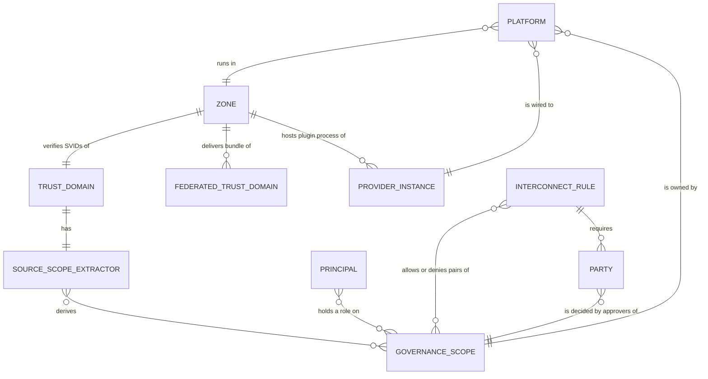

*Catalog and bindings:*
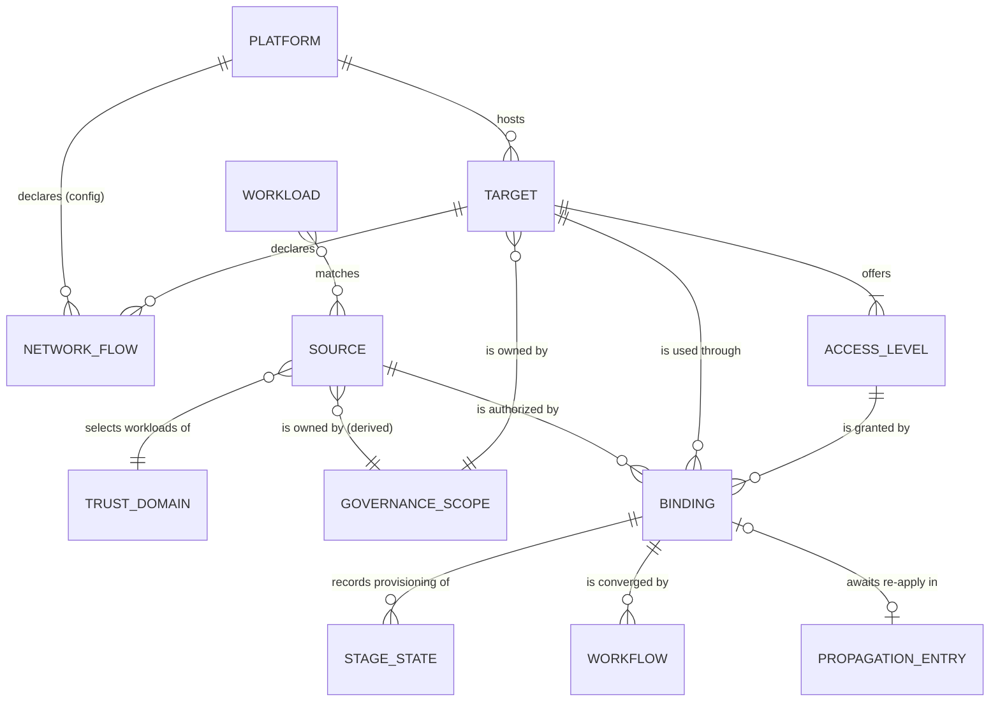

*Change requests:*
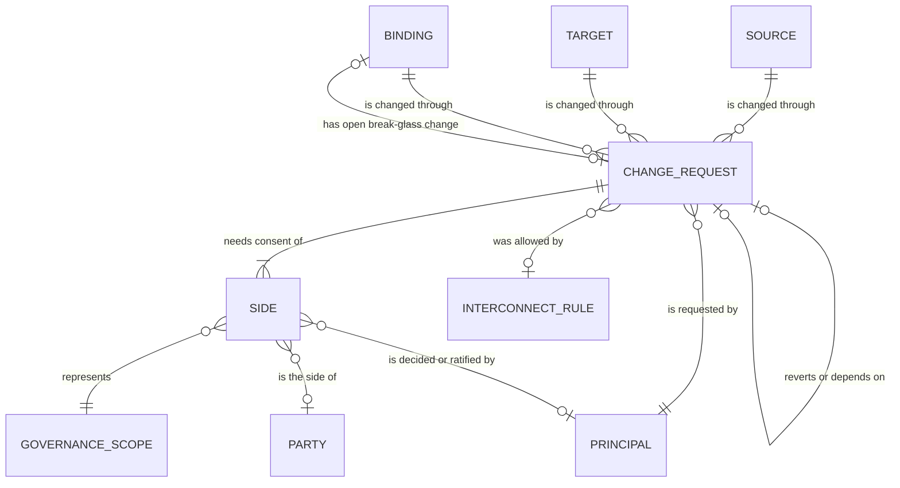

*Records and notifications:*
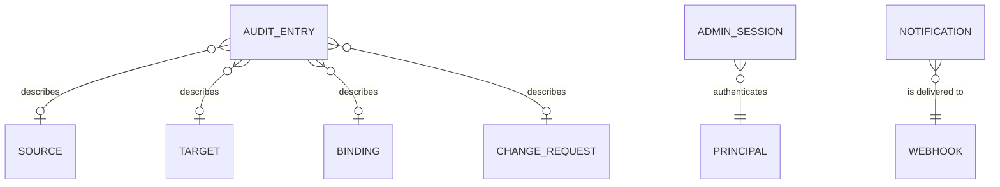

**Entities.**

| Entity | Kind | Definition |
| :--- | :--- | :--- |
| Zone | Configuration | A technical placement: one trust domain, its SPIRE agent socket and the plugin processes attached to it (ADR-03). |
| Trust domain | Configuration | A SPIFFE trust domain whose SVIDs `ligo` verifies, either a zone's own or a federated one reached through a zone (§7.1). |
| Provider instance | Configuration | A configured identity provider or secret store (`identity_providers`, `secret_stores`), in exactly one zone. |
| Platform | Configuration | A system that hosts targets (`platform_providers[].platforms`): a plugin type and configuration in one zone, wired to one identity provider and one secret store of that zone, owned by one governance scope, with privilege bounds, an endpoint allowlist and its own network flows (§3.4). |
| Governance scope | Configuration (implicit) | An ownership boundary (§3.9). Scopes are not declared in a list: a scope exists when a platform, a target, a source-scope extractor or a party names it. |
| Source-scope extractor | Configuration | The rule that derives a source's scope from its regex, one per accepted source trust domain (§3.9). |
| Principal | External | A person (LDAP user) or a machine (SPIFFE ID) that uses the admin API or UI. Role bindings (§8.1 `authorization.bindings`) grant it roles on scope patterns. |
| Interconnection rule, party | Configuration | The organisation's rules on which scope pairs may be connected, and the additional parties some pairs need (ADR-14). |
| Webhook | Configuration | An HTTPS endpoint receiving notifications (§7.5). |
| Workload | External | A SPIRE-attested process identified by its SPIFFE ID. It is never stored; it receives the bindings of the sources whose regex matches its ID (§4.5). |
| Source | Operational | A named identity specification (trust domain, SVID regex, sample SPIFFE IDs) and its metadata, owned by the scope derived from the regex (§3.2). |
| Target | Operational | A named, specific resource on a platform, with a type-specific definition, metadata and visibility, owned by a scope (§3.3). |
| Access level | Operational | A named set of privileges a target offers, within its platform's bounds (§3.3). |
| Network flow | Operational (target) or configuration (platform, secret store, `ligo`) | A connection a workload needs: destination, protocol, ports, TLS (ADR-16). |
| Binding | Operational | The link between one source and one target at one access level, with parameters, optional expiry, requested state, active (served) snapshot and lifecycle (§3.5). |
| Stage state | Operational | The provisioning record of one pipeline stage of a binding (identity, target, secret store); it drives clean-up (ADR-02). |
| Propagation entry | Operational | A binding waiting to be re-applied after a change of its source or target (§6.8). |
| Change request | Operational | A proposed create, update or delete of a source, target or binding, with its consent rule, normalized payload and outcome (ADR-09). Kinds: standard, break-glass, system revert, system expiry. |
| Side | Operational | One governance scope whose consent a change request needs, with how it is decided and its decision (ADR-13). |
| Workflow | Operational (DBOS) | One durable attempt to converge a binding (`apply`, `reapply`, `delete`), identified by its workflow ID (ADR-08). |
| Audit entry | Operational | One hash-chained, append-only record of a state-changing action or outcome (T-13). |
| Admin session | Operational | A server-side UI session of a person (§7.3). |
| Notification | Operational | One webhook delivery in the transactional outbox (§7.5). |
| System settings | Operational | The single row of cluster-wide settings (maintenance mode, §10.3). |

**Relationships.**

| Relationship | Cardinality | Meaning |
| :--- | :--- | :--- |
| Platform → target | one to many | Every target is hosted by exactly one platform, fixed at publication. |
| Target → access level | one to one..sixteen | A target offers at least one access level. |
| Target → network flow | one to zero..thirty-two | Flows specific to the target; platform flows are added from the configuration. |
| Source → trust domain | many to one | Every source selects workloads of exactly one trust domain, fixed at registration. |
| Source, target, platform → governance scope | many to one | Every source, target and platform has one owner scope (INV-17). |
| Source → binding | one to many | A source may be bound to many targets. |
| Target → binding | one to many | A target may be used by many sources. |
| (Source, target) → binding | one to zero..one | At most one binding per pair (INV-23). |
| Access level → binding | one to many | Every binding uses exactly one access level of its own target. |
| Binding → stage state | one to zero..three | At most one record per stage; absent until the stage starts, removed when it is cleaned up. |
| Binding → propagation entry | one to zero..one | Present while a source or target change waits to be applied to the binding. |
| Source, target, binding → change request | one to many | All changes of the resource, over its whole life. At most one is pending at a time. A create request exists before its resource does. |
| Change request → side | one to one..many | By resource type and consent rule (ADR-13 rule 4). |
| Side → governance scope | many to one | Whose consent the side represents. |
| Change request → interconnection rule | many to zero..one | The rule that allowed a cross-scope binding change with consent `ALL`. |
| Change request → change request | zero..one to zero..one | A system revert reverts exactly one break-glass change; a binding create filed with an inline source depends on that source's create. |
| Binding → change request (open break-glass) | zero..one to zero..one | The unratified break-glass change that will be reverted at expiry. |
| Binding → workflow | one to many | One workflow per attempt; workflow IDs are never reused (INV-09). |
| Workload → source | many to many | Computed at each request from the regexes (INV-01); never stored. |
| Audit entry → resource, change request | many to zero..one | Descriptive references that survive the deletion of a binding or the retirement of a source or target. |

#### 4.0.2 Logical model

The logical model has one relation per operational entity, except workflows, which are owned by DBOS in the `dbos` schema and referenced only by their ID. Configuration entities appear as attributes holding their names. The diagrams show primary keys (PK), foreign keys (FK), unique keys (UK) and the main attributes.

**Illustrative** (the enforcement table below and §4.2 are authoritative). Each table shows its keys and the attributes that matter for relationships and lifecycle; the full column lists are in §4.2.

*Catalog and bindings:*
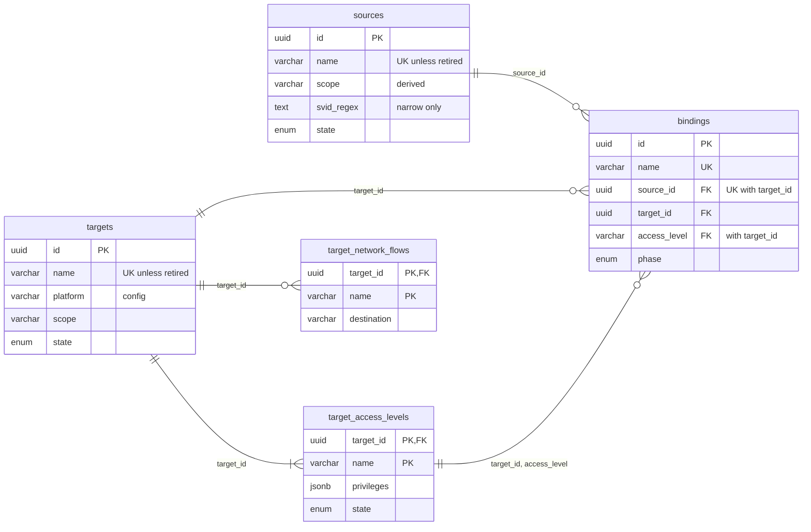

*Provisioning:*
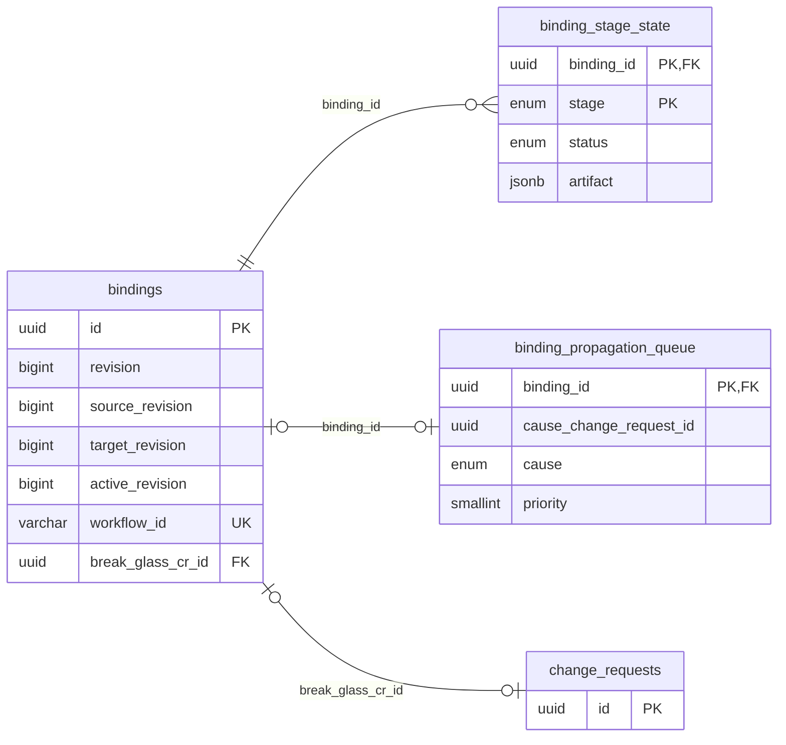

*Change requests:*
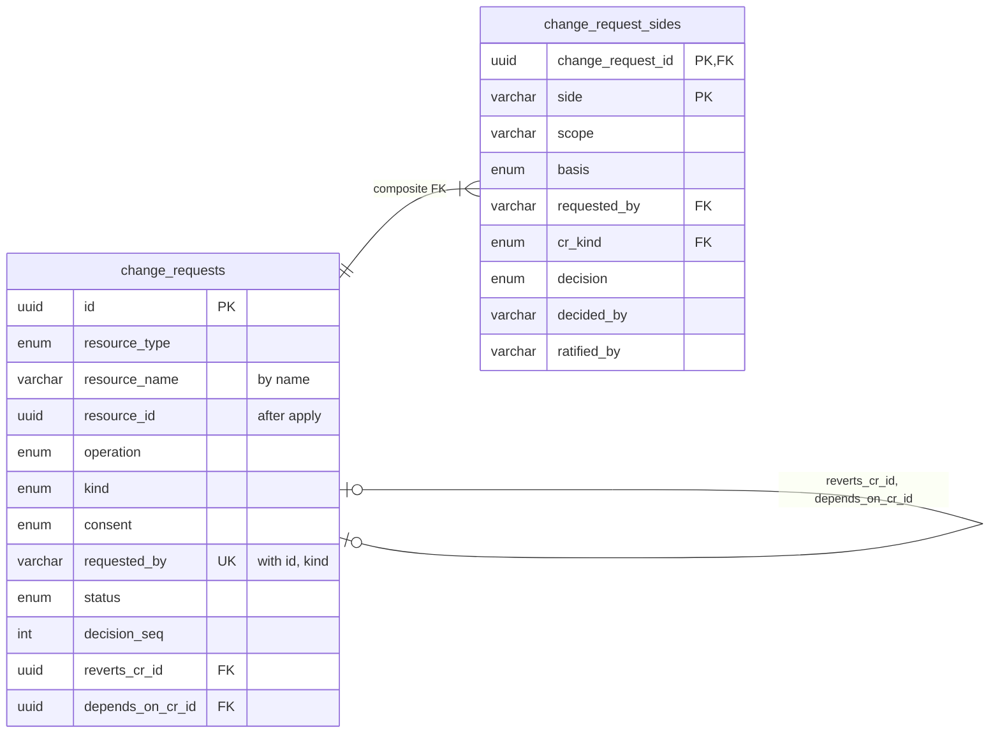

*Audit, sessions, notifications and settings:*
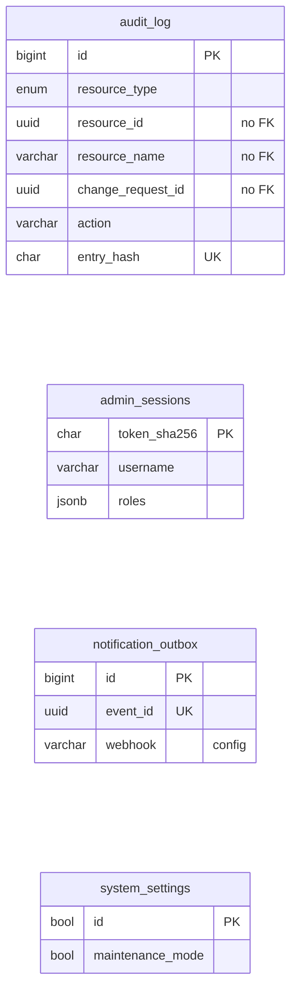

**Relationships and how they are enforced (Normative).**

| From | To | Columns | Enforcement | Why |
| :--- | :--- | :--- | :--- | :--- |
| `target_access_levels`, `target_network_flows` | `targets` | `target_id` | FK | Levels and flows belong to one target. Targets are never deleted, only retired. |
| `bindings` | `sources`, `targets` | `source_id`, `target_id` | FK, `ON DELETE RESTRICT`; unique `(source_id, target_id)`; immutable (trigger) | A binding cannot lose its ends (INV-22) and links each pair once (INV-23). |
| `bindings` | `target_access_levels` | `(target_id, access_level)` | Composite FK, `ON DELETE RESTRICT` | The level must belong to the binding's own target. Using the target ID in the key makes a level of another target impossible. |
| `bindings` | `sources`, `targets` (state) | — | Application, in the §6.2.2 transaction with `FOR SHARE` locks on the source, target and level rows | New bindings and level changes need `ACTIVE` resources (INV-22); retiring takes `FOR UPDATE` and checks for bindings, so the two cannot interleave. |
| `binding_stage_state`, `binding_propagation_queue` | `bindings` | `binding_id` | FK, `ON DELETE CASCADE` | They exist only for a live binding; the final delete transaction removes them with it (§6.5). |
| `bindings` | `change_requests` | `break_glass_cr_id` | FK | The open break-glass change must exist. |
| `change_requests` | `change_requests` | `reverts_cr_id`, `depends_on_cr_id` | FK; `chk_revert`, `chk_depends_on` | A revert names the change it reverts, and only reverts do; only a binding create can depend on another request. |
| `change_request_sides` | `change_requests` | `(change_request_id, requested_by, cr_kind)` → `(id, requested_by, kind)` | Composite FK to `uq_cr_id_requester_kind`, `ON DELETE CASCADE` | The copies of requester and kind let row checks enforce four-eyes and the allowed bases (`chk_side_decision`, `chk_side_basis`), and the composite FK guarantees the copies are true. |
| `change_requests` | `sources`, `targets`, `bindings` | `resource_type`, `resource_name`, `resource_id` | **None** (application) | A `CREATE` request exists before its resource, and requests outlive a deleted binding or a retired resource (and a later one with the same name). The name, plus `resource_id` once applied, identifies the resource at the time; `uq_cr_one_pending_per_resource` allows one pending request per resource name and type. |
| `audit_log` | resources, `change_requests` | `resource_type`, `resource_id`, `resource_name`, `change_request_id` | **None** (deliberate) | The audit log is append-only and must keep its history after a binding is deleted; a foreign key would either block the delete or erase history. |
| `bindings`, `binding_stage_state` | DBOS workflows | `workflow_id` | None (text); fencing (ADR-08) | DBOS owns its schema; every workflow write is fenced on `bindings.workflow_id`. |
| `targets`, `bindings`, `binding_stage_state`, `change_requests`, `change_request_sides`, `notification_outbox` | Configuration entities | `platform`, `platform_type`, `zone`, wiring columns, scopes, `interconnect_rule`, `webhook` | Startup checks (§8.2 rules 10, 11, 16–18) | Configuration is not in the database. Startup refuses to run if stored references point to platforms or instances that no longer exist, or if stored scopes no longer match the configuration. |
| `admin_sessions` | Principals | `username`, `roles` | LDAP re-check every `authz_recheck_interval` (§7.3) | Principals live in LDAP. |

**Integrity rules that span rows** (cardinalities a plain foreign key cannot express) are enforced by deferred constraint triggers at commit (`change_request_check`, §4.2): a change request has at least one side and no two sides with the same scope; side scopes equal the request's scopes; a source change has exactly one `OWNER` side; a target change has an `OWNER` side and at most a `PLATFORM` side of a different scope, with consent `ALL`; a binding change with consent `ALL` has exactly one `TARGET` side, a `SOURCE` side exactly when the scopes differ, no `PLATFORM` side, and parties only across scopes; a binding change with consent `ANY` has no parties; `APPLIED` and `REJECTED` require the decisions of INV-14 and INV-20; distinct people per side (INV-18).

**Normalization.** The model is in third normal form except for these deliberate redundancies:
- `targets` copies `platform_type`, `zone` and `platform_scope` from its platform, and `bindings` copies the wiring and the three scopes, as snapshots (INV-08), so that a configuration change never silently changes an existing resource; startup detects any divergence (§8.2 rules 10 and 17).
- `bindings` copies, per revision, the source's trust domain and regex and the composed `requested_spec`, with `source_revision` and `target_revision`, so that each revision is a consistent snapshot and provisioning never depends on live joins (ADR-15 rule 6). It keeps the requested state and the active snapshot (`active_*`) side by side, so that workloads keep the last good revision while a new one is provisioned (§4.4, INV-02).
- `target_access_levels.privileges` is derived from `grants` by the plugin and stored so that narrowing can be checked without calling the plugin for the old revision.
- `change_request_sides` copies `requested_by` and `kind`, guarded by the composite foreign key, so that four-eyes is a row check.
- `admin_sessions.roles` caches the roles found at login and at each re-check.

### 4.1 Schemas, roles, pools
- **Schemas:** `public` holds the application tables. `dbos` holds the workflow journal and is managed by `dbos-transact-golang`.
- **Database roles** are pre-created by operations, not by migrations:

| Role | Privileges |
| :--- | :--- |
| `ligo_migrator` | Owns `public` objects; runs migrations only. |
| `ligo_app` | `SELECT, INSERT, UPDATE, DELETE` on `bindings`, `binding_stage_state`, `binding_propagation_queue`, `target_network_flows`, `change_requests`, `admin_sessions`, `notification_outbox`. **Only** `SELECT, INSERT, UPDATE` on `sources`, `targets`, `target_access_levels` (retired, never deleted) and `change_request_sides`. **Only** `SELECT, UPDATE` on `system_settings`. **Only** `SELECT, INSERT` on `audit_log`. |
| `ligo_reader` | `SELECT` on the views `v_active_bindings` and `v_active_binding_flows` only. |
| `ligo_dbos` | Whatever DBOS requires on the `dbos` schema (EXT-08). No access to `public` tables. |

- **Connection pools:** `app` (statement timeout 5s), `reader` (statement timeout 500ms), and DBOS's own pool. All connections MUST use TLS with `sslmode=verify-full`.

### 4.2 Migration `migrations/001_init_schema.sql`

4.0 replaces the 3.x schema. There is no migration from 3.x: 4.0 is installed on an empty database.

**Normative.**
```sql
CREATE TYPE binding_phase      AS ENUM ('PROVISIONING','ACTIVE','FAILED','DELETING','DELETE_FAILED');
CREATE TYPE binding_operation  AS ENUM ('APPLY','REAPPLY','DELETE');
CREATE TYPE binding_stage      AS ENUM ('IDENTITY','TARGET','SECRET_STORE');
CREATE TYPE stage_status       AS ENUM ('STARTED','ENSURED');
CREATE TYPE lifecycle_state    AS ENUM ('ACTIVE','DEPRECATED','RETIRED');
CREATE TYPE visibility         AS ENUM ('PRIVATE','LISTED','PUBLIC');
CREATE TYPE flow_purpose       AS ENUM ('DATA','CREDENTIALS','DISCOVERY');
CREATE TYPE flow_protocol      AS ENUM ('TCP','UDP');
CREATE TYPE resource_type      AS ENUM ('SOURCE','TARGET','BINDING');
CREATE TYPE change_request_op  AS ENUM ('CREATE','UPDATE','DELETE');
CREATE TYPE change_request_kind AS ENUM ('STANDARD','BREAK_GLASS','SYSTEM_REVERT','SYSTEM_EXPIRY');
CREATE TYPE consent_rule       AS ENUM ('ALL','ANY');
CREATE TYPE approval_basis     AS ENUM ('AUTO','HUMAN','DELEGATED','BREAK_GLASS','SYSTEM_REVERT','SYSTEM_EXPIRY');
CREATE TYPE side_decision      AS ENUM ('APPROVED','DECLINED');
CREATE TYPE change_request_status AS ENUM
    ('PENDING','APPLIED','REJECTED','WITHDRAWN','EXPIRED','FAILED_TO_APPLY');

-- Scope paths (§3.9) are checked with this pattern wherever they are stored.
CREATE DOMAIN scope_path AS VARCHAR(128)
    CHECK (VALUE ~ '^[a-z0-9]([a-z0-9-]*[a-z0-9])?(/[a-z0-9]([a-z0-9-]*[a-z0-9])?){0,7}$');
-- Names of sources, targets and bindings (§3.8).
CREATE DOMAIN resource_name AS VARCHAR(63)
    CHECK (VALUE ~ '^[a-z0-9]([-a-z0-9]{0,61}[a-z0-9])?$');

-- ---------------------------------------------------------------------------
-- Sources (ADR-15): who may use bindings. The identity specification (trust
-- domain, regex, sample IDs) plus descriptive metadata. Never hard-deleted:
-- retiring a source sets state = 'RETIRED' and releases its name.
-- ---------------------------------------------------------------------------
CREATE TABLE sources (
    id                 UUID PRIMARY KEY,                    -- UUIDv7
    name               resource_name NOT NULL,
    scope              scope_path NOT NULL,                 -- derived from the regex (§3.9); immutable
    trust_domain       VARCHAR(255) NOT NULL,               -- immutable
    svid_regex         TEXT NOT NULL CHECK (length(svid_regex) <= 512),   -- may only be narrowed (§3.10)
    sample_spiffe_ids  JSONB NOT NULL DEFAULT '[]'::jsonb,  -- array of SPIFFE IDs the regex must match
    display_name       VARCHAR(128),
    description        TEXT CHECK (length(description) <= 4096),
    labels             JSONB NOT NULL DEFAULT '{}'::jsonb,
    external_refs      JSONB NOT NULL DEFAULT '{}'::jsonb,  -- e.g. {"cmdb": "APP-0042", "environment": "prod"}
    contacts           JSONB NOT NULL DEFAULT '[]'::jsonb,
    visibility         visibility NOT NULL DEFAULT 'PRIVATE',
    visible_to         JSONB NOT NULL DEFAULT '[]'::jsonb,  -- scope patterns, for LISTED
    state              lifecycle_state NOT NULL DEFAULT 'ACTIVE',
    revision           BIGINT NOT NULL DEFAULT 1 CHECK (revision >= 1),
    created_at         TIMESTAMPTZ NOT NULL DEFAULT now(),
    updated_at         TIMESTAMPTZ NOT NULL DEFAULT now(),
    created_by         VARCHAR(255) NOT NULL,
    updated_by         VARCHAR(255) NOT NULL,
    -- Coarse defense in depth only; authoritative validation is Appendix A (ADR-06).
    CONSTRAINT chk_source_regex_shape CHECK (
        svid_regex LIKE '^spiffe://%' AND svid_regex LIKE '%$'
        AND right(svid_regex, 2) <> '\$'                      -- an escaped \$ is a literal, not an anchor
    ),
    CONSTRAINT chk_source_samples CHECK (jsonb_typeof(sample_spiffe_ids) = 'array' AND jsonb_array_length(sample_spiffe_ids) <= 20),
    CONSTRAINT chk_source_visible_to CHECK (
        jsonb_typeof(visible_to) = 'array' AND (visibility <> 'LISTED' OR jsonb_array_length(visible_to) > 0)
    )
);
CREATE UNIQUE INDEX uq_sources_name ON sources (name) WHERE state <> 'RETIRED';
CREATE INDEX idx_sources_scope ON sources (scope, name);

-- ---------------------------------------------------------------------------
-- Targets (ADR-15): one specific resource on a platform, with its access
-- levels and network flows. Register-only in 4.0: publishing a target does
-- not create the resource. Never hard-deleted (retired instead).
-- ---------------------------------------------------------------------------
CREATE TABLE targets (
    id                 UUID PRIMARY KEY,                    -- UUIDv7
    name               resource_name NOT NULL,
    platform           VARCHAR(128) NOT NULL,               -- configured platform (§8.1); immutable
    platform_type      VARCHAR(128) NOT NULL,               -- plugin type of the platform; immutable
    zone               VARCHAR(63)  NOT NULL,               -- the platform's zone; immutable
    scope              scope_path NOT NULL,                 -- owner scope; immutable (re-scoping only)
    platform_scope     scope_path NOT NULL,                 -- the platform's owner scope; immutable (re-scoping only)
    definition         JSONB NOT NULL,                      -- normalized by PlatformProvider.ValidateTarget
    display_name       VARCHAR(128),
    description        TEXT CHECK (length(description) <= 4096),
    labels             JSONB NOT NULL DEFAULT '{}'::jsonb,
    documentation_url  VARCHAR(512),
    contacts           JSONB NOT NULL DEFAULT '[]'::jsonb,
    visibility         visibility NOT NULL DEFAULT 'PRIVATE',
    visible_to         JSONB NOT NULL DEFAULT '[]'::jsonb,  -- scope patterns, for LISTED
    state              lifecycle_state NOT NULL DEFAULT 'ACTIVE',
    revision           BIGINT NOT NULL DEFAULT 1 CHECK (revision >= 1),
    created_at         TIMESTAMPTZ NOT NULL DEFAULT now(),
    updated_at         TIMESTAMPTZ NOT NULL DEFAULT now(),
    created_by         VARCHAR(255) NOT NULL,
    updated_by         VARCHAR(255) NOT NULL,
    CONSTRAINT chk_target_visible_to CHECK (
        jsonb_typeof(visible_to) = 'array' AND (visibility <> 'LISTED' OR jsonb_array_length(visible_to) > 0)
    )
);
CREATE UNIQUE INDEX uq_targets_name ON targets (name) WHERE state <> 'RETIRED';
CREATE INDEX idx_targets_scope ON targets (scope, name);
CREATE INDEX idx_targets_platform ON targets (platform, name);

-- Access levels offered by a target. Grants may be narrowed in place; adding
-- privilege means adding a new level (§3.10). A level in use cannot be removed.
CREATE TABLE target_access_levels (
    target_id          UUID NOT NULL REFERENCES targets(id),
    name               VARCHAR(32) NOT NULL CHECK (name ~ '^[a-z][a-z0-9-]{0,31}$'),
    description        TEXT CHECK (length(description) <= 1024),
    grants             JSONB NOT NULL,                      -- normalized by ValidateTarget; within the platform's grantable privileges
    privileges         JSONB NOT NULL,                      -- canonical sorted privilege list from the plugin, used to compare levels
    state              lifecycle_state NOT NULL DEFAULT 'ACTIVE',  -- DEPRECATED: no new bindings
    PRIMARY KEY (target_id, name)
);

-- Network flows needed to reach a target (ADR-16). Platform, secret-store and
-- ligo flows are configuration (§8.1); a binding's effective flows are computed.
CREATE TABLE target_network_flows (
    target_id          UUID NOT NULL REFERENCES targets(id),
    name               VARCHAR(63) NOT NULL CHECK (name ~ '^[a-z0-9]([-a-z0-9]{0,61}[a-z0-9])?$'),
    purpose            flow_purpose NOT NULL DEFAULT 'DATA',
    protocol           flow_protocol NOT NULL,
    destination        VARCHAR(253) NOT NULL,               -- DNS name, IP address or CIDR; within the platform's allowed endpoints
    ports              INT4MULTIRANGE NOT NULL,
    tls                BOOLEAN NOT NULL,
    server_name        VARCHAR(253),                        -- expected TLS server name, if tls
    description        TEXT CHECK (length(description) <= 1024),
    PRIMARY KEY (target_id, name),
    CONSTRAINT chk_flow_ports CHECK (NOT isempty(ports) AND lower(ports) >= 1 AND upper(ports) <= 65536),
    CONSTRAINT chk_flow_tls CHECK (tls OR server_name IS NULL)
);

-- Sources and targets: immutable identity and ownership columns (INV-08, INV-21).
CREATE FUNCTION sources_immutable_guard() RETURNS trigger LANGUAGE plpgsql AS $$
BEGIN
  IF NEW.scope <> OLD.scope AND coalesce(current_setting('ligo.rescope', true), '') <> 'on' THEN
    RAISE EXCEPTION 'source scope modified outside the re-scoping procedure';
  END IF;
  IF NEW.id <> OLD.id OR NEW.trust_domain <> OLD.trust_domain OR NEW.name <> OLD.name
     OR (OLD.state = 'RETIRED' AND NEW.state <> 'RETIRED') THEN
    RAISE EXCEPTION 'immutable source column modified';
  END IF;
  RETURN NEW;
END $$;
CREATE TRIGGER trg_sources_immutable BEFORE UPDATE ON sources
    FOR EACH ROW EXECUTE FUNCTION sources_immutable_guard();

CREATE FUNCTION targets_immutable_guard() RETURNS trigger LANGUAGE plpgsql AS $$
BEGIN
  IF (NEW.scope <> OLD.scope OR NEW.platform_scope <> OLD.platform_scope)
     AND coalesce(current_setting('ligo.rescope', true), '') <> 'on' THEN
    RAISE EXCEPTION 'target scope modified outside the re-scoping procedure';
  END IF;
  IF NEW.id <> OLD.id OR NEW.name <> OLD.name OR NEW.platform <> OLD.platform
     OR NEW.platform_type <> OLD.platform_type OR NEW.zone <> OLD.zone
     OR (OLD.state = 'RETIRED' AND NEW.state <> 'RETIRED') THEN
    RAISE EXCEPTION 'immutable target column modified';
  END IF;
  RETURN NEW;
END $$;
CREATE TRIGGER trg_targets_immutable BEFORE UPDATE ON targets
    FOR EACH ROW EXECUTE FUNCTION targets_immutable_guard();

-- ---------------------------------------------------------------------------
-- Bindings: the link between one source and one target at one access level.
-- The requested state of each revision is a copy composed from the source,
-- the target and the access level (§3.5), so that every revision is a
-- consistent, reviewable snapshot (INV-02).
-- ---------------------------------------------------------------------------
CREATE TABLE bindings (
    id                          UUID PRIMARY KEY,               -- UUIDv7, generated by application
    name                        resource_name NOT NULL UNIQUE,
    source_id                   UUID NOT NULL REFERENCES sources(id) ON DELETE RESTRICT,   -- immutable
    target_id                   UUID NOT NULL REFERENCES targets(id) ON DELETE RESTRICT,   -- immutable
    access_level                VARCHAR(32) NOT NULL,
    zone                        VARCHAR(63)  NOT NULL,
    platform_type               VARCHAR(128) NOT NULL,
    platform                    VARCHAR(128) NOT NULL,
    identity_provider_type      VARCHAR(128) NOT NULL,
    identity_provider_instance  VARCHAR(128) NOT NULL,
    secret_store_type           VARCHAR(128) NOT NULL,
    secret_store_instance       VARCHAR(128) NOT NULL,
    secret_storage_strategy       VARCHAR(64)  NOT NULL,          -- §5.6; from the platform's wiring at creation; immutable
    derived_principal_name      VARCHAR(20) NOT NULL UNIQUE,    -- Appendix B, with the platform's principal_prefix at creation; immutable
    source_scope                scope_path NOT NULL,            -- copied from the source; immutable (re-scoping only)
    target_scope                scope_path NOT NULL,            -- copied from the target
    platform_scope              scope_path NOT NULL,            -- copied from the target's platform
    parameters                  JSONB NOT NULL DEFAULT '{}'::jsonb,   -- per-binding parameters, validated by ValidateBinding
    purpose                     TEXT CHECK (length(purpose) <= 1024),
    labels                      JSONB NOT NULL DEFAULT '{}'::jsonb,
    expires_at                  TIMESTAMPTZ,                    -- optional; revoked by the sweeper (§6.3)
    expiry_warned_at            TIMESTAMPTZ,                    -- BINDING_EXPIRING already emitted

    revision                    BIGINT NOT NULL DEFAULT 1 CHECK (revision >= 1),
    attempt                     BIGINT NOT NULL DEFAULT 1 CHECK (attempt >= 1),
    phase                       binding_phase     NOT NULL DEFAULT 'PROVISIONING',
    operation                   binding_operation NOT NULL DEFAULT 'APPLY',
    workflow_id                 VARCHAR(255) NOT NULL UNIQUE,
    current_step                VARCHAR(64)  NOT NULL DEFAULT 'INIT',
    status_message              TEXT NOT NULL DEFAULT '' CHECK (length(status_message) <= 2048),
    last_transition_at          TIMESTAMPTZ NOT NULL DEFAULT now(),
    rotate_static_secrets       BOOLEAN NOT NULL DEFAULT TRUE,

    -- Requested state for `revision`, composed from the source, target and access level
    source_revision             BIGINT NOT NULL,
    target_revision             BIGINT NOT NULL,
    source_trust_domain         VARCHAR(255) NOT NULL,
    source_svid_regex           TEXT NOT NULL CHECK (length(source_svid_regex) <= 512),
    requested_spec              JSONB NOT NULL,                 -- normalized by ValidateBinding

    -- Active (served) snapshot
    active_revision             BIGINT,
    active_source_svid_regex    TEXT,
    active_auth_config          JSONB,
    active_spec                 JSONB,
    active_since                TIMESTAMPTZ,
    last_rotated_at             TIMESTAMPTZ,                    -- NULL for identity modes without static secrets (§6.4)
    break_glass_cr_id           UUID,                           -- open (unratified) break-glass change, ADR-12
    break_glass_expires_at      TIMESTAMPTZ,
    break_glass_warned_at       TIMESTAMPTZ,                    -- BREAK_GLASS_EXPIRING already emitted for the open change

    created_at                  TIMESTAMPTZ NOT NULL DEFAULT now(),
    updated_at                  TIMESTAMPTZ NOT NULL DEFAULT now(),
    created_by                  VARCHAR(255) NOT NULL,
    updated_by                  VARCHAR(255) NOT NULL,

    CONSTRAINT uq_binding_source_target UNIQUE (source_id, target_id),          -- one binding per pair (ADR-15)
    CONSTRAINT fk_binding_access_level FOREIGN KEY (target_id, access_level)
        REFERENCES target_access_levels (target_id, name) ON DELETE RESTRICT,
    -- Coarse defense in depth only; authoritative validation is Appendix A (ADR-06).
    CONSTRAINT chk_regex_shape CHECK (
        source_svid_regex LIKE '^spiffe://%' AND source_svid_regex LIKE '%$'
        AND right(source_svid_regex, 2) <> '\$'                    -- an escaped \$ is a literal, not an anchor
    ),
    CONSTRAINT chk_break_glass_open CHECK ((break_glass_cr_id IS NULL) = (break_glass_expires_at IS NULL)),
    CONSTRAINT chk_active_consistent CHECK (
        (active_revision IS NULL AND active_source_svid_regex IS NULL
            AND active_auth_config IS NULL AND active_spec IS NULL)
     OR (active_revision IS NOT NULL AND active_source_svid_regex IS NOT NULL
            AND active_auth_config IS NOT NULL AND active_spec IS NOT NULL
            AND active_revision <= revision)
    )
);

CREATE INDEX idx_bindings_active_td ON bindings (source_trust_domain)
    WHERE active_revision IS NOT NULL AND phase NOT IN ('DELETING','DELETE_FAILED');
CREATE INDEX idx_bindings_phase           ON bindings (phase, last_transition_at);
CREATE INDEX idx_bindings_platform        ON bindings (platform_type, platform);
CREATE INDEX idx_bindings_target          ON bindings (target_id, access_level);
CREATE INDEX idx_bindings_zone            ON bindings (zone);
CREATE INDEX idx_bindings_source_scope    ON bindings (source_scope, name);
CREATE INDEX idx_bindings_target_scope    ON bindings (target_scope, name);
CREATE INDEX idx_bindings_break_glass     ON bindings (break_glass_expires_at) WHERE break_glass_cr_id IS NOT NULL;
CREATE INDEX idx_bindings_expiry          ON bindings (expires_at) WHERE expires_at IS NOT NULL;

-- Immutability of identity/wiring/scope columns (INV-08). Scopes change only through the
-- startup re-scoping procedure (§8.2 rule 17), which sets ligo.rescope = 'on' for its transaction.
CREATE FUNCTION bindings_immutable_guard() RETURNS trigger LANGUAGE plpgsql AS $$
BEGIN
  IF (NEW.source_scope <> OLD.source_scope OR NEW.target_scope <> OLD.target_scope
      OR NEW.platform_scope <> OLD.platform_scope)
     AND coalesce(current_setting('ligo.rescope', true), '') <> 'on' THEN
    RAISE EXCEPTION 'binding scope modified outside the re-scoping procedure';
  END IF;
  IF NEW.id <> OLD.id OR NEW.name <> OLD.name OR NEW.zone <> OLD.zone
     OR NEW.source_id <> OLD.source_id OR NEW.target_id <> OLD.target_id
     OR NEW.platform_type <> OLD.platform_type OR NEW.platform <> OLD.platform
     OR NEW.identity_provider_type <> OLD.identity_provider_type
     OR NEW.identity_provider_instance <> OLD.identity_provider_instance
     OR NEW.secret_store_type <> OLD.secret_store_type
     OR NEW.secret_store_instance <> OLD.secret_store_instance
     OR NEW.secret_storage_strategy <> OLD.secret_storage_strategy
     OR NEW.derived_principal_name <> OLD.derived_principal_name
     OR NEW.source_trust_domain <> OLD.source_trust_domain THEN
    RAISE EXCEPTION 'immutable binding column modified';
  END IF;
  RETURN NEW;
END $$;
CREATE TRIGGER trg_bindings_immutable BEFORE UPDATE ON bindings
    FOR EACH ROW EXECUTE FUNCTION bindings_immutable_guard();

-- Change notification for workload resolution caches (fires ONLY when workload-visible state changes)
CREATE FUNCTION bindings_notify() RETURNS trigger LANGUAGE plpgsql AS $$
BEGIN
  PERFORM pg_notify('ligo_bindings_changed', COALESCE(NEW.id, OLD.id)::text);
  RETURN NULL;
END $$;

CREATE TRIGGER trg_bindings_notify_delete
    AFTER DELETE ON bindings
    FOR EACH ROW EXECUTE FUNCTION bindings_notify();

CREATE TRIGGER trg_bindings_notify_update
    AFTER UPDATE OF active_revision, active_source_svid_regex,
          active_auth_config, active_spec, phase, expires_at
    ON bindings FOR EACH ROW
    WHEN (
        OLD.active_revision IS DISTINCT FROM NEW.active_revision
        OR OLD.active_source_svid_regex IS DISTINCT FROM NEW.active_source_svid_regex
        OR OLD.active_auth_config IS DISTINCT FROM NEW.active_auth_config
        OR OLD.active_spec IS DISTINCT FROM NEW.active_spec
        OR OLD.expires_at IS DISTINCT FROM NEW.expires_at
        OR (OLD.phase IN ('DELETING', 'DELETE_FAILED')) IS DISTINCT FROM (NEW.phase IN ('DELETING', 'DELETE_FAILED'))
    )
    EXECUTE FUNCTION bindings_notify();

-- A source's regex and state are part of resolution (INV-01): notify the caches,
-- which reload every binding of the source.
CREATE FUNCTION sources_notify() RETURNS trigger LANGUAGE plpgsql AS $$
BEGIN
  PERFORM pg_notify('ligo_bindings_changed', 'source:' || NEW.id::text);
  RETURN NULL;
END $$;

CREATE TRIGGER trg_sources_notify
    AFTER UPDATE OF svid_regex, state ON sources FOR EACH ROW
    WHEN (OLD.svid_regex IS DISTINCT FROM NEW.svid_regex OR OLD.state IS DISTINCT FROM NEW.state)
    EXECUTE FUNCTION sources_notify();

-- ---------------------------------------------------------------------------
-- Per-stage provisioning state (drives cleanup; ADR-02, INV-05)
-- `artifact` holds NON-SECRET data only:
--   IDENTITY     -> IdentityArtifact without static_secret (JSON)
--   TARGET       -> {"finalizedClientSpec": {...}, "declaredEndpoints": [...]}
--   SECRET_STORE -> {"finalizedClientAuth": {...}, "declaredEndpoints": [...]}
-- ---------------------------------------------------------------------------
CREATE TABLE binding_stage_state (
    binding_id         UUID NOT NULL REFERENCES bindings(id) ON DELETE CASCADE,
    stage              binding_stage NOT NULL,
    provider_type      VARCHAR(128) NOT NULL,
    provider_instance  VARCHAR(128) NOT NULL,
    status             stage_status NOT NULL,
    revision           BIGINT NOT NULL,
    workflow_id        VARCHAR(255) NOT NULL,
    artifact           JSONB NOT NULL DEFAULT '{}'::jsonb,
    updated_at         TIMESTAMPTZ NOT NULL DEFAULT now(),
    PRIMARY KEY (binding_id, stage)
);

-- ---------------------------------------------------------------------------
-- Propagation queue (§6.8): bindings whose source, target or access level
-- changed and that must be re-applied. One row per binding; a later cause
-- replaces an earlier one. Security-relevant narrowing has priority 0.
-- ---------------------------------------------------------------------------
CREATE TABLE binding_propagation_queue (
    binding_id         UUID PRIMARY KEY REFERENCES bindings(id) ON DELETE CASCADE,
    cause_change_request_id UUID NOT NULL,
    cause              resource_type NOT NULL,              -- SOURCE or TARGET
    priority           SMALLINT NOT NULL CHECK (priority IN (0, 1)),
    enqueued_at        TIMESTAMPTZ NOT NULL DEFAULT now(),
    attempts           INTEGER NOT NULL DEFAULT 0,
    CONSTRAINT chk_propagation_cause CHECK (cause IN ('SOURCE', 'TARGET'))
);
CREATE INDEX idx_propagation_due ON binding_propagation_queue (priority, enqueued_at);

-- ---------------------------------------------------------------------------
-- Change requests (ADR-09, ADR-13, ADR-15): every change to a source, target
-- or binding. Scope columns by resource type:
--   SOURCE  -> owner_scope (the source's scope)
--   TARGET  -> owner_scope (the target's scope), platform_scope
--   BINDING -> source_scope, target_scope, platform_scope
-- ---------------------------------------------------------------------------
CREATE TABLE change_requests (
    id                 UUID PRIMARY KEY,                    -- UUIDv7
    resource_type      resource_type NOT NULL,              -- immutable
    resource_name      resource_name NOT NULL,
    resource_id        UUID,                                -- NULL for CREATE until applied
    operation          change_request_op NOT NULL,
    kind               change_request_kind NOT NULL,        -- STANDARD, BREAK_GLASS (ADR-12), SYSTEM_REVERT, SYSTEM_EXPIRY; immutable
    consent            consent_rule NOT NULL,               -- ALL: every side must approve; ANY: one side suffices (ADR-13, ADR-15); immutable
    zone               VARCHAR(63),                         -- TARGET and BINDING: the platform's zone
    owner_scope        scope_path,                          -- SOURCE, TARGET
    source_scope       scope_path,                          -- BINDING
    target_scope       scope_path,                          -- BINDING
    platform_scope     scope_path,                          -- TARGET, BINDING
    interconnect_rule  VARCHAR(64),                         -- BINDING with consent ALL across scopes: matched rule, or 'default' (ADR-14)
    policy_sha256      CHAR(64) NOT NULL,                   -- governance policy in force at creation (§8.2)
    distinct_approvers_required BOOLEAN NOT NULL,           -- ADR-13 rule 7; immutable
    expected_revision  BIGINT,                              -- REQUIRED for UPDATE/DELETE
    payload            JSONB NOT NULL,                      -- normalized desired state (§7.2.3); '{}' for DELETE
    payload_sha256     CHAR(64) NOT NULL,                   -- SHA-256 of RFC 8785 (JCS) canonical payload
    status             change_request_status NOT NULL DEFAULT 'PENDING',
    decision_seq       INTEGER NOT NULL DEFAULT 0,          -- incremented by every side decision; serializes deciders (§4.3)
    external_approval_ref VARCHAR(128),                     -- upstream approval reference (DELEGATED sides) or incident reference (BREAK_GLASS)
    automation_context JSONB CHECK (automation_context IS NULL OR octet_length(automation_context::text) <= 4096), -- self-asserted, informative only
    break_glass_justification TEXT CHECK (length(break_glass_justification) <= 2048),   -- BREAK_GLASS only
    break_glass_ttl_seconds   INTEGER,                                                 -- BREAK_GLASS only
    revert_payload     JSONB,                               -- BREAK_GLASS UPDATE: normalized payload of the previous revision
    reverts_cr_id      UUID REFERENCES change_requests(id), -- SYSTEM_REVERT: the break-glass change being reverted
    depends_on_cr_id   UUID REFERENCES change_requests(id), -- BINDING CREATE filed with an inline source: the source's CREATE (§7.2.4)
    review_overdue_notified_at TIMESTAMPTZ,                 -- BREAK_GLASS_REVIEW_OVERDUE already emitted
    requested_by       VARCHAR(255) NOT NULL,
    requested_at       TIMESTAMPTZ NOT NULL DEFAULT now(),
    decided_by         VARCHAR(255),                        -- the principal whose action closed the request
    decided_at         TIMESTAMPTZ,
    decision_comment   TEXT CHECK (length(decision_comment) <= 2048),
    apply_error        TEXT CHECK (length(apply_error) <= 2048),
    expires_at         TIMESTAMPTZ NOT NULL,
    CONSTRAINT uq_cr_id_requester_kind UNIQUE (id, requested_by, kind),  -- target of the sides' composite foreign key
    CONSTRAINT chk_expected_revision CHECK (operation = 'CREATE' OR expected_revision IS NOT NULL),
    CONSTRAINT chk_cr_scope_columns CHECK (
        (resource_type = 'SOURCE'  AND owner_scope IS NOT NULL AND source_scope IS NULL AND target_scope IS NULL
                                   AND platform_scope IS NULL AND zone IS NULL)
     OR (resource_type = 'TARGET'  AND owner_scope IS NOT NULL AND platform_scope IS NOT NULL AND zone IS NOT NULL
                                   AND source_scope IS NULL AND target_scope IS NULL)
     OR (resource_type = 'BINDING' AND owner_scope IS NULL AND source_scope IS NOT NULL AND target_scope IS NOT NULL
                                   AND platform_scope IS NOT NULL AND zone IS NOT NULL)
    ),
    CONSTRAINT chk_interconnect_rule CHECK (
        interconnect_rule IS NULL
        OR (resource_type = 'BINDING' AND consent = 'ALL' AND source_scope <> target_scope)
    ),
    CONSTRAINT chk_system_kinds CHECK (
        (kind NOT IN ('SYSTEM_REVERT', 'SYSTEM_EXPIRY') OR consent = 'ANY')
        AND (kind <> 'SYSTEM_EXPIRY' OR (resource_type = 'BINDING' AND operation = 'DELETE'))
        AND (kind <> 'BREAK_GLASS' OR resource_type IN ('BINDING', 'SOURCE'))
    ),
    -- Reserved 'system:*' identities can never collide with people or services: usernames cannot
    -- contain ':' (§7.2.1) and SPIFFE principals start with 'spiffe://'.
    CONSTRAINT chk_break_glass CHECK (
        kind <> 'BREAK_GLASS'
        OR (requested_by NOT LIKE 'spiffe://%' AND requested_by NOT LIKE 'system:%'
            AND external_approval_ref IS NOT NULL                       -- incident reference
            AND break_glass_justification IS NOT NULL AND length(break_glass_justification) >= 20
            AND break_glass_ttl_seconds BETWEEN 300 AND 86400
            AND (operation <> 'UPDATE' OR revert_payload IS NOT NULL))
    ),
    CONSTRAINT chk_break_glass_fields CHECK (
        kind = 'BREAK_GLASS'
        OR (break_glass_justification IS NULL AND break_glass_ttl_seconds IS NULL AND revert_payload IS NULL)
    ),
    CONSTRAINT chk_revert CHECK ((kind = 'SYSTEM_REVERT') = (reverts_cr_id IS NOT NULL)),
    CONSTRAINT chk_depends_on CHECK (depends_on_cr_id IS NULL OR (resource_type = 'BINDING' AND operation = 'CREATE')),
    CONSTRAINT chk_cr_decided CHECK (
        status NOT IN ('APPLIED', 'REJECTED')
        OR (decided_by IS NOT NULL AND decided_at IS NOT NULL AND decided_by <> requested_by)
    )
);

-- ---------------------------------------------------------------------------
-- One row per side whose consent a change request needs (ADR-13, ADR-15):
--   SOURCE resources:  OWNER
--   TARGET resources:  OWNER, plus PLATFORM for material changes when the scopes differ
--   BINDING, consent ALL: TARGET, SOURCE (if its scope differs), PARTY:<name> (ADR-14)
--   BINDING, consent ANY: the sides the requester acts for among SOURCE, TARGET, PLATFORM
-- The four-eyes rules of ADR-09, ADR-11 and ADR-12 are enforced here per side.
-- ---------------------------------------------------------------------------
CREATE TABLE change_request_sides (
    change_request_id  UUID NOT NULL,
    side               VARCHAR(40) NOT NULL,                -- 'OWNER' | 'SOURCE' | 'TARGET' | 'PLATFORM' | 'PARTY:<name>'
    scope              scope_path NOT NULL,                 -- whose consent this side represents
    approval_required  BOOLEAN NOT NULL,                    -- a person (or a delegation, or break-glass) must decide it
    basis              approval_basis NOT NULL,             -- how the side is decided; fixed at creation
    requested_by       VARCHAR(255) NOT NULL,               -- copy of change_requests.requested_by (composite FK)
    cr_kind            change_request_kind NOT NULL,        -- copy of change_requests.kind (composite FK)
    decision           side_decision,
    decided_by         VARCHAR(255),
    decided_at         TIMESTAMPTZ,
    decision_comment   TEXT CHECK (length(decision_comment) <= 2048),
    ratified_by        VARCHAR(255),                        -- BREAK_GLASS sides: approver who ratified this side
    ratified_at        TIMESTAMPTZ,
    ratification_comment TEXT CHECK (length(ratification_comment) <= 2048),
    PRIMARY KEY (change_request_id, side),
    FOREIGN KEY (change_request_id, requested_by, cr_kind)
        REFERENCES change_requests (id, requested_by, kind) ON DELETE CASCADE,
    CONSTRAINT chk_side_name CHECK (
        side IN ('OWNER', 'SOURCE', 'TARGET', 'PLATFORM') OR side ~ '^PARTY:[a-z0-9]([a-z0-9-]{0,30}[a-z0-9])?$'
    ),
    CONSTRAINT chk_side_party_required CHECK (side NOT LIKE 'PARTY:%' OR approval_required),
    -- A side that needs a decision can never be auto-approved (AC-24); each kind allows only its bases.
    CONSTRAINT chk_side_basis CHECK (
        (basis <> 'AUTO' OR NOT approval_required)
        AND (basis NOT IN ('HUMAN', 'DELEGATED', 'BREAK_GLASS') OR approval_required)
        AND (basis <> 'DELEGATED' OR requested_by LIKE 'spiffe://%')        -- ADR-11: machines only
        AND (cr_kind <> 'STANDARD' OR basis IN ('AUTO', 'HUMAN', 'DELEGATED'))
        AND (cr_kind <> 'BREAK_GLASS' OR basis IN ('AUTO', 'BREAK_GLASS'))
        AND ((cr_kind = 'SYSTEM_REVERT') = (basis = 'SYSTEM_REVERT'))
        AND ((cr_kind = 'SYSTEM_EXPIRY') = (basis = 'SYSTEM_EXPIRY'))
    ),
    -- Four-eyes per side (ADR-09): never the requester; the decider must fit the basis.
    CONSTRAINT chk_side_decision CHECK (
        (decision IS NULL AND decided_by IS NULL AND decided_at IS NULL)
        OR (decision IS NOT NULL AND decided_by IS NOT NULL AND decided_at IS NOT NULL
            AND decided_by <> requested_by
            AND (
                   (decision = 'DECLINED' AND basis = 'HUMAN' AND decided_by NOT LIKE 'system:%')
                OR (decision = 'APPROVED' AND (
                       (basis = 'AUTO'          AND decided_by = 'system:auto-approve')
                    OR (basis = 'DELEGATED'     AND decided_by = 'system:delegated-approval')
                    OR (basis = 'BREAK_GLASS'   AND decided_by = 'system:break-glass')
                    OR (basis = 'SYSTEM_REVERT' AND decided_by = 'system:break-glass-revert')
                    OR (basis = 'SYSTEM_EXPIRY' AND decided_by = 'system:expiry')
                    OR (basis = 'HUMAN'         AND decided_by NOT LIKE 'system:%')))
            ))
    ),
    CONSTRAINT chk_side_ratification CHECK (
        ratified_by IS NULL
        OR (basis = 'BREAK_GLASS' AND ratified_at IS NOT NULL AND ratified_by <> requested_by
            AND ratified_by NOT LIKE 'system:%' AND ratified_by NOT LIKE 'spiffe://%')
    )
);

-- Approval facts are fixed at creation (INV-14).
CREATE FUNCTION change_requests_immutable_guard() RETURNS trigger LANGUAGE plpgsql AS $$
BEGIN
  IF NEW.resource_type <> OLD.resource_type OR NEW.resource_name <> OLD.resource_name
     OR NEW.kind <> OLD.kind OR NEW.consent <> OLD.consent OR NEW.operation <> OLD.operation
     OR NEW.zone IS DISTINCT FROM OLD.zone
     OR NEW.owner_scope IS DISTINCT FROM OLD.owner_scope
     OR NEW.source_scope IS DISTINCT FROM OLD.source_scope
     OR NEW.target_scope IS DISTINCT FROM OLD.target_scope
     OR NEW.platform_scope IS DISTINCT FROM OLD.platform_scope
     OR NEW.interconnect_rule IS DISTINCT FROM OLD.interconnect_rule
     OR NEW.policy_sha256 <> OLD.policy_sha256
     OR NEW.distinct_approvers_required <> OLD.distinct_approvers_required
     OR NEW.external_approval_ref IS DISTINCT FROM OLD.external_approval_ref
     OR NEW.break_glass_justification IS DISTINCT FROM OLD.break_glass_justification
     OR NEW.break_glass_ttl_seconds IS DISTINCT FROM OLD.break_glass_ttl_seconds
     OR NEW.revert_payload IS DISTINCT FROM OLD.revert_payload
     OR NEW.reverts_cr_id IS DISTINCT FROM OLD.reverts_cr_id
     OR NEW.depends_on_cr_id IS DISTINCT FROM OLD.depends_on_cr_id
     OR NEW.requested_by <> OLD.requested_by OR NEW.payload_sha256 <> OLD.payload_sha256
     OR (OLD.status <> 'PENDING' AND NEW.status <> OLD.status) THEN
    RAISE EXCEPTION 'immutable change_request column modified';
  END IF;
  RETURN NEW;
END $$;
CREATE TRIGGER trg_change_requests_immutable BEFORE UPDATE ON change_requests
    FOR EACH ROW EXECUTE FUNCTION change_requests_immutable_guard();

CREATE FUNCTION change_request_sides_immutable_guard() RETURNS trigger LANGUAGE plpgsql AS $$
BEGIN
  IF NEW.change_request_id <> OLD.change_request_id OR NEW.side <> OLD.side OR NEW.scope <> OLD.scope
     OR NEW.approval_required <> OLD.approval_required OR NEW.basis <> OLD.basis
     OR NEW.requested_by <> OLD.requested_by OR NEW.cr_kind <> OLD.cr_kind
     OR (OLD.decision IS NOT NULL AND (NEW.decision IS DISTINCT FROM OLD.decision
         OR NEW.decided_by IS DISTINCT FROM OLD.decided_by OR NEW.decided_at IS DISTINCT FROM OLD.decided_at
         OR NEW.decision_comment IS DISTINCT FROM OLD.decision_comment))
     OR (OLD.ratified_by IS NOT NULL AND (NEW.ratified_by IS DISTINCT FROM OLD.ratified_by
         OR NEW.ratified_at IS DISTINCT FROM OLD.ratified_at)) THEN
    RAISE EXCEPTION 'immutable change_request_sides column modified';
  END IF;
  RETURN NEW;
END $$;
CREATE TRIGGER trg_change_request_sides_immutable BEFORE UPDATE ON change_request_sides
    FOR EACH ROW EXECUTE FUNCTION change_request_sides_immutable_guard();

-- Cross-row rules (INV-14, INV-18, INV-20), checked at COMMIT by deferred constraint triggers,
-- so a change request and its sides can be written in any order within one transaction.
CREATE FUNCTION change_request_check(p_id UUID) RETURNS void LANGUAGE plpgsql AS $$
DECLARE
  cr change_requests%ROWTYPE;
  n_all int; n_approved int; n_declined int; n_scopes int;
  n_owner int; n_target int; n_source int; n_platform int; n_party int; n_bad int;
  n_human int; n_human_distinct int; n_ratified int; n_ratified_distinct int; n_delegated int;
BEGIN
  SELECT * INTO cr FROM change_requests WHERE id = p_id;
  IF NOT FOUND THEN RETURN; END IF;
  SELECT count(*),
         count(*) FILTER (WHERE decision = 'APPROVED'),
         count(*) FILTER (WHERE decision = 'DECLINED'),
         count(DISTINCT scope),
         count(*) FILTER (WHERE side = 'OWNER'),
         count(*) FILTER (WHERE side = 'TARGET'),
         count(*) FILTER (WHERE side = 'SOURCE'),
         count(*) FILTER (WHERE side = 'PLATFORM'),
         count(*) FILTER (WHERE side LIKE 'PARTY:%'),
         count(*) FILTER (WHERE (side = 'OWNER'    AND scope IS DISTINCT FROM cr.owner_scope)
                             OR (side = 'SOURCE'   AND scope IS DISTINCT FROM cr.source_scope)
                             OR (side = 'TARGET'   AND scope IS DISTINCT FROM cr.target_scope)
                             OR (side = 'PLATFORM' AND scope IS DISTINCT FROM cr.platform_scope)),
         count(decided_by) FILTER (WHERE basis = 'HUMAN' AND decision = 'APPROVED'),
         count(DISTINCT decided_by) FILTER (WHERE basis = 'HUMAN' AND decision = 'APPROVED'),
         count(ratified_by),
         count(DISTINCT ratified_by),
         count(*) FILTER (WHERE basis = 'DELEGATED')
    INTO n_all, n_approved, n_declined, n_scopes, n_owner, n_target, n_source, n_platform, n_party, n_bad,
         n_human, n_human_distinct, n_ratified, n_ratified_distinct, n_delegated
    FROM change_request_sides WHERE change_request_id = p_id;

  -- Structure (ADR-13, ADR-15)
  IF n_all = 0 OR n_bad > 0 OR n_scopes <> n_all THEN
    RAISE EXCEPTION 'change request %: missing sides, side scope mismatch, or two sides with one scope', p_id;
  END IF;
  IF cr.resource_type = 'SOURCE' AND (n_owner <> 1 OR n_all <> 1) THEN
    RAISE EXCEPTION 'change request %: a source change has exactly one OWNER side', p_id;
  END IF;
  IF cr.resource_type = 'TARGET'
     AND (n_owner <> 1 OR n_target + n_source + n_party > 0 OR cr.consent <> 'ALL'
          OR (n_platform = 1 AND cr.platform_scope = cr.owner_scope)) THEN
    RAISE EXCEPTION 'change request %: a target change has OWNER and optionally PLATFORM (different scope), consent ALL', p_id;
  END IF;
  IF cr.resource_type = 'BINDING' AND n_owner > 0 THEN
    RAISE EXCEPTION 'change request %: a binding change has no OWNER side', p_id;
  END IF;
  IF cr.resource_type = 'BINDING' AND cr.consent = 'ALL' AND cr.kind IN ('STANDARD', 'BREAK_GLASS')
     AND (n_target <> 1 OR n_platform > 0
          OR n_source <> (CASE WHEN cr.source_scope <> cr.target_scope THEN 1 ELSE 0 END)
          OR (n_party > 0 AND cr.source_scope = cr.target_scope)) THEN
    RAISE EXCEPTION 'change request %: a granting binding change needs TARGET, and SOURCE exactly when the scopes differ', p_id;
  END IF;
  IF cr.resource_type = 'BINDING' AND cr.consent = 'ANY' AND n_party > 0 THEN
    RAISE EXCEPTION 'change request %: a revoking binding change has no additional parties', p_id;
  END IF;
  IF n_delegated > 0 AND cr.external_approval_ref IS NULL THEN
    RAISE EXCEPTION 'change request %: a delegated side needs an approval reference', p_id;
  END IF;
  -- Distinct people per side (INV-18)
  IF cr.distinct_approvers_required AND (n_human <> n_human_distinct OR n_ratified <> n_ratified_distinct) THEN
    RAISE EXCEPTION 'change request %: one person decided more than one side', p_id;
  END IF;
  -- Completeness (INV-14, INV-20)
  IF cr.status = 'APPLIED' THEN
    IF cr.consent = 'ANY' THEN
      IF n_approved < 1 THEN
        RAISE EXCEPTION 'change request %: applied without any approved side', p_id;
      END IF;
    ELSIF n_approved <> n_all THEN
      RAISE EXCEPTION 'change request %: applied without approval of every side', p_id;
    END IF;
  ELSIF cr.status = 'REJECTED' THEN
    IF cr.kind <> 'STANDARD'
       OR (cr.consent = 'ANY' AND n_declined <> n_all)
       OR (cr.consent = 'ALL' AND n_declined < 1) THEN
      RAISE EXCEPTION 'change request %: rejected without the required declines', p_id;
    END IF;
  END IF;
END $$;

CREATE FUNCTION change_requests_check_trigger() RETURNS trigger LANGUAGE plpgsql AS $$
BEGIN PERFORM change_request_check(NEW.id); RETURN NULL; END $$;
CREATE CONSTRAINT TRIGGER trg_change_requests_check AFTER INSERT OR UPDATE ON change_requests
    DEFERRABLE INITIALLY DEFERRED FOR EACH ROW EXECUTE FUNCTION change_requests_check_trigger();

CREATE FUNCTION change_request_sides_check_trigger() RETURNS trigger LANGUAGE plpgsql AS $$
BEGIN PERFORM change_request_check(NEW.change_request_id); RETURN NULL; END $$;
CREATE CONSTRAINT TRIGGER trg_change_request_sides_check AFTER INSERT OR UPDATE ON change_request_sides
    DEFERRABLE INITIALLY DEFERRED FOR EACH ROW EXECUTE FUNCTION change_request_sides_check_trigger();

CREATE UNIQUE INDEX uq_cr_one_pending_per_resource ON change_requests (resource_type, resource_name) WHERE status = 'PENDING';

ALTER TABLE bindings ADD CONSTRAINT fk_bindings_break_glass_cr
    FOREIGN KEY (break_glass_cr_id) REFERENCES change_requests(id);
CREATE INDEX idx_cr_status_zone ON change_requests (status, zone, id DESC);
CREATE INDEX idx_cr_resource ON change_requests (resource_type, resource_name, id DESC);
CREATE INDEX idx_cr_sides_pending ON change_request_sides (scope) WHERE decision IS NULL;

-- ---------------------------------------------------------------------------
-- Admin UI sessions (server-side; cookie carries an opaque random token)
-- ---------------------------------------------------------------------------
CREATE TABLE admin_sessions (
    token_sha256       CHAR(64) PRIMARY KEY,
    username           VARCHAR(255) NOT NULL,
    roles              JSONB NOT NULL,          -- [{"role":"operator","scopes":["dc/corp-prod"]}, ...]
    csrf_token         CHAR(64) NOT NULL,       -- 32 random bytes, hex
    client_ip          INET,
    created_at         TIMESTAMPTZ NOT NULL DEFAULT now(),
    last_seen_at       TIMESTAMPTZ NOT NULL DEFAULT now(),
    authz_checked_at   TIMESTAMPTZ NOT NULL DEFAULT now(),
    expires_at         TIMESTAMPTZ NOT NULL,
    revoked_at         TIMESTAMPTZ
);
CREATE INDEX idx_sessions_user ON admin_sessions (username);

-- ---------------------------------------------------------------------------
-- Hash-chained, append-only audit log (T-13), for every resource type
-- ---------------------------------------------------------------------------
CREATE TABLE audit_log (
    id                 BIGSERIAL PRIMARY KEY,
    resource_type      resource_type,
    resource_id        UUID,
    resource_name      VARCHAR(63),             -- NULL only for SESSION_*, CONFIG_* and SYSTEM_* actions
    change_request_id  UUID,
    action             VARCHAR(48) NOT NULL,
    actor              VARCHAR(255) NOT NULL,
    actor_groups       TEXT[] NOT NULL DEFAULT '{}',
    approver           VARCHAR(255),
    revision           BIGINT,
    attempt            BIGINT,
    workflow_id        VARCHAR(255),
    request_id         VARCHAR(64),
    snapshot           JSONB,                   -- NON-SECRET
    occurred_at        TIMESTAMPTZ NOT NULL DEFAULT clock_timestamp(),
    prev_hash          CHAR(64) NOT NULL,
    entry_hash         CHAR(64) NOT NULL UNIQUE,
    CONSTRAINT chk_audit_resource CHECK (
        action LIKE 'SESSION\_%' OR action LIKE 'CONFIG\_%' OR action LIKE 'SYSTEM\_%'
        OR (resource_type IS NOT NULL AND resource_name IS NOT NULL)
    )
);
CREATE INDEX idx_audit_resource ON audit_log (resource_type, resource_name, id DESC);

CREATE FUNCTION audit_append_only() RETURNS trigger LANGUAGE plpgsql AS $$
BEGIN RAISE EXCEPTION 'audit_log is append-only'; END $$;
CREATE TRIGGER trg_audit_no_update BEFORE UPDATE OR DELETE ON audit_log
    FOR EACH ROW EXECUTE FUNCTION audit_append_only();

-- ---------------------------------------------------------------------------
-- Read models for workload resolution (§4.5) and network flows (ADR-16)
-- ---------------------------------------------------------------------------
-- A binding is served only to callers matching BOTH its active regex and its
-- source's current regex (INV-01), so narrowing a source takes effect at once,
-- before the propagation re-apply has updated the provisioned access (§6.8).
-- An expired binding stops being served at its expiry, before the sweeper
-- revokes it (INV-25).
CREATE VIEW v_active_bindings AS
SELECT b.id, b.name, b.platform_type, b.platform, t.name AS target_name, s.name AS source_name,
       b.access_level, b.source_trust_domain, b.active_revision, b.active_source_svid_regex,
       s.svid_regex AS current_source_svid_regex,
       b.active_auth_config, b.active_spec, b.secret_store_instance, b.expires_at, b.updated_at
FROM bindings b
JOIN targets t ON t.id = b.target_id
JOIN sources s ON s.id = b.source_id
WHERE b.active_revision IS NOT NULL
  AND b.phase NOT IN ('DELETING','DELETE_FAILED')
  AND s.state <> 'RETIRED'
  AND (b.expires_at IS NULL OR b.expires_at > now());

-- Target-declared flows of served bindings. Platform, secret-store and ligo
-- flows come from the configuration and are added by the application (ADR-16).
CREATE VIEW v_active_binding_flows AS
SELECT b.id AS binding_id, f.name, f.purpose, f.protocol, f.destination, f.ports, f.tls, f.server_name
FROM bindings b
JOIN target_network_flows f ON f.target_id = b.target_id
JOIN sources s ON s.id = b.source_id
WHERE b.active_revision IS NOT NULL
  AND b.phase NOT IN ('DELETING','DELETE_FAILED')
  AND s.state <> 'RETIRED'
  AND (b.expires_at IS NULL OR b.expires_at > now());

-- ---------------------------------------------------------------------------
-- System-wide settings (exactly one row). Maintenance mode lives here so that
-- every replica sees the same value and the §6.2 transaction can check it (§10.3).
-- ---------------------------------------------------------------------------
CREATE TABLE system_settings (
    id                  BOOLEAN PRIMARY KEY DEFAULT TRUE CHECK (id),   -- forces a single row
    maintenance_mode    BOOLEAN NOT NULL DEFAULT FALSE,
    maintenance_reason  TEXT CHECK (length(maintenance_reason) <= 512),
    changed_by          VARCHAR(255),
    changed_at          TIMESTAMPTZ
);
INSERT INTO system_settings (id) VALUES (TRUE);

-- ---------------------------------------------------------------------------
-- Transactional outbox for webhook notifications (§7.5). Rows are written in the
-- same transaction as the event they announce, and delivered by a dispatcher.
-- ---------------------------------------------------------------------------
CREATE TABLE notification_outbox (
    id               BIGSERIAL PRIMARY KEY,
    event_id         UUID NOT NULL UNIQUE,           -- UUIDv7 generated by the application; sent as eventId
    webhook          VARCHAR(64) NOT NULL,
    event            VARCHAR(64) NOT NULL,
    payload          JSONB NOT NULL,                 -- NON-SECRET
    created_at       TIMESTAMPTZ NOT NULL DEFAULT now(),
    attempts         INTEGER NOT NULL DEFAULT 0,
    next_attempt_at  TIMESTAMPTZ NOT NULL DEFAULT now(),
    delivered_at     TIMESTAMPTZ,
    abandoned_at     TIMESTAMPTZ,
    last_error       TEXT CHECK (length(last_error) <= 1024)
);
CREATE INDEX idx_outbox_due ON notification_outbox (next_attempt_at)
    WHERE delivered_at IS NULL AND abandoned_at IS NULL;

-- Grants (role names fixed; executed by ligo_migrator)
GRANT SELECT, INSERT, UPDATE ON sources, targets, target_access_levels TO ligo_app;   -- never hard-deleted
GRANT SELECT, INSERT, UPDATE, DELETE ON target_network_flows TO ligo_app;           -- flows are replaced on target change
GRANT SELECT, INSERT, UPDATE, DELETE ON bindings, binding_stage_state, binding_propagation_queue,
      change_requests, admin_sessions TO ligo_app;
GRANT SELECT, INSERT, UPDATE ON change_request_sides TO ligo_app;   -- no DELETE: decisions are never removed
GRANT SELECT, INSERT ON audit_log TO ligo_app;
GRANT USAGE ON SEQUENCE audit_log_id_seq TO ligo_app;
GRANT SELECT, UPDATE ON system_settings TO ligo_app;
GRANT SELECT, INSERT, UPDATE, DELETE ON notification_outbox TO ligo_app;
GRANT USAGE ON SEQUENCE notification_outbox_id_seq TO ligo_app;
GRANT SELECT ON v_active_bindings, v_active_binding_flows TO ligo_reader;
```

The audit action vocabulary (**Normative**) is (`resource_type` and `resource_name` identify the resource; `SESSION_*`, `CONFIG_*` and `SYSTEM_*` actions may have none):
- Change requests: `CR_CREATED` (snapshot includes the consent rule, the sides and their bases), `CR_SIDE_APPROVED` (snapshot: side, scope, basis; for `DELEGATED` also `approvalReference` and `automationContext`), `CR_SIDE_DECLINED`, `CR_APPROVED` (the consent rule is satisfied; the change is applied), `CR_REJECTED`, `CR_WITHDRAWN`, `CR_EXPIRED`, `CR_APPLY_FAILED`, `CR_INTERCONNECT_DENIED` (snapshot: scopes and rule; no change request is stored), `CR_DEPENDENCY_FAILED` (a binding create whose inline source was not registered)
- Sources and targets: `SOURCE_REGISTERED`, `SOURCE_UPDATED` (snapshot: changed fields; for a narrowing, old and new regex), `SOURCE_DEPRECATED`, `SOURCE_REACTIVATED`, `SOURCE_RETIRED`, `TARGET_PUBLISHED`, `TARGET_UPDATED` (snapshot: changed fields, added levels, narrowed levels, flow changes), `TARGET_DEPRECATED`, `TARGET_REACTIVATED`, `TARGET_RETIRED`, `ACCESS_LEVEL_DEPRECATED`, `ACCESS_LEVEL_REACTIVATED`, `ACCESS_LEVEL_RETIRED`
- Propagation: `PROPAGATION_ENQUEUED` (on the source or target: the cause and the number of bindings), `PROPAGATION_STARTED` (on each binding: cause and new revision), `PROPAGATION_DEFERRED` (binding busy; snapshot: attempts)
- Workflow starts: `APPLY_STARTED`, `REAPPLY_STARTED`, `DELETE_STARTED`
- Workflow outcomes: `PROVISION_SUCCESS`, `PROVISION_FAILURE`, `DELETE_COMPLETED`, `DELETE_FAILURE`
- Expiry: `BINDING_EXPIRY_WARNED`, `BINDING_EXPIRED` (the `SYSTEM_EXPIRY` revocation was applied)
- Operator actions: `RETRY_REQUESTED`, `ROTATE_REQUESTED`
- Cleanup: `CLEANUP_SKIPPED_NOT_OWNER`
- Sessions: `SESSION_LOGIN`, `SESSION_LOGIN_FAILED`, `SESSION_LOGOUT`, `SESSION_REVOKED`
- Configuration: `CONFIG_LOADED` (snapshot: config SHA-256, theme file SHA-256 values, the governance policy with its SHA-256, and each platform's privilege bounds, allowed endpoints and flows, which the next start compares for rule 19, §8.2), `CONFIG_APPROVAL_POLICY_WEAKENED`, `CONFIG_GOVERNANCE_POLICY_CHANGED`, `CONFIG_PLATFORM_CHANGED` (snapshot: platform, changed privilege bounds, endpoints or flows, §8.2 rule 19)
- Governance: `SOURCE_RESCOPED`, `TARGET_RESCOPED`, `BINDING_RESCOPED` (snapshot: old and new scopes, §8.2 rule 17)
- Break-glass: `BREAK_GLASS_USED`, `BREAK_GLASS_RATIFIED` (one per ratified side; the snapshot says whether the change is now fully ratified), `BREAK_GLASS_REVERT_STARTED`, `BREAK_GLASS_REVERTED`, `BREAK_GLASS_REVERT_FAILED`, `BREAK_GLASS_REVIEW_OVERDUE` (snapshots include justification, incident reference and expiry)
- System: `SYSTEM_MAINTENANCE_ENABLED`, `SYSTEM_MAINTENANCE_DISABLED` (snapshot: reason and the number of in-flight bindings at the time), `SYSTEM_INTERCONNECT_VIOLATIONS` (snapshot: the bindings that the current interconnection policy would deny, §8.2 rule 18), `SYSTEM_PRIVILEGE_BOUND_VIOLATIONS` (snapshot: access levels outside their platform's current bounds, §8.2 rule 19), `SYSTEM_ORPHANED_BINDINGS` (snapshot: the references to platforms, instances or strategies no longer configured, accepted with `--allow-orphaned-bindings`, §8.2 rule 10)

### 4.3 Audit hash chain & lock ordering
Every audit insert MUST run inside a database transaction that:
1. Takes `pg_advisory_xact_lock(hashtext('ligo_audit_chain'))`.
2. Reads `prev_hash` as the `entry_hash` of the row with the highest `id`. If the table is empty, `prev_hash` is 64 `0` characters.
3. Computes `entry_hash = hex(SHA-256(prev_hash || JCS(row)))`. `JCS(row)` is the RFC 8785 canonical JSON of all columns except `id`, `prev_hash` and `entry_hash`. `occurred_at` MUST be set by the application in RFC 3339 format with microsecond precision, so that the hash is reproducible.

**Lock-ordering rule (Normative):** In any database transaction that modifies application tables and writes to `audit_log`, the audit insert (and its `pg_advisory_xact_lock` acquisition) MUST be the **final** operation before `COMMIT`. Row locks are taken in a strict global hierarchy: `system_settings` $\rightarrow$ `change_requests` (a pending request being decided) $\rightarrow$ `change_request_sides` (of that request) $\rightarrow$ `sources` $\rightarrow$ `targets` $\rightarrow$ `target_access_levels` $\rightarrow$ `bindings` (in ascending `id` order when several) $\rightarrow$ `binding_propagation_queue` $\rightarrow$ `notification_outbox` $\rightarrow$ `ligo_audit_chain`. A binding change takes `FOR SHARE` on its source, target and access level before locking the binding; applying a source or target change takes `FOR UPDATE` on that resource and then only inserts into the propagation queue; retiring takes `FOR UPDATE` and checks for bindings. Inserting a new row does not count as taking a lock in this order. The one exception, ratification and the break-glass revert, is described below. The hierarchy prevents deadlocks and minimizes hold time on the global hash-chain lock.

**Change-request decisions (Normative).** Two compare-and-set statements cover every decision.

**Side decision** (approving or declining sides, §7.2.3). All deciders of one request are serialized on its row, then the sides are written:

```sql
UPDATE change_requests
SET decision_seq = decision_seq + 1
WHERE id = $id AND status = 'PENDING'          -- approve additionally: AND payload_sha256 = $hash
RETURNING decision_seq;
-- 0 rows => 409 change-request-not-pending (or 409 payload-mismatch if only the hash differs).

UPDATE change_request_sides
SET decision = $decision, decided_by = $actor, decided_at = now(), decision_comment = $comment
WHERE change_request_id = $id AND side = ANY($sides) AND decision IS NULL AND basis = 'HUMAN'
RETURNING side;
-- fewer rows than $sides => another decider took a side first: roll back and return 409 change-request-not-pending.
```

After these statements, the transaction reads all sides of the request. Because the first statement holds the request's row lock, it sees every decision committed by earlier deciders, and it can decide reliably whether the request is now complete.

**Request decision** (applied, rejected, withdrawn, expired, failed to apply):

```sql
UPDATE change_requests
SET status = $new_status, decided_by = $actor, decided_at = now(), decision_comment = $comment, apply_error = $err
WHERE id = $id AND status = 'PENDING'
RETURNING id;
-- 0 rows => the request was decided concurrently: roll back and return 409 change-request-not-pending.
```

- A request being decided is locked first, by one of the statements above, and its resource afterwards (§6.2). No transaction locks a source, target or binding row and then a pending change request row. Change requests are never read with `SELECT … FOR UPDATE`.
- Ratification and the break-glass revert lock the binding row first and then write the sides of a request that is already `APPLIED`, which no decider locks, so they cannot deadlock with a decider.
- No transaction that holds row locks may perform remote calls (plugin RPCs, LDAP, Vault). Validation that calls plugins runs before the transaction opens.
- **Rationale.** A change request has exactly one mutable state, `PENDING`, and an immutable payload, so `status = 'PENDING'` (plus `payload_sha256` on approval) is a complete optimistic version check for the request. Without it, a decision made on a stale read could overwrite a concurrent one: a withdrawn or rejected change could still be applied, or two approvers could both apply the same request. With it, the first decision to commit wins and every later one fails cleanly. Two-sided consent adds one more race: two approvers of different sides approving at the same moment would each see the other's side as still pending, and the request would stay `PENDING` with every side approved. Incrementing `decision_seq` under the same condition serializes them: the second approver's transaction waits for the first, then sees its decision and completes the request. Locking the change request pessimistically for the whole approval would instead hold row locks across the plugin call in re-validation (up to `plugins.rpc_timeout`); the row lock is therefore taken only in the short transaction that records the decision, after validation. A resource's `revision` cannot serve as a version for this purpose: it counts desired-state revisions, already provides optimistic concurrency for edits via `expectedRevision`, and a binding's does not change on retry, rotate or reconcile. The concurrency token for a binding is its `phase` plus `workflow_id` (ADR-08).

`GET /v1/admin/audit/verify` recomputes the chain. Audit entries MUST also be emitted as structured log events, so they can be forwarded to the SIEM.

### 4.4 Zero-downtime updates via active-snapshot shadowing
While revision N+1 is `PROVISIONING` or `FAILED`, workloads keep receiving revision N's snapshot (`active_*`), including revision N's regex (INV-02). Only the finalize step of a successful apply or reapply overwrites the snapshot, and it does so atomically.

**Accepted residual risk (R-01):** while an attempt is in flight or after it fails, external state may be partially converged towards N+1. Plugins MUST apply additive changes (new grants) before subtractive ones (revocations) to minimize disruption to workloads still using revision N.

### 4.5 Workload resolution (in-process cache)
Matching happens in Go (ADR-06). Each `ligo` replica maintains a resolution cache:

1. **Load:** read all rows of `SELECT * FROM v_active_bindings` through the `reader` pool. For each row, validate `active_source_svid_regex` and `current_source_svid_regex` with the Appendix A validator and compile both (sources' regexes are compiled once per source and shared). Rows that fail validation are excluded (INV-15), increment `ligo_resolution_invalid_regex_total`, and are logged at `ERROR`.
2. **Index:** `map[trustDomain][]entry`, where each entry is sorted by `name`, plus `map[sourceID][]bindingID`.
3. **Refresh:**
   - `LISTEN ligo_bindings_changed`. A payload that is a binding ID reloads that single row by `id`; a payload `source:<id>` reloads every binding of that source. Removal from the view means eviction.
   - Additionally, perform a full reload every `resolution_cache.full_reload_interval` (default 30s).
4. **Staleness:** if the cache cannot refresh for longer than `resolution_cache.max_staleness` (default 5m), the workload API MUST return `503` (fail closed).
5. **Request:** take candidates for the caller's trust domain, filter by optional `target`, drop entries whose `expires_at` has passed, keep entries where **both** the active regex and the source's current regex match the caller's SPIFFE ID (INV-01), and serialize the result.
6. **Flows:** `GET /v1/flows` resolves the caller's bindings as above, then reads their target flows from `v_active_binding_flows` (reader pool) and adds the platform, secret-store and `ligo` flows from the configuration (ADR-16).

**Illustrative.**
```sql
-- Single-row refresh after NOTIFY
SELECT id, name, platform_type, platform, target_name, source_name, access_level, source_trust_domain,
       active_revision, active_source_svid_regex, current_source_svid_regex,
       active_auth_config, active_spec, expires_at, updated_at
FROM v_active_bindings WHERE id = $1;
```

**Accepted residual risk (R-02):** if a `NOTIFY` is lost, a deleted or updated binding, or a binding of a narrowed source, may be served for up to `full_reload_interval`.

---

## 5. Plugin Architecture

### 5.1 Internal and external plugins
- Plugins are either **internal** (compiled in: `svid.v1`, `target-local.v1`, `delegated-dynamic.v1`, `none.v1`) or **external** (separate binaries hosted via HashiCorp `go-plugin` over gRPC).
- Both kinds implement the same Go interfaces, generated from §5.9.
- Internal plugins are subject to the same output validation (INV-13) as external ones.

### 5.2 Process topology (ADR-03)
- The plugin manager spawns one process per `(type, zone)`. Each process receives `ConfigureInstances` containing only its zone's instances (for target plugins, its zone's platforms) and that zone's `spiffe_workload_socket`.
- Crashed processes are restarted with exponential backoff (`plugins.restart_backoff`). Any in-flight RPC fails with a retryable error.
- **Startup in two passes.** `Describe` takes no input and returns the plugin type's capabilities, independent of its instances, so processes may start in any order. Pass 1 spawns every process and calls `Describe`; the descriptions are then checked against the configuration and against each other (§8.2 rules 3, 8). Pass 2 calls `ConfigureInstances` on every process. No process is configured before every process has described itself.
- **`Describe` is static.** A plugin MUST return the same `DescribeResponse` for the life of its binary. A restarted process that describes itself differently from its first start is not used: the restart counts as failed and is retried with backoff, like a restart that resolves other SVIDs.

### 5.3 go-plugin hosting requirements
1. **Handshake.** `ProtocolVersion: 1` (the first plugin SDK; a plugin with another version is refused), `MagicCookieKey: "LIGO_PLUGIN"`, `MagicCookieValue: "l1g0-pl7g-v1"`. `AllowedProtocols: [gRPC]` only.
2. **Transport security.** `AutoMTLS: true`.
3. **Binary location and permissions.**
   - Binaries MUST reside in `plugins.directory`. That directory and every binary in it MUST be owned by `root:root`, MUST NOT be writable by group, others or the `ligo` user (binaries `0755`), and MUST NOT be symlinks.
   - `ligo` MUST verify all of this before every spawn and refuse to spawn on violation.
4. **Integrity.**
   - The SHA-256 of each binary is verified against `server.yaml` before every spawn (go-plugin `SecureConfig`, EXT-11).
   - To close the check-then-exec race, implementations SHOULD open the binary, hash it from the open file descriptor, and execute that descriptor (Linux `/proc/self/fd/N`, or `execveat` with `AT_EMPTY_PATH`).
5. **Logging.** Plugin stderr and hclog output pass through the redacting logger (§10.1).
6. **Timeouts.** Every RPC carries a deadline of `plugins.rpc_timeout` (default 60s).
7. **Concurrency.** At most `plugins.max_concurrent_rpcs_per_instance` (default 4) concurrent `Ensure*`/`Cleanup*` RPCs per logical instance. This is enforced by a host-side semaphore.

### 5.4 SVID selection (`pkg/pluginsdk`)
- The expression environment uses the field names below. The expression MUST compile with `expr.Env(SVIDEvalEnv{})` and `expr.AsBool()` when the config is loaded.
- At `ConfigureInstances`, each instance MUST resolve exactly one X.509-SVID, and its trust domain MUST equal the instance's zone trust domain. `ConfigureInstancesResponse.resolved` reports the resolved SPIFFE IDs.
- The host validates distinctness (ADR-03) and logs the resolved IDs at `INFO`.

**Illustrative.**
```go
package pluginsdk

// SVIDEvalEnv field names (expr tags) are NORMATIVE.
type SVIDEvalEnv struct {
	SpiffeID     string `expr:"spiffe_id"`
	TrustDomain  string `expr:"trust_domain"`
	Path         string `expr:"path"`
	Hint         string `expr:"hint"`
	SubjectCN    string `expr:"subject_cn"`
	InstanceName string `expr:"instance_name"`
}

type SelectorConfig struct {
	MatchExpr   string   `json:"matchExpr"   yaml:"match_expr"`
	JWTAudience []string `json:"jwtAudience" yaml:"jwt_audience"`
}

// SelectX509SVID returns the single SVID matching the instance expression.
func (s *InstanceSVIDSelector) SelectX509SVID(ctx context.Context) (*x509svid.SVID, error) {
	svids, err := s.workloadCli.FetchX509SVIDs(ctx) // EXT-04
	if err != nil {
		return nil, fmt.Errorf("fetching x509 svids: %w", err)
	}
	var match *x509svid.SVID
	for _, c := range svids {
		env := SVIDEvalEnv{
			SpiffeID: c.ID.String(), TrustDomain: c.ID.TrustDomain().Name(), Path: c.ID.Path(),
			Hint: c.Hint, SubjectCN: c.Certificates[0].Subject.CommonName, InstanceName: s.instanceName,
		}
		out, err := expr.Run(s.program, env)
		if err != nil {
			return nil, fmt.Errorf("evaluating selector for %q: %w", s.instanceName, err)
		}
		if ok, _ := out.(bool); ok {
			if match != nil {
				return nil, fmt.Errorf("selector for %q matched more than one SVID", s.instanceName)
			}
			match = c
		}
	}
	if match == nil {
		return nil, fmt.Errorf("selector for %q matched no SVID", s.instanceName)
	}
	if match.ID.TrustDomain().Name() != s.zoneTrustDomain {
		return nil, fmt.Errorf("selector for %q resolved to foreign trust domain", s.instanceName)
	}
	return match, nil
}
```
- JWT-SVIDs are fetched for the selected subject with the instance's audiences (`Audience = jwt_audience[0]`, `ExtraAudiences = jwt_audience[1:]`).
- JWT-SVIDs MAY be cached until 80% of their lifetime has elapsed. X.509-SVIDs used for TLS SHOULD be obtained through a watcher, so that rotation is picked up.

### 5.5 Bootstrap credentials for non-SPIFFE backends
Oracle, OpenLDAP and Active Directory do not accept SVIDs. A plugin instance that manages such a backend MUST obtain its privileged credential at runtime:
- Credentials are configured as `config.bootstrap_credential`, read from Vault using the instance's JWT-SVID.
- Static credentials on disk or in `server.yaml` are prohibited.
- Credentials are held only in memory, renewed per Vault lease, and MUST NOT be logged or returned in any RPC.

**Normative** (config shape).
```yaml
bootstrap_credential:
  source: vault
  address: "https://vault.prod.internal:8200"
  namespace: "prod"
  auth_mount: "jwt-spiffe"
  role: "ligo-plugin-oracle-prod"
  jwt_audience: "https://vault.prod.internal"   # MUST be listed in the instance svid_selector.jwt_audience
  kv_path: "kv/data/ligo/bootstrap/oracle-prod" # or: db_static_role: "oracle-prod-ligo-admin"
```

### 5.6 Identity-mode compatibility matrix and secret routing

**Normative.**

| Identity mode (Stage 1) | Stage 2 output payload | Allowed Stage 3 types | Source of the Stage 3 secret |
| :--- | :--- | :--- | :--- |
| `SVID` | none (`mode=SVID`) | `none.v1` | — |
| `EXTERNAL_DIR` | none (`mode=EXTERNAL_DIR`) | `vault.v1`, `s3-e2ee.v1` | Stage 1 `static_secret`, forwarded by the engine |
| `TARGET_LOCAL` | `static_secret` | `vault.v1`, `s3-e2ee.v1` | Stage 2 |
| `DELEGATED_DYNAMIC` | `delegated_role` | `vault.v1` | Stage 2 (statements only; Vault generates credentials) |

- `s3-e2ee.v1` is a planned store specified with the external plugins; until it exists, only `vault.v1` and `none.v1` are available.
- **Secret storage strategies.** A secret store declares in `Describe.secret_store.secret_storage_strategies` the strategies it serves, each with the identity modes it accepts. One store process MAY serve several strategies. `none.v1` declares `svid` (`SVID`). The Vault store declares `vault-static` (`EXTERNAL_DIR`, `TARGET_LOCAL`), `vault-dynamic` and `vault-static-rotated` (`DELEGATED_DYNAMIC`); its plugin specification defines their `config` shapes.
- A platform chooses its strategy in `secret_store.secret_storage_strategy` (§8.1). When omitted, it is the store's only strategy that accepts the platform's identity mode; if there are several, the configuration is rejected. The engine passes the strategy to the platform (`InstanceDescriptor.secret_storage_strategy`), so the target emits a matching `DelegatedRoleSpec.role_type`, and to the store on every call (`secret_storage_strategy`). The store MUST reject a payload that does not match the strategy (`FAILED_PRECONDITION`, `INCOMPATIBLE_IDENTITY_MODE`).
- A binding snapshots the strategy at creation (`bindings.secret_storage_strategy`, INV-08). A later change of the platform's strategy affects only new bindings.
- The engine enforces this matrix through the plugins' declarations (§8.2 rule 3), not through type names: the "Allowed Stage 3 types" column lists the stores whose declared strategies accept each mode.
- At startup, after every plugin has described itself and before any `ConfigureInstances` (§5.2), the engine rejects a platform whose plugin's `Describe.platform_provider.accepted_identity_modes` does not include the wired identity provider's `Describe.identity_provider.produced_identity_mode`, and a secret storage strategy that the wired store does not declare for that mode. It then sets the platform's `InstanceDescriptor.identity_mode` and `secret_storage_strategy` (explicit or defaulted), which the platform's `ConfigureInstances` receives.
- `secret_unchanged = true` is valid only for `EXTERNAL_DIR` and `TARGET_LOCAL`. In that case no secret is forwarded, and Stage 3 MUST leave the stored secret in place while still converging policies and roles using the non-secret `IdentityArtifact` and `previous_finalized_client_auth_json`.

### 5.7 Output validation (INV-13)
- At startup, `Describe` returns a JSON Schema (2020-12) for the plugin's client-facing output: `finalized_client_spec_json` for platform providers, `finalized_client_auth_json` for secret stores (`client_output_schema_json`, §5.9). A platform provider or secret store whose output schema is empty or does not compile is refused at startup, after every plugin has described itself and before any `ConfigureInstances` (§5.2).
- Schema properties carrying network endpoints MUST be annotated with `"x-ligo-endpoint": true`. The value is a string: a host, a `host:port`, or an absolute URL. A non-string value of an annotated property fails validation.
- The engine MUST, in this order:
  1. reject outputs larger than 64 KiB;
  2. validate each finalized output against the schema, checking every annotated value against the instance's `allowed_endpoints` as it goes;
  3. check every entry in `declared_endpoints` against the same `allowed_endpoints`.
- **Endpoint matching.** An endpoint is allowed when an `allowed_endpoints` entry has the same host (case-insensitive; an address must lie within an address or CIDR entry) and either no port, which allows any port, or the endpoint's port. An endpoint without a port, including a URL without one, is allowed only by an entry without a port: a URL scheme does not imply a default port.
- A validation failure is a terminal error (`OUTPUT_VALIDATION_FAILED`) and is audited.
- **Target network flows** (ADR-16, INV-24) are checked against the platform's `allowed_endpoints` when a target change request is created and again when it is applied: a DNS-name destination MUST equal an allowed host; an IP address or CIDR destination MUST lie within an allowed CIDR entry (`allowed_endpoints` accepts CIDR entries for this purpose); when the allowed entry has a port, every port of the flow MUST equal it. A failure is `422 flow-destination-not-allowed`. The same check applies at startup to the configured flows of platforms and secret stores (§8.2 rule 19).

### 5.8 Plugin implementation rules (normative for every plugin)
1. **Idempotency (INV-07).**
   - `Ensure*` converges: it creates what is missing, updates what differs, and revokes what the revision no longer requests.
   - `Cleanup*` returns success when the resource is absent.
2. **Ownership.**
   - Resources MUST be named from `BindingContext.derived_principal_name` (Appendix B). A plugin MUST NOT apply a prefix of its own; it MAY apply a deterministic case transformation (Oracle's unquoted identifiers are upper case).
   - Identity providers set `IdentityArtifact.principal_id` to `derived_principal_name` (case-transformed if needed); a backend-specific form, such as an LDAP DN, goes in `distinguished_name`. The built-in markers return no metadata, except `target-local.v1`'s `password_length` (§8.1), the length of the password the target generates.
   - Where the backend supports metadata (LDAP `description`, Vault role metadata, PostgreSQL `COMMENT ON ROLE`), resources MUST be tagged with `ligo:binding_id=<uuid>`.
   - `Ensure*` finding an existing resource tagged with a *different* binding id MUST fail with `FAILED_PRECONDITION` and code `RESOURCE_OWNED_BY_OTHER_BINDING`.
   - `Cleanup*` finding a foreign-owned resource MUST skip it and report `skipped_not_owner=true`; the engine audits `CLEANUP_SKIPPED_NOT_OWNER`.
3. **DDL and command safety (T-11).**
   - User-supplied values MUST NOT be concatenated into SQL, DDL, LDAP filters or DNs, or Vault templates, unless they pass a strict per-target identifier grammar. For example, Oracle uses `^[A-Z][A-Z0-9_$#]{0,127}$`, after which the plugin applies `DBMS_ASSERT.ENQUOTE_NAME` or an equivalent quoting function.
   - Access-level grants MUST stay within the platform's privilege bounds (for database plugins, the `grantable_roles` allowlist). This is enforced in `ValidateTarget`, **again** in `ValidateBinding`, and **again** in `EnsureTarget`, so that a bound tightened in `server.yaml` takes effect even for levels published earlier.
   - Generated passwords MUST use the alphabet `[A-Za-z0-9]`, at least 32 characters long and generated with `crypto/rand`, so that no quoting is needed.
   - `DelegatedRoleSpec` statements MUST use only the Vault template variables (`{{name}}`, `{{password}}`, `{{expiration}}`) plus validated identifiers.
4. **Secrets.**
   - `StaticSecret` is returned only in `EnsureIdentityResponse` and `EnsureTargetResponse`. It MUST be omitted when `secret_unchanged` is true.
   - When `rotate_static_secrets` is false and the principal already exists, the plugin MUST NOT change the credential.
   - Targets SHOULD use native dual-password rollover where available, to avoid an outage window between Stage 2 and Stage 3 (R-03).
5. **Errors.**
   - Errors are returned as gRPC status codes with a `PluginErrorDetail` (§5.9).
   - Neither `status.message` nor `public_message` may contain secrets or full SQL statements.
   - The host persists **only** `code` and `public_message`.
6. **Logging.** No secret values, no bootstrap credentials, no SQL text containing `IDENTIFIED BY`.
7. **Targets are register-only (ADR-15).** `ValidateTarget` and `ValidateBinding` MUST NOT change anything on the platform. They MAY read from it (for example, to confirm that a schema and the roles named by an access level exist) when `check_existence` is set, using the platform's bootstrap credential with read-only use.
8. **Parameters never add privilege.** `ValidateBinding` MUST reject parameters that would grant anything beyond the access level (for example extra roles, or a schema other than the target's). The privileges it returns MUST equal those of the access level.
9. **Canonical privileges.** `ValidateTarget` returns, for each access level, `privileges`: a sorted, duplicate-free list of identifiers such that, for two levels of the same target, `privileges(A) ⊆ privileges(B)` implies that everything `A` grants is also granted by `B` (§3.10). Identifiers are stable across plugin versions; a plugin that changes them MUST bump its major type version (`oracle.v2`). Where containment cannot be guaranteed (for example a grant with conditions the plugin cannot compare), the plugin MUST emit an identifier unique to that grant.

### 5.9 Plugin Protobuf contract (`api/proto/plugin/v1/plugin.proto`)

4.0 changes the target plugin contract: `ValidateSpec` is replaced by `ValidateTarget` (a target's definition and access levels, at publication) and `ValidateBinding` (a binding's parameters against its target and access level), and `GetUISchema` by `GetUISchemas` (one form per purpose). The package becomes `ligo.plugin.v1`.

**Normative.**
```protobuf
syntax = "proto3";
package ligo.plugin.v1;
option go_package = "github.com/dihedron/ligo/api/gen/plugin/v1;pluginv1";

// ============================================================================
// Enums & common types
// ============================================================================

enum IdentityMode {
  IDENTITY_MODE_UNSPECIFIED = 0;
  IDENTITY_MODE_SVID = 1;              // Client authenticates directly with its SVID
  IDENTITY_MODE_EXTERNAL_DIR = 2;      // Directory account created in Stage 1
  IDENTITY_MODE_TARGET_LOCAL = 3;      // Local user created on the target in Stage 2
  IDENTITY_MODE_DELEGATED_DYNAMIC = 4; // Secret store creates ephemeral target users
}

enum PluginKind {
  PLUGIN_KIND_UNSPECIFIED = 0;
  PLUGIN_KIND_IDENTITY_PROVIDER = 1;
  PLUGIN_KIND_PLATFORM_PROVIDER = 2;
  PLUGIN_KIND_SECRET_STORE = 3;
}

enum Operation {
  OPERATION_UNSPECIFIED = 0;
  OPERATION_APPLY = 1;
  OPERATION_REAPPLY = 2;
  OPERATION_DELETE = 3;
}

message Endpoint {
  string host = 1;
  uint32 port = 2;
  string scheme = 3;      // e.g. "tcp", "https", "ldaps"
}

// Attached to non-OK gRPC statuses via status details.
message PluginErrorDetail {
  bool retryable = 1;
  string code = 2;            // UPPER_SNAKE_CASE, e.g. RESOURCE_OWNED_BY_OTHER_BINDING
  string public_message = 3;  // <= 512 chars, no secrets, no SQL text
}

message SVIDSelectorConfig {
  string match_expr = 1;
  repeated string jwt_audience = 2;
}

message InstanceDescriptor {
  string name = 1;
  string zone = 2;
  string trust_domain = 3;
  string config_json = 4;               // validated against Describe.instance_config_schema_json
  SVIDSelectorConfig svid_selector = 5;
  bool allow_shared_svid = 6;
  // PlatformProvider instances (platforms) only:
  string identity_provider_type = 7;
  string identity_provider_instance = 8;
  IdentityMode identity_mode = 9;
  string secret_store_type = 10;
  string secret_store_instance = 11;
  string secret_storage_strategy = 12;    // §5.6; the target emits a matching DelegatedRoleSpec.role_type
}

message BindingContext {
  string binding_id = 1;
  string binding_name = 2;
  int64 revision = 3;
  int64 attempt = 4;
  Operation operation = 5;
  string zone = 6;
  string source_trust_domain = 7;
  string source_svid_regex = 8;          // validated regex of `revision`
  bool rotate_static_secrets = 9;
  string derived_principal_name = 10;    // 20 chars: Appendix B
  string source_name = 11;               // the binding's source (informative; never used to name resources)
  string target_id = 12;
  string target_name = 13;
  string access_level = 14;              // name of the access level of `revision`
  int64 source_revision = 15;
  int64 target_revision = 16;
}

message StaticSecret {
  string username = 1;
  string password = 2;
  bytes private_key_pem = 3;
  bytes certificate_pem = 4;
  map<string, string> extra_fields = 5;
}

// Produced by Stage 1; static_secret is stripped by the host before Stage 2 and Stage 3.
message IdentityArtifact {
  IdentityMode mode = 1;
  string principal_id = 2;
  string distinguished_name = 3;
  repeated string groups = 4;
  map<string, string> metadata = 5;
  StaticSecret static_secret = 6;
  bool secret_unchanged = 7;
}

message DelegatedRoleSpec {
  string role_type = 1;                     // "database-dynamic" | "database-static-rotated"
  string target_connection_ref = 2;
  string target_username = 3;
  repeated string creation_statements = 4;
  repeated string revocation_statements = 5;
  repeated string rollback_statements = 6;
  repeated string rotation_statements = 7;
  int32 default_ttl_seconds = 8;
  int32 max_ttl_seconds = 9;
}

// Composed by the ENGINE for Stage 3 (ADR-01). Unset payload for SVID mode
// or when secret_unchanged is true.
message SecretProvisioningPayload {
  IdentityMode mode = 1;
  oneof payload {
    StaticSecret static_secret = 2;
    DelegatedRoleSpec delegated_role = 3;
  }
  bool secret_unchanged = 4;
}

// ============================================================================
// Control service (implemented by every plugin binary)
// ============================================================================

service PluginControl {
  rpc Describe(DescribeRequest) returns (DescribeResponse);
  rpc ConfigureInstances(ConfigureInstancesRequest) returns (ConfigureInstancesResponse);
  rpc Health(HealthRequest) returns (HealthResponse);
}

message DescribeRequest {}
message DescribeResponse {
  string plugin_type = 1;                 // e.g. "oracle.v1"
  PluginKind kind = 2;
  uint32 plugin_protocol_version = 3;     // MUST be 1
  string plugin_version = 4;              // semver of the binary
  string instance_config_schema_json = 5; // JSON Schema 2020-12
  oneof capabilities {                    // exactly the one of the plugin's kind
    IdentityProviderCapabilities identity_provider = 6;
    PlatformProviderCapabilities platform_provider = 7;
    SecretStoreCapabilities secret_store = 8;
  }
}

message IdentityProviderCapabilities {
  IdentityMode produced_identity_mode = 1; // exactly one; never UNSPECIFIED (refused at startup)
}

message PlatformProviderCapabilities {
  repeated IdentityMode accepted_identity_modes = 1;
  string client_output_schema_json = 2;   // JSON Schema 2020-12 of finalized_client_spec_json
}

message SecretStoreCapabilities {
  repeated SecretStorageStrategy secret_storage_strategies = 1; // §5.6
  string client_output_schema_json = 2;   // JSON Schema 2020-12 of finalized_client_auth_json
}

message SecretStorageStrategy {
  string name = 1;                        // e.g. "svid", "vault-static", "vault-dynamic"
  repeated IdentityMode identity_modes = 2;
}

message ConfigureInstancesRequest {
  string zone = 1;
  string spiffe_workload_socket = 2;
  repeated InstanceDescriptor instances = 3;
}
message ResolvedInstance {
  string instance = 1;
  string spiffe_id = 2;
}
message ConfigureInstancesResponse {
  repeated ResolvedInstance resolved = 1;
}

message HealthRequest { string instance = 1; }
message HealthResponse {
  bool serving = 1;
  string public_message = 2;
}

// ============================================================================
// Declarative UI schema
// ============================================================================

enum UIFieldType {
  UI_FIELD_TYPE_UNSPECIFIED = 0;
  UI_FIELD_TYPE_TEXT = 1;
  UI_FIELD_TYPE_NUMBER = 2;
  UI_FIELD_TYPE_BOOLEAN = 3;
  UI_FIELD_TYPE_SELECT = 4;
  UI_FIELD_TYPE_MULTISELECT = 5;
  UI_FIELD_TYPE_TEXTAREA = 6;
}

message UIFieldOption { string label = 1; string value = 2; }

message UIFieldDescriptor {
  string json_key = 1;           // MUST match ^[a-zA-Z][a-zA-Z0-9_]{0,63}$
  string label = 2;
  UIFieldType field_type = 3;
  bool required = 4;
  string default_value = 5;
  string placeholder = 6;
  string help_text = 7;
  string validation_regex = 8;   // RE2; authoritative check is server-side (ValidateTarget, ValidateBinding)
  repeated UIFieldOption options = 9;
}

message UIForm { repeated UIFieldDescriptor fields = 1; }   // max 64 fields

message GetUISchemasRequest { string instance = 1; }
message GetUISchemasResponse {
  string plugin_type = 1;
  string instance = 2;
  UIForm target_definition = 3;     // Target.definition
  UIForm access_level_grants = 4;   // Target.accessLevels[].grants
  UIForm binding_parameters = 5;    // Binding.parameters (MAY be empty)
}

// ============================================================================
// Network flows (ADR-16)
// ============================================================================

enum FlowPurpose { FLOW_PURPOSE_UNSPECIFIED = 0; FLOW_PURPOSE_DATA = 1; FLOW_PURPOSE_CREDENTIALS = 2; FLOW_PURPOSE_DISCOVERY = 3; }
enum FlowProtocol { FLOW_PROTOCOL_UNSPECIFIED = 0; FLOW_PROTOCOL_TCP = 1; FLOW_PROTOCOL_UDP = 2; }
message PortRange { uint32 low = 1; uint32 high = 2; }     // inclusive; low == high for one port
message NetworkFlow {
  string name = 1;
  FlowPurpose purpose = 2;
  FlowProtocol protocol = 3;
  string destination = 4;
  repeated PortRange ports = 5;
  bool tls = 6;
  string server_name = 7;
}

// ============================================================================
// Stage 1: IdentityProviderPlugin
// ============================================================================

service IdentityProviderPlugin {
  rpc EnsureIdentity(EnsureIdentityRequest) returns (EnsureIdentityResponse);
  rpc CleanupIdentity(CleanupIdentityRequest) returns (CleanupIdentityResponse);
}

message EnsureIdentityRequest {
  string instance = 1;
  BindingContext binding = 2;
  IdentityArtifact previous_artifact = 3;  // non-secret; empty on first apply
}
message EnsureIdentityResponse { IdentityArtifact artifact = 1; }

message CleanupIdentityRequest {
  string instance = 1;
  BindingContext binding = 2;
  IdentityArtifact previous_artifact = 3;  // non-secret; MAY be empty after partial failure
}
message CleanupIdentityResponse { bool skipped_not_owner = 1; }

// ============================================================================
// Stage 2: PlatformProviderPlugin
// ============================================================================

service PlatformProviderPlugin {
  rpc GetUISchemas(GetUISchemasRequest) returns (GetUISchemasResponse);
  rpc ValidateTarget(ValidateTargetRequest) returns (ValidateTargetResponse);
  rpc ValidateBinding(ValidateBindingRequest) returns (ValidateBindingResponse);
  rpc EnsureTarget(EnsureTargetRequest) returns (EnsureTargetResponse);
  rpc CleanupTarget(CleanupTargetRequest) returns (CleanupTargetResponse);
}

// Publication or change of a Target (register-only: MUST NOT modify the platform, §5.8 rule 7).
message AccessLevelInput {
  string name = 1;
  bytes grants_json = 2;
}
message ValidateTargetRequest {
  string instance = 1;                     // the platform
  bytes definition_json = 2;
  repeated AccessLevelInput access_levels = 3;
  repeated NetworkFlow network_flows = 4;  // already checked by the host against allowed_endpoints; for plugin-specific checks
  bool check_existence = 5;                // read-only existence check of the resource and the granted privileges
}
message NormalizedAccessLevel {
  string name = 1;
  bytes grants_json = 2;
  repeated string privileges = 3;          // canonical, sorted, duplicate-free (§5.8 rule 9)
}
message ValidateTargetResponse {
  bool valid = 1;
  repeated string errors = 2;              // field-scoped, no secrets
  bytes normalized_definition_json = 3;
  repeated NormalizedAccessLevel access_levels = 4;   // same order as the request
}

// Creation or change of a Binding: composes the requested spec of a revision.
message ValidateBindingRequest {
  string instance = 1;                     // the platform
  bytes definition_json = 2;               // normalized target definition
  string access_level = 3;
  bytes access_level_grants_json = 4;      // normalized grants of that level
  bytes parameters_json = 5;
  string source_trust_domain = 6;
}
message ValidateBindingResponse {
  bool valid = 1;
  repeated string errors = 2;
  bytes normalized_parameters_json = 3;
  bytes requested_spec_json = 4;           // composition passed to EnsureTarget; stored as bindings.requested_spec
  repeated string privileges = 5;          // MUST equal the access level's privileges (§5.8 rule 8)
}

message EnsureTargetRequest {
  string instance = 1;
  BindingContext binding = 2;
  IdentityArtifact identity = 3;           // static_secret ALWAYS stripped
  bytes requested_spec_json = 4;
  bytes previous_finalized_client_spec_json = 5; // TARGET stage row's last ENSURED artifact (§6.4); empty if none
}
message EnsureTargetResponse {
  bytes finalized_client_spec_json = 1;
  SecretProvisioningPayload secret_payload = 2;
  repeated Endpoint declared_endpoints = 3;
}

message CleanupTargetRequest {
  string instance = 1;
  BindingContext binding = 2;
  IdentityArtifact identity = 3;           // non-secret; MAY be empty
  bytes requested_spec_json = 4;
  bytes finalized_client_spec_json = 5;    // MAY be empty after partial failure
}
message CleanupTargetResponse { bool skipped_not_owner = 1; }

// ============================================================================
// Stage 3: SecretStorePlugin
// ============================================================================

service SecretStorePlugin {
  rpc EnsureSecretStore(EnsureSecretStoreRequest) returns (EnsureSecretStoreResponse);
  rpc CleanupSecretStore(CleanupSecretStoreRequest) returns (CleanupSecretStoreResponse);
}

message EnsureSecretStoreRequest {
  string instance = 1;
  BindingContext binding = 2;
  SecretProvisioningPayload secret_payload = 3;
  IdentityArtifact identity = 4;                    // static_secret ALWAYS stripped
  bytes previous_finalized_client_auth_json = 5;    // SECRET_STORE stage row's last ENSURED artifact (§6.4); empty if none
  string secret_storage_strategy = 6;                       // the binding's secret_storage_strategy (§5.6)
}
message EnsureSecretStoreResponse {
  bytes finalized_client_auth_json = 1;
  repeated Endpoint declared_endpoints = 2;
}

message CleanupSecretStoreRequest {
  string instance = 1;
  BindingContext binding = 2;
  bytes finalized_client_auth_json = 3;    // MAY be empty after partial failure
  IdentityArtifact identity = 4;           // non-secret; MAY be empty
  string secret_storage_strategy = 5;              // the binding's secret_storage_strategy (§5.6)
}
message CleanupSecretStoreResponse { bool skipped_not_owner = 1; }
```

---

## 6. Durable Workflow Orchestration (DBOS)

### 6.1 Common rules
1. **Primitives.** Workflows use only DBOS workflows and steps (EXT-01). Every database write a workflow performs is a step that runs its own database transaction on the `app` pool, fenced by `workflow_id` (ADR-08). Steps are at-least-once, so every step MUST be idempotent.
2. **Workflow identity.**
   - Apply and reapply: `ligo:{apply|reapply}:{binding_id}:r{revision}:a{attempt}`
   - Delete: `ligo:delete:{binding_id}:r{revision}:a{attempt}`
   - The ID is passed to DBOS explicitly when the workflow is started (EXT-02).
3. **Retries.**
   - DBOS step-level automatic retries are disabled for plugin-call steps. The host wrapper retries `retryable` errors with exponential backoff (`plugins.retry`: max attempts 5, initial 2s, max 60s, full jitter).
   - Non-retryable errors and exhausted retries are **terminal** for the attempt.
4. **Error classification.**

   | gRPC code | Retryable |
   | :--- | :--- |
   | `UNAVAILABLE`, `DEADLINE_EXCEEDED`, `RESOURCE_EXHAUSTED`, `ABORTED` | Yes |
   | `INVALID_ARGUMENT`, `FAILED_PRECONDITION`, `PERMISSION_DENIED`, `UNAUTHENTICATED`, `ALREADY_EXISTS`, `NOT_FOUND` (outside Cleanup), `INTERNAL`, `UNKNOWN` | No |

   If present, `PluginErrorDetail.retryable` overrides the default.
5. **Error persistence.** Only `{code, public_message}` reach `status_message`, the audit log and DBOS-recorded errors. The host wraps every plugin error into a sanitized Go error before returning from a step.
6. **Step outputs.** Step outputs are plain Go DTOs with JSON tags, never Protobuf messages (EXT-07). Secret material in step outputs exists only as `SealedSecret` (ADR-07).
7. **Fenced status update.**

**Normative.**
```sql
-- markStep
UPDATE bindings
SET current_step = $3, status_message = $4, last_transition_at = now(), updated_at = now()
WHERE id = $1 AND workflow_id = $2 AND phase IN ('PROVISIONING','DELETING');
-- 0 rows affected => ErrFenced: the workflow MUST return immediately without further side effects.
```

### 6.2 Applying changes (admin side)
When the trigger is an approval, the full validation pipeline (§7.2.3), including the `ValidateTarget` or `ValidateBinding` plugin call, runs **before** the transaction, with no transaction open and no locks held.

#### 6.2.1 Source and target changes
Sources and targets have no workflow: applying their change requests is a single `app` transaction.
1. Check maintenance mode as in §6.2.2 step 1. Record the side decision and check consent as in §6.2.2.
2. `SELECT … FROM sources|targets WHERE id = $1 FOR UPDATE` (insert the row, for `CREATE`). For `UPDATE` and `DELETE`, check `expected_revision` against the resource's `revision` (`409 revision-conflict`, request `FAILED_TO_APPLY`, as in §6.2.2).
3. Re-check what depends on other rows, under the lock: a narrowing is still a narrowing of the **current** regex or grants (§3.10; the check is repeated if the stored revision changed since validation); retiring (`DELETE` operation, or `state = 'RETIRED'`) finds no binding of the resource and, for an access level, no binding using it (`409 resource-in-use`).
4. Write the new state, `revision = revision + 1`, `updated_by`. A target's access levels are upserted (removed levels are refused, they can only be retired); its flows are replaced.
5. **Propagation.** If the change affects provisioning (a source regex; a target definition; the grants of an access level in use), insert one `binding_propagation_queue` row for every binding of the resource that is not `DELETING` or `DELETE_FAILED` (for an access level, every binding using it), with `cause` and `cause_change_request_id`, and priority 0 for a narrowing (regex or grants) or 1 otherwise. A row already queued for a binding is replaced, keeping the lower priority. Audit `PROPAGATION_ENQUEUED` on the resource. Flow and metadata changes do not propagate: flows are read live (ADR-16).
6. Close the change request (`APPLIED`) with the compare-and-set of §4.3, insert outbox rows (for example `SOURCE_DEPRECATED`, sent to the owners of the source's bindings' targets) and the audit records (`SOURCE_*` or `TARGET_*`) as the final operation before `COMMIT`.

Narrowing a source takes effect for resolution at commit (INV-01): the `sources_notify` trigger makes every cache reload the source's bindings.

#### 6.2.2 Starting a binding workflow
Applying a binding change request whose consent rule is satisfied, a propagation, a retry, a rotation or a scheduled reapply all follow the same procedure.

1. In **one** `app` transaction:
   - `SELECT maintenance_mode FROM system_settings FOR SHARE`. If maintenance mode is on, roll back and return `503 maintenance` (§10.3). **Exception:** the `SYSTEM_REVERT` of an expired break-glass change proceeds during maintenance, because removing temporary emergency access must not be postponed. Break-glass changes themselves are refused during maintenance like any other change; an `admin.full_access` holder turns maintenance off if an emergency arises during a maintenance window. The shared lock makes the check race-free: turning maintenance on (`UPDATE system_settings`) waits for transactions that already passed this check, and every later transaction sees the new value. If the trigger was an approval, the change request stays `PENDING`.
   - If the trigger is an approval, take the change request's row with the side-decision compare-and-set of §4.3 and record the approver's side decision **before** locking the binding (lock hierarchy, §4.3), then check that every side the request requires is approved (§7.2.3, "Deciding sides"). If not, commit the side decision and stop here: the request stays `PENDING`.
   - For a `CREATE`, an access-level change or a propagation: `SELECT … FOR SHARE` on the source, the target and the access level (lock hierarchy, §4.3). For a `CREATE` or a level change with consent `ALL`, all three MUST be `ACTIVE` (`409 resource-deprecated` otherwise, request `FAILED_TO_APPLY`). For a `CREATE` that depends on an inline source (`depends_on_cr_id`), that request MUST be `APPLIED` (`409 dependency-pending`; the request stays `PENDING`).
   - `SELECT … FROM bindings WHERE name = $1 FOR UPDATE` (or insert the row, for `CREATE`).
   - Check the transition against §3.11.
     - If the binding is currently in an in-flight phase (`PROVISIONING` or `DELETING`), the request is refused with `409 binding-busy`. What happens to the change request depends on who triggered the apply:
       - **Approval by a person that completes the request** (`POST /v1/admin/change-requests/{id}/approve`): roll back the transaction, including the side decision. The change request MUST remain `PENDING` and the side undecided, so the approver can approve again once the in-flight operation completes.
       - **Request complete at creation** (every side was approved automatically or by delegation when the request was filed, ADR-13 rule 6): in the same transaction that creates the change request and its sides, record it as `FAILED_TO_APPLY` with `apply_error = "binding busy"` and `decided_by` = the system identity that decided its last side (`'system:auto-approve'` or `'system:delegated-approval'`), write audit `CR_APPLY_FAILED` as the final statement before `COMMIT`, commit, and return `409 binding-busy`. The caller retries with a new request.
       - **Rationale.** A `PENDING` change request holds the binding's name (`uq_cr_one_pending_per_resource`) until it is decided or expires. When a person approved, that person is there to retry, so keeping the request pending is useful. When the request was complete at creation, nobody will ever approve it, so leaving it `PENDING` would block every further change to the binding for the whole `change_request_ttl` (72h by default). Recording the attempt as `FAILED_TO_APPLY` releases the name immediately while keeping the attempt in the audit trail, consistent with how revision conflicts are handled below.
     - For change requests (`UPDATE` or `DELETE`), check `expected_revision` against `bindings.revision`. If `expected_revision <> bindings.revision`, move the change request to `FAILED_TO_APPLY` with the compare-and-set of §4.3 (`apply_error = "revision conflict"`), write audit `CR_APPLY_FAILED` as the final statement before `COMMIT`, commit that status change, and return `409 revision-conflict`.
   - Set `phase`, `operation`, `revision`, `attempt = attempt + 1` (1 on create), `workflow_id`, `current_step = 'INIT'`, `rotate_static_secrets` (§6.4) and the requested fields; on create, also `derived_principal_name` (Appendix B, with the platform's `principal_prefix`) and `secret_storage_strategy` (§5.6). For a new revision (create, update, propagation), compose the requested state from the source, target and access level read under the `FOR SHARE` locks: `source_revision`, `target_revision`, `source_trust_domain`, `source_svid_regex`, and `requested_spec` from `ValidateBinding` (§5.9). If the source or target revision differs from the one validated before the transaction (a change of the resource was applied meanwhile), roll back and validate again (at most 3 times, then `409 resource-changed`). Delete the binding's `binding_propagation_queue` row, if any: the new revision includes every applied change.
   - For `DELETE`, also set `active_revision`, `active_source_svid_regex`, `active_auth_config` and `active_spec` to `NULL` (T-10).
   - **Break-glass bookkeeping (ADR-12).** For a `BREAK_GLASS` `CREATE` or `UPDATE`, set `bindings.break_glass_cr_id` and `break_glass_expires_at = now() + ttl`. For a `SYSTEM_REVERT`, and for any `DELETE` of the binding, clear `break_glass_cr_id`, `break_glass_expires_at` and `break_glass_warned_at`, so that the same change is never reverted twice. An unratified break-glass change whose binding is deleted is not reverted; it falls under the overdue-review rule of §6.3. Insert the corresponding `notification_outbox` rows (§7.5) before the audit insert.
   - Close the change request, if any, with the request-decision compare-and-set of §4.3: `status = 'APPLIED'`, `decided_by` = the principal whose decision completed it, `decided_at`. If it updates zero rows, the request was withdrawn, rejected or expired concurrently: roll back the whole transaction and return `409 change-request-not-pending`.
   - For `CREATE`, a unique-violation on `bindings.name` (an unrelated binding with that name appeared concurrently) rolls back the transaction and returns `409 invalid-transition`, and a unique-violation on `uq_binding_source_target` returns `409 binding-exists`; neither may surface as a 500.
   - Insert the audit records (`CR_SIDE_APPROVED`, `CR_APPROVED`, `*_STARTED`) as the final operation before `COMMIT` (§4.3).
2. After commit, start the DBOS workflow with that ID and its input.
3. If step 2 fails, or the process crashes between commit and start, the **sweeper** (§6.3) starts the workflow.

### 6.3 Sweeper
Every 30s, one replica, holding `pg_try_advisory_lock(hashtext('ligo_sweeper'))`, performs the following:
- For each binding in `PROVISIONING`/`DELETING` with `last_transition_at < now() - 60s`, query DBOS for `workflow_id` (EXT-03):
  - **not found:** start the workflow with that ID. This is idempotent.
  - **terminal error or cancelled, while the binding is not terminal:** run the fenced failure transition (`FAILED`/`DELETE_FAILED`, `status_message = "workflow terminated unexpectedly"`).
- Expire `PENDING` change requests past `expires_at` (status `EXPIRED`, audit `CR_EXPIRED`), each with the compare-and-set of §4.3, so a request approved concurrently is not expired.
- Delete expired and revoked `admin_sessions` older than 7 days.
- **Dependencies.** A `PENDING` binding `CREATE` whose `depends_on_cr_id` request ended other than `APPLIED` moves to `FAILED_TO_APPLY` (`apply_error = "inline source not registered"`, audit `CR_DEPENDENCY_FAILED`).
- **Binding expiry (INV-25):**
  - For each binding whose `expires_at` is within `bindings.expiry_warning` and whose `expiry_warned_at` is `NULL`, emit `BINDING_EXPIRING` (to the owners of all three scopes), audit `BINDING_EXPIRY_WARNED` and set `expiry_warned_at`. Changing `expires_at` clears `expiry_warned_at`.
  - For each binding whose `expires_at` has passed and that is not busy and not already `DELETING`/`DELETE_FAILED`, create a `SYSTEM_EXPIRY` change request (`operation = 'DELETE'`, `consent = 'ANY'`, `requested_by = 'system:binding-expiry'`, `decided_by = 'system:expiry'`, `expected_revision` = the current revision) with one `TARGET` side (basis `SYSTEM_EXPIRY`, approved by `system:expiry`), and apply it via §6.2.2, during maintenance too. Audit `BINDING_EXPIRED`. Busy bindings are retried on the next run; resolution already stopped serving them at `expires_at`. An expired binding's own pending change request, if any, is withdrawn first (`CR_WITHDRAWN`, `decided_by = 'system:binding-expiry'`).
- **Break-glass (ADR-12):**
  - For each binding whose `break_glass_expires_at` is within `warn_before` and whose `break_glass_warned_at` is `NULL`, emit `BREAK_GLASS_EXPIRING` and set `break_glass_warned_at`.
  - For each binding whose `break_glass_expires_at` has passed and that is not busy, create a `SYSTEM_REVERT` change request (`requested_by = 'system:break-glass-expiry'`, `decided_by = 'system:break-glass-revert'`, `reverts_cr_id` = the break-glass change) with one side for each side of the break-glass change (same names and scopes, basis `SYSTEM_REVERT`, approved by `system:break-glass-revert`), and start it via §6.2: a `DELETE` if the break-glass change was a `CREATE`, otherwise an `UPDATE` to its `revert_payload`, bypassing `expectedRevision` but not validation: the revert payload is re-validated with creation steps 2–6, 8 and 9 (§7.2.3; the system needs no RBAC check), and a validation failure, including an interconnection policy that now denies the pair, is treated as a failed revert. Audit `BREAK_GLASS_REVERT_STARTED`. Busy bindings are retried on the next run. A pending change request of the binding, if any, is withdrawn first (`CR_WITHDRAWN`, `decided_by` = the revert's requester): the revert supersedes it, and a pending request would hold the binding's name (`uq_cr_one_pending_per_resource`). The same applies to `/revert`.
  - When a revert workflow ends, audit and announce `BREAK_GLASS_REVERTED` or `BREAK_GLASS_REVERT_FAILED`. A failed revert leaves the emergency state served until an operator retries it, so it MUST be alerted on.
  - **Inline source.** When the revert of a break-glass binding `CREATE` with an inline source completes, and the source then has no binding, a `SYSTEM_REVERT` source change retires it (one `OWNER` side, basis `SYSTEM_REVERT`). If it has bindings by then (added through normal consent), it stays, and its break-glass change falls under the overdue-review rule until ratified.
  - For each break-glass change that is unratified (at least one of its `BREAK_GLASS` sides has no ratification), whose `requested_at + break_glass_ttl_seconds` has passed, that has not been reverted by an applied `SYSTEM_REVERT`, and whose `review_overdue_notified_at` is `NULL` (emergency deletes, and changes whose binding was deleted), emit `BREAK_GLASS_REVIEW_OVERDUE` and set `review_overdue_notified_at`.
- **Notification dispatcher** (singleton, advisory lock `ligo_notifier`): deliver due `notification_outbox` rows (§7.5); purge delivered or abandoned rows after 30 days.

### 6.4 Apply and reapply workflow (`ApplyBindingWorkflow`)

**Rotation flag** (`rotate_static_secrets`), set when the workflow is started:
- `true` for: `CREATE`; any new revision whose `source_svid_regex` differs from the previous revision's (a propagated narrowing); any update, propagation or retry from `FAILED`; an explicit rotate; a scheduled rotation (the binding uses a static-secret identity mode, `EXTERNAL_DIR` or `TARGET_LOCAL`, and `last_rotated_at` is `NULL` or older than the platform's `rotation_interval`).
- `false` for: scheduled reconcile, and updates or propagations from `ACTIVE` that do not change the regex.
- **Rationale.** A narrowed regex removes workloads that may have read the static secret while they were covered; rotating it makes sure they cannot keep using it.

**Steps (Normative order):**

| # | Step | Behavior |
| :--- | :--- | :--- |
| S1 | `markStage(IDENTITY, STARTED)` | Upsert the stage row with wiring, `revision` and `workflow_id`. The previous `artifact` is preserved. Fenced through `bindings.workflow_id` in the same transaction. |
| S2 | `ensureIdentity` | Call the plugin with the previous non-secret artifact. Strip `static_secret` and seal it (if present) into `IdentityStageOutput.Sealed`. |
| S3 | `markStage(IDENTITY, ENSURED, artifact)` | Store the non-secret artifact. |
| S4 | `markStage(TARGET, STARTED)` | |
| S5 | `ensureTarget` | Call with the stripped identity. Validate the output (§5.7). Seal `secret_payload.static_secret` if present. Pass `DelegatedRoleSpec` through as-is; it contains no secrets. |
| S6 | `markStage(TARGET, ENSURED, artifact)` | `{finalizedClientSpec, declaredEndpoints}` |
| S7 | `markStage(SECRET_STORE, STARTED)` | |
| S8 | `ensureSecretStore` | The engine composes the payload per §5.6, unsealing in memory. Pass the stripped `IdentityArtifact` and `previous_finalized_client_auth_json` alongside `secret_payload`. Call the plugin and validate the output. |
| S9 | `markStage(SECRET_STORE, ENSURED, artifact)` | `{finalizedClientAuth, declaredEndpoints}` |
| S10 | `finalizeActive` | In one fenced transaction: `phase='ACTIVE'`, `current_step='COMPLETED'`, `active_revision=revision`, `active_source_svid_regex=source_svid_regex`, `active_auth_config`, `active_spec`, `active_since=now()`, `rotate_static_secrets=false`, and, if this attempt ran with `rotate_static_secrets=true` in a static-secret identity mode, `last_rotated_at=now()`. Insert audit `PROVISION_SUCCESS` with the non-secret snapshot as the final operation before `COMMIT`. `active_spec` is the target's `finalized_client_spec_json`; `active_auth_config` is the workload `auth` object of §3.6, composed from the binding's `secret_storage_strategy`, `secret_store_type`, `secret_store_instance` and the store's `finalized_client_auth_json` as `config`, so that the workload API serves it as stored. |

**Previous outputs passed to plugins (Normative).** `previous_artifact` (Stage 1), `previous_finalized_client_spec_json` (Stage 2) and `previous_finalized_client_auth_json` (Stage 3) are read from the corresponding `binding_stage_state` row's `artifact`, as last written with status `ENSURED`, and never from the `active_*` snapshot. If the row does not exist or was never `ENSURED`, they are empty. **Rationale:** after a failed attempt, a stage may already have converged the external system beyond the served snapshot; a convergent plugin must compare against the real external state, which the stage row records.

Every step is preceded by `markStep(<step name>, <message>)`; this MAY be merged into the `markStage` transaction. Before S2, S5 and S8, the workflow also checks plugin `Health` for the instance; an unhealthy instance yields a retryable error.

**Failure path:** on a terminal error in S2–S9, run the `markFailed` step (fenced):
- `phase='FAILED'`, `current_step=<failing step>`, `status_message=<code>: <public_message>`;
- insert audit `PROVISION_FAILURE` as the final operation before `COMMIT`;
- the workflow returns the error.

**Illustrative.**
```go
func (w *Workflows) ApplyBindingWorkflow(ctx dbos.DBOSContext, in ApplyInput) (ApplyResult, error) {
	fence := Fence{BindingID: in.Binding.BindingID, WorkflowID: in.WorkflowID}

	if err := w.step(ctx, "markStage:IDENTITY:STARTED", func(c context.Context) error {
		return w.store.MarkStageStarted(c, fence, StageIdentity, in.Wiring.Identity, in.Binding.Revision)
	}); err != nil {
		return w.fail(ctx, fence, "IDENTITY_STEP", err)
	}

	idOut, err := dbos.RunAsStep(ctx, func(c context.Context) (IdentityStageOutput, error) {
		art, err := w.plugins.EnsureIdentity(c, in.Wiring.Identity, in.Binding, in.PrevIdentityArtifact)
		if err != nil {
			return IdentityStageOutput{}, sanitize(err)
		}
		return w.sealer.SealIdentity(c, in.Binding, art) // strips + seals static_secret
	})
	if err != nil {
		return w.fail(ctx, fence, "IDENTITY_STEP", err)
	}
	// ... S3..S9 analogous; S8 unseals idOut.Sealed or tgtOut.Sealed in memory and passes idOut.StrippedIdentity + in.PrevFinalizedClientAuth ...
	return w.finalize(ctx, fence, in, tgtOut.FinalizedClientSpec, storeOut.FinalizedClientAuth)
}
```

### 6.5 Delete workflow (`DeleteBindingWorkflow`)
The active snapshot was already cleared in the start transaction (§6.2.2), so workloads lose visibility before any external cleanup begins.

For each stage in `[SECRET_STORE, TARGET, IDENTITY]`:
1. If no `binding_stage_state` row exists for the stage, skip it.
2. `markStep(CLEANUP_<STAGE>)`.
3. Call `Cleanup*` with the row's `provider_type`/`provider_instance` (not the current config) and its non-secret artifact. `CleanupSecretStore` and `CleanupTarget` additionally receive the IDENTITY row's non-secret artifact, if any, and `CleanupTarget` also receives `requested_spec`.
4. On success, delete the stage row (fenced). If `skipped_not_owner` is set, insert audit `CLEANUP_SKIPPED_NOT_OWNER`.

Finally, in one fenced transaction: delete the `bindings` row (stage rows cascade) and insert audit `DELETE_COMPLETED` as the final operation before `COMMIT`.

On a terminal error: `phase='DELETE_FAILED'`, audit `DELETE_FAILURE`. A retry starts a new delete attempt and resumes naturally, because rows for stages already cleaned no longer exist.

### 6.6 Scheduled reconcile and rotation
- One replica (advisory lock `ligo_reconciler`) wakes every `reconciliation.interval` plus random jitter (EXT-05 for DBOS scheduling, or an internal ticker).
- For each `ACTIVE` binding, it starts a `reapply` via §6.2, with `rotate_static_secrets` computed per §6.4. A pending change request does **not** exempt a binding from reconciliation.
- Bindings that are busy (`PROVISIONING`, `DELETING`) are skipped until the next run.
- While maintenance mode is on (§10.3), the reconciler starts nothing.
- **Rationale.** Reconciliation is a security control: it reverts manual drift on targets (for example a privilege granted by hand) and performs scheduled rotation of static secrets. Version 2.3.0 skipped bindings with a `PENDING` change request, to spare approvers a transient `409 binding-busy`. That paused drift repair and rotation for as long as a change request stayed pending (up to `change_request_ttl`, 72h by default). Filing change requests repeatedly could also keep a credential from ever rotating. The skip was removed in 2.4.0. A collision between an approval and a reconcile is rare (reapplies run every few hours and take seconds to minutes), and it costs nothing: the change request stays `PENDING` and the approver approves again (§6.2). The UI shows a specific message for this case (§7.4).
- Reapplies are rate-limited by `reconciliation.max_concurrent` (default 4) and by the per-instance RPC semaphore.

### 6.7 Retention
Completed DBOS workflow records and step outputs (sealed ciphertexts only) MUST be purged after `storage.dbos.workflow_retention` (default 168h) (EXT-06).

### 6.8 Propagation of source and target changes
An applied change of a source or target that affects provisioning is carried into every binding that uses it by re-applying the binding at a new revision (ADR-15 rule 6). The queue (`binding_propagation_queue`) is filled in the transaction that applies the change (§6.2.1), so no change is ever lost.

- **Propagator.** One replica, holding `pg_try_advisory_lock(hashtext('ligo_propagator'))`, runs every `propagation.interval` (default 5s). It takes due rows ordered by `priority`, then `enqueued_at`, and starts at most `propagation.max_concurrent` (default 8) workflows at a time, in addition to the reconciler's.
- **Start.** For each row, it runs §6.2.2 with the trigger "propagation": `revision + 1` composed from the current source and target, `op = APPLY`, actor `system:propagator`, audit `PROPAGATION_STARTED` with the cause. No change request is created: the change was approved on the source or target, and the propagation adds no access that the binding's sides have not consented to (narrowing only removes access, definitions and flows are owned by the target and platform owners).
- **Busy bindings.** A binding in `PROVISIONING` or `DELETING` keeps its row; `attempts` is incremented, audit `PROPAGATION_DEFERRED` at the first deferral, and the row is retried on the next run. A binding with a pending change request is propagated anyway (as for reconciliation, §6.6): when that request is applied, its new revision is composed from the then-current source and target.
- **Failures.** A propagated revision that fails ends in `FAILED` like any apply (§6.4); its queue row was deleted at start. The binding keeps serving its last active snapshot, but resolution already applies the narrowed source regex (INV-01). `ligo_propagation_failed_total` counts these, and the binding's owners are notified (`PROPAGATION_FAILED`). A retry re-applies the same revision.
- **Maintenance.** While maintenance mode is on, the propagator starts nothing, except rows with priority 0, which remove access and therefore proceed, like break-glass reverts.
- **Rate.** A change of a widely used source or target can enqueue many bindings. They are drained at the configured concurrency, narrowings first; `ligo_propagation_queue_depth{priority}` and `ligo_propagation_oldest_seconds` expose the backlog (§10.1).
- **Rationale.** Copying the composed state into each binding revision keeps provisioning deterministic and auditable, but means that a resource change is not provisioned until each binding has been re-applied. The queue makes that eventual step durable and visible; prioritising narrowings and letting them run during maintenance bounds the window during which removed access still exists on the target, and resolution closes the window at once for the workload API.

---

## 7. Network Listeners, APIs and Web GUI

### 7.1 Workload listener (`:8443`, read-only)

**Transport & Composite Trust Bundle Source.**
- TLS 1.3 minimum. The server certificate comes either from SPIRE (`tls_source: spiffe`, `ligo`'s `core_identity` SVID) or from files (`tls_source: file`).
- **Composite Bundle Source (Normative):** To verify client X.509-SVIDs and JWT-SVIDs, `ligo` merges the `X509BundleSet` and `JWTBundleSet` streams of **all configured `zones[].spiffe_workload_socket`** into one composite `x509bundle.Source` and `jwtbundle.Source`. It is used by the workload listener and by `client_svid_auth` on the admin listener. Every accepted trust domain has **exactly one authoritative bundle source**:
  - **Zone trust domains.** The bundle of a configured zone's `trust_domain` is taken **only** from that zone's own socket.
  - **Federated trust domains.** A trust domain that is not a zone is accepted only if it is listed in `workload_listener.federated_trust_domains` with a `via_zone`. Its bundle is then taken only from that zone's socket, where the SPIRE agent delivers it as a federated bundle.
  - **Everything else is ignored.** A bundle for a given trust domain arriving from any other socket is discarded and logged at `WARN` (`ligo_bundle_conflicts_total{trust_domain,socket_zone}`). So are bundles for trust domains outside `accepted_trust_domains`.
  - **Fail closed.** If the authoritative stream for a trust domain fails to initialize or becomes unreadable, authentication for that trust domain fails closed (T-21). No other socket is used as a fallback.
  - **Rationale.** Whoever controls the bundle `ligo` trusts for a trust domain controls which callers `ligo` treats as workloads of that domain, and therefore which callers receive its credentials. A SPIRE server's federation configuration decides which foreign bundles its agents deliver. Without a single authoritative source, an administrator of a lower-assurance SPIRE server (e.g. `test.internal`) could publish their own CA as a federated `prod.internal` bundle, and `ligo` would accept prod SVIDs minted by that administrator (T-24).
  - **SPIRE prerequisite.** A SPIRE agent releases bundles only to callers that hold at least one registration entry on it, unless the agent sets `allow_unauthenticated_verifiers`. It releases federated bundles only to registered callers, and only for the trust domains in their entry's `federatesWith` (EXT-16). `ligo` therefore needs a registration entry on every zone's agent, and federated trust domains MUST appear in the `federatesWith` of the entry on the `via_zone` agent (§10.5).
- REST and gRPC share the port: after TLS termination, requests with `Content-Type: application/grpc` are routed to the gRPC server (via `grpc.Server.ServeHTTP` or an equivalent). Raw-byte connection multiplexers MUST NOT be used.

**Authentication modes** (`auth_modes`, evaluated in this order):
1. **`x509_svid` (preferred).**
   - The client certificate is verified against the composite bundle set of `accepted_trust_domains`, using go-spiffe `tlsconfig` with an authorizer that accepts any member of `accepted_trust_domains`.
   - The caller identity is the certificate's SPIFFE ID.
   - If a bearer token is also present, its subject MUST equal the mTLS identity, or the request is rejected with `401`.
2. **`jwt_svid`** (for paths through TLS-terminating proxies).
   - Extract `Authorization: Bearer <token>`.
   - Validate it with `jwtsvid.ParseAndValidate(token, compositeJwtBundles, []string{expected_jwt_audience})`. The audience MUST match; tokens carrying additional audiences are accepted only if one of them equals `expected_jwt_audience` (EXT-12).
   - The `iat` claim is REQUIRED. Read it from the claims (EXT-12).
   - Reject the token if `exp - iat > max_token_ttl` (default 15m), or if `iat > now + clock_skew` (default 30s).
   - The caller's trust domain MUST be in `accepted_trust_domains`.

**Controls.**
- Per-caller-SPIFFE-ID token-bucket rate limit (`rate_limit.per_svid_rps`, `burst`). Exceeding it returns `429`.
- The `Authorization` header and client certificates MUST be redacted from access logs.
- Every resolution is logged at `INFO` with `request_id`, the caller SPIFFE ID, the returned binding ids and revisions, and the ETag (T-13).

**REST: `GET /v1/bindings?target=<optional target name>&platformType=<optional plugin type>`**
- Headers: `Authorization` (JWT mode only); optional `If-None-Match`.
- `200 OK`: body as §3.6. Headers:
  - `ETag: "sha256:<hex>"`, where the hex is the SHA-256 of the exact response body bytes, serialized as RFC 8785 canonical JSON;
  - `Cache-Control: private, no-store`.
- `304 Not Modified`: `If-None-Match` equals the current ETag.
- `401` invalid credentials, `429` rate-limited, `503` resolution cache stale (§4.5).

**REST: `GET /v1/flows?target=<optional target name>`**
- Returns the effective network flows (§3.6, ADR-16) of every binding the caller would receive from `GET /v1/bindings` with the same filter. It is intended for the network verification tool running on the workload host with the host's or workload's SVID.
- Same authentication, rate limit, ETag and error rules as `/v1/bindings`. The response contains no credential and no `auth` or `spec`.

**gRPC (`api/proto/workload/v1alpha1/workload.proto`)**

**Normative.**
```protobuf
syntax = "proto3";
package ligo.workload.v1alpha1;
option go_package = "github.com/dihedron/ligo/api/gen/workload/v1alpha1;workloadv1alpha1";

import "google/protobuf/struct.proto";
import "google/protobuf/timestamp.proto";

service WorkloadBindingService {
  rpc GetBindings(GetBindingsRequest) returns (GetBindingsResponse);
  rpc GetFlows(GetFlowsRequest) returns (GetFlowsResponse);
}

message GetBindingsRequest {
  string target_filter = 1;
  string platform_type_filter = 2;
  string known_etag = 3;
}

message GetBindingsResponse {
  bool not_modified = 1;          // when true, items is empty
  string etag = 2;                // identical to the REST ETag for the same caller/filter
  string caller_spiffe_id = 3;
  repeated WorkloadBinding items = 4;
}

message WorkloadBinding {
  string id = 1;
  string name = 2;
  string source = 3;
  string target = 4;
  string access_level = 5;
  string platform_type = 6;
  string platform = 7;
  int64 revision = 8;             // active revision
  google.protobuf.Struct auth = 9;
  google.protobuf.Struct spec = 10;
  google.protobuf.Timestamp updated_at = 11;
}

message GetFlowsRequest {
  string target_filter = 1;
  string known_etag = 2;
}
message GetFlowsResponse {
  bool not_modified = 1;
  string etag = 2;
  string caller_spiffe_id = 3;
  repeated BindingFlows items = 4;
}
message BindingFlows {
  string binding = 1;
  string source = 2;
  string target = 3;
  repeated NetworkFlow flows = 4;
}
message PortRange { uint32 low = 1; uint32 high = 2; }   // inclusive
message NetworkFlow {
  string name = 1;
  string purpose = 2;             // DATA | CREDENTIALS | DISCOVERY
  string protocol = 3;            // TCP | UDP
  string destination = 4;
  repeated PortRange ports = 5;
  bool tls = 6;
  string server_name = 7;
  string description = 8;
  string declared_by = 9;         // target:<name> | platform:<name> | secret-store:<name> | ligo
}
```
In REST, `ports` uses the JSON form of §3.3 (an integer per single port, `"low-high"` per range).
gRPC errors map to `UNAUTHENTICATED`, `RESOURCE_EXHAUSTED` and `UNAVAILABLE`.

### 7.2 Admin listener (`:9443`)

#### 7.2.1 Authentication
| Path prefix | Accepted credentials |
| :--- | :--- |
| `/v1/admin/*` | (a) mTLS X.509-SVID (verified against the composite bundle set of `client_svid_auth.accepted_trust_domains`), mapped through `authorization.bindings[].spiffe_id`; (b) LDAP via `Authorization: Basic`, **only** if `allow_basic_auth: true` (default `false`). Session cookies MUST be ignored. |
| `/ui/*` | `__Host-ligo_session` cookie. `POST /ui/login` accepts form credentials. |

**LDAP rules (T-04):**
- Reject empty usernames and passwords before dialing.
- Usernames MUST match `^[a-zA-Z0-9._-]{1,64}$` (note: colons `:` are disallowed, preventing collision with the reserved `system:*` identities). Apply `ldap.EscapeFilter` for search filters.
- Search with the service account, then bind as the found user DN. Exactly one entry MUST match.
- Use `ldaps://` with the configured CA only.
- Group membership is resolved per `authorization.bindings[].ldap_group_dn`, using `group_membership_filter` (default `(member=%s)` with the escaped user DN). Nested groups are resolved only if `nested_groups: true`.

#### 7.2.2 Authorization (RBAC)
Roles are scoped by governance scope patterns (§3.9). A principal's effective permissions are the union of all matching role bindings. "A role on a resource" means that role on:
- a **source**: its scope;
- a **target**: its scope or its platform's scope;
- a **binding**: its source scope, its target scope or its platform scope (ADR-13); for a change request, the scope of each of its additional parties counts too.

| Action | viewer | operator | approver |
| :--- | :---: | :---: | :---: |
| List and get sources, targets, bindings, change requests and audit entries (any role on the resource, or visibility, §7.2.4) | ✓ | ✓ | ✓ |
| Browse the catalog, list platforms and their UI schemas, read the governance policy, evaluate a planned binding, verify the audit chain, view maintenance status | ✓ | ✓ | ✓ |
| Register, change or retire a source (role on its scope) | | ✓ | |
| Publish, change or retire a target (role on its scope or its platform's scope) | | ✓ | |
| Create or change a binding (role on its source or target scope) | | ✓ | |
| Revoke a binding, lower its access level or bring its expiry forward (role on its source, target or platform scope) | | ✓ | |
| Withdraw own change request | | ✓ | |
| Approve or decline a side (decider ≠ requester; one side per person when distinct approvers are required) | | ✓¹ | ✓ |
| Retry, rotate a binding (role on its source, target or platform scope) | | ✓ | |
| Ratify a break-glass side (ratifier ≠ requester) | | | ✓ |
| Revert an open break-glass change now | | | ✓ (an approver of any of its sides, or the requester) |

¹ An `operator` may consent to a side only if the side's scope does not require approval and the side needs a decision because the requester does not act for it (ADR-13 rule 6). Additional parties are decided only by their approvers.

`trusted_automation` (SPIFFE principals only, ADR-11) has the operator rights listed above within its `scopes` and, if set, `platforms` (for targets and bindings). In addition, the sides of its own change requests that lie within its scopes are decided by delegation. It cannot decide other principals' change requests.

`break_glass` (LDAP groups only, ADR-12) allows `POST /v1/admin/break-glass` for the sides in its scopes and nothing else; its holders need `viewer` or `operator` for everything else.

- `scopes: ["*"]` in an authorization binding means every scope.
- Scope checks use the stored scopes. For a create, they use the scope derived from the regex (source), the chosen scope and the platform's scope (target), or the linked source's and target's scopes (binding). Responses for resources and change requests the caller cannot see are `404`, so that their existence is not revealed. A create by a principal with `operator` on none of the relevant scopes is refused with `403 forbidden`; for a binding, this is returned only when both ends are visible to the caller, and `404` otherwise.
- `admin.full_access` (an optional role) grants all actions in all scopes and counts as an approver of every scope, **except** that four-eyes and distinct approvers still apply. It is the **only** role that may turn maintenance mode on or off (`PUT /v1/admin/maintenance`).

#### 7.2.3 Admin REST endpoints

**JSON naming (Normative).** Every JSON body that `ligo` accepts or returns, on the admin and workload APIs, in audit snapshots and in webhook payloads, names its fields in lowerCamelCase (`policySha256`, `targetScopes`); a duration is a whole number of seconds in a field ending in `Seconds` (`ttlSeconds`). Configuration keys in `server.yaml` stay snake_case. Enumerated values keep their own spelling (`PENDING`, `path_template`). Bodies defined by a third party, such as plugin configuration or Vault requests, keep that party's names.

**Sources.**

| Method | Path | Role | Description |
| :--- | :--- | :--- | :--- |
| `POST` | `/v1/admin/sources` | operator (the source's scope) | Change request `SOURCE`/`CREATE`. Body as §3.2 without `metadata` except `name`. |
| `PUT` | `/v1/admin/sources/{name}` | operator | Change request `SOURCE`/`UPDATE` (`expectedRevision` required). A regex change MUST narrow (§3.10): otherwise `422 widening-not-allowed` with the witness. |
| `POST` | `/v1/admin/sources/{name}/deprecate`, `/reactivate`, `/retire` | operator | Change request `SOURCE`/`UPDATE` of the state (`expectedRevision` required). `retire` is refused while bindings exist (`409 resource-in-use`, with their number and, for those visible to the caller, their names). |
| `GET` | `/v1/admin/sources` | viewer | Keyset-paginated list of visible sources. Filters: `scope`, `trustDomain`, `state`, `label` (`key=value`), `q` (name and display name). |
| `GET` | `/v1/admin/sources/{name}` | viewer | Representation (§3.2) plus the last 20 audit entries. |
| `GET` | `/v1/admin/sources/{name}/bindings` | viewer | The source's bindings visible to the caller ("what can this source reach"). |
| `POST` | `/v1/admin/sources/test` | viewer | Regex tester. Body `{"trustDomain", "svidRegex", "spiffeIds": [...], "currentSource": "<name>"}`. Returns the Appendix A result, the derived scope, which IDs match, and, with `currentSource`, whether the regex narrows it (with a witness if not) and which of the source's samples it would drop. Also lists other sources of the same scope whose regex overlaps (T-34). Stores nothing. |

**Targets.**

| Method | Path | Role | Description |
| :--- | :--- | :--- | :--- |
| `POST` | `/v1/admin/targets` | operator (the target's scope or the platform's scope) | Change request `TARGET`/`CREATE`. Body as §3.3 without `metadata` except `name`, `platform` and `scope`. |
| `PUT` | `/v1/admin/targets/{name}` | operator | Change request `TARGET`/`UPDATE` (`expectedRevision` required). Sides per §3.7: a `PLATFORM` side is added when the normalized definition, the flows or a level's `privileges` change, or a level is added (grants with equal `privileges` need only the owner, §3.10 rule 3). A grants change MUST narrow (`422 widening-not-allowed`). |
| `POST` | `/v1/admin/targets/{name}/deprecate`, `/reactivate`, `/retire` | operator | As for sources. |
| `POST` | `/v1/admin/targets/{name}/access-levels/{level}/deprecate`, `/reactivate`, `/retire` | operator | Change request `TARGET`/`UPDATE` of the level's state. `retire` refused while bindings use the level. |
| `GET` | `/v1/admin/targets` | viewer | Keyset-paginated list of targets the caller owns or administers (role on the target or platform scope). Filters as for the catalog. |
| `GET` | `/v1/admin/targets/{name}` | viewer | Representation (§3.3) plus the last 20 audit entries. |
| `GET` | `/v1/admin/targets/{name}/bindings` | viewer | The target's bindings visible to the caller ("who can reach this target"). For the target's or platform's owners, every binding, with its source's scope and name. |
| `POST` | `/v1/admin/targets/{name}/bindings/revoke` | operator (target or platform scope) | Bulk revocation for containment (scenario 22). Body `{"source": "<name>"} ` or `{"sourceScope": "<pattern>"}`, `"comment"`, optional `approvalReference`. Files one `DELETE` change request (consent `ANY`) per matching binding, each with the caller's sides; those approved at creation are applied. Returns the change requests. |

**Platforms and catalog** (§7.2.4).

| Method | Path | Role | Description |
| :--- | :--- | :--- | :--- |
| `GET` | `/v1/admin/platforms` | viewer | Platforms (§3.4) with health. |
| `GET` | `/v1/admin/platforms/{name}` | viewer | One platform, with its `uiSchemas`. |
| `GET` | `/v1/admin/catalog/targets` | viewer | Catalog search (§7.2.4). Filters: `q`, `platform`, `platformType`, `scope`, `label`, `state` (default `ACTIVE`), `forSource=<name>` (only targets the interconnection policy allows for that source, marking those already bound). |
| `GET` | `/v1/admin/catalog/targets/{name}` | viewer | Catalog view of a target: description, contacts, access levels (names, descriptions, privileges), flows, platform, and the governance outcome for each of the caller's sources (`allowed` with the sides it would need, or `denied`). |
| `GET` | `/v1/admin/catalog/targets/{name}/flows` | viewer | The target's effective flows without a secret store (§3.6), for the verification tool before a binding exists. |
| `GET` | `/v1/admin/catalog/sources` | viewer | Sources visible to the caller beyond their own (for a target owner offering a binding). |

**Bindings.**

| Method | Path | Role | Description |
| :--- | :--- | :--- | :--- |
| `POST` | `/v1/admin/bindings` | operator (source or target scope) | Change request `BINDING`/`CREATE`. If the consent rule is satisfied at creation (ADR-13 rule 6), it is applied immediately; if the apply is then refused (busy binding, revision conflict), the change request is recorded as `FAILED_TO_APPLY` rather than left `PENDING` (§6.2.2). With `inlineSource`, the source's `CREATE` is filed first and the binding's `CREATE` depends on it (§7.2.4). |
| `PUT` | `/v1/admin/bindings/{name}` | operator (source or target scope; also platform scope if every change removes access) | Change request `BINDING`/`UPDATE` (`expectedRevision` required). Consent `ANY` if every change removes access (§3.7), otherwise `ALL`. |
| `DELETE` | `/v1/admin/bindings/{name}?expectedRevision=N` | operator (source, target or platform scope) | Change request `BINDING`/`DELETE`, consent `ANY`, with a side for each of the binding's scopes the requester acts for (ADR-13 rule 4). |
| `GET` | `/v1/admin/bindings` | viewer | Keyset-paginated list (`pageSize` ≤ 200, `pageToken`) of the bindings visible to the caller. Filters: `source`, `target`, `accessLevel`, `platform`, `platformType`, `phase`, `trustDomain`, `zone`, `scope` (a scope pattern matched against any of the three scopes), `expiringBefore`, `propagationPending`. |
| `GET` | `/v1/admin/bindings/{name}` | viewer | Full admin representation (§3.5) plus stage states (without secrets) plus the last 20 audit entries. |
| `GET` | `/v1/admin/bindings/{name}/flows` | viewer | Effective network flows (§3.6). |
| `POST` | `/v1/admin/bindings/{name}/retry` | operator | Allowed in `FAILED`/`DELETE_FAILED`. |
| `POST` | `/v1/admin/bindings/{name}/rotate` | operator | Allowed in `ACTIVE`; starts a `reapply` with rotation. |

**Change requests, governance, break-glass and operations.**

| Method | Path | Role | Description |
| :--- | :--- | :--- | :--- |
| `GET` | `/v1/admin/change-requests` | viewer | Keyset-paginated list of the change requests visible to the caller. Filters: `status`, `resourceType`, `resourceName`, `zone`, `scope` (matched against every scope of the request), `awaitingMe=true` (requests with a pending side the caller may decide). |
| `GET` | `/v1/admin/change-requests/{id}` | viewer | The change request representation below, including `payloadSha256`, its sides, `awaitingApproval` and a diff against the current revision of the resource (for a narrowing, the samples it drops or the privileges it removes). |
| `POST` | `/v1/admin/change-requests/{id}/approve` | approver of a pending side (or operator, ADR-13 rule 6) | Body: `{"payloadSha256": "...", "comment": "...", "side": "TARGET"}` (`side` optional). The hash MUST match. Runs the approval steps below (stale-hash check, re-validation and drift check with no locks held), records the approval of the selected side(s) with the side-decision compare-and-set (§4.3), and applies the change (§6.2) if the consent rule is now satisfied. Returns `200` with the updated change request while sides are still pending. Errors: `400 side-required`, `403 four-eyes-violation`, `403 distinct-approver-required`, `409 payload-mismatch`, `409 normalization-drift`, `409 governance-policy-changed`, `409 dependency-pending`, `422 validation-failed`, `409 binding-busy`, `409 change-request-not-pending`. |
| `POST` | `/v1/admin/change-requests/{id}/decline` | approver of a pending side (or operator, ADR-13 rule 6) | Declines the selected side(s). Body: `{"comment": "...", "side": "SOURCE"}` (`comment` required, `side` optional: without it, every side the caller may decide is declined). A request with consent `ALL` is rejected by any one decline; one with consent `ANY` only when all its sides have declined (INV-20). Compare-and-set (§4.3); `409 change-request-not-pending` if already decided. |
| `POST` | `/v1/admin/change-requests/{id}/withdraw` | requester | Allowed only while `PENDING`. Compare-and-set (§4.3); `409 change-request-not-pending` if already decided. Withdrawing an inline source's `CREATE` fails the binding `CREATE` that depends on it. |
| `GET` | `/v1/admin/governance` | viewer | The governance policy in force (source-scope extractors, approval-required scopes, distinct-approver default, interconnection rules, name prefixes, break-glass policies, platforms' `target_scopes`) and its SHA-256 (§8.2): `{"policy": {…}, "sha256": "<64 hex>"}`. `policy` is the canonical JSON the hash is computed over, so a client can verify `sha256` and compare it with a change request's `policySha256`. |
| `POST` | `/v1/admin/governance/evaluate` | viewer | Dry run for a planned change. Body: `{"resourceType": "BINDING", "name": "…", "source": "<name>" or {"trustDomain", "svidRegex"}, "target": "<name>", "accessLevel": "…"}`, or a source or target body. Returns the scopes, the name-prefix check, the consent rule, the matched interconnection rule and its action, and the sides with the basis each would have if the caller filed the request now. Stores nothing and calls no plugin. Response: `{"resourceType", "name", "scopes": {"source", "target", "platform"} (bindings) or {"owner", "platform"?} (sources, targets), "namePrefix": {"valid", "detail"?}, "consent", "interconnect": {"rule", "action": "allow"\|"deny"} or null (same-scope bindings, sources, targets), "sides": [{"side", "scope", "basis", "decision", "decidedBy"?}]}`; `sides` is empty when the policy denies. It evaluates creations only; the other checks of the pipelines (regex policy, trust domains, plugin validation, RBAC) run when the request is filed. |
| `GET` | `/v1/admin/maintenance` | viewer | `{"maintenanceMode": bool, "reason": "...", "changedBy": "...", "changedAt": "...", "inFlight": N, "propagationQueued": M}`. `inFlight` is the number of bindings in `PROVISIONING` or `DELETING`; the drain of §10.3 is complete when it reaches 0. |
| `PUT` | `/v1/admin/maintenance` | `admin.full_access` | Body: `{"enabled": bool, "reason": "..."}` (`reason` required when enabling). Updates `system_settings` and audits `SYSTEM_MAINTENANCE_ENABLED`/`_DISABLED` in one transaction. Idempotent. |
| `POST` | `/v1/admin/break-glass` | `break_glass` (people only) | Break-glass change of a binding (ADR-12). Body: `{"operation": "CREATE\|UPDATE\|DELETE", "binding": {…create/update body…} or "name" + "expectedRevision" for DELETE, "inlineSource": {…source body…} (CREATE only, optional), "justification": "…", "incidentReference": "…", "ttl": "4h"}`. Requires Basic credentials on this request (API) or password re-entry (UI); group membership is re-checked against LDAP. The person MUST hold `break_glass` on every side that would otherwise need a decision (ADR-12). Applied immediately; `409 break-glass-open` if the binding already has an open break-glass change; `429 break-glass-limit` if a side's break-glass policy has `max_open` open changes. Rejected with `422` if no side needs a decision (use a normal change there). |
| `GET` | `/v1/admin/break-glass` | viewer | Open and recent break-glass changes with expiry countdown and ratification state (keyset-paginated). |
| `POST` | `/v1/admin/change-requests/{id}/ratify` | approver of a break-glass side | Ratify one side of a break-glass change. Body `{"comment": "…", "side": "…"}` (`comment` required; `side` selected as for approval). The ratifier MUST differ from the requester, and from the ratifiers of the other sides when distinct approvers are required. Audit `BREAK_GLASS_RATIFIED`. When every `BREAK_GLASS` side is ratified, the binding's expiry is cleared. Ratifying the `SOURCE` side also ratifies the inline source's break-glass change. |
| `POST` | `/v1/admin/change-requests/{id}/revert` | approver of any side, or the requester | Revert an open break-glass `CREATE`/`UPDATE` now, by the same `SYSTEM_REVERT` as expiry (`requested_by` = the caller). |
| `GET` | `/v1/admin/{sources\|targets\|bindings}/{name}/audit` | viewer | Keyset-paginated audit entries of the resource. |
| `GET` | `/v1/admin/audit/verify` | viewer | Verifies the hash chain: `{"valid": true, "entries": N}`, or the first broken `id`. |

**Keyset Pagination Convention (Normative):**
All paginated endpoints accept `pageSize` (default `50`, max `200`) and an optional `pageToken` query parameter, and return `{"items": [...], "nextPageToken": "<token>|null"}`. SQL `OFFSET` MUST NOT be used. `pageToken` is the base64url-encoded (unpadded) JSON of the keyset cursor:
- Lists of sources, targets, bindings and the catalog: sorted by `name ASC`; cursor `{"afterName": "<name>"}` (`WHERE name > $1 ORDER BY name ASC LIMIT $2`).
- `GET /v1/admin/change-requests`: sorted by `id DESC` (UUIDv7 chronological order); cursor `{"beforeId": "<uuidv7>"}` (`WHERE id < $1 ORDER BY id DESC LIMIT $2`).
- Audit of a resource: sorted by `id DESC`; cursor `{"beforeId": 12345}` (`WHERE resource_type = $1 AND resource_name = $2 AND id < $3 ORDER BY id DESC LIMIT $4`).

**Request body for a binding create and update (Normative):**
```json
{
  "name": "payments-ledger-workers-ledger",
  "source": "payments-ledger-workers",
  "target": "ledger-schema",
  "accessLevel": "write",
  "parameters": { "connectionLimit": 20 },
  "purpose": "Ledger posting for the payments batch",
  "labels": { "change": "CHG0012345" },
  "expiresAt": null,
  "expectedRevision": 1,
  "approvalReference": "CHG0012345",
  "automationContext": { "platform": "awx", "jobId": 48213, "jobTemplate": "db-bindings-prod", "launchedBy": "livia" }
}
```
`source` and `target` are names and cannot change on update. `expectedRevision` is REQUIRED for `PUT` (and for every source or target update) and forbidden for `POST`. `approvalReference` (≤ 128 characters) is REQUIRED when the change request will be delegated (ADR-11), MUST match the principal's `approval_reference_pattern` if one is configured, and is otherwise optional and recorded. `automationContext` (≤ 4 KiB JSON object) is optional, self-asserted and informative. For `DELETE`, both are passed as query parameters (`approvalReference`, and `automationContext` as base64url JSON). Source and target bodies follow §3.2 and §3.3 and accept the same `expectedRevision`, `approvalReference` and `automationContext`.

**Sides at creation (Normative, ADR-13).** When a change request is created, `ligo` determines its consent rule and builds its sides once, storing them in `change_request_sides` (immutable):
1. **Consent rule and sides.**
   - `SOURCE`: consent `ALL`; one `OWNER` side (the source's scope).
   - `TARGET`: consent `ALL`; an `OWNER` side (the target's scope), plus a `PLATFORM` side (the platform's scope) for a `CREATE` or a change of the definition, flows or grants or an added level (§3.7), unless the two scopes are equal.
   - `BINDING`, every change removes access (`DELETE`, a lower level, an earlier expiry, §3.10): consent `ANY`; a side for each of the binding's source, target and platform scopes that the requester acts for (holds `operator`, `trusted_automation` or `admin.full_access` on): `SOURCE`, `TARGET`, `PLATFORM`. Scopes that are equal give one side, named after the first of `SOURCE`, `TARGET`, `PLATFORM` that applies.
   - `BINDING`, otherwise: consent `ALL`; `TARGET` (the target scope); `SOURCE` (the source scope) if it differs from the target scope; and one `PARTY:<name>` side per additional party of the matched interconnection rule (ADR-14).
2. **How each side is decided**, checked in this order:
   - the requester acts for the side and its scope does not match `approval.required_scopes` → basis `AUTO`, approved at once by `system:auto-approve` (`approval_required = false`);
   - the requester is a SPIFFE principal holding `trusted_automation` whose `scopes` cover the side's scope and whose `platforms` (if set) include the platform (targets and bindings) → basis `DELEGATED`, approved at once by `system:delegated-approval`;
   - otherwise → basis `HUMAN`, pending (`approval_required = true`).
3. If any side is `DELEGATED`, `approvalReference` is REQUIRED and MUST match the principal's `approval_reference_pattern` if one is configured. Otherwise → `422 validation-failed`, and nothing is stored.
4. `distinct_approvers_required` is the matched rule's `distinct_approvers` if set, else `approval.require_distinct_approvers_across_scopes`.
5. If the consent rule is satisfied at creation, the change is applied immediately (§6.2) and each side is audited `CR_SIDE_APPROVED`. Otherwise the request is stored `PENDING`, and `CR_AWAITING_APPROVAL` is announced for each pending side (§7.5).

Break-glass changes are created only through `POST /v1/admin/break-glass` (kind `BREAK_GLASS`, bindings and inline sources only). Their sides are built as above, except that every side that would be `DELEGATED` or `HUMAN` becomes `BREAK_GLASS`, approved at once by `system:break-glass` (`approval_required = true`). The person MUST hold `break_glass` on the scope of every such side (`403 forbidden` otherwise), and at least one such side must exist (`422` otherwise). System reverts are created only by the sweeper or `/revert` (kind `SYSTEM_REVERT`), with sides copied from the break-glass change (basis `SYSTEM_REVERT`); expiry revocations only by the sweeper (kind `SYSTEM_EXPIRY`). A normal `UPDATE` change request on a binding with an open break-glass change is refused with `409 break-glass-open`, at creation and again at approval.

A `trusted_automation` principal whose `platforms` do not include a target's platform has no rights on that target and its bindings, and gets `403 forbidden`.

**Break-glass operations (Normative, ADR-12).**
- **Authentication.** Through the API, `POST /v1/admin/break-glass` requires LDAP Basic credentials on the request itself, so it is available only when `allow_basic_auth` is enabled; SVID callers get `403`. Through the UI, the form requires password re-entry, verified by an LDAP bind. In both cases membership in the `break_glass` group of every side's scope is checked against LDAP at that moment. A failed re-authentication is audited as `SESSION_LOGIN_FAILED` and counts towards the login rate limits.
- **Validation.** `CREATE` and `UPDATE` run the binding creation pipeline (with the `break_glass` check of "Sides at creation" in place of the operator check); an inline source runs the source pipeline in the same way and is created in the same transaction as the binding (both requests `BREAK_GLASS`, the binding's `depends_on_cr_id` set). `DELETE` runs the revocation pipeline, where acting for a side also includes holding `break_glass` on it. `ttl` is a Go duration string between `5m` and the most restrictive `max_ttl` among the break-glass policies of the change's `BREAK_GLASS` sides (default: the most restrictive `default_ttl`); `justification` must have at least `min_justification_length` characters; `incidentReference` must match `incident_reference_pattern` if configured. Refused in maintenance mode (`503`), when no side needs a decision (`422`), if the binding has an open break-glass change (`409 break-glass-open`) and if a side's policy has `max_open` open changes (`429 break-glass-limit`).
- **Revert payload.** For an `UPDATE`, `revert_payload` is the normalized payload of the binding's requested state immediately before the break-glass change (its current `revision`, whether or not that revision is active).
- **Ratify** (one transaction): lock the binding row (`FOR UPDATE`) if it exists; require `bindings.break_glass_cr_id` to equal the change request (for a `CREATE`/`UPDATE` whose binding still exists); select the side as for approval (eligible: `BREAK_GLASS` sides not yet ratified whose scope the caller is approver for; `400 side-required` and `403 distinct-approver-required` as for approval); set the side's `ratified_by`, `ratified_at`, `ratification_comment` with a compare-and-set on `ratified_by IS NULL` (and, for the `SOURCE` side with an inline source, the same on the source change's `OWNER` side); if every `BREAK_GLASS` side is now ratified, clear the binding's `break_glass_*` fields; insert outbox rows and audit `BREAK_GLASS_RATIFIED`. If a revert has already started (the binding no longer references the change) or the side is already ratified, return `409 break-glass-not-open`. Because ratify and the revert start both lock the binding row first, exactly one of them wins.
- **Revert now**: allowed while the binding references the change; it starts the same `SYSTEM_REVERT` as expiry, with `requested_by` = the caller. Otherwise `409 break-glass-not-open`.

**Normalized payload and hash (Normative).** For `CREATE` and `UPDATE`, `change_requests.payload` is the normalized desired state of the resource:

```json
{ "kind": "Binding", "name": "...", "source": "...", "sourceRevision": 3,
  "target": "...", "targetRevision": 2, "accessLevel": "...",
  "parameters": { "...": "normalized_parameters_json returned by ValidateBinding" },
  "requestedSpec": { "...": "requested_spec_json returned by ValidateBinding" },
  "purpose": "...", "labels": { }, "expiresAt": null }
```

For a source, it is the §3.2 body (normalized: `identity`, metadata, visibility, state); for a target, the §3.3 body with `definition` and `accessLevels` as returned by `ValidateTarget` (including `privileges`). `payload_sha256` is the SHA-256 of the RFC 8785 (JCS) serialization of this **whole** object, so that any change of what is reviewed changes the hash. A binding payload records the source and target revisions the approver reviewed against; if either resource has changed by the time of approval, the payload is rebuilt, and a different hash means the request must be filed again (`409 normalization-drift`). `expected_revision` is stored in its own column and is not part of the payload. For `DELETE`, the payload is `{}`.

**Validation pipeline at creation** (`SOURCE`, `CREATE` and `UPDATE`):
1. JSON schema of the request body.
2. Name grammar, and for `CREATE` the name prefix (§3.8) and uniqueness among non-retired sources (`422 validation-failed` on `metadata.name`). A `CREATE` body sets neither `metadata.scope` nor `metadata.state`.
3. `identity.trustDomain` is a valid SPIFFE trust domain, accepted by at least one platform, with a `governance.source_scopes` entry.
4. Regex validator (Appendix A).
5. Scope (§3.9): `422 scope-unresolvable` if the fixed prefix does not resolve; for `UPDATE`, `422 immutable-field` if it differs from the stored scope.
6. For `UPDATE` with a new regex: narrowing (§3.10, Appendix D.3), `422 widening-not-allowed` with the witness.
7. Samples belong to the trust domain and match the regex (`422 sample-not-matched`).
8. RBAC: `operator` (or `trusted_automation`) on the scope. For an `UPDATE` of a source the caller cannot see, `404`.
9. State changes: `deprecate` from `ACTIVE`, `reactivate` from `DEPRECATED`, `retire` from either; any other change of state is `409 invalid-transition`. `RETIRED` only without bindings (`409 resource-in-use`), and final: a retired source is no longer found by name.
10. `expectedRevision` matches (`409 revision-conflict`); no `PENDING` change request exists for the source (`409 change-request-pending`).

**Validation pipeline at creation** (`TARGET`, `CREATE` and `UPDATE`):
1. JSON schema; name grammar, prefix and uniqueness among non-retired targets.
2. The platform exists; `scope` matches its `target_scopes`; derive `platformType`, `platformScope` and `zone`.
3. Flows: schema, unique names, destinations within the platform's `allowed_endpoints` (§5.7).
4. RBAC: `operator` (or `trusted_automation`, with `platforms`) on the target's or the platform's scope.
5. `PlatformProvider.ValidateTarget` (with `check_existence` if `platforms[].check_existence`, default `true`): normalized definition, grants and privileges. `valid = false` is `422 validation-failed` with the plugin's errors; so are `privileges` that are not sorted and free of duplicates (§5.8 rule 9), or levels returned in another order than requested.
6. For `UPDATE`: immutable fields (`422 immutable-field`); every existing level is kept (removal is `422 validation-failed`; retire instead); changed grants narrow (§3.10; otherwise `422 widening-not-allowed`, naming the level and the privileges it would add); the target and each level change state as a source does (step 9 of the source pipeline: `409 invalid-transition`, and `RETIRED` is final); retiring a level or the target finds no binding using it (`409 resource-in-use`).
7. `expectedRevision` matches (`409 revision-conflict`); no `PENDING` change request exists for the target (`409 change-request-pending`).

**Validation pipeline at creation** (`BINDING`, `CREATE` and `UPDATE` with consent `ALL`):
1. JSON schema of the request body; name grammar and, for `CREATE`, the name prefix (§3.8).
2. The source and target exist and are visible to the caller (`404` otherwise); for `CREATE`, both are `ACTIVE`; the access level exists and is `ACTIVE`; no binding links the pair (`409 binding-exists`).
3. The source's trust domain is in the platform's `allowed_source_trust_domains`.
4. The source's regex passes Appendix A (it did at registration; re-checked because the regex policy may have tightened).
5. Scopes: copied from the source, target and platform.
6. RBAC: `operator` (or `trusted_automation`) on the source or the target scope.
7. Interconnection policy (ADR-14), when the source and target scopes differ: `403 interconnect-denied` (audited `CR_INTERCONNECT_DENIED`, nothing else stored), or the rule and its additional parties.
8. `expiresAt` within the allowed range (§3.5).
9. `PlatformProvider.ValidateBinding`, which produces the normalized parameters and the requested spec; build the normalized payload and its hash. `valid = false`, or `privileges` different from the access level's (§5.8 rule 8), is `422 validation-failed`. The requested spec is part of the payload, because the apply transaction makes no plugin call (§6.2) and stores it as `bindings.requested_spec`.
10. Immutable-field check (update).
11. `expectedRevision` matches (§6.2.2).
12. No `PENDING` change request exists for the binding name.

**Validation pipeline at creation** (`BINDING`, consent `ANY`: `DELETE`, and updates that only remove access): the binding exists and is visible to the caller (`404` otherwise); RBAC (`operator` on the source, target or platform scope); for an update, the new level exists and its privileges are a subset of the current level's, and a new expiry is earlier; `expectedRevision` matches; no `PENDING` change request exists for the binding. The interconnection policy is not consulted. A lower level is validated with `ValidateBinding`; a `DELETE` calls no plugin.

**Approval** (`POST /v1/admin/change-requests/{id}/approve`, Normative). All steps before the transaction of §6.2 run with no transaction open and no locks held (§4.3):
1. **Stale-hash check.** The caller-supplied `payloadSha256` MUST equal the stored `payload_sha256`. Otherwise return `409 payload-mismatch` and leave the change request `PENDING`: the approver was looking at an out-of-date view and can refresh and approve again.
2. **Re-validation.** Re-run the creation pipeline of the resource type against the stored payload, without the uniqueness of the pending request and with the policy in force now (ADR-14 rule 5). The RBAC check is replaced by the approver's eligibility for the sides being decided (below). For a `DELETE`, there is no plugin call and no drift check. A binding `CREATE` with an unapplied dependency returns `409 dependency-pending` and stays `PENDING`.
3. **Normalization drift** (`CREATE`/`UPDATE` only). Rebuild the normalized payload from the plugin result of step 2 and the current source and target revisions, and recompute its hash over the whole payload. If it differs from `payload_sha256` (a plugin upgrade, or an applied change of the source or target since creation), move the change request to `FAILED_TO_APPLY` with the compare-and-set of §4.3 (`apply_error = "normalization drift"`), audit `CR_APPLY_FAILED`, and return `409 normalization-drift`. The requester files a new change request, so the approver reviews the new values.
4. **Other re-validation failures.** If step 2 fails for any other reason, for example an access level now outside the platform's privilege bounds, a trust domain removed from `allowed_source_trust_domains`, a tightened regex policy, a deprecated target or a removed platform, move the change request to `FAILED_TO_APPLY` with the compare-and-set of §4.3 (`apply_error` = the validation errors), audit `CR_APPLY_FAILED`, and return `422 validation-failed` with the errors.
5. **Governance re-check** (ADR-14 rule 5). It needs no remote call, so it runs inside the transaction of step 6, after the side-decision compare-and-set, whenever the request would be complete: compute the sides the request would need under the policy now in force. If the pair is now denied, if a required party is missing from the stored sides, or if a side stored as `AUTO` would now need a decision, move the request to `FAILED_TO_APPLY` (`apply_error = "governance policy changed"`), audit `CR_APPLY_FAILED`, and return `409 governance-policy-changed`.
6. **Record and apply.** Record the side decision and, if the consent rule is now satisfied, apply (§6.2) in the same transaction. A busy binding leaves the change request `PENDING` and the side undecided (§6.2.2); a revision conflict moves it to `FAILED_TO_APPLY`.

**Deciding sides (Normative)** (`/approve`, `/decline`):
1. **Eligible sides.** The caller's eligible sides are the request's pending `HUMAN` sides whose scope the caller holds `approver` for (or `operator`, ADR-13 rule 6). If the caller is the requester, nothing is eligible: `403 four-eyes-violation`. If nothing else is eligible: `403 forbidden` (or `404` if the caller cannot see the request).
2. **Distinct approvers.** If `distinct_approvers_required` is set and the caller has already approved another side of this request, the caller cannot approve a further side: `403 distinct-approver-required`. Declines are not limited.
3. **Side selection.** If `side` is given, it MUST be one of the eligible sides (`403 forbidden` otherwise). If it is omitted: for an approval with distinct approvers required and more than one eligible side, `400 side-required`; otherwise all eligible sides are selected.
4. **Approval.** Run the approval steps above; then, in one transaction, the side-decision compare-and-set (§4.3) and, if the request is now complete, the apply (§6.2). If sides are still pending, commit with audit `CR_SIDE_APPROVED` and return `200` with `awaitingApproval`.
5. **Decline.** In one transaction, the side-decision compare-and-set (§4.3) with `decision = 'DECLINED'`, audit `CR_SIDE_DECLINED`; then, with consent `ALL`, close the request as `REJECTED` (request-decision compare-and-set, audit `CR_REJECTED`); with consent `ANY`, only when every side has declined.

**Change request representation (Normative,** field names and structure; example of a cross-scope binding `CREATE` waiting for the target owner and Information Security):
```json
{
  "id": "0192a4f1-3c55-7d10-8a2e-6f1b2c3d4e5f",
  "resourceType": "BINDING",
  "resourceName": "payments-ledger-workers-ledger",
  "resourceId": null,
  "operation": "CREATE",
  "kind": "STANDARD",
  "consent": "ALL",
  "status": "PENDING",
  "zone": "prod",
  "sourceScope": "cloud/fin-01/payments",
  "targetScope": "dc/corp-prod/ledger",
  "platformScope": "dc/corp-prod",
  "interconnectRule": "cloud-to-dc",
  "dependsOn": null,
  "policySha256": "<64 hex>",
  "distinctApproversRequired": true,
  "payloadSha256": "<64 hex>",
  "requestedBy": "alice",
  "requestedAt": "2026-10-16T09:12:00Z",
  "expiresAt": "2026-10-19T09:12:00Z",
  "sides": [
    { "side": "SOURCE", "scope": "cloud/fin-01/payments", "basis": "AUTO", "decision": "APPROVED",
      "decidedBy": "system:auto-approve", "decidedAt": "2026-10-16T09:12:00Z" },
    { "side": "TARGET", "scope": "dc/corp-prod/ledger", "basis": "HUMAN", "decision": null },
    { "side": "PARTY:security", "scope": "sec/infosec", "basis": "HUMAN", "decision": null }
  ],
  "awaitingApproval": ["TARGET", "PARTY:security"]
}
```
Source change requests carry `ownerScope`; target change requests carry `ownerScope` and `platformScope`. Break-glass sides additionally carry `ratifiedBy`, `ratifiedAt` and `ratificationComment`.

**Rationale.** Approval must apply exactly what the approver reviewed, and stay valid against today's policy, including the governance policy. A stale hash is the approver's problem and is recoverable by refreshing, so the request stays `PENDING`. Drift and validation failures mean the request as reviewed can never be applied unchanged, and any change requires a new review, so the request is closed (`FAILED_TO_APPLY`) instead of holding the resource's name until it expires. Each outcome has its own error code, so the CLI and UI can tell the user what to do next.

**Responses:**
- `202 Accepted` with `{"changeRequest": {...}, "resource": {...}|null}`.
- With `?wait=true`, when a binding request is applied at creation, the call blocks for up to 10s and returns `200` once the binding reaches a terminal phase.

**Error model:** RFC 9457 `application/problem+json`, with `type = "urn:ligo:problem:<slug>"`.

| Slug | HTTP |
| :--- | :--- |
| `validation-failed` (includes `errors[]` with `field`, `message`) | 422 |
| `immutable-field` | 422 |
| `widening-not-allowed` (includes `reason`: `wider` with `witness`, or `undecided`) | 422 |
| `sample-not-matched` | 422 |
| `flow-destination-not-allowed` | 422 |
| `scope-unresolvable` | 422 |
| `revision-conflict` | 409 |
| `binding-busy` | 409 |
| `binding-exists` | 409 |
| `invalid-transition` | 409 |
| `resource-deprecated` | 409 |
| `resource-in-use` | 409 |
| `resource-changed` | 409 |
| `dependency-pending` | 409 |
| `change-request-pending` | 409 |
| `change-request-not-pending` | 409 |
| `payload-mismatch` | 409 |
| `normalization-drift` | 409 |
| `governance-policy-changed` | 409 |
| `break-glass-open` | 409 |
| `break-glass-not-open` | 409 |
| `four-eyes-violation` | 403 |
| `distinct-approver-required` | 403 |
| `interconnect-denied` | 403 |
| `forbidden` | 403 |
| `side-required` | 400 |
| `not-found` | 404 |
| `unauthenticated` | 401 |
| `rate-limited` | 429 |
| `break-glass-limit` | 429 |
| `maintenance` | 503 (with `Retry-After: 60`) |

#### 7.2.4 Catalog, visibility and the binding wizard
- **Visibility (Normative).** A source or target is visible to a principal who holds any role on its scope (for a target, also on its platform's scope), or, beyond them, according to `visibility`: `LISTED` to holders of any role on a scope matching `visibleTo`; `PUBLIC` to every authenticated principal with any role. A binding is visible to holders of a role on any of its three scopes or on a party's scope; seeing a binding shows the names and scopes of its source and target even when those are not otherwise visible, because the link concerns both. Everything else is `404`.
- **Catalog (Normative).** `GET /v1/admin/catalog/targets` returns the `ACTIVE` (and, on request, `DEPRECATED`) targets visible to the caller whose target scope the interconnection policy allows for at least one source scope in which the caller holds `operator` or `trusted_automation` (ADR-14 rule 7); same-scope targets are always allowed. Owners and administrators of a target see it regardless. Results are sorted by name; `q` matches name, display name, description and labels.
- **Binding wizard (UI).** 1) Pick a target from the catalog (search, filters, details with access levels, flows and contacts). 2) Pick an access level. 3) Pick one of the caller's sources, filtered to those the target's platform and the policy allow, or register a new source inline. 4) Fill the parameters (form from `GetUISchemas`), purpose, labels and optional expiry. 5) Review: scopes, sides with their basis, the matched interconnection rule, the effective flows, and the name (suggested, §3.8). 6) Submit.
- **Inline source (Normative).** When the wizard (or `POST /v1/admin/bindings` with `inlineSource`) registers a new source, `ligo` creates, in one transaction, the source's `CREATE` change request and the binding's `CREATE` change request with `depends_on_cr_id` pointing to it. The binding request's sides are built from the scope the new source will have. The binding request can be approved only after the source request is `APPLIED` (`409 dependency-pending`); if the source request is rejected, withdrawn or expires, the binding request is failed (`CR_DEPENDENCY_FAILED`). When both requests are approved at creation, the source is created first and the binding applied in the same transaction.
- **Offering a binding (scenario 14).** A target owner uses the same wizard from the target's page, picking a source from the sources visible to them (`GET /v1/admin/catalog/sources`). The source side then needs its owner's consent, which preserves the protection against credential injection (ADR-13).

### 7.3 UI sessions and CSRF
1. `GET /ui/login` sets a pre-login cookie `__Host-ligo_prelogin` (random 32 bytes; `Secure; HttpOnly; SameSite=Strict; Path=/`) and embeds the same value as a hidden form field. `POST /ui/login` MUST verify that the two match (double-submit), which prevents login CSRF.
2. On successful login:
   - Generate a 32-byte random session token and a 32-byte CSRF token.
   - Store `sha256(token)` in `admin_sessions`.
   - Set the cookie `__Host-ligo_session=<token>; Secure; HttpOnly; SameSite=Strict; Path=/`. No `Domain` attribute.
   - Clear the temporary pre-login cookie by setting `__Host-ligo_prelogin=; Max-Age=0; Secure; HttpOnly; SameSite=Strict; Path=/`.
   - Rotate (re-issue) the session token on every privilege change.
3. Timeouts: idle 30m, absolute 8h. Group membership is re-checked against LDAP every `authz_recheck_interval` (default 5m). Losing all roles revokes the session.
4. Every non-`GET` `/ui/*` request MUST carry an `X-CSRF-Token` header equal to the session's `csrf_token` (constant-time compare). It MUST also carry `Sec-Fetch-Site: same-origin`, or an `Origin` header equal to the listener's configured external origin.
5. `POST /ui/logout` sets `revoked_at` and clears `__Host-ligo_session` (`Max-Age=0`).
6. Rate limits: `login_per_ip_per_min`, `login_per_user_per_min`, `api_per_principal_rps`. Failed logins are audited (`SESSION_LOGIN_FAILED`) without the password.

### 7.4 HTMX Web GUI

Templates are embedded via `//go:embed web/templates/* web/static/*` and rendered with `html/template`. The UI uses **htmx 4.0**, pinned to version `4.0.0`: `htmx.min.js` and the `hx-csp` extension (`ext/hx-csp.min.js`) are vendored in `web/static/` with their SHA-256 values recorded in `web/static/VERSIONS`, served by `ligo` itself (never from a CDN) and verified by a build test. Upgrading htmx is a code change, reviewed like any other.

**Security headers (all `/ui/*` responses, Normative):**
```text
Content-Security-Policy: default-src 'none'; script-src 'self' 'nonce-<N>'; style-src 'self'; img-src 'self'; font-src 'self'; connect-src 'self'; form-action 'self'; frame-ancestors 'none'; base-uri 'none'; require-trusted-types-for 'script'; trusted-types htmx
X-Content-Type-Options: nosniff
Referrer-Policy: no-referrer
Strict-Transport-Security: max-age=31536000
Cache-Control: no-store
```
Theme assets under `/ui/theme/` are the only exception to `Cache-Control: no-store` (§7.6). `<N>` is a fresh nonce for **every** response, page or fragment: 16 bytes from `crypto/rand`, base64-encoded.

**Nonces and the `hx-csp` extension (Normative).**
- A full page loads `htmx.min.js`, `ext/hx-csp.min.js` and `app.js` with `<script src="…" nonce="<N>">` (in that order); no inline script exists anywhere.
- Every element of a page or fragment that carries an `hx-*` attribute also carries `hx-nonce="<N>"`, the nonce of the response that contains it. Templates add it through one template function, never by hand, and a template test fails if an element has `hx-*` attributes without it.
- `hx-csp` takes the page's nonce from its script elements. For each same-origin fragment it rewrites the fragment's nonce (read from the response's CSP header) to the page nonce, removes any copy of the page nonce from the response (a server never knows it, so a copy means an injection attempt), and strips every `hx-*` attribute from elements whose `hx-nonce` does not match. Markup injected into a fragment, even if it escaped `html/template`, therefore cannot issue requests or change targets (T-05).
- `hx-csp` creates the Trusted Types policy `htmx`; the CSP allows no other policy, so only htmx writes HTML into the page. `app.js` uses DOM APIs and `textContent` only, never HTML sinks. If the policy cannot be created or no nonce is found, `hx-csp` blocks all htmx processing (fail closed). Browsers without Trusted Types ignore those two directives; nonce gating still applies.
- `safeEval` is not enabled: htmx's expression features (`hx-on*`, `js:` and `javascript:` values, trigger filters, `hx-vals` with `js:`) MUST NOT be used, and the CSP has no `unsafe-eval`, so they would fail anyway.
- Fragments MUST NOT contain `<script>` elements. htmx 4 re-creates every script in swapped content; inline ones are blocked by the CSP (`inlineScriptNonce` stays empty), and a template test rejects `<script>` in fragment templates so that no same-origin `src` script can be introduced either.

**htmx configuration** (`<meta name="htmx-config">`, Normative): `{"extensions": "hx-csp", "mode": "same-origin", "noSwap": [204, 304, "5xx"], "defaultTimeout": 90000, "includeIndicatorCSS": false, "history": true, "implicitInheritance": false}`.
- `extensions` allows only `hx-csp` to register.
- `mode: same-origin` (the htmx 4 default, stated explicitly) makes `fetch()` refuse cross-origin requests, in addition to `connect-src 'self'`.
- `noSwap` adds `5xx` to htmx 4's default (`204`, `304`): a server error never replaces page content. `app.js` listens for `htmx:response:error` and shows a generic error banner with the `request_id`.
- **4xx responses are swapped** by htmx 4. Every form declares where errors go with `hx-status:409="target:#<form>-errors swap:innerHTML"` and `hx-status:422="…"` (same target), so `409` and `422` fragments land in the form's error container; other 4xx responses go to the page's global error container through `HX-Retarget`/`HX-Reswap` response headers.
- `defaultTimeout` is 90 s, above `plugins.rpc_timeout` (60 s), because an approval re-validates through a plugin before answering (§7.2.3); htmx 4's default of 60 s could cut such a request off.
- `includeIndicatorCSS: false`: indicator styles live in `styles.css`.
- `history: true`: htmx 4 re-fetches pages on back navigation and keeps nothing in `localStorage` or `sessionStorage`; every `/ui/*` page renders completely on a direct `GET`. The `hx-history-cache` extension MUST NOT be used.
- `implicitInheritance: false` (the htmx 4 default): templates set every htmx attribute on the element that uses it and do not use `:inherited`.
- The CSRF header is attached by `web/static/app.js` in a `htmx:config:request` listener (`evt.detail.ctx.request.headers['X-CSRF-Token'] = …`), reading the token from a `<meta>` element; it is never placed in `hx-headers`. When maintenance mode is on (§10.3), every page shows a banner with the reason, and mutating controls are disabled. While any break-glass change is open, the dashboard shows a banner listing them with time to expiry and, for approvers, ratify and revert buttons.

**HTMX Navigation & Response Semantics (Normative):**
- Full-page navigations triggered by mutating HTMX actions (`POST /ui/login`, `POST /ui/logout`, and `POST`, `PUT` and `DELETE` on `/ui/sources…`, `/ui/targets…` and `/ui/bindings…`) MUST respond with HTTP `200 OK` and an `HX-Redirect: <target-path>` header (never HTTP `301`/`302`/`303`, which cause inconsistent browser method repetition on `PUT`/`DELETE` or partial swap of full pages).
- Inline partial mutations (`retry`, `rotate`, `approve`, `decline`, `withdraw`) respond with HTTP `200 OK` and the updated HTML fragment.
- Validation or conflict errors on `/ui/*` endpoints respond with `422 Unprocessable Entity` or `409 Conflict` and an HTML error alert fragment swapped into the form's error target container.
- When an approval returns `409 binding-busy`, the alert MUST state that the binding is currently being provisioned or reconciled, that the change request is still `PENDING`, and that approving again once the operation completes will apply it.
- **Governance (ADR-13, ADR-14).** Every create and update form (source, target, binding wizard) shows, as soon as the relevant fields are entered, the resolved scopes, the name-prefix check, the consent rule, the interconnection outcome (allowed, denied by rule X, extra parties) and the sides that will need a decision, using the same code as `POST /v1/admin/governance/evaluate`. A source form shows the regex tester (matches, samples, overlaps with other sources of the scope, and for an update whether it narrows); a target form shows, for an update, which bindings will be re-applied. The change-request view shows every side with its scope, basis and state; approve and decline buttons appear only for sides the user may decide, with a side selector when the user is eligible for more than one. The dashboard has an "Awaiting my decision" queue (`awaitingMe`).

**Routes:**

| Method | Path | Purpose |
| :--- | :--- | :--- |
| `GET` | `/ui/login` | Login page (sets the pre-login cookie). |
| `GET` | `/ui/theme/{tokens.css,theme.css,logo,logo-dark,favicon,fonts/*}` | Theme assets, public and cacheable (§7.6). |
| `POST` | `/ui/preferences/theme` | Set the color mode cookie (`system`, `light`, `dark`); returns `200 OK` with `HX-Refresh: true`. |
| `POST` | `/ui/login` | Authenticate; clears pre-login cookie; `200 OK` with `HX-Redirect: /ui/bindings`. |
| `POST` | `/ui/logout` | Revoke the session; `200 OK` with `HX-Redirect: /ui/login`. |
| `GET` | `/ui/catalog` | Catalog of targets (§7.2.4): search, filters by platform type, platform, owner scope and label; deprecated targets marked. |
| `GET` | `/ui/catalog/{target}` | Target card: description, contacts, documentation, access levels with privileges, flows (with a "copy for verification" JSON button), and, per source of the user, whether a binding would be allowed and which sides it needs. "Request access" opens the wizard. |
| `GET` | `/ui/sources` · `/ui/sources/{name}` | Sources the user can see; detail with identity, samples, metadata, bindings and audit trail. |
| `GET` | `/ui/sources/new-form` · `/ui/sources/{name}/edit-form` | Source forms. The regex field calls `/ui/sources/test`. Immutable fields are read-only. |
| `POST` | `/ui/sources/test` | Regex tester (Appendix A, scope resolution, samples, overlaps, narrowing check with witness), using the **same** Go code as production. |
| `POST` · `PUT` | `/ui/sources` · `/ui/sources/{name}` | Submit a source change request; `200 OK` with `HX-Redirect`. |
| `POST` | `/ui/sources/{name}/{deprecate,reactivate,retire}` | State changes (with confirmation; retire lists the remaining bindings). |
| `GET` | `/ui/targets` · `/ui/targets/{name}` | Targets the user owns or administers; detail with definition, access levels, flows, bindings ("who can reach this") and audit trail. |
| `GET` | `/ui/targets/new-form` · `/ui/targets/{name}/edit-form` | Target forms. The platform select triggers `hx-get="/ui/platforms/{name}/fields"`, which renders the definition and grants forms from `GetUISchemas`. |
| `POST` · `PUT` | `/ui/targets` · `/ui/targets/{name}` | Submit a target change request; `200 OK` with `HX-Redirect`. |
| `POST` | `/ui/targets/{name}/{deprecate,reactivate,retire}`, `/ui/targets/{name}/access-levels/{level}/{deprecate,reactivate,retire}` | State changes. |
| `POST` | `/ui/targets/{name}/bindings/revoke` | Bulk revocation by source or source scope (containment), with confirmation. |
| `GET` | `/ui/platforms` · `/ui/platforms/{name}/fields` | Platforms (read-only) and their forms. |
| `GET` | `/ui/bindings` | Dashboard: filterable table (source, target, level, phase, expiry), phase badges, pending-change-request and propagation indicators. |
| `GET` | `/ui/bindings/wizard` | Binding wizard (§7.2.4), started from the catalog (`?target=`) or from a target's page to offer a binding (`?offer=1`). Each step is a fragment; the review step renders `/ui/bindings/governance-preview`. |
| `GET` | `/ui/bindings/{name}` | Detail view: source, target, level, snapshot, effective flows, stage states, audit trail. |
| `GET` | `/ui/bindings/{name}/edit-form` | Update form: access level (levels with fewer privileges marked "unilateral"), parameters, purpose, labels, expiry. |
| `POST` | `/ui/bindings` | Submit a create change request (and an inline source's, if any); `200 OK` with `HX-Redirect: /ui/bindings/{name}` (or `/ui/change-requests/{id}` if `PENDING`). |
| `PUT` | `/ui/bindings/{name}` | Submit an update change request; `200 OK` with `HX-Redirect`. |
| `DELETE` | `/ui/bindings/{name}` | Submit a revocation (with a confirmation dialog); `200 OK` with `HX-Redirect: /ui/bindings`. |
| `POST` | `/ui/bindings/governance-preview` | Renders the governance outcome for the wizard's or form's current values (scopes, name prefix, consent rule, interconnection rule, sides), as `POST /v1/admin/governance/evaluate`. |
| `GET` | `/ui/bindings/{name}/status-row` | Polled with `hx-trigger="every 2s"` and `hx-swap="outerHTML"` while the phase is `PROVISIONING`/`DELETING`. Renders the stepper `[1. Identity] → [2. Target] → [3. Secret Store]` (reversed for delete). Once the phase is terminal, it returns the final row **without** `hx-trigger`; the polling element is replaced and polling stops (htmx 4 has no `286` convention). |
| `POST` | `/ui/bindings/{name}/retry` | Retry (returns updated status-row fragment). |
| `POST` | `/ui/bindings/{name}/rotate` | Rotate (returns updated status-row fragment). |
| `GET` | `/ui/change-requests` | Queue view for all resource types, including a diff and the sides; `?awaiting=me` lists requests with a side the user may decide. |
| `GET` | `/ui/break-glass/new-form` | Break-glass form (visible only to `break_glass` members): operation, binding (with an optional inline source), justification, incident reference, TTL, and **password re-entry**. Styled as an emergency action with a confirmation step. |
| `POST` | `/ui/break-glass` | Submit a break-glass change; `200 OK` with `HX-Redirect` to the binding. |
| `POST` | `/ui/change-requests/{id}/ratify` · `/revert` | Ratify or revert a break-glass change (returns the updated fragment). |
| `POST` | `/ui/change-requests/{id}/approve` · `/decline` · `/withdraw` | Decisions (approve submits the displayed `payloadSha256` and the selected `side`). |

**UISchema rendering rules (INV-12):**
- Every descriptor field is passed to templates as plain data.
- `json_key` is validated against its grammar before rendering.
- `options` are capped at 500.
- `validation_regex` MAY be emitted as an HTML `pattern` attribute, for user experience only, and only if it compiles as RE2. The server-side validation (`ValidateTarget`, `ValidateBinding`) is authoritative.

### 7.5 Notifications (webhooks)

`ligo` announces security-relevant events to configured HTTPS webhooks, such as an on-call or ticketing system.

- **Events:** `BREAK_GLASS_USED`, `BREAK_GLASS_EXPIRING`, `BREAK_GLASS_REVERTED`, `BREAK_GLASS_REVERT_FAILED`, `BREAK_GLASS_RATIFIED`, `BREAK_GLASS_REVIEW_OVERDUE`, `CR_AWAITING_APPROVAL` (one per pending side, so that each owner's queue or ticketing system learns of its own decisions), `CR_INTERCONNECT_DENIED`, `BINDING_REVOKED` (a binding revoked or downgraded by one side, announced to the other scopes), `BINDING_EXPIRING`, `BINDING_EXPIRED`, `SOURCE_DEPRECATED`, `TARGET_DEPRECATED`, `ACCESS_LEVEL_DEPRECATED` (announced to the scopes of the affected bindings), `PROPAGATION_FAILED`, `CONFIG_APPROVAL_POLICY_WEAKENED`, `CONFIG_GOVERNANCE_POLICY_CHANGED`, `CONFIG_PLATFORM_CHANGED`, `SYSTEM_INTERCONNECT_VIOLATIONS`, `SYSTEM_PRIVILEGE_BOUND_VIOLATIONS`, `SYSTEM_MAINTENANCE_ENABLED`, `SYSTEM_MAINTENANCE_DISABLED`. Each webhook subscribes to a subset.
- **Scope filter.** A webhook MAY set `scopes` (scope patterns). It then receives only events about a resource or change request that has a scope matching the filter (for `CR_AWAITING_APPROVAL`, the pending side's scope must match; for deprecation events, the scope of an affected binding). Configuration and system events are delivered regardless of the filter.
- **Durability (Normative).** Notifications use a transactional outbox: the `notification_outbox` row is inserted in the same transaction as the event (§4.3 lock order), so an event is never lost and never announced unless it committed. A singleton dispatcher (§6.3) delivers due rows with `POST`, retries with exponential backoff (10s doubling to 15m) and abandons a row after 24h (`abandoned_at`, metric `ligo_notifications_abandoned_total{webhook}`, logged at `ERROR`). Delivery is at-least-once; receivers deduplicate on `eventId`. `eventId` is a UUIDv7 generated by the application, not the outbox row number, because a row number can be reused after a database restore (§10.4) and receivers would then drop new events as duplicates.
- **Never blocking.** A webhook failure never delays or blocks the change it announces.
- **Payload (Normative):**
  ```json
  { "eventId": "<event_id, UUIDv7>", "event": "BREAK_GLASS_USED", "occurredAt": "2026-10-14T21:03:11Z",
    "zone": "prod", "sourceScope": "dc/corp-prod", "targetScope": "dc/corp-prod", "platformScope": "dc/corp-prod", "side": null,
    "resource": { "type": "BINDING", "id": "…", "name": "…", "source": "…", "target": "…", "platform": "oracle-prod" },
    "changeRequestId": "…", "actor": "livia", "operation": "CREATE",
    "justification": "…", "incidentReference": "INC0012345", "expiresAt": "2026-10-15T01:03:11Z" }
  ```
  No secrets or credential locations are included.
- **Authenticity.** Each request carries `X-Ligo-Timestamp` and `X-Ligo-Signature: sha256=<hex HMAC-SHA256 over "<timestamp>.<body>">` using the webhook's secret (from `hmac_secret_env`). TLS is verified against `ca_cert_file`. Receivers SHOULD reject timestamps older than 5 minutes.

### 7.6 Theming, logo and color modes

**Goals.** Operators can brand the admin UI (colors, fonts, logo, favicon, product name) without rebuilding `ligo`, and every user can choose a light or dark appearance. Theming changes appearance only; it never changes behavior, and it must keep working under the CSP of §7.4.

**Design tokens (Normative).** The built-in stylesheet `web/static/styles.css` uses only CSS custom properties for colors, fonts and radii. Themes override these tokens and SHOULD NOT restyle individual components:

| Token | Purpose |
| :--- | :--- |
| `--color-bg`, `--color-surface`, `--color-border` | Page background, cards and tables, separators |
| `--color-text`, `--color-text-muted` | Body text, secondary text |
| `--color-primary`, `--color-primary-contrast` | Buttons and links, and text on them |
| `--color-success`, `--color-warning`, `--color-danger` (each with a `-contrast` variant) | Phase badges; maintenance banner (warning); break-glass form and banner (danger) |
| `--color-focus` | Keyboard focus outline |
| `--font-family`, `--font-family-mono`, `--radius` | Typography and corner radius |

The built-in tokens are defined for light mode on `:root`, and for dark mode both under `@media (prefers-color-scheme: dark)` (guarded by `:root:not([data-theme="light"])`) and under `:root[data-theme="dark"]`. Both built-in palettes meet WCAG 2.1 AA contrast (4.5:1 for text).

**Color modes (Normative).**
- Three modes: `system` (follow the operating system or browser setting), `light`, `dark`. The default comes from `ui.theme.default_mode` (default `system`).
- Each user can switch mode with a control in the page header. The choice is stored in the cookie `__Host-ligo_theme` (`system|light|dark`; `Secure; HttpOnly; SameSite=Strict; Path=/`; only the server reads it) through `POST /ui/preferences/theme` (CSRF-protected like every non-`GET`, §7.3). It is a cosmetic preference, not stored in the database.
- The server renders `<html data-theme="light|dark">` for an explicit choice and omits the attribute for `system`. Choosing a mode therefore needs **no inline script**, which the CSP forbids, and pages never flash the wrong colors while loading.
- Logos switch with the mode: `logo-dark` is shown in dark mode when present, otherwise `logo`.

**Sources and precedence (Normative).** Each theme element is taken from the first source that provides it:
1. an explicit path in `server.yaml` (`ui.theme.css_file`, `logo_file`, `logo_dark_file`, `favicon_file`, `fonts_dir`);
2. a file with the conventional name in `ui.theme.directory` (default `/etc/ligo/theme/`):

   | File | Use |
   | :--- | :--- |
   | `theme.css` | Token overrides and additional rules, loaded after the built-in stylesheet |
   | `logo.svg` or `logo.png` (or `.webp`) | Logo in the header and on the login page |
   | `logo-dark.svg` or `logo-dark.png` (or `.webp`) | Logo for dark mode (optional) |
   | `favicon.svg`, `favicon.png` or `favicon.ico` | Browser tab icon |
   | `fonts/*.woff2` | Fonts referenced by `theme.css` |

   If two files differ only by extension (for example `logo.svg` and `logo.png`), the first in the order `svg`, `png`, `webp`, `ico` is used and a `WARN` is logged;
3. the built-in default.

Additionally, `ui.theme.product_name` (default `ligo`) sets the page title and the logo's alternative text. `ui.theme.colors.light` and `ui.theme.colors.dark` set token values directly in `server.yaml`; they are served as the generated stylesheet `/ui/theme/tokens.css`, because inline styles are forbidden by the CSP. The stylesheet order is: built-in `styles.css`, then `tokens.css` (from YAML), then `theme.css` (from file). The last one wins.

**Serving (Normative).**
- Routes: `GET /ui/theme/tokens.css`, `/ui/theme/theme.css`, `/ui/theme/logo`, `/ui/theme/logo-dark`, `/ui/theme/favicon`, `/ui/theme/fonts/{name}.woff2`. They are public (no session), because the login page needs them, and contain nothing sensitive.
- Theme files are read and validated **once at startup** and served from memory with an `ETag` (the file's SHA-256) and `Cache-Control: public, max-age=3600`. Changing the theme requires a restart; there is no runtime upload.
- Allowed types, fixed by extension: `.css` → `text/css`; `.svg` → `image/svg+xml`; `.png`, `.webp`, `.ico` → their image types; `.woff2` → `font/woff2`. Size limits: CSS 256 KiB; each image 512 KiB; each font 1 MiB; at most 16 fonts. Image files MUST match their declared type by content sniffing.
- **SVG safety.** SVG can contain scripts. The UI displays logos only through ``, where scripts never run, and every SVG response carries `Content-Security-Policy: sandbox; default-src 'none'; style-src 'unsafe-inline'` **instead of** the §7.4 policy, together with `X-Content-Type-Options: nosniff`, so a script in an SVG cannot run even if a user opens the logo URL directly.
- **External resources.** The CSP allows styles, images and fonts only from `ligo` itself. A `theme.css` that references remote URLs (`@import`, `url(https://…)`) is not rejected, but the browser blocks those requests; startup logs a `WARN` for every non-relative `url(` or `@import` found in it.

**Integrity and audit.** Theme files are part of the configuration. They MUST be owned by root and not writable by the `ligo` user (as for `server.yaml`, T-22), and their SHA-256 values are included in the `CONFIG_LOADED` audit snapshot, so any change to the UI's appearance is visible in the audit log. The security-relevant UI (the maintenance banner, the break-glass banner and form, the four-eyes messages) is always rendered by the server, whatever the theme. CSS can still hide elements, so `theme.css` MUST NOT hide or obscure them, and theme changes need the same change control as `server.yaml` (T-27).

**Contrast check.** For colors given in `ui.theme.colors`, startup computes the WCAG contrast ratio of each text token against its background (`--color-text` on `--color-bg` and `--color-surface`, each `-contrast` token on its base color) in both modes, and logs a `WARN` below 4.5:1. `theme.css` is not analysed; its accessibility is the operator's responsibility.

---

## 8. Configuration, Daemon Lifecycle, Repository Structure and CLI

### 8.1 `server.yaml` reference

**Normative** (keys). The SHA-256 values below are placeholders and MUST be replaced.
```yaml
service:
  application_version: "4.0.1"          # passed to DBOS (EXT-09)
  instance_id_env: "LIGO_INSTANCE_ID"  # unique per replica
  workload_advertise:                    # how workloads reach the workload API; served as the "ligo" flow (ADR-16)
    destination: "ligo.prod.internal"
    port: 8443
    server_name: "ligo.prod.internal"

zones:
  - name: prod
    trust_domain: prod.internal
    spiffe_workload_socket: "unix:///run/spire/prod/agent.sock"
  - name: test
    trust_domain: test.internal
    spiffe_workload_socket: "unix:///run/spire/test/agent.sock"

core_identity:                           # ligo's own SVID (serving TLS, Vault Transit)
  zone: prod
  svid_selector:
    match_expr: 'path == "/ns/sys/sa/ligo"'
    jwt_audience: ["https://vault.prod.internal"]

server:
  workload_listener:
    listen_address: "0.0.0.0:8443"
    tls_source: spiffe                   # spiffe | file
    auth_modes: [x509_svid, jwt_svid]
    accepted_trust_domains: [prod.internal, test.internal, cloud.internal]
    federated_trust_domains:              # §7.1, §10.5 Topology C
      - { trust_domain: cloud.internal, via_zone: prod }   # multi-tenant cloud platform, verified through federation
    expected_jwt_audience: "spiffe://prod.internal/ns/sys/sa/ligo"
    max_token_ttl: 15m
    clock_skew: 30s
    rate_limit: { per_svid_rps: 5, burst: 20 }
    resolution_cache: { full_reload_interval: 30s, max_staleness: 5m }

  admin_listener:
    listen_address: "0.0.0.0:9443"
    external_origin: "https://ligo-admin.corp.internal:9443"
    tls_source: file
    tls_cert_file: "/etc/ligo/tls/admin.crt"
    tls_key_file: "/etc/ligo/tls/admin.key"
    client_svid_auth: { enabled: true, accepted_trust_domains: [prod.internal] }
    allow_basic_auth: false
    session: { idle_timeout: 30m, absolute_timeout: 8h, authz_recheck_interval: 5m }
    rate_limit: { login_per_ip_per_min: 10, login_per_user_per_min: 5, api_per_principal_rps: 10 }

admin_auth:
  ldap:
    url: "ldaps://ldap.corp.internal:636"
    ca_cert_file: "/etc/ligo/tls/corp-ca.crt"
    service_bind_dn: "cn=ligo-admin-auth,ou=services,dc=corp,dc=internal"
    service_bind_password_env: "LIGO_LDAP_BIND_PASS"
    user_base_dn: "ou=users,dc=corp,dc=internal"
    user_filter: "(&(objectClass=inetOrgPerson)(uid=%s))"
    group_membership_filter: "(member=%s)"
    nested_groups: false

authorization:                            # roles are granted on governance scope patterns (§3.9, §7.2.2)
  bindings:
    - { ldap_group_dn: "cn=ligo-viewers,ou=groups,dc=corp,dc=internal",          role: viewer,      scopes: ["*"] }
    # Central data centre teams: own the platforms (platform scope dc/corp-prod)
    - { ldap_group_dn: "cn=ligo-operators-prod,ou=groups,dc=corp,dc=internal",   role: operator,    scopes: ["dc/corp-prod"] }
    - { ldap_group_dn: "cn=ligo-approvers-prod,ou=groups,dc=corp,dc=internal",   role: approver,    scopes: ["dc/corp-prod"] }
    - { ldap_group_dn: "cn=ligo-breakglass-prod,ou=groups,dc=corp,dc=internal",  role: break_glass, scopes: ["dc/corp-prod/*"] }
    # An application team owning targets on the shared platforms (target scope dc/corp-prod/ledger)
    - { ldap_group_dn: "cn=ledger-dbas,ou=groups,dc=corp,dc=internal",           role: operator,    scopes: ["dc/corp-prod/ledger"] }
    - { ldap_group_dn: "cn=ledger-leads,ou=groups,dc=corp,dc=internal",          role: approver,    scopes: ["dc/corp-prod/ledger"] }
    - { ldap_group_dn: "cn=ligo-operators-test,ou=groups,dc=corp,dc=internal",   role: operator,    scopes: ["dc/corp-test"] }
    - { spiffe_id: "spiffe://prod.internal/ns/ci/sa/ligo-deployer",              role: operator,    scopes: ["dc/corp-test"] }
    # A cloud tenancy: self-service developers and their leads
    - { ldap_group_dn: "cn=cloud-fin01-payments-devs,ou=groups,dc=corp,dc=internal",  role: operator,    scopes: ["cloud/fin-01/payments"] }
    - { ldap_group_dn: "cn=cloud-fin01-payments-leads,ou=groups,dc=corp,dc=internal", role: approver,    scopes: ["cloud/fin-01/payments"] }
    - { ldap_group_dn: "cn=cloud-fin01-breakglass,ou=groups,dc=corp,dc=internal",     role: break_glass, scopes: ["cloud/fin-01/*"] }
    # Information Security, an additional party for cloud-to-data-centre connections (ADR-14)
    - { ldap_group_dn: "cn=infosec-approvers,ou=groups,dc=corp,dc=internal",     role: approver,    scopes: ["sec/infosec"] }
    # Delegated approval (ADR-11): SPIFFE principals only; see §10.6 for identity requirements.
    - spiffe_id: "spiffe://prod.internal/ns/automation-prod/sa/awx-runner-db-team"
      role: trusted_automation
      scopes: ["dc/corp-prod/*"]
      platforms: ["oracle-prod"]                   # optional; omit to cover every platform in the scopes
      approval_reference_pattern: '^CHG[0-9]{7}$'  # optional; RE2, fully anchored
      rate_limit: { api_rps: 50, burst: 200 }      # optional; overrides admin_listener.rate_limit.api_per_principal_rps
  approval:
    required_scopes: ["dc/corp-prod/*", "cloud/fin-01/*"] # scopes whose sides need an approver (ADR-09)
    require_distinct_approvers_across_scopes: true        # ADR-13 rule 7 (default true)
    change_request_ttl: 72h

governance:                               # ADR-13, ADR-14, §3.9
  source_scopes:                          # exactly one entry per trust domain listed in any allowed_source_trust_domains
    - { trust_domain: prod.internal, mode: static, scope: "dc/corp-prod" }
    - { trust_domain: test.internal, mode: static, scope: "dc/corp-test" }
    - trust_domain: cloud.internal
      mode: path_template
      path_regex: '^/acct/([a-z0-9-]+)/tenant/([a-z0-9-]+)/'   # matched against the regex's fixed prefix only
      scope_template: 'cloud/${1}/${2}'
  name_prefixes:                          # §3.8; first matching entry wins; {n} = n-th segment of the owner scope
    - { scopes: ["cloud/*"], prefix: "{2}-{3}-", resources: [source, target, binding] }  # cloud/fin-01/payments -> "fin-01-payments-"
  interconnects:                          # ADR-14; evaluated in order for binding changes with consent ALL across scopes
    default_cross_scope: deny             # deny | allow, for cross-scope pairs no rule matches
    rules:
      - name: no-test-to-prod
        from: ["dc/corp-test/*", "cloud/fin-01-test/*"]   # patterns match whole segments only (§3.9)
        to:   ["dc/corp-prod/*"]
        action: deny
      - name: within-dc-prod              # data centre workloads (dc/corp-prod) to application-owned targets below it
        from: ["dc/corp-prod/*"]
        to:   ["dc/corp-prod/*"]
        action: allow
      - name: cloud-to-dc
        from: ["cloud/*"]
        to:   ["dc/corp-prod/*"]
        action: allow
        additional_approvals:
          - { name: security, scope: "sec/infosec" }
      - name: dc-to-cloud
        from: ["dc/corp-prod/*"]
        to:   ["cloud/*"]
        action: allow
      - name: cloud-within-account
        from: ["cloud/fin-01/*"]
        to:   ["cloud/fin-01/*"]
        action: allow
        distinct_approvers: false           # one lead may approve both tenancies of the same account (R-09)

regex_policy:
  max_length: 512
  min_literal_path_segments: 2            # Appendix A.2, rule 6
  narrowing_state_limit: 20000            # §3.10, Appendix D.3; undecided => not narrowing

bindings:                                 # §3.5, §6.3
  max_expiry: 8760h                       # longest allowed expiresAt from now (365 days)
  expiry_warning: 168h                    # BINDING_EXPIRING this long before expiry

propagation:                              # §6.8
  interval: 5s
  max_concurrent: 8

storage:
  postgres:
    app_dsn_env: "LIGO_PG_APP_DSN"
    reader_dsn_env: "LIGO_PG_READER_DSN"
    dbos_dsn_env: "LIGO_PG_DBOS_DSN"
    max_conns: 25
    app_statement_timeout: 5s
    reader_statement_timeout: 500ms
    sslmode: verify-full
  dbos:
    workflow_retention: 168h

secret_sealing:
  provider: vault-transit                 # vault-transit | local-kek (requires --insecure-dev)
  vault_transit:
    address: "https://vault.prod.internal:8200"
    namespace: "prod"
    auth_mount: "jwt-spiffe"
    role: "ligo-sealer"
    jwt_audience: "https://vault.prod.internal"
    mount: "transit"
    key_name: "ligo-interstage"
  # local_kek_file: "/etc/ligo/dev/kek"   # local-kek only: 32-byte key, not group- or world-readable

plugins:
  directory: "/usr/lib/ligo/plugins"
  rpc_timeout: 60s
  retry: { max_attempts: 5, initial_backoff: 2s, max_backoff: 60s }
  max_concurrent_rpcs_per_instance: 4
  restart_backoff: { initial: 1s, max: 60s }

ui:                                       # §7.6
  theme:
    default_mode: system                  # system | light | dark
    product_name: "ligo"
    directory: "/etc/ligo/theme"       # conventional files: theme.css, logo.svg|png, logo-dark.svg|png, favicon.*, fonts/*.woff2
    # Explicit paths override the conventional files (all optional):
    # css_file: "/etc/ligo/theme/corp.css"
    # logo_file: "/etc/ligo/theme/corp-logo.svg"
    # logo_dark_file: "/etc/ligo/theme/corp-logo-white.svg"
    # favicon_file: "/etc/ligo/theme/corp.ico"
    # fonts_dir: "/etc/ligo/theme/fonts"
    colors:                               # optional token overrides, served as /ui/theme/tokens.css
      light: { primary: "#1f4e8c", primary-contrast: "#ffffff" }
      dark:  { primary: "#8fb4e8", primary-contrast: "#0b1a2e" }

break_glass:                              # ADR-12; role holders are set in authorization.bindings (role: break_glass)
  min_justification_length: 20
  incident_reference_pattern: '^INC[0-9]{7}$'   # optional; RE2, fully anchored
  policies:                               # first entry whose pattern matches a side's scope applies to that side
    - { scopes: ["dc/corp-prod/*"], default_ttl: 4h, max_ttl: 8h, max_open: 5, warn_before: 1h }
    - { scopes: ["cloud/fin-01/*"], default_ttl: 2h, max_ttl: 4h, max_open: 3, warn_before: 30m }

notifications:                            # §7.5
  webhooks:
    - name: oncall
      url: "https://oncall.corp.internal/hooks/ligo"
      ca_cert_file: "/etc/ligo/tls/corp-ca.crt"
      hmac_secret_env: "LIGO_WEBHOOK_ONCALL_SECRET"
      timeout: 5s
      events: [BREAK_GLASS_USED, BREAK_GLASS_EXPIRING, BREAK_GLASS_REVERTED, BREAK_GLASS_REVERT_FAILED,
               BREAK_GLASS_RATIFIED, BREAK_GLASS_REVIEW_OVERDUE, CONFIG_APPROVAL_POLICY_WEAKENED,
               CONFIG_GOVERNANCE_POLICY_CHANGED, SYSTEM_INTERCONNECT_VIOLATIONS]
    - name: dba-queue                     # the data centre DBAs' ticket queue: only their own decisions
      url: "https://tickets.corp.internal/hooks/ligo-dba"
      ca_cert_file: "/etc/ligo/tls/corp-ca.crt"
      hmac_secret_env: "LIGO_WEBHOOK_DBA_SECRET"
      timeout: 5s
      scopes: ["dc/corp-prod/*"]          # §7.5 scope filter
      events: [CR_AWAITING_APPROVAL]

reconciliation:
  enabled: true
  interval: 6h
  jitter: 30m
  max_concurrent: 4

identity_providers:
  - type: "svid.v1"
    builtin: true
    instances:
      - { name: "svid-passthrough-prod", zone: prod, config: {} }
  - type: "target-local.v1"
    builtin: true
    instances:
      - { name: "local-account-prod", zone: prod, config: { password_length: 32 } }
  - type: "delegated-dynamic.v1"
    builtin: true
    instances:
      - { name: "vault-dynamic-db-test", zone: test, config: {} }
  - type: "openldap.v1"
    builtin: false
    binary: "id-openldap"                 # relative to plugins.directory
    sha256: "<64-hex-sha256-of-id-openldap>"
    instances:
      - name: "ldap-prod"
        zone: prod
        svid_selector:
          match_expr: 'path == "/ligo/plugin/id-openldap"'
          jwt_audience: ["https://vault.prod.internal"]
        config:
          url: "ldaps://openldap.prod.internal:636"
          service_ou_dn: "ou=ligo-accounts,dc=prod,dc=internal"
          allowed_endpoints: ["openldap.prod.internal:636"]
          bootstrap_credential:
            source: vault
            address: "https://vault.prod.internal:8200"
            namespace: "prod"
            auth_mount: "jwt-spiffe"
            role: "ligo-plugin-ldap-prod"
            jwt_audience: "https://vault.prod.internal"
            kv_path: "kv/data/ligo/bootstrap/ldap-prod"

secret_stores:
  - type: "none.v1"
    builtin: true
    instances:
      - { name: "no-store-prod", zone: prod, config: {} }
  - type: "vault.v1"
    builtin: false
    binary: "store-vault"
    sha256: "<64-hex-sha256-of-store-vault>"
    instances:
      - name: "vault-prod"
        zone: prod
        svid_selector:
          match_expr: 'path == "/ligo/plugin/store-vault" && hint == "vault-prod"'
          jwt_audience: ["https://vault.prod.internal"]
        config:
          address: "https://vault.prod.internal:8200"
          namespace: "prod"
          spiffe_auth_mount: "jwt-spiffe"
          kv_mount: "kv"
          db_mount: "database"
          allowed_endpoints: ["vault.prod.internal:8200"]
        network_flows:                    # ADR-16; added to every binding whose credential is in this store
          - { name: vault, purpose: CREDENTIALS, protocol: TCP, destination: "vault.prod.internal", ports: [8200], tls: true, server_name: "vault.prod.internal" }
      - name: "vault-test"
        zone: test
        svid_selector:
          match_expr: 'path == "/ligo/plugin/store-vault"'
          jwt_audience: ["https://vault.test.internal"]
        config:
          address: "https://vault.test.internal:8200"
          namespace: "test"
          spiffe_auth_mount: "jwt-spiffe"
          kv_mount: "kv"
          db_mount: "database"
          allowed_endpoints: ["vault.test.internal:8200"]
        network_flows:
          - { name: vault, purpose: CREDENTIALS, protocol: TCP, destination: "vault.test.internal", ports: [8200], tls: true, server_name: "vault.test.internal" }

platform_providers:                       # plugin types and the platforms that use them (§3.4)
  - type: "oracle.v1"
    builtin: false
    binary: "target-oracle"
    sha256: "<64-hex-sha256-of-target-oracle>"
    platforms:
      - name: "oracle-prod"
        zone: prod
        scope: "dc/corp-prod"            # platform owner scope (§3.9); REQUIRED
        target_scopes: ["dc/corp-prod/*"] # scopes that may own targets here (default: scope and below)
        display_name: "Oracle production cluster"
        description: "Shared RAC cluster for production schemas."
        contacts: [ { name: "DBA on call", email: "dba@example.org" } ]
        check_existence: true             # ValidateTarget checks, read-only, that the resource exists (§5.8 rule 7)
        network_flows:                    # flows shared by every target of the platform (ADR-16)
          - { name: scan-listener, purpose: DATA, protocol: TCP, destination: "ora-scan.prod.internal", ports: [1521], tls: true, server_name: "ora-scan.prod.internal" }
        identity_provider: { type: "openldap.v1", instance: "ldap-prod" }
        secret_store: { type: "vault.v1", instance: "vault-prod", secret_storage_strategy: "vault-static" }   # strategy optional when the mode allows only one (§5.6)
        principal_prefix: "svc_"          # optional; <= 4 chars; replaces "bnd_" for bindings created from now on (Appendix B)
        allowed_source_trust_domains: [prod.internal, cloud.internal]   # cloud workloads too, subject to ADR-13/14
        rotation_interval: 720h
        svid_selector:
          match_expr: 'path == "/ligo/plugin/target-oracle"'
          jwt_audience: ["https://vault.prod.internal"]
        config:
          host: "ora-scan.prod.internal"
          port: 1521
          service_name: "ORCLPROD.prod.internal"
          grantable_roles: ["ORDERS_RO_ROLE", "ORDERS_RW_ROLE", "LEDGER_RO_ROLE", "LEDGER_RW_ROLE"]   # privilege bounds
          allowed_endpoints: ["ora-scan.prod.internal:1521", "ledger-db.prod.internal:1522"]
          bootstrap_credential:
            source: vault
            address: "https://vault.prod.internal:8200"
            namespace: "prod"
            auth_mount: "jwt-spiffe"
            role: "ligo-plugin-oracle-prod"
            jwt_audience: "https://vault.prod.internal"
            db_static_role: "oracle-prod-ligo-admin"
      - name: "oracle-test-dynamic"
        zone: test
        scope: "dc/corp-test"
        network_flows:
          - { name: listener, purpose: DATA, protocol: TCP, destination: "ora-test.test.internal", ports: [1521], tls: false }
        identity_provider: { type: "delegated-dynamic.v1", instance: "vault-dynamic-db-test" }
        secret_store: { type: "vault.v1", instance: "vault-test" }
        allowed_source_trust_domains: [test.internal]
        svid_selector:
          match_expr: 'path == "/ligo/plugin/target-oracle"'
          jwt_audience: ["https://vault.test.internal"]
        config:
          host: "ora-test.test.internal"
          port: 1521
          service_name: "ORCLTEST.test.internal"
          vault_db_connection_name: "oracle-test-conn"
          grantable_roles: ["ORDERS_RO_ROLE", "ORDERS_RW_ROLE"]
          allowed_endpoints: ["ora-test.test.internal:1521"]
          bootstrap_credential:
            source: vault
            address: "https://vault.test.internal:8200"
            namespace: "test"
            auth_mount: "jwt-spiffe"
            role: "ligo-plugin-oracle-test"
            jwt_audience: "https://vault.test.internal"
            db_static_role: "oracle-test-ligo-admin"
```

### 8.2 Configuration validation & Daemon Startup/Shutdown Sequence

**Validation rules (at startup; failures are fatal):**
1. A plugin type is declared once, in one of `identity_providers`, `secret_stores` and `platform_providers`: a type has one kind (§5.9). Instance names are unique within each provider kind; platform names are unique across all platform providers. Zone names are unique.
2. Every instance's and platform's `zone` exists. Platform wiring references existing instances **in the same zone**.
3. The wiring satisfies the §5.6 matrix and the plugins' Describe capabilities (§5.9: an identity provider produces exactly one mode, a platform provider lists the modes it accepts); the platform's `secret_store.secret_storage_strategy`, explicit or defaulted, is declared by the store for the identity provider's mode (§5.6).
4. Every `match_expr` compiles. At `ConfigureInstances`: exactly one SVID per instance; the trust domain equals the zone's; SPIFFE IDs are distinct unless `allow_shared_svid`.
5. Every `bootstrap_credential.jwt_audience` appears in the instance's `svid_selector.jwt_audience`.
6. `allowed_source_trust_domains` ⊆ `workload_listener.accepted_trust_domains`. A platform's `principal_prefix`, if set, matches `^[a-zA-Z][a-zA-Z0-9_]{0,3}$` (Appendix B).
7. Every `sha256` is 64 lowercase hex characters. Binaries pass the ownership, permission and no-symlink checks (§5.3).
8. Every `config` validates against `Describe.instance_config_schema_json`, checked after every plugin has described itself and before any `ConfigureInstances` (§5.2). The schema MUST compile as JSON Schema 2020-12: a plugin with an empty or invalid schema is refused. An omitted `config` is validated as `{}`. A failure names the instance and the schema location that failed.
9. `secret_sealing.provider = local-kek` requires `--insecure-dev` and `secret_sealing.local_kek_file`.
10. Every platform referenced by a target that is not `RETIRED`, and every `(type, instance)` referenced by an existing binding row (`bindings` wiring columns or `binding_stage_state`), MUST still exist in the configuration, with the same plugin type and zone for a platform; the store of every binding MUST still declare the binding's `secret_storage_strategy`. Otherwise startup fails, unless `--allow-orphaned-bindings` is given (logged at `WARN` and audited as `SYSTEM_ORPHANED_BINDINGS`). The strategy check needs the stores' `Describe` and runs in startup step 5.
11. Wiring that differs from existing bindings' snapshots is logged at `WARN`. Existing bindings keep their snapshot (INV-08).
12. Every entry of `accepted_trust_domains` (and of `client_svid_auth.accepted_trust_domains`) is either the `trust_domain` of exactly one zone or listed exactly once in `federated_trust_domains`, never both. Every `federated_trust_domains[].via_zone` is a configured zone.
13. Every `trusted_automation` binding uses `spiffe_id` (never `ldap_group_dn`); its `platforms` exist; its `approval_reference_pattern`, if set, compiles as RE2 and starts with `^` and ends with `$`.
14. Every `break_glass` binding uses `ldap_group_dn` (never `spiffe_id`); every scope pattern it lists appears in the `scopes` of a `break_glass.policies` entry; every policy has `5m ≤ default_ttl ≤ max_ttl ≤ 24h` and `max_open ≥ 1`; `min_justification_length ≥ 20` (the database minimum); `incident_reference_pattern`, if set, is a fully anchored RE2. Every webhook URL is `https://`, every `hmac_secret_env` is set, and every webhook `scopes` entry is a valid scope pattern.
15. Theme (§7.6): `ui.theme.default_mode` is `system`, `light` or `dark`; every explicitly configured theme file exists; every theme file found has an allowed extension, is within its size limit, matches its type by content, is owned by root and is not writable by the `ligo` user; every key in `ui.theme.colors.light|dark` is a known token name without the `--color-` prefix, and every value is a CSS hex color (`#rgb`, `#rrggbb` or `#rrggbbaa`). A missing optional file or theme directory is not an error.
16. **Governance (§3.9, ADR-13, ADR-14).**
    - Every authorization binding has `scopes` (and no `zones`); every entry of `scopes`, `approval.required_scopes`, `interconnects.rules[].from`/`to`, `name_prefixes[].scopes` and `break_glass.policies[].scopes` is a valid scope pattern.
    - Every platform has a `scope`, which is a valid scope path (not a pattern), and valid `target_scopes` patterns.
    - `governance.source_scopes` has exactly one entry for each trust domain listed in any `allowed_source_trust_domains`, and no entry for any other trust domain. `static` entries have a valid scope path; `path_template` entries satisfy the rules of §3.9 (verified with the Appendix D code).
    - Interconnection rule names are unique and match `^[a-z0-9]([a-z0-9-]{0,62}[a-z0-9])?$` (`default` is reserved); `action` is `allow` or `deny`; `default_cross_scope` is `allow` or `deny`; `additional_approvals` appear only on `allow` rules, with unique names matching `^[a-z0-9]([a-z0-9-]{0,30}[a-z0-9])?$` and a valid scope path; `distinct_approvers` is a boolean.
    - Every `name_prefixes` entry has `resources` ⊆ {`source`, `target`, `binding`}. A placeholder `{n}` greater than the number of segments of a scope the entry matches is an error when that scope is used (at creation, `422 validation-failed`), and at startup for the scopes of existing resources. A resolved prefix MUST match `^[a-z0-9][-a-z0-9]{0,31}$`.
    - The **governance policy** is the RFC 8785 (JCS) canonical JSON of `authorization.approval.required_scopes`, `require_distinct_approvers_across_scopes`, `governance.source_scopes`, `governance.name_prefixes`, `governance.interconnects`, `break_glass.policies` and the sorted list of `(platform, scope, target_scopes)` triples, with lowerCamelCase field names and durations in whole seconds (§7.2.3 "JSON naming"). Its SHA-256 is stored on every change request (`policy_sha256`) and in `CONFIG_LOADED`.
17. **Scope drift** (checked after the database is connected). For every source that is not `RETIRED`, the scope derived from its regex with the current extractor MUST equal its stored scope. For every target that is not `RETIRED`, its stored `platform_scope` MUST equal its platform's `scope`, and its scope MUST still match the platform's `target_scopes`. For every binding, the three scopes MUST equal those of its source, its target and its target's platform. Otherwise startup fails, naming the resources, unless `--accept-scope-changes` is given. With that flag, `ligo` re-scopes, in one transaction per source or target together with its bindings (`SET LOCAL ligo.rescope = 'on'`, the only way the immutability triggers allow a scope change): update the scopes, move every `PENDING` change request of the affected resources and bindings to `FAILED_TO_APPLY` (`apply_error = "re-scoped"`), and audit `SOURCE_RESCOPED`, `TARGET_RESCOPED` and `BINDING_RESCOPED` with the old and new scopes. A source whose regex no longer resolves at all, and a target whose scope no longer matches its platform's `target_scopes`, are fatal errors even with the flag: their owners must retire them, or the configuration must be corrected.
18. **Interconnection violations** (checked after rule 17). Every cross-scope binding is evaluated against the current interconnection policy. Bindings the policy would deny are logged at `WARN`, listed in one `SYSTEM_INTERCONNECT_VIOLATIONS` audit entry (announced by webhook), and counted in `ligo_interconnect_violations`. They are not changed (ADR-14 rule 6).
19. **Platforms** (checked after rule 18, once plugins are running). Every platform's and secret store's `network_flows` follow the flow schema (§3.3) with destinations inside their `allowed_endpoints` (§5.7); `service.workload_advertise` is set. A change of a platform's privilege bounds, endpoints or flows since the previous `CONFIG_LOADED` is audited `CONFIG_PLATFORM_CHANGED`. Every `ACTIVE` or `DEPRECATED` access level is re-checked against its platform's current privilege bounds (with `ValidateTarget`, without `check_existence`); levels now outside the bounds are listed in `SYSTEM_PRIVILEGE_BOUND_VIOLATIONS` (audit and webhook, gauge `ligo_privilege_bound_violations`). They are not changed: re-applying their bindings fails in `EnsureTarget` (§5.8 rule 3) until the target owner narrows or retires the level. Every target flow is re-checked against its platform's current `allowed_endpoints`; flows outside it are omitted from effective flow lists and reported in the same entry.

**Daemon Startup Sequence (`ligo serve`, Normative):**
Because `dbos.Launch()` immediately recovers and executes pending workflows from PostgreSQL (`AC-08`), all dependencies required by workflow steps MUST be initialized **before** DBOS is launched:
1. Parse CLI flags (`jessevdk/go-flags`), load `server.yaml`, compute and log its SHA-256 checksum, and run static config checks (Rules 1, 2, 5, 6, 7, 9, 12, 13, 14, 15, 16, and the static part of 19).
2. Connect PostgreSQL pools (`app`, `reader`, `dbos`) and write audit `CONFIG_LOADED` with the configuration SHA-256, the SHA-256 of every theme file in use (§7.6), and the governance policy with its SHA-256 (rule 16, T-22). Compare the policy with the snapshot of the most recent previous `CONFIG_LOADED` entry. If its hash differs, write `CONFIG_GOVERNANCE_POLICY_CHANGED` with the differences. If the change loosens the policy (a pattern removed from `required_scopes`; `require_distinct_approvers_across_scopes` turned off or a rule's `distinct_approvers: false` added; a `deny` rule removed, moved below an `allow` rule that now matches its pairs, or changed to `allow`; an additional party removed; `default_cross_scope` changed to `allow`; a break-glass policy's `max_ttl` or `max_open` raised), log at `WARN` and also write `CONFIG_APPROVAL_POLICY_WEAKENED` listing the loosening changes. Then verify existing platform references and binding wiring (Rules 10, 11), scopes (Rule 17) and interconnections (Rule 18).
3. Connect to all `zones[].spiffe_workload_socket` endpoints, start the composite bundle source (§7.1), and acquire `core_identity` from its zone's socket.
4. Initialize the **Sealer** (`vault-transit` or `local-kek`) and verify connectivity/key availability.
5. Start the **Plugin Manager**: verify binary permissions/checksums, spawn all `(type, zone)` plugin processes and execute `Describe` on each; validate Rules 3 and 8 against the descriptions; then execute `ConfigureInstances` on each (§5.2) and initial `Health` checks, and validate Rule 4 and the plugin part of 19.
6. Initialize the **DBOS runtime**, register `ApplyBindingWorkflow` and `DeleteBindingWorkflow`, and call `dbos.Launch()`.
7. Load the initial **Workload Resolution Cache** (`v_active_bindings`) and start the `LISTEN ligo_bindings_changed` subscriber.
8. Start the background **Sweeper**, **Reconciler**, **Propagator** and **Notification dispatcher** loops.
9. Bind and serve the **Workload Listener (`:8443`)** and **Admin Listener (`:9443`)**.

**Graceful Shutdown Sequence (`SIGINT` / `SIGTERM`, Normative):**
1. Stop accepting new connections on `:9443` and `:8443` and drain active HTTP/gRPC requests (up to 15s).
2. Cancel the Sweeper, Reconciler, Propagator, Notification dispatcher and `LISTEN` subscriber contexts (undelivered notifications and queued propagations stay in their tables).
3. Shut down the DBOS executor so in-flight steps finish checkpointing cleanly.
4. Terminate all `go-plugin` subprocesses.
5. Close SPIRE Workload API clients and PostgreSQL connection pools.

### 8.3 Repository layout

**Illustrative.**
```text
ligo/
├── api/
│   ├── openapi/admin.v1alpha1.yaml      # MUST be kept consistent with §7.2
│   ├── schemas/v1alpha1/network-flow.json   # §3.3
│   └── proto/
│       ├── plugin/v1/plugin.proto
│       └── workload/v1alpha1/workload.proto
├── cmd/
│   ├── ligo/                            # jessevdk/go-flags CLI + daemon (Section 8.4)
│   └── plugins/{id-openldap,target-oracle,target-postgres,store-vault}/   # external plugins: specified separately
├── internal/
│   ├── adminauth/                       # LDAP, SVID mTLS principal mapping, sessions, CSRF
│   ├── audit/                           # hash-chained writer + verifier
│   ├── authz/                           # scope-based RBAC (§7.2.2)
│   ├── builtinplugins/                  # svid.v1, target-local.v1, delegated-dynamic.v1, none.v1
│   ├── catalog/                         # sources, targets, platforms, visibility, catalog search (§7.2.4)
│   ├── changerequests/                  # CR lifecycle for sources, targets and bindings, four-eyes, validation pipelines
│   ├── config/                          # YAML parsing + §8.2 validation
│   ├── engine/                          # domain types, naming (App. B), payload composition (§5.6)
│   ├── flows/                           # flow schema, allowlist checks, effective flows (ADR-16)
│   ├── governance/                      # scopes, source-scope extractors (§3.9, App. D), sides, interconnection policy (ADR-13, ADR-14)
│   ├── outputvalidation/                # JSON Schema + endpoint allowlist (§5.7)
│   ├── pluginmgr/                       # go-plugin host, integrity checks, zone processes, retries
│   ├── propagation/                     # propagation queue and propagator (§6.8)
│   ├── reconcile/                       # scheduled reapply/rotation
│   ├── regexpolicy/                     # Appendix A validator, narrowing check (§3.10, App. D.3)
│   ├── resolution/                      # workload resolution cache (§4.5)
│   ├── sealing/                         # Vault Transit / local-kek sealers (ADR-07)
│   ├── server/{adminhttp,workloadsrv}/
│   ├── store/                           # pgx/v5 repositories, fenced updates
│   ├── sweeper/                         # includes binding expiry (§6.3)
│   └── workflows/                       # DBOS apply/reapply/delete
├── pkg/pluginsdk/                       # SVID selector, bootstrap creds, redacting logger, error helpers (plugin SDK: specified separately)
├── web/{static,templates}/               # built-in stylesheet uses design tokens only (§7.6); vendored htmx 4.0.0 + hx-csp, pinned in web/static/VERSIONS (§7.4)
├── migrations/001_init_schema.sql
├── test/lab/                            # lab definition as code (§11.1, .specs/ligo-test-environment.md)
└── test/
    ├── acceptance/                      # §11.2 scenarios, run on the lab
    ├── invariants/                      # one test suite per INV-nn
    └── faults/                          # fault-injection scripts for the lab (§11.1 rule 3)
```

### 8.4 CLI Architecture (`cmd/ligo` with `github.com/jessevdk/go-flags`)

The `ligo` binary uses `github.com/jessevdk/go-flags` with command/subcommand struct embedding. (Informative: these are the same conventions as `github.com/dihedron/openstack-spiffe` and `github.com/dihedron/lxd-spiffe`. The struct listing below is the authoritative definition; implementers need not consult those repositories.) Every subcommand implements `flags.Commander` (`Execute(args []string) error`).

- **Credentials (Normative).** The CLI MUST NOT accept a password as a flag value or environment variable, because those are visible in the process list, shell history and the process environment. The password is read from `--password-file` (which MUST NOT be group- or world-readable; the CLI refuses otherwise), or prompted for on a terminal without echo. Automation SHOULD authenticate with an X.509-SVID (`--spiffe-socket`) instead of LDAP.

**Normative** (CLI struct hierarchy and struct tags):
```go
package main

// GlobalOptions holds flags common across all commands.
type GlobalOptions struct {
	LogLevel string `short:"l" long:"log-level" env:"LIGO_LOG_LEVEL" default:"info" choice:"debug" choice:"info" choice:"warn" choice:"error" description:"Set logging verbosity."`
	Format   string `short:"o" long:"output" env:"LIGO_OUTPUT" default:"table" choice:"table" choice:"json" choice:"yaml" description:"Output format for CLI commands."`
}

// ClientOptions holds connection and authentication settings for Admin REST API commands.
type ClientOptions struct {
	ServerURL    string `short:"s" long:"server" env:"LIGO_SERVER_URL" default:"https://localhost:9443" description:"Admin server base URL."`
	CACert       string `long:"ca-cert" env:"LIGO_CA_CERT" description:"Path to CA certificate bundle for verifying the Admin server."`
	SpiffeSocket string `long:"spiffe-socket" env:"LIGO_SPIFFE_SOCKET" description:"SPIRE Workload API socket path for mTLS X.509-SVID authentication."`
	Username     string `short:"u" long:"username" env:"LIGO_USERNAME" description:"LDAP username (only when server allow_basic_auth is enabled)."`
	PasswordFile string `long:"password-file" env:"LIGO_PASSWORD_FILE" description:"File containing the LDAP password (only when server allow_basic_auth is enabled). If omitted and no SPIFFE socket is set, the password is prompted for without echo."`
}

// Options is the root parser struct passed to flags.NewParser(&opts, flags.Default).
type Options struct {
	GlobalOptions

	Serve    ServeCommand         `command:"serve" description:"Run the ligo control-plane daemon."`
	Apply    ApplyCommand         `command:"apply" description:"Submit create or update change requests from a YAML/JSON manifest (kind Source, Target or Binding)."`
	Get      GetCommand           `command:"get" description:"Display a source, target or binding."`
	List     ListCommand          `command:"list" alias:"ls" description:"List sources, targets or bindings."`
	Delete   DeleteCommand        `command:"delete" alias:"rm" description:"Revoke a binding, or retire a source or target."`
	Retry    RetryCommand         `command:"retry" description:"Retry a binding in FAILED or DELETE_FAILED phase."`
	Rotate   RotateCommand        `command:"rotate" description:"Trigger an immediate credential rotation (reapply) on an ACTIVE binding."`
	Source   SourceCommand        `command:"source" description:"Source operations: test a regex, deprecate, reactivate."`
	Target   TargetCommand        `command:"target" description:"Target operations: deprecate, reactivate, access levels, bulk revocation."`
	Platform PlatformCommand      `command:"platform" description:"Inspect configured platforms and their UI schemas."`
	Catalog  CatalogCommand       `command:"catalog" description:"Search the catalog of targets and show their flows."`
	Flows    FlowsCommand         `command:"flows" description:"Show the effective network flows of a binding (JSON for the verification tool)."`
	CR       ChangeRequestCommand `command:"cr" description:"Manage change requests (list, get, approve, decline, withdraw)."`
	Audit    AuditCommand         `command:"audit" description:"Query and verify the cryptographic audit log."`
	Maint  MaintenanceCommand   `command:"maintenance" description:"Show, enable or disable cluster-wide maintenance mode."`
	BG     BreakGlassCommand    `command:"break-glass" description:"Emergency changes in approval-required scopes (ADR-12)."`
	Gov    GovernanceCommand    `command:"governance" description:"Show the governance policy and evaluate a planned change (ADR-13, ADR-14)."`
}

// ResourceArgs names one resource: `ligo get binding payments-ledger-workers-ledger`.
type ResourceArgs struct {
	Kind string `positional-arg-name:"kind" choice:"source" choice:"target" choice:"binding" description:"Resource kind."`
	Name string `positional-arg-name:"name" description:"Resource name."`
}

// ---------------------------------------------------------------------------
// Daemon command: `ligo serve`
// ---------------------------------------------------------------------------
type ServeCommand struct {
	ConfigFile            string `short:"c" long:"config" env:"LIGO_CONFIG" default:"/etc/ligo/server.yaml" description:"Path to server.yaml configuration file."`
	InsecureDev           bool   `long:"insecure-dev" description:"Allow local-kek secret sealer for local development ONLY."`
	AllowOrphanedBindings bool   `long:"allow-orphaned-bindings" description:"Allow startup even if existing DB bindings reference removed provider instances."`
	MaintenanceMode       bool   `long:"maintenance" env:"LIGO_MAINTENANCE_MODE" description:"Turn maintenance mode ON at startup (stored in the database, applies to all replicas; turn it off with 'ligo maintenance off')."`
	AcceptScopeChanges    bool   `long:"accept-scope-changes" description:"Re-scope sources, targets and bindings whose stored scopes no longer match the configuration (§8.2 rule 17; audited, pending change requests fail)."`
}

// ---------------------------------------------------------------------------
// Resource commands: `ligo apply|get|list|delete|retry|rotate`
// ---------------------------------------------------------------------------
type ApplyCommand struct {
	ClientOptions
	File string `short:"f" long:"file" required:"true" description:"Manifest file (YAML or JSON, or '-' for stdin); may hold several documents, applied in order Source, Target, Binding."`
	Wait bool   `short:"w" long:"wait" description:"If a binding change is applied at creation, block up to 10s until provisioning reaches a terminal phase."`
	ApprovalRef string `long:"approval-ref" env:"LIGO_APPROVAL_REF" description:"Upstream approval reference (required for delegated approval, ADR-11)."`
	AutomationContext string `long:"automation-context" env:"LIGO_AUTOMATION_CONTEXT" description:"Optional JSON object describing the calling automation (informative only)."`
}

type GetCommand struct {
	ClientOptions
	Args ResourceArgs `positional-args:"yes" required:"yes"`
}

type ListCommand struct {
	ClientOptions
	Zone        string `short:"z" long:"zone" description:"Filter by zone (targets, bindings)."`
	Scope       string `long:"scope" description:"Filter by governance scope pattern (any scope of the resource)."`
	Source      string `long:"source" description:"Bindings of this source."`
	Target      string `long:"target" description:"Bindings of this target."`
	Platform    string `long:"platform" description:"Filter by platform (targets, bindings)."`
	Type        string `short:"t" long:"type" description:"Filter by platform type (targets, bindings)."`
	State       string `long:"state" choice:"ACTIVE" choice:"DEPRECATED" choice:"RETIRED" description:"Filter by state (sources, targets)."`
	Phase       string `long:"phase" choice:"PROVISIONING" choice:"ACTIVE" choice:"FAILED" choice:"DELETING" choice:"DELETE_FAILED" description:"Filter by lifecycle phase (bindings)."`
	TrustDomain string `long:"trust-domain" description:"Filter by source trust domain."`
	ExpiringBefore string `long:"expiring-before" description:"Bindings expiring before this RFC 3339 time."`
	PageSize    int    `long:"page-size" default:"50" description:"Maximum items per page (<= 200)."`
	PageToken   string `long:"page-token" description:"Keyset cursor token from previous page."`
	Args        struct {
		Kind string `positional-arg-name:"kind" choice:"sources" choice:"targets" choice:"bindings" description:"Resource kind."`
	} `positional-args:"yes" required:"yes"`
}

type DeleteCommand struct {
	ClientOptions
	ExpectedRevision int64 `short:"r" long:"expected-revision" required:"true" description:"Expected current revision of the resource."`
	ApprovalRef      string `long:"approval-ref" env:"LIGO_APPROVAL_REF" description:"Upstream approval reference (required for delegated approval, ADR-11)."`
	Wait             bool  `short:"w" long:"wait" description:"If a binding revocation is applied at creation, block up to 10s until deletion completes."`
	Args             ResourceArgs `positional-args:"yes" required:"yes"`
}

type RetryCommand struct {
	ClientOptions
	Args struct {
		Name string `positional-arg-name:"name" description:"Binding name."`
	} `positional-args:"yes" required:"yes"`
}

type RotateCommand struct {
	ClientOptions
	Args struct {
		Name string `positional-arg-name:"name" description:"Binding name."`
	} `positional-args:"yes" required:"yes"`
}

// ---------------------------------------------------------------------------
// Change Request subcommands: `ligo cr list|get|approve|decline|withdraw`
// ---------------------------------------------------------------------------
type ChangeRequestCommand struct {
	List     CRListCommand     `command:"list" alias:"ls" description:"List change requests."`
	Get      CRGetCommand      `command:"get" description:"Inspect a change request, its diff, and its payloadSha256."`
	Approve  CRApproveCommand  `command:"approve" description:"Approve one or more sides of a PENDING change request; applies it when every required side is approved (four-eyes)." `
	Decline  CRDeclineCommand  `command:"decline" description:"Decline one or more sides of a PENDING change request."`
	Withdraw CRWithdrawCommand `command:"withdraw" description:"Withdraw own PENDING change request."`
	Ratify   CRRatifyCommand   `command:"ratify" description:"Ratify one side of a break-glass change (approver, not the requester)."`
	Revert   CRRevertCommand   `command:"revert" description:"Revert an open break-glass change now."`
}

type CRListCommand struct {
	ClientOptions
	Status      string `long:"status" choice:"PENDING" choice:"APPLIED" choice:"REJECTED" choice:"WITHDRAWN" choice:"EXPIRED" choice:"FAILED_TO_APPLY" description:"Filter by status."`
	Zone        string `short:"z" long:"zone" description:"Filter by zone."`
	Scope       string `long:"scope" description:"Filter by governance scope pattern (any scope of the request)."`
	AwaitingMe  bool   `long:"awaiting-me" description:"Only requests with a pending side the caller may decide."`
	Kind        string `short:"k" long:"kind" choice:"source" choice:"target" choice:"binding" description:"Filter by resource kind."`
	Name        string `short:"n" long:"name" description:"Filter by resource name."`
	PageSize    int    `long:"page-size" default:"50" description:"Maximum items per page (<= 200)."`
	PageToken   string `long:"page-token" description:"Keyset cursor token from previous page."`
}

type CRGetCommand struct {
	ClientOptions
	Args struct {
		ID string `positional-arg-name:"cr-id" description:"Change request UUID."`
	} `positional-args:"yes" required:"yes"`
}

type CRApproveCommand struct {
	ClientOptions
	SHA256  string `long:"sha256" required:"true" description:"Expected 64-char hex payloadSha256 of the change request."`
	Comment string `short:"m" long:"comment" description:"Optional approval comment."`
	Side    string `long:"side" description:"Side to approve (OWNER, PLATFORM, SOURCE, TARGET or PARTY:<name>); required when you may decide several sides and distinct approvers are required."`
	Args    struct {
		ID string `positional-arg-name:"cr-id" description:"Change request UUID."`
	} `positional-args:"yes" required:"yes"`
}

type CRDeclineCommand struct {
	ClientOptions
	Comment string `short:"m" long:"comment" required:"true" description:"Rejection reason (required)."`
	Side    string `long:"side" description:"Side to decline; default: every side you may decide."`
	Args    struct {
		ID string `positional-arg-name:"cr-id" description:"Change request UUID."`
	} `positional-args:"yes" required:"yes"`
}

type CRRatifyCommand struct {
	ClientOptions
	Comment string `short:"m" long:"comment" required:"true" description:"Ratification comment (required)."`
	Side    string `long:"side" description:"Side to ratify; required when you may ratify several sides and distinct approvers are required."`
	Args    struct {
		ID string `positional-arg-name:"cr-id" description:"Break-glass change request UUID."`
	} `positional-args:"yes" required:"yes"`
}

type CRRevertCommand struct {
	ClientOptions
	Args struct {
		ID string `positional-arg-name:"cr-id" description:"Break-glass change request UUID."`
	} `positional-args:"yes" required:"yes"`
}

type CRWithdrawCommand struct {
	ClientOptions
	Args struct {
		ID string `positional-arg-name:"cr-id" description:"Change request UUID."`
	} `positional-args:"yes" required:"yes"`
}

// ---------------------------------------------------------------------------
// Source, target, platform, catalog and flows subcommands
// ---------------------------------------------------------------------------
type NameArg struct {
	Name string `positional-arg-name:"name" description:"Resource name."`
}

type SourceCommand struct {
	Test       SourceTestCommand  `command:"test" description:"Test a regex: Appendix A, scope, sample IDs, overlaps, and narrowing of an existing source (nothing is stored)."`
	Deprecate  SourceStateCommand `command:"deprecate" description:"Deprecate a source (no new bindings)."`
	Reactivate SourceStateCommand `command:"reactivate" description:"Reactivate a deprecated source."`
}

type SourceTestCommand struct {
	ClientOptions
	TrustDomain string   `long:"trust-domain" required:"true" description:"Trust domain."`
	Regex       string   `long:"regex" required:"true" description:"SVID regex."`
	SpiffeIDs   []string `long:"id" description:"SPIFFE ID to test (repeatable)."`
	Current     string   `long:"current" description:"Existing source to check narrowing against."`
}

type SourceStateCommand struct {
	ClientOptions
	ExpectedRevision int64   `short:"r" long:"expected-revision" required:"true" description:"Expected current revision."`
	Args             NameArg `positional-args:"yes" required:"yes"`
}

type TargetCommand struct {
	Deprecate  TargetStateCommand   `command:"deprecate" description:"Deprecate a target (no new bindings)."`
	Reactivate TargetStateCommand   `command:"reactivate" description:"Reactivate a deprecated target."`
	Level      TargetLevelCommand   `command:"level" description:"Deprecate, reactivate or retire an access level."`
	Revoke     TargetRevokeCommand  `command:"revoke-bindings" description:"Revoke every binding of a source or source scope on this target (containment)."`
}

type TargetStateCommand struct {
	ClientOptions
	ExpectedRevision int64   `short:"r" long:"expected-revision" required:"true" description:"Expected current revision."`
	Args             NameArg `positional-args:"yes" required:"yes"`
}

type TargetLevelCommand struct {
	ClientOptions
	ExpectedRevision int64 `short:"r" long:"expected-revision" required:"true" description:"Expected current revision of the target."`
	Args             struct {
		Action string `positional-arg-name:"action" choice:"deprecate" choice:"reactivate" choice:"retire" description:"State change."`
		Target string `positional-arg-name:"target" description:"Target name."`
		Level  string `positional-arg-name:"level" description:"Access level name."`
	} `positional-args:"yes" required:"yes"`
}

type TargetRevokeCommand struct {
	ClientOptions
	Source      string  `long:"source" description:"Revoke the bindings of this source."`
	SourceScope string  `long:"source-scope" description:"Revoke the bindings of every source in this scope pattern."`
	Comment     string  `short:"m" long:"comment" required:"true" description:"Reason (recorded on every change request)."`
	ApprovalRef string  `long:"approval-ref" env:"LIGO_APPROVAL_REF" description:"Upstream approval reference."`
	Args        NameArg `positional-args:"yes" required:"yes"`
}

type PlatformCommand struct {
	List   PlatformListCommand   `command:"list" alias:"ls" description:"List configured platforms and their health."`
	Show   PlatformShowCommand   `command:"show" description:"Show a platform, including its flows and privilege bounds."`
	Schema PlatformSchemaCommand `command:"schema" description:"Fetch the UI forms (target definition, access-level grants, binding parameters) of a platform."`
}

type PlatformListCommand struct {
	ClientOptions
}

type PlatformShowCommand struct {
	ClientOptions
	Args NameArg `positional-args:"yes" required:"yes"`
}

type PlatformSchemaCommand struct {
	ClientOptions
	Args NameArg `positional-args:"yes" required:"yes"`
}

type CatalogCommand struct {
	Search CatalogSearchCommand `command:"search" description:"Search targets visible to you that the interconnection policy allows."`
	Show   CatalogShowCommand   `command:"show" description:"Show a target's catalog card and the governance outcome for your sources."`
	Flows  CatalogFlowsCommand  `command:"flows" description:"Print a target's flows (JSON, for the verification tool) before any binding exists."`
}

type CatalogSearchCommand struct {
	ClientOptions
	Query     string `short:"q" long:"query" description:"Text to match in name, display name, description and labels."`
	Platform  string `long:"platform" description:"Filter by platform."`
	Type      string `short:"t" long:"type" description:"Filter by platform type."`
	Scope     string `long:"scope" description:"Filter by target scope pattern."`
	Label     []string `long:"label" description:"Filter by label key=value (repeatable)."`
	ForSource string `long:"for-source" description:"Only targets allowed for this source, marking those already bound."`
	PageSize  int    `long:"page-size" default:"50" description:"Maximum items per page (<= 200)."`
	PageToken string `long:"page-token" description:"Keyset cursor token from previous page."`
}

type CatalogShowCommand struct {
	ClientOptions
	Args NameArg `positional-args:"yes" required:"yes"`
}

type CatalogFlowsCommand struct {
	ClientOptions
	Args NameArg `positional-args:"yes" required:"yes"`
}

type FlowsCommand struct {
	ClientOptions
	Args struct {
		Binding string `positional-arg-name:"binding" description:"Binding name."`
	} `positional-args:"yes" required:"yes"`
}

// ---------------------------------------------------------------------------
// Audit subcommands: `ligo audit list|verify`
// ---------------------------------------------------------------------------
type AuditCommand struct {
	List   AuditListCommand   `command:"list" alias:"ls" description:"List audit entries for a source, target or binding."`
	Verify AuditVerifyCommand `command:"verify" description:"Verify the cryptographic hash chain of the audit log."`
}

type AuditListCommand struct {
	ClientOptions
	PageSize  int          `long:"page-size" default:"50" description:"Maximum items per page (<= 200)."`
	PageToken string       `long:"page-token" description:"Keyset cursor token from previous page."`
	Args      ResourceArgs `positional-args:"yes" required:"yes"`
}

type AuditVerifyCommand struct {
	ClientOptions
}

// ---------------------------------------------------------------------------
// Maintenance subcommands: `ligo maintenance on|off|status`
// ---------------------------------------------------------------------------
type MaintenanceCommand struct {
	On     MaintenanceOnCommand     `command:"on" description:"Enable maintenance mode on all replicas (requires admin.full_access)."`
	Off    MaintenanceOffCommand    `command:"off" description:"Disable maintenance mode (requires admin.full_access)."`
	Status MaintenanceStatusCommand `command:"status" description:"Show maintenance mode and the number of in-flight bindings."`
}

type MaintenanceOnCommand struct {
	ClientOptions
	Reason string `short:"m" long:"reason" required:"true" description:"Why maintenance is being enabled (recorded in the audit log)."`
}

type MaintenanceOffCommand struct {
	ClientOptions
}

type MaintenanceStatusCommand struct {
	ClientOptions
	WaitDrained bool `long:"wait-drained" description:"Block until no binding is PROVISIONING or DELETING."`
}

// ---------------------------------------------------------------------------
// Break-glass subcommands: `ligo break-glass apply|delete|list` (people only;
// requires server allow_basic_auth, because credentials must be presented on the request)
// ---------------------------------------------------------------------------
type BreakGlassCommand struct {
	Apply  BGApplyCommand  `command:"apply" description:"Emergency create or update from a manifest."`
	Delete BGDeleteCommand `command:"delete" description:"Emergency revocation (not reverted on expiry)."`
	List   BGListCommand   `command:"list" alias:"ls" description:"List open and recent break-glass changes."`
}

type BGOptions struct {
	Justification string `short:"j" long:"justification" required:"true" description:"Why the emergency change is needed."`
	Incident      string `short:"i" long:"incident" required:"true" description:"Incident reference (e.g. INC0012345)."`
	TTL           string `long:"ttl" description:"Time until automatic revert unless ratified (default: the most restrictive default_ttl of the sides' policies)."`
}

type BGApplyCommand struct {
	ClientOptions
	BGOptions
	File string `short:"f" long:"file" required:"true" description:"Binding manifest (YAML or JSON, or '-' for stdin); may also contain one Source document, created inline."`
}

type BGDeleteCommand struct {
	ClientOptions
	BGOptions
	ExpectedRevision int64 `short:"r" long:"expected-revision" required:"true" description:"Expected current revision of the binding."`
	Args             struct {
		Name string `positional-arg-name:"name" description:"Binding name."`
	} `positional-args:"yes" required:"yes"`
}

type BGListCommand struct {
	ClientOptions
	Open bool `long:"open" description:"Only open (unratified, unexpired) changes."`
}

// ---------------------------------------------------------------------------
// Governance subcommands: `ligo governance show|check` (ADR-13, ADR-14)
// ---------------------------------------------------------------------------
type GovernanceCommand struct {
	Show  GovShowCommand  `command:"show" description:"Show the governance policy in force and its SHA-256."`
	Check GovCheckCommand `command:"check" description:"Evaluate a planned change: scopes, name prefix, consent rule, interconnection rule and sides (nothing is stored)."`
}

type GovShowCommand struct {
	ClientOptions
}

type GovCheckCommand struct {
	ClientOptions
	File string `short:"f" long:"file" required:"true" description:"Manifest to evaluate (YAML or JSON, or '-' for stdin)."`
}

```

**Manifests (Normative).** A manifest document has `apiVersion: ligo.dihedron.org/v1alpha1`, `kind` (`Source`, `Target` or `Binding`) and the create or update body of that kind (§3.2, §3.3, §7.2.3). A file may contain several documents (YAML `---` or a JSON array); `ligo apply` submits sources first, then targets, then bindings, and a binding whose source is created in the same file is filed with that source as its inline dependency (§7.2.4).

**Create or update in `ligo apply` (Normative):** if a document contains `expectedRevision`, the CLI sends `PUT` to the resource (update); otherwise it sends `POST` (create). Replacing an existing resource therefore always requires stating which revision is being replaced. A create for a name that already exists fails with `409 invalid-transition` (`409 binding-exists` for a second binding of the same pair); the CLI then prints the current revision and tells the user to add `expectedRevision`.

**CLI Output Behavior for `ligo apply` and `ligo delete` (Normative):**
- When the change was applied at creation (`changeRequest.status == "APPLIED"`), the CLI prints the Change Request ID and, for a binding, its current phase (`PROVISIONING` or `ACTIVE` if `--wait` was passed) and `workflowId`; for a source or target, its new revision and the number of bindings queued for propagation.
- When sides are still pending (`changeRequest.status == "PENDING"`), the CLI prints a clear notice containing `changeRequest.id`, `changeRequest.payloadSha256`, each pending side with its scope, and the exact command an approver of each side needs to run:
  `ligo cr approve <cr-id> --sha256 <payloadSha256> --side <side> -m "<comment>"`.
- When the interconnection policy denies the request, the CLI prints the source and target scopes and the rule that denied it; `ligo governance check` shows the same evaluation before anything is submitted.
- When a source or grants update is not a narrowing, the CLI prints the witness (`422 widening-not-allowed`) and suggests registering a new source or adding a new access level.

---

## 9. Threat Model (STRIDE)

### 9.1 Trust boundaries
1. **Workload data plane (`:8443`):** SPIRE-attested workloads, possibly behind L7 proxies.
2. **Management plane (`:9443`):** human operators (browser sessions) and automation (SVID mTLS).
3. **Plugin IPC:** go-plugin (AutoMTLS) between `ligo` and plugin processes, plus each process's SPIRE agent socket.
4. **External infrastructure:** plugins ↔ LDAP/AD, Vault, S3, target systems; `ligo` ↔ Vault Transit.
5. **Persistence:** `ligo` ↔ PostgreSQL (`public` and `dbos` schemas), across three database roles.
6. **Governance:** requester ↔ approver (change requests), governance scope ↔ governance scope (two-sided consent, ADR-13), and resource owner ↔ catalog reader (visibility, §7.2.4).
7. **Host:** configuration files, plugin directory, `ligo` service account.

### 9.2 Threat matrix

| ID | STRIDE | Boundary | Threat | Mitigations (normative) |
| :--- | :--- | :--- | :--- | :--- |
| T-01 | Spoofing / Replay | 1 | A captured JWT-SVID is replayed to enumerate binding metadata. | Prefer `x509_svid` mTLS (no bearer token). JWT mode: exact audience, `iat` required, `exp-iat ≤ max_token_ttl`, clock-skew bound, header redaction. Residual risk R-04: replay within TTL in JWT mode. |
| T-02 | EoP (regex bleed) | 1/5 | Broad, unanchored, dot-wildcard or alternation-bearing regex grants a workload access to another's binding, or an in-place edit widens a source to new workloads. | AST validator enforcing segment confinement (Appendix A): no `.`, no character class including `/`, no `/` inside a repeated or optional group, plus literal trust-domain prefix and minimum literal path segments; trust-domain partitioning; matching in Go only (ADR-06); the regex served always belongs to the active revision and also matches the source's current regex (INV-01, INV-02); regex changes only by exact narrowing (§3.10, INV-21); review at source registration with sample IDs; two-sided consent (ADR-13) and maker-checker in approval-required scopes. |
| T-03 | DoS (ReDoS / load) | 1/5 | Pathological regex or request flood. | RE2 (linear time) only; regex length ≤ 512; resolution from the in-memory cache; per-SVID rate limits; reader statement timeout. |
| T-04 | Spoofing / Injection | 2 | LDAP filter/DN injection or unauthenticated bind. | Reject empty credentials; username grammar (`^[a-zA-Z0-9._-]{1,64}$`); `EscapeFilter`; search-then-bind with exactly one match; rate limits; Basic auth disabled by default. |
| T-05 | Tampering / XSS | 2/3 | A plugin injects script or htmx attributes through the UI schema or other displayed data. | Declarative `UISchema`; `html/template`; no plugin data in `hx-*`; strict CSP with a per-response nonce, no `unsafe-eval` and Trusted Types; `hx-csp` nonce gating strips htmx attributes from unnonced elements; no `<script>` in fragments; `json_key` grammar. |
| T-06 | Spoofing (CSRF) | 2 | Cross-site state change, or login CSRF. | `SameSite=Strict` `__Host-` cookies; `X-CSRF-Token`; `Sec-Fetch-Site`/`Origin` checks; pre-login double-submit cleared (`Max-Age=0`) on login; cookies never accepted on `/v1/admin/*`. |
| T-07 | Info disclosure | 5 | Secrets persisted in DBOS checkpoints, errors or status. | Host-side durable sealing via Vault Transit with `wrappedDek` bound into AES-GCM AAD (ADR-07, Appendix C); error sanitization (§6.1); `dbos` retention; INV-03 tests scan all tables and logs for canary secrets. |
| T-08 | EoP (SVID confusion) | 3 | An instance authenticates with another instance's or zone's SVID. | Process per (type, zone); exactly-one match; trust-domain equality check; distinctness check; resolved IDs logged. |
| T-09 | Tampering (supply chain) | 3/7 | A plugin binary is replaced. | Root-owned, non-writable directory; no symlinks; SHA-256 verified before every spawn; fd-based exec; SPIRE `unix:sha256` selectors. |
| T-10 | Tampering / Orphaned access | 4 | Delete leaves live credentials or accounts. | Visibility removed in the start transaction; state-driven reverse-order cleanup; `DELETE_FAILED` plus retry; sweeper; ownership tags. |
| T-11 | Tampering / EoP (DDL injection) | 4 | Target definitions, grants or binding parameters inject SQL/DDL into target databases, or into Vault statements. | Identifier grammars plus quoting; privilege bounds (`grantable_roles`) enforced in `ValidateTarget`, `ValidateBinding` and `EnsureTarget`; parameters can never add privilege (§5.8 rule 8); restricted password alphabet; Vault template variables only (§5.8). |
| T-12 | EoP (insider) | 2/6 | An admin grants a workload under their control excessive privileges or another team's credentials. | Scope-based RBAC; two-sided consent (ADR-13); maker-checker in approval-required scopes (INV-14); distinct approvers per side (INV-18); payload hash and normalization stability bound to the approval; privilege only through published access levels reviewed by the target and platform owners (ADR-15); full audit. |
| T-13 | Repudiation | 2/5 | An actor denies a change; audit is altered; workload reads are untraceable. | Hash-chained, append-only audit (insert-only database privileges plus trigger, lock-ordered at transaction end); SIEM forwarding; request IDs; resolution logging; approver recorded. |
| T-14 | Tampering | 5 | Direct database writes insert a broad binding or alter the active snapshot. | Separate database roles; `ligo_reader` limited to the view; resolution re-validates regexes (INV-15); immutable-column trigger; PostgreSQL access restricted and audited at the database level. Residual risk R-05: a fully compromised `ligo_app` role can alter bindings; detected by the audit/state mismatch check in reconciliation. |
| T-15 | Spoofing / Info disclosure | 3/4 | A compromised plugin returns attacker-controlled endpoints, so workloads send credentials to the attacker. | Output JSON Schema validation and `allowed_endpoints` checks (INV-13); Vault address allowlisted per store instance. |
| T-16 | Info disclosure | 3 | Secrets leak through plugin logs or stderr. | SDK redacting logger; secret types with redacting `String()`/`MarshalJSON`; host-side redaction filter for known secret patterns. |
| T-17 | DoS | 2/3/4 | Workflow fan-out overloads targets (including the propagation of a change of a widely used source or target); a plugin hangs. | Per-instance RPC semaphore; RPC deadlines; bounded retries; reconciliation and propagation concurrency limits (§6.8); plugin restart backoff; admin rate limits. |
| T-18 | Tampering / EoP | 4 | Two bindings collide on a resource name; one deletes the other's access. | 20-char names derived from the binding UUID (Appendix B); ownership tags; foreign-owned resources rejected on Ensure and skipped on Cleanup. |
| T-19 | EoP (stale authz) | 2 | A user removed from LDAP groups keeps their session. | Server-side sessions; group re-check every 5m; idle and absolute timeouts; revocation on logout. |
| T-20 | Info disclosure | 2 | Admin views leak auth metadata; Basic auth exposes LDAP passwords on every CI call. | Scope-based `viewer` role; `404` for out-of-scope resources; automation uses SVID mTLS; Basic auth off by default. |
| T-21 | Spoofing / DoS | 1/3 | SPIRE agent or bundle unavailable or stale. | Fail closed on bundle errors; workload API returns `503`; plugin calls fail retryably; alerting on bundle refresh age. |
| T-22 | Tampering | 7 | `server.yaml` modified to redirect wiring or relax policy. | Config owned by root and read-only for `ligo`; config SHA-256 logged and audited at startup; per-binding wiring snapshots (INV-08); orphan check (§8.2 rule 10). |
| T-23 | Info disclosure / Tampering | 4 | Sealing key compromise, or Transit unavailable. | Transit key `ligo-interstage` usable only by `ligo-sealer` (encrypt/decrypt, no export); key rotation via Transit versioning; sealed blobs short-lived (retention); unavailability fails attempts terminally, and a retry rotates. |
| T-24 | Spoofing / EoP | 1/3 | An administrator of one SPIRE server publishes a forged bundle for another trust domain (e.g. a test server federating a fake `prod.internal` bundle), so that `ligo` accepts SVIDs they mint as that domain's workloads. | Exactly one authoritative bundle source per trust domain (§7.1): a zone's bundle only from its own socket, a federated domain only via its configured `via_zone`; conflicting bundles discarded and counted (`ligo_bundle_conflicts_total`); a trust domain cannot be both a zone and federated (§8.2 rule 12). |
| T-25 | EoP / Repudiation | 2/6 | A `trusted_automation` identity is stolen or misused (a compromised runner, a person reaching the automation's execution context, a buggy playbook) to create, change or delete sources, targets or bindings in prod without human review in `ligo`. | SPIFFE principals only (DB-enforced `chk_side_basis`); identity scoped to dedicated, non-interactive execution contexts (§10.6); `scopes` + `platforms`; delegation decides only the sides inside the automation's own scopes, never the other owner's side of a cross-scope binding (ADR-11); mandatory `approvalReference` with optional pattern; all validation controls still apply; per-principal rate limit; `CR_SIDE_APPROVED` audit (basis `DELEGATED`) and `ligo_delegated_approvals_total` metric with alerting on spikes. Residual risk R-06. |
| T-26 | EoP / Repudiation | 2/6 | Break-glass is misused for non-emergencies, with a stolen session, or to make access permanent without review. | People-only role (DB-enforced) in a small per-scope group, required on every side that needs a decision; fresh LDAP group check and re-authentication at use; mandatory justification and incident reference; TTL with automatic revert unless every break-glass side is ratified by a different approver of that side (DB-enforced); updates blocked while open; `max_open` per policy; immediate audit, SIEM and webhook announcement; `ligo_break_glass_open` gauge. Residual risk R-07. |
| T-27 | Spoofing / Tampering | 2/7 | A modified theme misleads administrators: hiding the maintenance or break-glass banner, imitating a different system, or running script through an SVG logo. | Theme files root-owned and validated at startup; their hashes audited in `CONFIG_LOADED`; types and sizes restricted; SVG served sandboxed and shown only via ``; CSP limits styles, images and fonts to `ligo` itself; security-relevant UI rendered by the server in every theme. Residual: CSS can still hide elements, so theme changes need the same change control as `server.yaml`. |
| T-28 | EoP / Spoofing | 2/6 | **Target hijacking and credential injection.** An operator who controls only one end of a binding provisions it alone: binding their own workload to another owner's target and granting access there, or binding another owner's source to a target the operator controls, so that those workloads receive connection details for a system the operator controls. | Two-sided consent: every binding change with consent `ALL` needs the approval of both the source and the target scope (ADR-13, INV-14), enforced per side in the database; the source's scope is derived from its regex, so the workload owner cannot be bypassed by choosing a scope; consent `ANY` is limited to changes that remove access (INV-20); the requester never decides a side; any side can veto. |
| T-29 | Spoofing / EoP | 1/6 | **Scope spoofing through SPIRE registration.** Someone who can create SPIRE registration entries registers a workload under another tenancy's path (e.g. `/acct/fin-01/tenant/payments/…`), so that bindings approved for that tenancy reach it, or so that their own bindings are attributed to that tenancy. | Source scopes depend only on SPIFFE ID paths, so registration is part of the trusted base: each tenancy's path prefix MUST be assigned by the platform (a workload registrar that derives the path from the real account, namespace or project; node and workload attestation that tenants cannot influence), and tenants MUST NOT be able to create entries outside their own prefix. The lab tests this assumption (§11.1). Residual risk R-08. |
| T-30 | EoP / Repudiation | 2/6/7 | **Bypass of cross-boundary governance.** A forbidden flow is created because both owners agree (test to production); a third party is left out; one person with broad approver roles signs for both owners; or the guardrails are weakened to let a change through. | Interconnection policy with default deny and additional parties (ADR-14, INV-19), re-checked at apply; distinct approvers per side (INV-18, DB-enforced); policy only in `server.yaml`, outside the admin API, hashed into every change request and audited at startup, loosening flagged (`CONFIG_APPROVAL_POLICY_WEAKENED`); pending requests can only fail after a policy change. Residual risk R-09. |
| T-31 | Info disclosure / DoS | 2 | **Name squatting and probing.** In a shared name space, an operator takes names other owners need, or learns from `409` conflicts that resources invisible to them exist. | Optional per-scope, per-resource-type name prefixes (§3.8), so each owner creates names only in its own range; `404` for every out-of-scope read. |
| T-32 | Spoofing / EoP | 2/4/6 | **Rogue or misleading target.** A target owner publishes a target that claims to be something it is not (a schema it does not own, an access level whose description understates its grants), or names privileges outside what the platform owner intends, to lure source owners or to obtain privilege. | Publication and every change of definition, grants or flows need the platform owner's consent (ADR-13 rule 4); grants bounded by the platform's privilege bounds in three places (§5.8 rule 3); `ValidateTarget` normalizes and, with `check_existence`, verifies the resource; the catalog shows the canonical `privileges` next to the description; the target scope must lie within the platform's `target_scopes`; full audit. |
| T-33 | Info disclosure | 2 | **Catalog disclosure.** Browsing the catalog or sources reveals the existence, owners, privileges or network layout of systems to people who should not know them. | `PRIVATE` by default for sources and targets; `LISTED` only to configured scope patterns; the catalog additionally filtered by the interconnection policy (ADR-14 rule 7); `404` for everything else; platform configuration beyond the documented fields is never exposed; flows of a target shown only to principals who can see it. |
| T-34 | EoP / Repudiation | 2/6 | **Overlapping sources.** Two sources of the same scope match overlapping workloads, so a workload receives bindings that were approved for the other source's audience, without the reviewers noticing. | Overlaps reported by the regex tester and shown on the source change request (§7.2.3); the source owner is the same scope in both cases, so no cross-owner escalation is possible; "what can this workload reach" queries in the admin API; access reviews (FW-4). Residual risk R-10. |
| T-35 | Tampering / Spoofing | 2/4 | **Misleading flows.** A target owner declares flows that point workloads, or the verification tool, at a host they control, or the platform's flows are edited to hide a required route. | Target flow destinations restricted to the platform's `allowed_endpoints` (INV-24), checked at creation, at apply and at startup; flow changes need the platform owner's consent; platform and secret-store flows only in `server.yaml`; flows are declarative (`ligo` never connects to them) and the served connection coordinates still pass output validation (INV-13). |

### 9.3 Accepted residual risks
| ID | Risk |
| :--- | :--- |
| R-01 | Partial convergence towards revision N+1 while an attempt is in flight or failed (§4.4). |
| R-02 | Up to `full_reload_interval` of staleness if a `NOTIFY` is lost (§4.5). |
| R-03 | Credential-switch window between Stage 2 and Stage 3 on rotation, where target-native dual-password support is unavailable. |
| R-04 | JWT-SVID replay within its TTL when `jwt_svid` mode is used. |
| R-05 | Compromise of the `ligo_app` database role. |
| R-06 | For delegated change requests, review quality depends on the upstream approval process; `ligo` records the reference but cannot verify that the referenced approval exists or covers the change. |
| R-07 | A break-glass change can be misused within its TTL (at most the most restrictive `max_ttl` of its sides' policies) before automatic revert or review. Emergency deletes are not reverted. |
| R-08 | Governance scopes are only as trustworthy as the assignment of SPIFFE ID paths in SPIRE (T-29). `ligo` cannot detect a workload registered under the wrong tenancy. |
| R-09 | An interconnection rule with `distinct_approvers: false` lets one person approve both sides for the scope pairs it covers. Such rules are visible in the governance policy and audited when added. |
| R-10 | Two sources of the same scope may overlap (T-34). Overlaps are reported, not refused, because a narrower source for a subset of workloads is a legitimate pattern. |
| R-11 | Between the commit of a source or target change and the re-apply of each binding (§6.8), the provisioned state on the platform can lag behind the approved state. For a narrowed regex, the workload API is already correct (INV-01); for narrowed grants, the old privileges remain on the target until the binding is re-applied, bounded by the propagation backlog. |

---

## 10. Operations

### 10.1 Observability
- **Logs:** structured JSON. Every request and workflow log line carries `request_id`, `binding_id`, `workflow_id`, `attempt` (and `source_id` or `target_id` for changes of those resources). A redacting logger masks `password`, `private_key_pem`, `token`, `Authorization`, and values matching `IDENTIFIED BY \S+`.
- **Traces:** OpenTelemetry spans for HTTP and gRPC handlers, each workflow, each step and each plugin RPC. Trace context propagates to plugins via gRPC metadata. No secrets in span attributes.
- **Metrics (Prometheus, Normative names).** No metric carries a scope label, because the number of scopes is unbounded; per-scope views come from the admin API and the audit log.
  - `ligo_bindings{phase,zone}`
  - `ligo_workflow_duration_seconds{op,result}`
  - `ligo_step_duration_seconds{stage,provider_type,result}`
  - `ligo_plugin_rpc_total{provider_type,instance,method,code}`
  - `ligo_workload_requests_total{auth_mode,result}`
  - `ligo_resolution_cache_age_seconds`
  - `ligo_resolution_invalid_regex_total`
  - `ligo_change_requests{status,zone}`
  - `ligo_change_request_sides_pending{resource_type,side_kind}` (`side_kind`: `OWNER`, `PLATFORM`, `SOURCE`, `TARGET`, `PARTY`)
  - `ligo_sources{state}`, `ligo_targets{state}` (gauges)
  - `ligo_propagation_queue_depth{priority}` and `ligo_propagation_oldest_seconds{priority}` (gauges; the latter SHOULD be alerted on for priority 0)
  - `ligo_propagation_started_total{cause}`, `ligo_propagation_failed_total{cause}`
  - `ligo_binding_expirations_total{result}` (`result`: `revoked`, `deferred`) and `ligo_bindings_expiring{within}` (gauge, `within`: `24h`, `7d`)
  - `ligo_privilege_bound_violations` (gauge, §8.2 rule 19; SHOULD be alerted on when non-zero)
  - `ligo_regex_narrowing_checks_total{result}` (`result`: `narrowing`, `wider`, `undecided`)
  - `ligo_interconnect_denied_total{rule}` (rule names are bounded by the configuration)
  - `ligo_interconnect_violations` (gauge: existing bindings the current interconnection policy would deny, §8.2 rule 18; SHOULD be alerted on when non-zero)
  - `ligo_audit_chain_valid` (gauge, from a periodic verification)
  - `ligo_plugin_process_restarts_total{type,zone}`
  - `ligo_break_glass_open{zone}` (gauge) and `ligo_break_glass_total{zone,operation,outcome}` (`outcome`: `ratified`, `reverted`, `revert_failed`, `review_overdue`)
  - `ligo_notifications_abandoned_total{webhook}`
  - `ligo_delegated_approvals_total{principal,zone,operation}` (SHOULD be alerted on for unusual rates)
  - `ligo_bundle_conflicts_total{trust_domain,socket_zone}` (bundles discarded because they came from a non-authoritative socket, §7.1; SHOULD be alerted on)
  - `ligo_rotation_overdue{zone,platform}` (gauge: `ACTIVE` bindings in a static-secret identity mode whose `last_rotated_at` is `NULL` or older than `rotation_interval` + `reconciliation.interval` + `reconciliation.jitter`; SHOULD be alerted on when non-zero)

### 10.2 High availability
- Multiple replicas are supported. Each replica has a unique DBOS executor ID (`instance_id_env`).
- Singletons (sweeper, reconciler, propagator, notification dispatcher) use PostgreSQL advisory locks.
- The resolution cache is per replica.

### 10.3 Maintenance mode and upgrades
**Maintenance mode (Normative).** Maintenance mode is a single cluster-wide setting stored in `system_settings` (§4.2). It is turned on and off at runtime with `PUT /v1/admin/maintenance` (or `ligo maintenance on|off`), restricted to `admin.full_access` and audited. `ligo serve --maintenance` turns it on at startup. While it is on:
- **Refused with `503 maintenance`:** creating change requests for sources, targets and bindings, approvals, retry, rotate and break-glass changes, through both the API and the UI. Reject and withdraw remain allowed, because they start no workflow.
- **Paused:** the reconciler starts no reapplies; the propagator starts only priority-0 propagations (removal of access, §6.8).
- **Still running:** in-flight workflows run to completion. The sweeper keeps working (starting workflows whose start transaction already committed, settling terminated workflows, expiring change requests, reverting expired break-glass changes, revoking expired bindings), because finishing committed work and removing access are part of the drain. Notifications keep being delivered. The workload API and all read endpoints keep serving.
- **Shown:** the UI displays a maintenance banner on every page.
- **Enforcement:** every mutating handler checks the setting, and the authoritative check is inside the §6.2 transaction (`FOR SHARE`), so no workflow can start after the `UPDATE` that enables maintenance commits.

**Rationale.** An earlier draft (2.3.0) made maintenance a per-process startup flag. Enabling it then required restarting every replica, during which replicas not yet restarted kept accepting changes, so the drain could never start cleanly; a replica that missed the restart would silently accept changes during the upgrade; disabling it needed another round of restarts; and nothing told the operator when the drain was complete. A shared, transactionally checked setting has none of these problems.

**Upgrade procedure.**
- `service.application_version` is passed to DBOS.
- Steps:
  1. `ligo maintenance on -m "upgrade to <version>"`;
  2. `ligo maintenance status --wait-drained` (waits until `inFlight` is 0);
  3. roll out the new version;
  4. `ligo maintenance off`.
- This avoids depending on cross-version workflow recovery (EXT-09).
- Migrations are forward-only and run by `ligo_migrator` before rollout.

### 10.4 Backup and disaster recovery
- `public` and `dbos` live in the same database and MUST be backed up together (PITR).
- After a restore:
  1. start `ligo` with `--maintenance`;
  2. let the sweeper settle non-terminal bindings (`ligo maintenance status --wait-drained`);
  3. while still in maintenance, clear `last_rotated_at` on all bindings (`UPDATE bindings SET last_rotated_at = NULL`), so that every static secret is due for rotation. Sealed checkpoints may be stale, and secrets may have been issued after the backup point;
  4. `ligo maintenance off`. The next reconcile run rotates every static secret (§6.4, §6.6).

### 10.5 SPIRE Deployment Topologies & Registration Guide

In SPIRE, a single SPIRE Agent connects to **one** SPIRE Server and issues SVIDs for **one** trust domain (`spiffe://<trust_domain>/...`). Even when SPIRE Federation is configured between two trust domains, federation only exchanges public trust bundles (CA certificates and JWT public keys)—it never allows a `prod` SPIRE Agent to issue a `test.internal` SVID.

`ligo`'s `zones` configuration supports two operational deployment topologies without any code changes:

#### Topology A: Single Central `ligo` Server Managing Multiple SPIRE Trust Domains (`prod.internal` + `test.internal`)
When a single `ligo` control plane provisions resources across separate SPIRE trust domains (as shown in §8.1 `server.yaml`):
1. **Two SPIRE Agents on the `ligo` host:** The host runs one SPIRE Agent connected to the `prod.internal` SPIRE Server (listening on `unix:///run/spire/prod/agent.sock`) and a second SPIRE Agent connected to the `test.internal` SPIRE Server (listening on `unix:///run/spire/test/agent.sock`).
2. **Core Identity:** `ligo` itself acquires its own serving and Vault Transit SVID (`core_identity`) from a single primary zone (`zone: prod`).
3. **Per-Zone Plugin Subprocesses:** `ligo` spawns one subprocess per `(plugin_type, zone)`. The `(oracle.v1, prod)` process attaches to `/run/spire/prod/agent.sock` and receives `spiffe://prod.internal/...` SVIDs; the `(oracle.v1, test)` process attaches to `/run/spire/test/agent.sock` and receives `spiffe://test.internal/...` SVIDs.
4. **Composite Workload Verification:** For client workloads calling `:8443`, `ligo` verifies each trust domain against the bundle from that zone's own socket (§7.1). It can therefore verify SVIDs from both `prod.internal` and `test.internal` even if the prod and test SPIRE servers are not federated with each other. This requires a `ligo` registration entry on **both** agents (see the registration rules below). (Note: if workloads in `test.internal` verify `ligo`'s `:8443` server certificate via SPIFFE mTLS, then either `test.internal` needs the `prod.internal` bundle federated, or `:8443` can use `tls_source: file` signed by a shared enterprise PKI CA.)

#### Topology B: Single SPIRE Agent per `ligo` Host
If operators prefer to run only **one** SPIRE Agent on the `ligo` host:
- **Option B1 (Separate `ligo` deployments per environment):** Deploy one `ligo` cluster in Test (with a single `test` zone in `server.yaml`) and one `ligo` cluster in Prod (with a single `prod` zone in `server.yaml`).
- **Option B2 (Shared Trust Domain with Multi-Instance SVIDs):** If both `oracle-prod` and `oracle-test` authenticate plugins from a single corporate trust domain (`corp.internal`), configure a single zone (or point multiple logical instances in the same zone to `/run/spire/agent.sock`). Register multiple SPIRE entries for the plugin binary with distinct SPIFFE ID paths or `hint` values (e.g. `hint: "oracle-prod"` vs. `hint: "oracle-test"`), and use `svid_selector.match_expr` to bind each logical instance to its dedicated SVID. **Security trade-off:** with a single zone, prod and test instances of a plugin type run in the **same process**. That gives up the isolation of ADR-03: a compromise of that process, or a bug that confuses instances, exposes the credentials of both environments. Choose B2 only if that is acceptable; otherwise use B1 or Topology A.

#### Topology C: Federated verification through a single zone
If the SPIRE servers are federated, `ligo` can verify workloads of another trust domain **without connecting to that domain's agent**. The bundle reaches it through federation instead.
1. Configure the `prod.internal` SPIRE server to federate with the `test.internal` SPIRE server: the prod server's `federation.federates_with` points at the test server's bundle endpoint, so the prod server fetches and keeps the `test.internal` bundle current. The test server must serve its bundle endpoint. Federation in the opposite direction is needed only if test workloads must verify `ligo`'s SPIFFE-issued server certificate.
2. Add `federatesWith: ["spiffe://test.internal"]` to `ligo`'s core registration entry on the prod SPIRE server. The prod agent then delivers the `test.internal` bundle to `ligo` alongside its own.
3. In `server.yaml`, add `{ trust_domain: test.internal, via_zone: prod }` to `workload_listener.federated_trust_domains` and `test.internal` to `accepted_trust_domains`. Do **not** also define a `test` zone. A trust domain is either a zone or federated, never both (§8.2 rule 12). If any target accepts the federated trust domain as a source, add an entry for it to `governance.source_scopes` (§3.9, §8.2 rule 16).

What this does **not** cover: plugin processes still need identities that the target systems trust. Test-zone plugins either run in a `test` zone (which needs the test agent after all, and turns this into Topology A), or the test backends (Vault, Oracle bootstrap) are configured to accept prod-issued plugin SVIDs, so the plugins live in the `prod` zone. In the second case, test and prod plugin instances share processes and lose the isolation of ADR-03.

Trade-off against Topology A: trust in the `test.internal` bundle now rests on the prod SPIRE server's federation configuration, administered by the prod team. That is the safe direction, because the higher-assurance environment decides what it trusts. It also replaces one agent and one registration entry per extra trust domain with a federation relationship.

#### SPIRE Registration Rules
- **Plugin entries:** parent = the zone's agent; selectors `unix:uid:<binding uid>`, `unix:sha256:<binary sha256>`; SPIFFE ID path `/ligo/plugin/<binary>` (with optional `hint` when multiple instances in the same zone use distinct SVIDs).
- **`ligo` core entry:** `/ns/sys/sa/ligo` in `core_identity.zone`, with `federatesWith` listing every `federated_trust_domains[].trust_domain` whose `via_zone` is the core zone.
- **`ligo` bundle-access entries:** one entry for the `ligo` process (same `unix:uid` and `unix:sha256` selectors) on **every other zone's agent**, with SPIFFE ID path `/ns/sys/sa/ligo-bundles` and `federatesWith` listing the federated trust domains whose `via_zone` is that zone. The SVID issued for this entry exists only so that the agent releases bundles (EXT-16). `ligo` MUST NOT use it to authenticate to anything.
- **Alternative, not recommended:** setting `allow_unauthenticated_verifiers = true` on a non-core agent releases its *own* trust domain's bundle to unregistered callers, but never federated bundles. It is an agent-wide setting that affects every process on the host.
- The plugin entry's `sha256` selector MUST be updated together with `server.yaml` on every plugin release.

### 10.6 Automation Identities (`trusted_automation`)

**What SPIFFE can and cannot distinguish.** SPIRE attests a workload from properties the platform can observe and the workload cannot forge: on a Linux host (`unix` attestor) the process's uid, gid, binary path and binary hash; on Kubernetes (`k8s` attestor) the namespace, service account, pod labels and container image digest; and, through node attestation, *which machine* the agent runs on. It does **not** see intent, command-line arguments or input files. Two consequences:
- **Ansible.** Every playbook is executed by the same `python3` binary (`ansible-playbook` is a Python script). Two playbooks, or a playbook and an ad-hoc Python script, run by the same uid on the same host are indistinguishable to SPIRE.
- **Terraform.** A provider plugin (`terraform-provider-…`) is a separate process with a fixed binary hash. The same provider started by a pipeline and by a person typing `terraform apply` on the same host, under the same uid, is indistinguishable to SPIRE.

So the question "is this the privileged automation or a person on the same machine?" cannot be answered by looking at the process. It must be made answerable by **separating the execution context**, and per-playbook or per-workspace authorization belongs in the automation platform, not in SPIFFE.

**Requirements (Normative) for every SPIRE entry whose SPIFFE ID is bound to `trusted_automation`:**
1. **Dedicated nodes.** The entry's `parentID` MUST resolve only to agents on nodes dedicated to the automation platform (AWX/AAP execution nodes, CI runners, Terraform agent hosts), selected by node attestation. Workstations, bastions and shared hosts never receive the identity, whatever runs on them.
2. **No interactive execution context.** The selectors MUST identify a context that people cannot enter:
   - **Preferred: containers.** Run jobs in containers or Kubernetes pods (AAP execution environments, CI runner pods, Terraform agents) and select on namespace + service account + image digest, e.g. `k8s:ns:automation-prod`, `k8s:sa:awx-runner`, `k8s:container-image:…@sha256:…`. Who may start pods there is then governed by Kubernetes RBAC, which is auditable.
   - **On plain hosts:** a dedicated uid (e.g. `unix:uid:<awx>`) that has no login shell, cannot be reached with `sudo`/`su` by non-administrators, and owns no files writable by others; combined with `unix:sha256` of the calling binary where it is meaningful (it is not for `python3`).
3. **Separate identities per scope, not per script.** Use different SPIFFE IDs for automation with different scopes (e.g. one per instance group or runner pool: `…/sa/awx-runner-db-team`, `…/sa/tf-agent-network`), each with its own `scopes` and `target_instances`. Do not try to give each playbook or workspace its own SPIFFE ID; per-playbook authorization (who may launch which job template or workspace, with which approval node) is enforced by the automation platform, and its approval is evidenced by `approvalReference`.
4. **Root is in the trusted base.** Anyone with root on an automation node can obtain that node's identities. Root access to automation nodes MUST be restricted to platform administrators and audited (PAM/auditd); this is the same trust placed in any SPIRE node.

**People running the same tools.** A person running `terraform apply` or `ansible-playbook` from their own machine, or under their own uid, does not get the automation's SPIFFE ID (rules 1 and 2). The binding Terraform provider and Ansible module SHOULD support both authentication modes: SVID mTLS for platform runs, and the user's own credentials for manual runs. A manual run is then an ordinary `operator` request, and on sides in approval-required scopes it waits for a human approver.

**Optional traceability.** Platforms SHOULD send `automationContext` (e.g. `{"platform": "awx", "jobId": 48213, "jobTemplate": "db-bindings-prod", "launchedBy": "livia"}`). `ligo` records it in the change request and audit log, but it is self-asserted and MUST NOT be used for authorization.

---

## 11. Testing: Lab Environment and Acceptance Scenarios

### 11.1 Lab environment (Normative)

All code MUST be tested on a lab that reproduces the production architecture with real components. Unit tests, mocks and fakes are required as well, but they do not replace the lab: a change is complete only when its tests pass on the lab.

**Minimum composition.** The lab is defined as code in `test/lab/` (VM definitions or container manifests, with pinned versions; see `.specs/ligo-test-environment.md`), and can be rebuilt from scratch with one command. It contains at least:

| Component | Count | Purpose |
| :--- | :--- | :--- |
| SPIRE server | 2 (trust domains `prod.lab` and `test.lab`) | Two zones, so zone isolation, the authoritative bundle source (§7.1, T-24) and optional federation (Topology C) can be exercised. `prod.lab` models a data centre (`static` source scope); workloads in `test.lab` are registered under `/acct/<account>/tenant/<tenancy>/…` paths by a registrar that tenants cannot influence, so that the multi-tenant extractor (§3.9), the four topologies of ADR-13 and the registration assumption of T-29 are exercised |
| SPIRE agent | one per trust domain on the `ligo` host, plus agents on workload and automation hosts | Topology A (§10.5); workload attestation; dedicated-node rules for `trusted_automation` (§10.6) |
| Vault **or** OpenBao | 1 per zone | Transit sealing (ADR-07), KV v2, Database Secrets Engine, JWT/SPIFFE auth for plugins and workloads (EXT-17) |
| `ligo` server | 2 replicas | High availability, singletons, cross-replica maintenance mode (AC-26) and concurrency scenarios |
| PostgreSQL | 1 | `ligo`'s own database (§4), with the three database roles and `sslmode=verify-full` |
| LDAP directory | 1 | Admin authentication; operator, approver and break-glass groups for several scopes, including at least two tenancies, a data centre and an Information Security party (§7.2.1, ADR-13, ADR-14); and the `openldap.v1` identity provider |
| Workload hosts | as needed | Attested clients that call the Workload API with X.509-SVIDs and JWT-SVIDs |
| Target systems | as needed by the plugins under test | For example a PostgreSQL target database or Oracle Database Free, configured as at least two platforms, each hosting targets owned by at least two different scopes, with schemas and roles created by the lab definition (targets are register-only) |
| Network verification probe | 1 per workload host | A stand-in for the organisation's verification tool: reads `GET /v1/flows` with the host's SVID and checks each flow, so that ADR-16 is exercised end to end |
| Webhook receiver | 1 | Records notifications and checks their signatures (§7.5) |

Further machines are added as needs emerge during development; each addition is made in `test/lab/` and documented in `.specs/ligo-test-environment.md`.

**Rules.**
1. **Production-like security.** The lab uses the production security settings: TLS everywhere with certificate verification, Vault/OpenBao Transit sealing (never `local-kek` or `--insecure-dev`), SVID mTLS between components, root-owned plugin binaries with checksums, and approval required for the data-centre scope of `prod.lab` and for at least one tenancy.
2. **Real separation where it is tested.** Tests that depend on node identity or process attestation (dedicated automation nodes, §10.6; plugin binary attestation, ADR-03) MUST run on separate machines or VMs, not only on containers sharing one kernel.
3. **Coverage.** Every acceptance scenario (§11.2) and every invariant test (`test/invariants`, one suite per INV) runs against the lab. Scenarios that need faults (AC-08, AC-09, AC-19, AC-37 and similar) use scripted fault injection: stopping Vault/OpenBao or a webhook receiver, killing a `ligo` replica mid-workflow, and interrupting database connections.
4. **Gate.** A change MUST NOT be merged unless the full lab suite passes for that commit, and the htmx `upgrade-check` of the pinned version reports nothing on the templates (AC-85).
5. **Vault and OpenBao.** `ligo` supports both only if the lab suite passes against both. CI runs the suite against each; a release notes which ones were tested.
6. **Clean state.** Each full run starts from a freshly provisioned lab (or a documented reset to a known state), so results do not depend on leftovers from earlier runs.
7. **No production data.** The lab never holds production data, credentials, certificates or trust bundles.
8. **Evidence.** Test reports, including the versions of every lab component, are archived per commit and per release, as evidence for audits.

### 11.2 Acceptance scenarios

Each scenario MUST be an automated test (`test/acceptance`) run on the lab (§11.1).

| ID | Given | When | Then |
| :--- | :--- | :--- | :--- |
| AC-01 | A source and a target in `dc/corp-test`, which does not require approval; the operator acts for it | Operator POSTs a valid binding between them | `202`; the binding reaches `ACTIVE`; matching workloads receive it; audit contains `CR_CREATED`, `APPLY_STARTED`, `PROVISION_SUCCESS`. |
| AC-02 | Any zone | A source is registered with the regex `^spiffe://prod\.internal/ns/a\|.*$` | `422 validation-failed` (top-level alternation). |
| AC-03 | Any zone | A source regex contains `(?i)`, `(?m)`, `(?s)`, `.`, a character class matching `/`, a `/` inside a repeated or optional group (e.g. `x(?:[a-z]+\|/)+`, `x(/[a-z]+)*`, `x(/[a-z]+)?`), or ends with `\$` | `422 validation-failed`. The full set of reference vectors in Appendix A.5 passes. |
| AC-04 | Scope `dc/corp-prod/ledger` requires approval (a source and a target in that scope) | Operator A creates a binding change request, and A tries to approve it | `403 four-eyes-violation`. Approver B approves with the matching `payloadSha256`, and the binding is applied. |
| AC-05 | Approver B | Approves with a stale `payloadSha256` | `409 payload-mismatch`; nothing applied; the change request stays `PENDING` and approving with the current hash succeeds. |
| AC-05a | A plugin upgrade changed `ValidateBinding`'s normalized output since the change request was created, or the target was changed (new revision) meanwhile | Approver B approves with the stored hash | `409 normalization-drift`; the change request is `FAILED_TO_APPLY` (`normalization drift`); nothing applied. |
| AC-05b | `LEDGER_RW_ROLE`, granted by the requested access level, was removed from the platform's `grantable_roles` after the change request was created | Approver B approves it | `422 validation-failed` listing the role; the change request is `FAILED_TO_APPLY`; nothing applied. |
| AC-05c | A `PENDING` `DELETE` change request in an approval-required scope | Approver B approves it | No plugin call is made; the delete is applied. |
| AC-06 | Binding `ACTIVE` at r1 | The target's definition is changed (a new service name), and propagation starts r2, which is `PROVISIONING` | Workloads keep receiving the r1 snapshot until r2 is `ACTIVE`, then the new service name. |
| AC-07 | Binding in an approval-required scope is `PROVISIONING` (e.g. a manual rotate is running) | An approver approves a `PENDING` change request for it | `409 binding-busy`; the change request stays `PENDING`; approving again after the rotate completes applies it. |
| AC-07a | Binding in a scope that does not require approval is `PROVISIONING` | An operator who acts for every side PUTs or DELETEs it | `409 binding-busy`; a change request is recorded as `FAILED_TO_APPLY` (`apply_error = "binding busy"`) with audit `CR_APPLY_FAILED`; no change request is left `PENDING`; an immediate retry after the rotate completes succeeds without `change-request-pending`. |
| AC-08 | `ligo` is killed after S5 (target ensured) | Restart | Plugins and Sealer initialize before `dbos.Launch()`; DBOS recovers the workflow; S8 unseals the sealed secret via Transit; the binding reaches `ACTIVE`; no plaintext secret in any table (canary scan). |
| AC-09 | Transit is unavailable at S8 | Workflow runs | Attempt `FAILED` with `SEALED_SECRET_UNAVAILABLE`; retry starts a new attempt with rotation and succeeds once Transit is back. |
| AC-10 | Stage 2 fails terminally after Stage 1 created an LDAP account | Operator deletes the binding | Delete cleans `TARGET` (empty artifact tolerated) and `IDENTITY`; LDAP account removed; row gone. |
| AC-11 | Binding deleted | A binding with the same name is created | New UUID; new workflow IDs; provisioning succeeds (no workflow ID collision). |
| AC-12 | Delete in progress | Workload calls `GET /v1/bindings` | The binding is never returned once the delete transaction commits. |
| AC-13 | A target plugin returns `spec.host` not in `allowed_endpoints` | Apply | Terminal `OUTPUT_VALIDATION_FAILED`; nothing promoted; audited. |
| AC-14 | A target's access level grants `DBA`, which is not in the platform's `grantable_roles`; or binding parameters try to add a role | Create change request | `422 validation-failed` (in `ValidateTarget`, respectively `ValidateBinding`). |
| AC-15 | Plugin selector matches two SVIDs | Startup | Fatal configuration error naming the instance. |
| AC-16 | JWT-SVID without `iat`, or with the wrong audience, or with `exp-iat` > 15m | Workload request | `401`. |
| AC-17 | Logged-in UI admin is removed from all LDAP groups | Next request after `authz_recheck_interval` | Session revoked; redirect to login; `SESSION_REVOKED` audited with `resource_name = NULL`. |
| AC-18 | Audit row modified directly in the database (as superuser) | `GET /v1/admin/audit/verify` | `valid: false`, with the first broken `id`. |
| AC-19 | Process crash between the admin commit and workflow start | Sweeper runs | The workflow is started with the recorded ID; the binding converges. |
| AC-20 | Two bindings would produce the same principal name | Second Ensure | `RESOURCE_OWNED_BY_OTHER_BINDING`; the first binding is unaffected. |
| AC-21 | A `PENDING` change request in an approval-required scope | The requester withdraws it while an approver approves it concurrently | Exactly one decision is recorded. If the withdrawal commits first, the approval returns `409 change-request-not-pending` and nothing is provisioned; otherwise the withdrawal returns `409 change-request-not-pending`. |
| AC-22 | A `PENDING` change request | Two approvers decide it concurrently (approve/approve, or approve/decline) | Exactly one decision is recorded and audited; the other caller gets `409 change-request-not-pending`; at most one workflow is started. |
| AC-23 | A `PENDING` binding `CREATE` change request | Approval is attempted while a plugin `ValidateBinding` call is slow (fault-injected delay) | No row locks are held during the delay: concurrent admin actions on other change requests and workflow steps on other bindings are not blocked. |
| AC-24 | A change request whose side is in an approval-required scope | The application (fault-injected) tries to record that side as approved by `system:auto-approve`, or to mark the request `APPLIED` while the side is pending | PostgreSQL rejects it (`chk_side_basis`, respectively `trg_change_requests_check` at commit); nothing is provisioned. |
| AC-25 | `dc/corp-prod` is removed from `approval.required_scopes` while a change request with a pending `dc/corp-prod` side exists, and `ligo` restarts | Startup, then an attempt to apply the pending request without approval | Startup logs a `WARN` and audits `CONFIG_GOVERNANCE_POLICY_CHANGED` and `CONFIG_APPROVAL_POLICY_WEAKENED` naming the pattern; the pending side still requires a human approver other than the requester. |
| AC-26 | Two replicas running; maintenance off | An admin runs `ligo maintenance on`, then an operator submits a change on either replica, and the reconciler's next tick fires | Both replicas return `503 maintenance` for the change; the reconciler starts nothing; in-flight workflows complete; `ligo maintenance status` reports `inFlight` falling to 0; the workload API keeps returning `200`; `SYSTEM_MAINTENANCE_ENABLED` is audited. |
| AC-27 | SPIFFE principal holds `trusted_automation` for scopes `dc/corp-prod/*` and platform `oracle-prod` with `approval_reference_pattern: '^CHG[0-9]{7}$'` | It POSTs a valid same-scope binding (source and target in `dc/corp-prod/ledger`) with `approvalReference: "CHG0012345"` | `202`; the change request is `APPLIED`; its single `TARGET` side has basis `DELEGATED`, decided by `system:delegated-approval`; audit `CR_SIDE_APPROVED` contains the reference; provisioning starts without a human approver. |
| AC-28 | Same principal | It omits `approvalReference`, sends `CHG12`, or binds a target on a platform outside `platforms` | `422 validation-failed` for the reference cases and `403 forbidden` for the target case; no change request is stored. |
| AC-29 | `server.yaml` binds `trusted_automation` to an `ldap_group_dn` | Startup | Fatal configuration error (§8.2 rule 13). Independently, a direct database insert of a `DELEGATED` side for a change request whose `requested_by` is not a `spiffe://` ID is rejected by `chk_side_basis`. |
| AC-30 | A person runs the same Terraform provider or Ansible module on their own workstation with their LDAP credentials | They submit a `dc/corp-prod/ledger` change | The side is `HUMAN` and the request `PENDING`; it requires an approver. |
| AC-31 | `livia` is in the `dc/corp-prod/*` break-glass group (same-scope binding in `dc/corp-prod/ledger`) | She submits a break-glass `CREATE` with justification, incident `INC0012345` and TTL 1h, re-entering her password | Applied without approval; basis `BREAK_GLASS`; `BREAK_GLASS_USED` audited and delivered to the webhook; `ligo_break_glass_open{zone="prod"}` = 1. |
| AC-32 | AC-31, nobody ratifies | The TTL expires | The sweeper reverts it: the binding is deleted by a `SYSTEM_REVERT` `DELETE`; `BREAK_GLASS_REVERTED` is audited and announced, preceded by `BREAK_GLASS_EXPIRING`. |
| AC-33 | A break-glass `UPDATE` from revision 3 to 4 is open | An approver other than the requester ratifies it | Expiry cleared; revision 4 stays; `BREAK_GLASS_RATIFIED`. If instead the requester tries to ratify, the database rejects it (`chk_side_ratification`). |
| AC-34 | A break-glass `UPDATE` from revision 3 to 4 expires unratified | Sweeper runs | A `SYSTEM_REVERT` `UPDATE` re-applies revision 3's desired state as revision 5. |
| AC-35 | A break-glass change is open on a binding | An operator files a normal `UPDATE`, or someone files a second break-glass change | `409 break-glass-open`. A `DELETE` change request is still accepted. |
| AC-36 | A SPIFFE principal, or a user not in the break-glass group, or a user whose group membership was removed since login | Calls `POST /v1/admin/break-glass` | `403 forbidden`; a direct database insert of a `BREAK_GLASS` change request by a `spiffe://` requester is rejected by `chk_break_glass`. |
| AC-37 | The webhook endpoint is down | A break-glass change is made | The change is applied immediately; the outbox retries delivery and abandons it after 24h with `ligo_notifications_abandoned_total` incremented. |
| AC-38 | Maintenance mode is on and a break-glass change expires | Sweeper runs | The revert still runs (§6.2.2 exception). |
| AC-38a | A break-glass `UPDATE` reaches its expiry while an approver ratifies it | Sweeper and ratify run concurrently | Exactly one wins: either the change is ratified and not reverted, or the revert starts and ratify returns `409 break-glass-not-open`. |
| AC-38b | Maintenance mode is on | A `break_glass` member submits a break-glass change | `503 maintenance`; nothing is applied. |
| AC-38c | A break-glass `CREATE` is open | An operator's normal `DELETE` of that binding is approved and completes | No revert is attempted; after the TTL, `BREAK_GLASS_REVIEW_OVERDUE` is emitted once if the change was not ratified. |
| AC-39 | `/etc/ligo/theme` contains `theme.css`, `logo.svg` and `logo-dark.png` | Startup, then the login page in light and dark mode | The custom stylesheet and logos are served (the dark logo in dark mode); their SHA-256 values appear in `CONFIG_LOADED`. |
| AC-40 | Same directory, plus `ui.theme.logo_file` pointing elsewhere | Startup | The explicitly configured logo is used, not `logo.svg`. |
| AC-41 | Browser set to dark mode, no cookie | A user opens the dashboard, then chooses `light` | Dark tokens apply via `prefers-color-scheme`; after choosing `light`, the page renders with `data-theme="light"` and keeps it across sessions; no inline script is used and no CSP violation is reported. |
| AC-42 | `logo.svg` contains a `<script>` element | A user opens `/ui/theme/logo` directly | The response carries the sandbox CSP and the script does not run. |
| AC-43 | `theme.css` is 2 MiB, or `logo.png` is actually an HTML file, or a theme file is writable by the `ligo` user | Startup | Fatal configuration error naming the file (§8.2 rule 15). |
| AC-44 | The four topologies of ADR-13, each with sides in approval-required scopes: cloud to cloud in the same tenancy, data centre to data centre (same scope), cloud to data centre (rule `cloud-to-dc` with the `security` party), and data centre to cloud | An operator of either side files each binding; approvers act | Same-scope bindings have one `TARGET` side and are applied after one approval. Cloud to data centre has `SOURCE`, `TARGET` and `PARTY:security` sides; data centre to cloud has `SOURCE` and `TARGET`. Each is applied only after its last side is approved, never earlier, and workloads receive nothing before that. |
| AC-45 | Extractor `^/acct/([a-z0-9-]+)/tenant/([a-z0-9-]+)/` → `cloud/${1}/${2}` | A source is registered whose regex is `…/tenant/(payments\|hr)/sa/x$` or `…/tenant/pay(?:ments\|roll)/sa/x$` | `422 scope-unresolvable`; nothing is stored. The Appendix D vectors pass. |
| AC-46 | A source with scope `cloud/fin-01/payments` | An update changes its regex to `…/tenant/hr/…` | `422 immutable-field`. |
| AC-47 | An operator of `dc/corp-prod/ledger` (target side only) | They offer a binding of `ledger-schema` to the source `payments-ledger-workers` (scope `cloud/fin-01/payments`) | The request is `PENDING` with a pending `SOURCE` side; nothing is provisioned or served. If a lead of `cloud/fin-01/payments` declines the side, the request is `REJECTED` (credential injection, T-28). |
| AC-48 | An operator of `cloud/fin-01/payments` (source side only) | They request a binding to `ledger-schema` (target scope `dc/corp-prod/ledger`) | The `SOURCE` side is approved at once only if the tenancy does not require approval; the `TARGET` side waits for a ledger approver; nothing is provisioned until it approves (target hijacking, T-28). |
| AC-49 | `marco` is an approver of both `dc/corp-prod/ledger` and `sec/infosec`; a cloud-to-data-centre request has both sides pending; distinct approvers required | `marco` approves without `side`; then with `side: TARGET`; then tries `side: PARTY:security` | `400 side-required`; then the `TARGET` side is approved; then `403 distinct-approver-required`. A direct database update recording `marco` on both sides is rejected at commit (`trg_change_request_sides_check`). With a rule setting `distinct_approvers: false`, one approval without `side` approves both sides. |
| AC-50 | A request with two pending sides held by different approvers | Both approve at the same moment, on different replicas | The request is applied exactly once; no request is left `PENDING` with every side approved; one workflow is started. |
| AC-51 | Rules as in §8.1 | A binding `CREATE` from a `dc/corp-test` source to a `dc/corp-prod/ledger` target; and one for a scope pair no rule covers | `403 interconnect-denied` naming `no-test-to-prod`, respectively `default`; no change request is stored; `CR_INTERCONNECT_DENIED` is audited. |
| AC-52 | A cross-scope request is `PENDING` with its `SOURCE` side approved automatically | The policy is tightened (a new additional party, or the source scope added to `required_scopes`) and `ligo` restarts; then the last pending side is approved | `409 governance-policy-changed`; the request is `FAILED_TO_APPLY`; nothing is provisioned. Loosening the policy instead never completes a pending request without its stored sides. |
| AC-53 | A cross-scope binding between `cloud/fin-01/payments` and `dc/corp-prod/ledger` | An operator of the target scope revokes it; separately, an operator of the tenancy revokes another such binding | Both requests have consent `ANY`. The first has only a `TARGET` side; a ledger approver approves it and the binding is deleted; nobody in the tenancy can decline it. The second has only a `SOURCE` side, which is approved and applied at once if the tenancy does not require approval. |
| AC-54 | `trusted_automation` scoped to `dc/corp-prod/*` | It files a binding `CREATE` from a `cloud/fin-01/payments` source to `ledger-schema` | The `TARGET` side is `DELEGATED`; the `SOURCE` side is `HUMAN` and pending; nothing is provisioned until a tenancy lead approves it. |
| AC-55 | A person holds `break_glass` on `dc/corp-prod/*` only | They submit a break-glass binding `CREATE` from a `cloud/fin-01/payments` source to `ledger-schema` | `403 forbidden`. With `break_glass` on both scopes, it is applied; it is reverted at expiry unless an approver of each side ratifies it (two different people); if only one side is ratified, it is still reverted. |
| AC-56 | `name_prefixes` maps `cloud/*` to `{2}-{3}-` for all resource types | A source with scope `cloud/fin-01/payments` is registered as `orders-workers` or `fin-01-hr-orders`; a binding of that source is named `orders-db` | `422 validation-failed` (name prefix); `fin-01-payments-orders-workers` and `fin-01-payments-orders-db` are accepted. |
| AC-57 | Targets and bindings on `oracle-prod`; the platform's `scope` is changed in `server.yaml` | Restart without, then with `--accept-scope-changes` | Without the flag, startup fails naming the resources. With it, the targets' and bindings' platform scope is updated, `TARGET_RESCOPED` and `BINDING_RESCOPED` are audited, and their `PENDING` change requests are `FAILED_TO_APPLY`. A direct `UPDATE` of a scope outside that procedure is rejected by the database. |
| AC-58 | An existing binding whose scope pair a newly added `deny` rule covers | Restart; then raising its access level, lowering it, and revoking it | `SYSTEM_INTERCONNECT_VIOLATIONS` lists it and `ligo_interconnect_violations` = 1; the raise gets `403 interconnect-denied`; the downgrade and the revocation are accepted. |
| AC-59 | A cross-scope binding | A viewer of its source scope, of its target scope, of its platform scope, an approver of its additional party, and a viewer of an unrelated scope request it and its change requests | The first four see them; the last gets `404`. |
| AC-60 | Scope `cloud/fin-01/payments` requires approval | An operator registers a source with two sample IDs, one of which the regex does not match; then with matching samples | `422 sample-not-matched`; then a `SOURCE` change request with one `OWNER` side, `PENDING`; the approver's view shows the samples, the derived scope and overlaps with other sources of the scope; after approval the source is `ACTIVE`. |
| AC-61 | Source `…/sa/ledger-[0-9]+$` with an `ACTIVE` binding in a static-secret identity mode; workloads `ledger-1` and `ledger-12` receive it | The owner narrows the regex to `…/sa/ledger-[0-9]$` (dropping sample `ledger-12`) and it is approved | From the commit on, `ledger-12` no longer receives the binding (before the re-apply); the binding is queued with priority 0, re-applied at a new revision with rotation, and `PROPAGATION_STARTED` is audited with the cause. |
| AC-62 | The same source | Updates to `…/sa/ledger-[0-9a-z]+$`, and to a regex whose comparison exceeds `narrowing_state_limit` | `422 widening-not-allowed`, with reason `wider` and witness `spiffe://…/sa/ledger-a`, respectively reason `undecided`; nothing stored. |
| AC-63 | Platform `oracle-prod` (scope `dc/corp-prod`) | A ledger operator publishes `ledger-schema` (scope `dc/corp-prod/ledger`); separately, a target whose schema does not exist; and a target with scope `cloud/fin-01/payments` | The first has `OWNER` and `PLATFORM` sides and is `ACTIVE` once both approve (two different people); the second gets `422 validation-failed` from `ValidateTarget` (`check_existence`); the third `422` (not in `target_scopes`). |
| AC-64 | Same platform | A target declares a flow to `evil.example.org:443`, or to `ledger-db.prod.internal:1600` | `422 flow-destination-not-allowed`. A direct database insert of a flow with port 0 is rejected (`chk_flow_ports`). |
| AC-65 | Target `ledger-schema` with levels `read` (`LEDGER_RO_ROLE`) and `write` (both roles), and bindings at each | The owner narrows `write` to `LEDGER_RO_ROLE` only; tries to add `LEDGER_RW_ROLE` to `read`; adds a level `admin` | The narrowing needs `OWNER` and `PLATFORM`; once applied, only the `write` bindings are queued with priority 0 and re-applied; the widening gets `422 widening-not-allowed`; adding `admin` re-applies nothing. |
| AC-66 | A `DEPRECATED` target, and a `DEPRECATED` level of an `ACTIVE` target | A new binding to the target, and an upgrade of an existing binding to the level | `409 resource-deprecated`; existing bindings keep being served and reconciled; `TARGET_DEPRECATED` was announced to their scopes. |
| AC-67 | A source with two bindings | Its owner retires it; then revokes both bindings and retires it again; then registers a new source with the same name | `409 resource-in-use`; then `RETIRED` (the row remains); the new source is accepted with a new `id`. A direct `DELETE` of a source row by `ligo_app` is refused (no privilege). |
| AC-68 | A binding between source S and target T | A second binding between S and T is requested (any level, any name) | `409 binding-exists`; a direct insert is rejected by `uq_binding_source_target`. |
| AC-69 | A cross-scope binding at `write`, both scopes requiring approval | The source owner lowers it to `read`; then raises it back to `write` | The downgrade has consent `ANY`, one `SOURCE` side, and is applied after that side's approval alone; the raise has consent `ALL` with `SOURCE`, `TARGET` and any party, and waits for all. |
| AC-70 | A cross-scope binding on `oracle-prod` | A `dc/corp-prod` operator (platform owner, not the target owner) revokes it | Consent `ANY` with one `PLATFORM` side; applied after a `dc/corp-prod` approval; `BINDING_REVOKED` is delivered to webhooks filtering on the source and target scopes. The same operator cannot create or raise a binding on that target (`403 forbidden`). |
| AC-71 | A binding with `expiresAt` in 8 days and `expiry_warning: 7d` | Time passes (lab clock control) to the warning, then to the expiry, with maintenance mode on at the expiry | `BINDING_EXPIRING` is emitted once; at `expiresAt` the workload API stops returning the binding at once; within one sweeper interval a `SYSTEM_EXPIRY` revocation is applied (basis `SYSTEM_EXPIRY`, decider `system:expiry`) even in maintenance; `BINDING_EXPIRED` is audited. |
| AC-72 | Target A `PRIVATE`, target B `LISTED` to `cloud/fin-01/*`, target C `PUBLIC` in a scope that rule `no-test-to-prod` denies for `cloud/fin-01-test/*` | An operator of `cloud/fin-01/payments`, and an operator of `cloud/fin-01-test/web`, search the catalog and fetch each target | The first sees B and C, and `404` for A; the second does not see C in the catalog and gets `denied` in C's governance outcome. |
| AC-73 | A workload with one binding whose credential is in `vault-prod` | The probe calls `GET /v1/flows`, `GET /v1/flows?target=ledger-schema` and the catalog flows of the target | The flows are the target's, the platform's, `vault-prod`'s and `ligo`'s, in that order, each with `declaredBy`; the response has no `auth` or `spec`; the catalog flows omit the secret store; ETag and `304` behave as for `/v1/bindings`. |
| AC-74 | An operator uses the wizard to request a binding with a new inline source | The target owner tries to approve the binding before the source is approved; then the source owner rejects the source | `409 dependency-pending` (the binding request stays `PENDING`); after the rejection, the binding request is `FAILED_TO_APPLY` with `CR_DEPENDENCY_FAILED`. |
| AC-75 | A break-glass binding `CREATE` with an inline source, unratified | The TTL expires | The binding is deleted by the `SYSTEM_REVERT`, then the source is retired by a `SYSTEM_REVERT` source change; both audited. |
| AC-76 | A source with 50 bindings, one of them `PROVISIONING`; maintenance mode is turned on after the change | The source is narrowed; separately, a target definition used by 10 bindings is changed | Priority-0 rows (the narrowing) are started first and continue during maintenance; priority-1 rows wait until maintenance ends; the busy binding is deferred (`PROPAGATION_DEFERRED`) and propagated once idle; `ligo_propagation_queue_depth` reflects the backlog. |
| AC-77 | An approved binding `CREATE` and the retirement of its target | Both are applied concurrently on different replicas | Exactly one wins: either the binding exists and the retirement fails with `409 resource-in-use`, or the target is `RETIRED` and the binding request fails with `409 resource-deprecated`. |
| AC-78 | `LEDGER_RW_ROLE` is removed from `oracle-prod`'s `grantable_roles` | Restart; then reconciliation of a `write` binding; then a new binding at `write` | `SYSTEM_PRIVILEGE_BOUND_VIOLATIONS` lists level `write`; the re-apply fails in `EnsureTarget` and the binding keeps its last active snapshot; the new binding gets `422 validation-failed`. |
| AC-79 | Source S of `cloud/fin-01/payments` has bindings to three targets of `dc/corp-prod/ledger` | A ledger operator calls bulk revocation for S | Three `DELETE` change requests with consent `ANY`, each with a `TARGET` side, are filed and applied after approval; S's other bindings are untouched. |
| AC-81 | Appendix D.3 | The reference vectors run | Every inclusion result and witness matches; results agree with brute-force enumeration over short strings. |
| AC-82 | A fragment is altered in transit by a test proxy to include `<button hx-post="/ui/bindings/x/rotate">` without `hx-nonce`, and one with a copy of the page's nonce | The fragment is swapped and the buttons are clicked | `hx-csp` strips the htmx attributes (`htmx:security:strip`) and no request is sent; the copied page nonce is scrubbed. Removing `trusted-types htmx` from the CSP blocks all htmx processing (fail closed). No CSP violation is reported during normal use of every page. |
| AC-83 | A form submission returns `409`, `422`, `403` and `500` in turn | The browser receives each response | `409` and `422` appear in the form's error container; `403` in the global error container; `500` replaces nothing and shows the generic banner with the `request_id`. |
| AC-84 | A binding is `PROVISIONING`, its status row is polling | The workflow completes | The final row is shown and no further `status-row` request is made. An approval that waits 70 s on a slow plugin (fault-injected) is not cut off by the browser. |
| AC-85 | The UI has been used for creates, approvals and navigation, including back navigation | Browser storage is inspected | `localStorage` and `sessionStorage` contain no page content; `htmx.min.js` and `hx-csp.min.js` match the SHA-256 values in `web/static/VERSIONS`; `npx htmx.org@4.0.0 upgrade-check` reports nothing on `web/templates/`. |
| AC-86 | Platform `oracle-prod` has `principal_prefix: "svc_"`; binding B is created, then the prefix is changed to `app_` and `ligo` restarted | B is reconciled, a binding C is created, B is deleted, and an `UPDATE` of B's `derived_principal_name` is attempted | B keeps `svc_…` in every `BindingContext`, in its principal and through cleanup, which removes it; C gets `app_…`; the `UPDATE` fails (INV-08). Every stage of one workflow receives the same name. |

---

## 12. External API Assumptions (verify before generation)

| ID | Library | Assumption | If false |
| :--- | :--- | :--- | :--- |
| EXT-01 | `dbos-transact-golang` | Provides workflows and steps (`RunAsStep`). This spec does **not** assume a transaction primitive. | No change needed. |
| EXT-02 | `dbos-transact-golang` | A workflow can be started with a caller-supplied workflow ID, and starting an existing ID is idempotent. | Add a dedup table keyed by `workflow_id`. |
| EXT-03 | `dbos-transact-golang` | A workflow's status can be retrieved by ID (not found / pending / success / error / cancelled). | The sweeper uses `dbos.workflow_status` read-only via SQL. |
| EXT-04 | `go-spiffe/v2` | `workloadapi.Client.FetchX509SVIDs` returns all SVIDs; `x509svid.SVID.Hint` exists. | Use `WatchX509Context` and drop `hint` from the env. |
| EXT-05 | `dbos-transact-golang` | Scheduled workflows are available. | Use an internal ticker plus advisory lock (already specified). |
| EXT-06 | `dbos-transact-golang` | Workflow garbage collection or retention is available. | A scheduled job deletes rows older than retention from DBOS tables, following SDK guidance. |
| EXT-07 | `dbos-transact-golang` | Step outputs are serialized by the SDK (gob or JSON). Custom types may need registration. | Use JSON-tagged DTOs only (already specified) and register types. |
| EXT-08 | `dbos-transact-golang` | DBOS can use its own DSN and role (`ligo_dbos`), separate from the app pool. | Share the role, and narrow its grants manually. |
| EXT-09 | `dbos-transact-golang` | Pending workflows are recovered only by executors with the same application version. | The §10.3 drain procedure already avoids reliance on this. |
| EXT-10 | `hashicorp/go-plugin` | One plugin binary can serve several gRPC services (`PluginControl` + kind service); `AutoMTLS` is supported. | Split the control RPCs into each kind service. |
| EXT-11 | `hashicorp/go-plugin` | `SecureConfig{Checksum, Hash}` verifies the binary before exec. | Implement the hash check in `pluginmgr` (fd-based, §5.3). |
| EXT-12 | `go-spiffe/v2` | `jwtsvid.SVID` exposes `Claims` (with `iat`) and `Audience`; `ParseAndValidate` checks `exp` and that the audience list contains the expected audience. | Parse and check claims explicitly. |
| EXT-13 | `go-ldap/ldap/v3` | `EscapeFilter` is available. A DN-escaping helper may not be; if absent, implement RFC 4514 escaping. | Implement escaping in `adminauth`. |
| EXT-14 | htmx 4.0.0 | **Checked in the 4.0.0 source** (`dist/htmx.js`, `dist/ext/hx-csp.js`): default config includes `mode: 'same-origin'`, `noSwap: [204, 304]`, `defaultTimeout: 60000`, `implicitInheritance: false`, `includeIndicatorCSS: true`, and `<meta name="htmx-config">` accepts JSON; `noSwap` is checked before `hx-status:*`, which matches exact codes, `NNx` and `Nxx`; `every` polling stops when its element leaves the document, and status `286` has no special meaning; scripts in swapped content are always re-inserted (nonce only if `inlineScriptNonce` is set); `htmx:config:request` exposes `detail.ctx.request.headers`; `hx-csp` reads the page nonce from `script[nonce]`, rewrites same-origin fragment nonces taken from the response's CSP header, scrubs the page nonce from responses, strips `hx-*` attributes from unnonced elements, and creates the Trusted Types policy `htmx`, failing closed. `HX-Redirect`, `HX-Refresh`, `HX-Retarget` and `HX-Reswap` are unchanged from 2.x (htmx 4 release notes). Re-check on every htmx upgrade. | Adjust §7.4 accordingly. |
| EXT-15 | Oracle Database | Gradual password rollover is available in the deployed versions. | Accept R-03, or schedule rotations in maintenance windows. |
| EXT-16 | SPIRE agent | **Verified** against `spiffe/spire` commit `6d10e93` (2026-10-11), `pkg/agent/endpoints/workload/handler.go`: `FetchX509Bundles` and `FetchJWTBundles` return `PermissionDenied ("no identity issued")` to a caller without a registration entry unless the agent sets `allow_unauthenticated_verifiers`; even then, only the agent's own trust-domain bundle is released. Federated bundles are released only to registered callers, for the trust domains in their entries' `federatesWith`. Re-check against the deployed SPIRE version. | Behavior unchanged in the deployed version: no action. Otherwise revise §7.1 and §10.5. |
| EXT-17 | OpenBao | OpenBao is API-compatible with Vault for every feature `ligo` and its plugins use: Transit `encrypt`/`decrypt` with key versioning, KV v2, the Database Secrets Engine, and JWT auth roles. Verified by running the lab suite against both (§11.1 rule 5). | Support only the product whose lab run passes; document the difference. |
| EXT-18 | Go `regexp/syntax` | `syntax.Parse(p, syntax.Perl)` merges consecutive literal characters (including escaped ones such as `\.`) into one `OpLiteral` node at the top level of a concatenation, and keeps a capture group or alternation as a separate node, so the leading literal is exactly the pattern's fixed beginning (§3.9, Appendix A). Verified with Go 1.24.7 by the Appendix D vectors. Re-run them on every Go upgrade. | Compute the fixed beginning by walking the top-level concatenation and joining leading literal nodes. |
| EXT-19 | Go `regexp/syntax` | `syntax.Compile` of a simplified `syntax.Perl` parse produces only the instruction kinds handled by Appendix D.3 (`Alt`, `AltMatch`, `Capture`, `Nop`, `EmptyWidth`, `Rune`, `Rune1`, `RuneAny`, `RuneAnyNotNL`, `Match`, `Fail`); `Inst.MatchRune` handles `InstRune` only (not `RuneAny*`, which D.3 matches itself); `^` and `$` compile to `EmptyBeginText` and `EmptyEndText`. Verified with Go 1.24.7 by the D.3 tests. | Extend the D.3 instruction switch; any unknown instruction makes the check return `ErrUnsupported` (fail closed). |

**Verified on `dbos-transact-golang` v1.8.0** (`internal/workflows/ext_integration_test.go`, run on the lab): EXT-01 holds (`RunAsStep`; steps are not retried unless `WithStepMaxRetries` is set, so §6.1 rule 3 needs no option). EXT-02 holds (`WithWorkflowID`; the default reuse policy returns the existing workflow without running its steps again). EXT-03 holds (`RetrieveWorkflow` and `GetStatus`; an unknown ID is an error; `dbos.workflow_status` is readable with SQL). EXT-05: cron schedules exist (`CreateSchedule`), but `ligo` keeps its internal ticker and advisory locks. EXT-06 holds: finished workflows are listed by age (`ListWorkflows` with `WithFilterCreatedBefore`) and deleted (`DeleteWorkflows`), which the retention job uses. EXT-07 holds (JSON serialization of DTOs by default). EXT-08 holds (its own DSN and the schema `dbos` owned by `ligo_dbos`, without access to `public`). EXT-09 holds (recovery re-enqueues only the workflows of the executor's application version).

**Verified on `go-ldap/ldap/v3` v3.4.15:** EXT-13 holds, and the DN helper exists too: `ldap.EscapeFilter` escapes the username in `user_filter` and the user DN in `group_membership_filter`; `ldap.EscapeDN` (RFC 4514) is available, so `adminauth` implements no escaping of its own. go-ldap requires `golang.org/x/crypto` (for `md4`, used by NTLM), which govulncheck flags at module level with GO-2026-5932: the deprecated `openpgp` package of that module is unsafe by design. Nothing in `ligo` or go-ldap imports `openpgp`, govulncheck reports the code unaffected, and no fixed version exists; the advisory is accepted and goes away when `x/crypto` drops the package.

---

## 13. Open Issues

| ID | Issue | Proposed direction |
| :--- | :--- | :--- |
| OI-1 | **Secondary enforcement points cannot express binding regexes.** `ligo` decides which workloads *see* a binding, but the credential itself is released by another system: Vault's JWT/SPIFFE auth role, a Keystone federation mapping, a Kafka ACL. These match subjects with globs or exact values, not RE2 regexes, and Vault's glob `*` also matches `/`. If the store's constraint is broader than the binding's regex, workloads that `ligo` rejects can still obtain the credential, which defeats segment confinement (Appendix A) at the point that matters. | Each store or target that enforces subjects declares in `Describe` what it can express (`exact`, `glob`, `regex`). `ligo` accepts a binding only if its regex translates exactly into that form, and rejects it at validation otherwise. Alternatively, the constraint can be a strict subset (an explicit list of SPIFFE IDs). To be decided before implementing `store-vault`. |
| OI-2 | **The example configuration wires the `oracle-prod` platform to `openldap.v1`.** Oracle cannot authenticate database users against a generic OpenLDAP directory; `EXTERNAL_DIR` on Oracle needs Centrally Managed Users with Active Directory, or Enterprise User Security. | Change the example to `target-local.v1` (or to an Active Directory identity provider once one is bundled), and make the config validator reject `oracle.v1` + `EXTERNAL_DIR` unless the platform declares `directory_integration`. |
| OI-3 | **Privilege identifiers of existing plugins.** Narrowing of access levels (§3.10) relies on each plugin's canonical `privileges` (§5.8 rule 9). For roles this is the role name, but plugins that grant object privileges, Kafka ACLs or OpenStack roles with project scoping need a documented identifier scheme in which set inclusion really means containment. | Each plugin specification defines its scheme and its test vectors before 4.0 plugins are released; until then, a plugin emits one identifier per grant, so every grant change is treated as a widening. |
| OI-4 | **Targets cannot map an X.509-SVID to a principal.** In `SVID` mode the workload authenticates to the target with its own SVID. The SPIFFE ID is in the certificate's URI SAN; the subject carries no identity (SPIRE sets the CN only from the entry's first DNS name, and `spiffe://…` is not a DNS name). PostgreSQL's `cert` authentication maps the subject CN or DN (`pg_ident.conf`), Oracle's `IDENTIFIED EXTERNALLY AS '<DN>'` one exact DN; neither reads the URI SAN, nor can express `source_svid_regex`. Mapping a CN set through SPIRE DNS names trusts a name outside `ligo`'s control instead of the SPIFFE ID. The target must also trust the CA bundle of every allowed source trust domain, kept current through rotations, and nobody is assigned to do it. | Each target plugin specification states its mechanism or leaves `SVID` out of `supported_identity_modes` (§8.2 rule 3 then refuses `svid.v1` on that platform). Candidates: a JWT-SVID with PostgreSQL 18 OAuth (`OAUTHBEARER`) and a validator module that verifies it against the SPIFFE bundle and matches `sub` against the regex; a proxy that verifies the URI SAN (but then the target no longer sees the workload's identity). To be decided before implementing `target-postgres` and `target-oracle`. |

**Future work** (not part of this version):

| ID | Option | Conditions |
| :--- | :--- | :--- |
| FW-1 | ~~**Target scope chosen by a request field.**~~ **Resolved in 4.0** by first-class targets (ADR-15): a cluster with one schema per tenant is modelled as one target per schema, each owned by its tenant's scope and confirmed by the platform owner, so no request field decides ownership. | — |
| FW-2 | **Consumer policies** (formerly "standing interconnection approvals"). A target owner, or an additional party, pre-approves a class of sources ("sources of `cloud/fin-01/*` may bind `ledger-schema` at `read` until 2027-12-31, reviewed under SEC-1234"), so that later bindings matching it have that side approved automatically (basis `POLICY`). | Stored with the target (`consumer_policies`: scope patterns of sources, allowed access levels, expiry), changed through target change requests with the platform owner's consent, audited. A consumer policy may only satisfy the target side or a party required by an `allow` rule, on a pair the interconnection policy allows; it can never override a `deny`, add an `allow`, approve an access level not listed, or replace the source owner's consent (ADR-14). |
| FW-3 | **Target provisioning.** 4.0 targets are register-only: publishing `ledger-schema` describes a schema that already exists, and per-binding provisioning creates only the binding's principal and grants (as in 3.x). Creating the resource itself (the schema, its roles, a Kafka topic) when a target is published, and removing it when it is retired, would let target owners self-serve resources. | A target lifecycle with its own workflow: `PlatformProvider.EnsureResource` / `CleanupResource` RPCs, a target phase (`PROVISIONING`, `ACTIVE`, `FAILED`, `DELETING`), stage state for the target, consent of the target and platform owners (already required for publication), reverse-order cleanup only after the last binding is gone, ownership tags as in §5.8 rule 2, and a platform setting enabling it (`provision_targets: true`). The data model already gives targets revisions and change requests, so no change to bindings is needed. Threat-model additions: resource exhaustion on the platform, and orphaned resources after a failed retirement. |
| FW-4 | **Access recertification.** Periodically, target owners (and optionally source owners) re-confirm each binding; bindings not re-confirmed within a grace period get an expiry and are revoked by the sweeper. | A `recertification` policy per target scope pattern (interval, grace period), a `RECERTIFICATION_DUE` notification and queue in the UI, re-confirmation recorded as an audited action (not a change request, because it changes nothing), and revocation through the existing `SYSTEM_EXPIRY` path. |

---

## Appendix A — SVID Regex Validator (Normative)

### A.1 Goal

A source's `svidRegex` decides which workloads receive the credentials of the source's bindings, so an over-broad pattern is a direct privilege-escalation path (T-02). SPIFFE IDs are hierarchical paths: each `/`-separated segment carries meaning (namespace, service account, environment, and so on). The validator therefore enforces one property:

> **Segment confinement.** Every SPIFFE ID matched by an accepted pattern has exactly the same number of `/`-separated segments, and segments sit at the same positions, as the path the pattern spells out literally. Variable parts of a pattern can vary *within* a segment, never across segment boundaries.

In practice an approver can read the slashes in a pattern and know the exact shape of every identity it can match. No pattern can reach "everything below this point" in the SPIFFE tree.

### A.2 Rules

Input: `pattern`, `trustDomain`, and `regex_policy`. The pattern is accepted only if **all** of the following rules hold.

1. `len(pattern) ≤ regex_policy.max_length`, and `pattern` is valid UTF-8.
2. `trustDomain` parses with `spiffeid.TrustDomainFromString`.
3. `ast, err := syntax.Parse(pattern, syntax.Perl)` succeeds. Under `syntax.Perl`, the `OneLine` flag makes `^`/`$` parse as `OpBeginText`/`OpEndText`.
4. Top-level shape:
   - `ast.Op == syntax.OpConcat` and `len(ast.Sub) ≥ 3`;
   - `ast.Sub[0].Op == OpBeginText`;
   - `ast.Sub[len-1].Op == OpEndText`;
   - `ast.Sub[1].Op == OpLiteral` and the `FoldCase` flag is **not** set on it.
5. `string(ast.Sub[1].Rune)` starts with `"spiffe://" + trustDomain + "/"`.
6. Counting the `/` characters in the literal **after** that prefix gives at least `regex_policy.min_literal_path_segments`. For example, `spiffe://prod.internal/ns/checkout/sa/order-worker-` has 3, and `spiffe://prod.internal/` has 0.
7. A recursive walk over every node of the AST rejects:
   - (a) any node with `FoldCase` (`(?i)`);
   - (b) `OpBeginLine`, `OpEndLine` (`(?m)`), `OpAnyChar` (`(?s).`) and `OpAnyCharNotNL` (plain `.`);
   - (c) any `OpCharClass` whose inclusive rune ranges `[lo, hi]` contain `'/'` (`0x2F`). Classes such as `[a-z0-9-]` and `[^/]` are accepted; `[^a]`, `\S`, `\W` and `\pP` are rejected because they include `/`;
   - (d) any `OpLiteral` containing `'/'` that lies anywhere inside a **repeating or optional** node: `OpStar` (`*`), `OpPlus` (`+`), `OpQuest` (`?`), or `OpRepeat` other than exactly `{1}`;
   - (e) `OpBeginText`/`OpEndText` anywhere except positions 0 and last at the top level;
   - (f) `OpAlternate` at the top level. This is already implied by rule 4; alternation nested inside the pattern, such as `(worker-1|worker-2)` or `(?:api|web)/replica-[0-9]+`, is allowed.
8. `regexp.Compile(pattern)` succeeds. The compiled program is the one used for matching (§4.5, `/ui/sources/test`).

### A.3 Rationale for each rule

- **Rules 4 and 5 (anchoring and literal prefix).** Matching uses `MatchString`, which finds a match *anywhere* in the input unless the pattern is anchored at both ends. Requiring `^` and `$` as the first and last nodes of a top-level concatenation also rules out top-level alternation: in `^spiffe://td/a|.*$` the `|` binds looser than the anchors, so the second branch matches every identity. A literal `spiffe://<trustDomain>/` prefix ties the pattern to the binding's own trust domain.
- **Rule 6 (minimum literal depth).** Stops patterns that pin only the trust domain, such as `^spiffe://prod\.internal/ns/[a-z]+$`, which would cover a whole category of workloads.
- **Rule 7a (no case folding).** SPIFFE IDs are case-sensitive. `(?i)` would let `…/sa/Admin` match a pattern written for `…/sa/admin`.
- **Rule 7b (no dot, no line anchors).** `.` matches `/`, so `order-.*` would match `order-x/anything/below`. `(?m)` changes `^`/`$` into line anchors, which weakens rule 4.
- **Rule 7c (no character class containing `/`).** The same reasoning as for `.`, applied to explicit classes: a negated class such as `[^a]` silently includes `/`.
- **Rule 7d (no `/` inside a repeat or optional group).** Rules 7b and 7c stop a *single* wildcard from crossing a segment boundary, but a literal `/` placed inside a repeated group can still be produced any number of times. Before 2.4.0 the validator accepted both of these patterns:
  - `…/sa/x(?:[a-z]+|/)+$`, "letters or slashes, repeated", which matches `…/sa/xa/b/c/d/e`;
  - `…/sa/x(/[a-z]+)*$`, which appends any number of extra segments.

  Rule 7d rejects any `/` that sits under `*`, `+`, `?` or `{n,m}`. Slashes may still appear in fixed positions, including inside a non-repeated alternation such as `(?:api|web)/replica-[0-9]+`, because every branch of such a group is matched exactly once.

  The optional form `(/segment)?` is rejected as well, although it can add at most one known segment. A single rule ("no slash inside any repeat or optional group") is easier to audit than a rule with an exception. A binding that genuinely needs to match both depths can spell both paths out in a non-repeated alternation, or two bindings can be used.
- **Empty alternation branches are allowed.** Version 2.3.0 rejected patterns such as `(foo|)`. That rule was removed in 2.4.0 because it protected nothing: an empty match stays within its segment, `?` and `*` already allow empty matches, and equivalent forms such as `(foo|[a-z]*)` or `(foo|a{0})` passed anyway.
- **Rule 8 and RE2.** Matching runs only in Go's RE2 engine, which guarantees linear-time matching (T-03), and the same compiled program is used by the resolution cache and the UI tester, so validation and matching can never disagree (ADR-06).

### A.4 Reference implementation

**Illustrative.** This code was tested against the vectors in A.5.
```go
func ValidateSVIDRegex(pattern, td string, pol RegexPolicy) (*regexp.Regexp, error) {
	if len(pattern) > pol.MaxLength || !utf8.ValidString(pattern) {
		return nil, errInvalid("length or encoding")
	}
	if _, err := spiffeid.TrustDomainFromString(td); err != nil {
		return nil, errInvalid("trust domain")
	}
	ast, err := syntax.Parse(pattern, syntax.Perl)
	if err != nil {
		return nil, errInvalid("syntax")
	}
	if ast.Op != syntax.OpConcat || len(ast.Sub) < 3 ||
		ast.Sub[0].Op != syntax.OpBeginText || ast.Sub[len(ast.Sub)-1].Op != syntax.OpEndText ||
		ast.Sub[1].Op != syntax.OpLiteral || ast.Sub[1].Flags&syntax.FoldCase != 0 {
		return nil, errInvalid("must be ^<literal spiffe://td/ prefix>...$ without top-level alternation")
	}
	lit := string(ast.Sub[1].Rune)
	prefix := "spiffe://" + td + "/"
	if !strings.HasPrefix(lit, prefix) {
		return nil, errInvalid("literal trust-domain prefix")
	}
	if strings.Count(lit[len(prefix):], "/") < pol.MinLiteralPathSegments {
		return nil, errInvalid("regex too broad")
	}
	if err := walkForbidden(ast, true, false); err != nil {
		return nil, err
	}
	return regexp.Compile(pattern)
}

// isRepeat reports whether n can match its operand zero times or more than once.
func isRepeat(n *syntax.Regexp) bool {
	switch n.Op {
	case syntax.OpStar, syntax.OpPlus, syntax.OpQuest:
		return true
	case syntax.OpRepeat:
		return !(n.Min == 1 && n.Max == 1)
	}
	return false
}

func walkForbidden(n *syntax.Regexp, isRoot, inRepeat bool) error {
	if n.Flags&syntax.FoldCase != 0 {
		return errInvalid("case-insensitive matching is forbidden")
	}
	switch n.Op {
	case syntax.OpBeginLine, syntax.OpEndLine, syntax.OpAnyChar, syntax.OpAnyCharNotNL:
		return errInvalid("'.' and line anchors are forbidden; use a character class that excludes '/'")
	case syntax.OpCharClass:
		for i := 0; i < len(n.Rune); i += 2 {
			if n.Rune[i] <= '/' && '/' <= n.Rune[i+1] {
				return errInvalid("character class must not match '/'")
			}
		}
	case syntax.OpLiteral:
		if inRepeat {
			for _, r := range n.Rune {
				if r == '/' {
					return errInvalid("'/' must not appear inside a repeated or optional group")
				}
			}
		}
	case syntax.OpAlternate:
		if isRoot {
			return errInvalid("top-level alternation is forbidden")
		}
	}
	childInRepeat := inRepeat || isRepeat(n)
	for i, sub := range n.Sub {
		if !isRoot || (i != 0 && i != len(n.Sub)-1) {
			if sub.Op == syntax.OpBeginText || sub.Op == syntax.OpEndText {
				return errInvalid("inner text anchors are forbidden")
			}
		}
		if err := walkForbidden(sub, false, childInRepeat); err != nil {
			return err
		}
	}
	return nil
}
```

### A.5 Reference test vectors (Normative)

The implementation MUST include these cases as unit tests, with trust domain `prod.internal` and `min_literal_path_segments: 2`. `P` stands for the prefix `^spiffe://prod\.internal/ns/checkout/sa/`.

| Pattern | Expected | Reason |
| :--- | :--- | :--- |
| `P` + `order-worker-[0-9]+$` | Accept | Variation within the last segment |
| `P` + `[^/]+$` | Accept | Class excludes `/` |
| `P` + `(worker-1\|worker-2)$` | Accept | Nested alternation |
| `P` + `worker-[0-9]{1,3}$` | Accept | Bounded repeat without `/` |
| `P` + `worker(?:-[a-z]+)*$` | Accept | Repeated group without `/` |
| `P` + `x(foo\|)$` | Accept | Empty branch stays within the segment |
| `P` + `(?:api\|web)/replica-[0-9]+$` | Accept | `/` in a non-repeated alternation |
| `P` + `x(?:[a-z]+\|/)+$` | Reject | 7d: `/` inside `+` |
| `P` + `x(/[a-z]+)*$` | Reject | 7d: `/` inside `*` |
| `P` + `x(/[a-z]+)?$` | Reject | 7d: `/` inside `?` |
| `P` + `x(?:/[a-z]+){0,3}$` | Reject | 7d: `/` inside `{0,3}` |
| `P` + `x(?:a\|b/c)+$` | Reject | 7d: `/` inside a repeated alternation |
| `P` + `x.+$` | Reject | 7b |
| `P` + `x\S+$` | Reject | 7c: `\S` includes `/` |
| `P` + `x[^a]+$` | Reject | 7c: negated class includes `/` |
| `(?i)` + `P` + `x$` | Reject | 7a |
| `^spiffe://prod\.internal/ns/a\|.*$` | Reject | Rule 4: top-level alternation |
| `^spiffe://prod\.internal/ns/[a-z]+$` | Reject | Rule 6: too broad |
| `^spiffe://test\.internal/ns/checkout/sa/x$` | Reject | Rule 5: wrong trust domain |
| `P` + `x\$` | Reject | Rule 4: escaped `$` is a literal, not an anchor |

## Appendix B — Derived Principal Name (Normative)

```text
derived_principal_name = "bnd_" + lower(base32_nopad_rfc4648(SHA-256(uuid_bytes(binding_id))))[0:16]
```
- **Architectural Rationale:** Active Directory enforces a strict 20-character maximum on `sAMAccountName`. By combining a 4-character prefix (`"bnd_"`) with 16 RFC 4648 Base32 characters (`[a-z2-7]`), `derived_principal_name` is **exactly 20 characters** out of the box.
- **Collision Resistance:** 16 Base32 characters encode $16 \times 5 = 80$ bits of SHA-256 output. By the birthday bound, a 50% collision probability requires $2^{40} \approx 1.1 \times 10^{12}$ bindings; at $10^5$ bindings, the collision probability is $\approx 4 \times 10^{-15}$. Any hypothetical collision is further stopped by the mandatory ownership tag check (`RESOURCE_OWNED_BY_OTHER_BINDING`, §5.8 Rule 2).
- **Custom Prefix Rule:** If a platform configures `principal_prefix` (e.g. `"svc_"` in §8.1), the prefix MUST be 1 to 4 characters matching `^[a-zA-Z][a-zA-Z0-9_]{0,3}$` and **replaces** `"bnd_"` (so total length remains $\le 20$ characters across AD, Oracle, PostgreSQL, OpenLDAP, and Vault with zero per-plugin truncation).
- **Computed once.** The engine computes the name when the binding is created, with the prefix of the binding's platform at that moment, and stores it in `bindings.derived_principal_name` (immutable, unique). Every stage of every later workflow receives the stored name, so all stages name the same principal, and cleanup finds what was created even after `principal_prefix` changed. Plugins never apply a prefix (§5.8 rule 2). **Rationale:** with a per-plugin prefix, Stage 1 and Stage 2 could name different principals, and a prefix change between apply and delete would orphan the principal with its grants.
- **Why an underscore, not a hyphen.** The separator must be legal in an *unquoted* identifier on every supported target. Oracle allows only letters, digits, `_`, `$` and `#` in unquoted identifiers (§5.8), and PostgreSQL requires quoting for role names containing `-`. A quoted name becomes case-sensitive in Oracle and must then be quoted in every DBA query, script and audit report. `_` is accepted unquoted by Oracle, PostgreSQL, Active Directory, OpenLDAP and Vault, so one name works everywhere without per-plugin substitution. (Version 2.3.0 used `bnd-`.)
- Vault KV paths use the binding UUID directly: `kv/data/bindings/<binding_id>`.

## Appendix C — Sealed Secret Envelope (Normative)

**Normative.**
```json
{
  "v": 1,
  "kek": "vault-transit:ligo-interstage",
  "wrappedDek": "vault:v3:...",
  "nonce": "<base64, 12 bytes>",
  "ciphertext": "<base64>",
  "aad": "<binding_id>|r<revision>|a<attempt>|<IDENTITY|TARGET>|<wrappedDek>"
}
```
- **4-Step Seal Procedure:**
  1. Generate a 32-byte random DEK and a 12-byte random GCM nonce using `crypto/rand`.
  2. Wrap the DEK via Vault Transit `encrypt` (`POST /v1/{mount}/encrypt/{key_name}`), yielding `wrappedDek` (`"vault:v..."`).
  3. Construct `aad = fmt.Sprintf("%s|r%d|a%d|%s|%s", bindingID, revision, attempt, stage, wrappedDek)`. Including `wrappedDek` in the local GCM AAD cryptographically welds the Transit-wrapped key blob to the local AES-256-GCM authentication tag.
  4. Encrypt the Protobuf encoding of `StaticSecret` with AES-256-GCM using `dek`, `nonce`, and `[]byte(aad)`.
- **Unseal Procedure:**
  1. Recompute `aad` from the trusted workflow execution context (`bindingID`, `revision`, `attempt`, `stage`) concatenated with `envelope.wrappedDek` (never trust `envelope.aad` directly).
  2. Call Vault Transit `decrypt` on `envelope.wrappedDek` to recover `dek`.
  3. Open `envelope.ciphertext` with AES-256-GCM using `dek`, `envelope.nonce`, and the recomputed `[]byte(aad)`. Any mismatch in workflow context or `wrappedDek` fails GCM authentication immediately.
- Plaintext buffers SHOULD be zeroed after use (best effort in Go).

## Appendix D — Governance Scope Extraction and Regex Narrowing (Normative)

### D.1 Reference implementation

**Illustrative.** This code was tested against the vectors in D.2, together with the Appendix A validator, with Go 1.24.7 (EXT-18).
```go
import (
	"errors"
	"fmt"
	"regexp"
	"regexp/syntax"
	"strconv"
	"strings"
)

const maxScopeLen = 128
const maxScopeSegments = 8

var scopePathRE = regexp.MustCompile(`^[a-z0-9]([a-z0-9-]*[a-z0-9])?(/[a-z0-9]([a-z0-9-]*[a-z0-9])?)*$`)

// ValidScopePath reports whether s is a governance scope path (§3.9).
func ValidScopePath(s string) bool {
	return len(s) <= maxScopeLen && scopePathRE.MatchString(s) &&
		strings.Count(s, "/")+1 <= maxScopeSegments
}

// ValidScopePattern: "*", an exact scope path, or "<scope path>/*".
func ValidScopePattern(p string) bool {
	if p == "*" {
		return true
	}
	return ValidScopePath(strings.TrimSuffix(p, "/*"))
}

// ScopeMatches reports whether pattern covers scope.
func ScopeMatches(pattern, scope string) bool {
	if pattern == "*" {
		return true
	}
	if base, ok := strings.CutSuffix(pattern, "/*"); ok {
		return scope == base || strings.HasPrefix(scope, base+"/")
	}
	return pattern == scope
}

type Extractor struct {
	Mode     string // "static" | "path_template"
	Scope    string // static
	re       *regexp.Regexp
	template string
	groups   int
}

var templateRE = regexp.MustCompile(`^(?:[a-z0-9/-]|\$\{[1-9]\})+$`)
var placeholderRE = regexp.MustCompile(`\$\{([1-9])\}`)

// NewPathTemplateExtractor validates path_regex and scope_template (§8.2 rule 16).
func NewPathTemplateExtractor(pathRegex, template string) (*Extractor, error) {
	ast, err := syntax.Parse(pathRegex, syntax.Perl)
	if err != nil {
		return nil, fmt.Errorf("path_regex: %v", err)
	}
	if ast.Op != syntax.OpConcat || len(ast.Sub) < 3 || ast.Sub[0].Op != syntax.OpBeginText {
		return nil, errors.New("path_regex must start with ^ and contain literals and capture groups")
	}
	first, last := ast.Sub[1], ast.Sub[len(ast.Sub)-1]
	if first.Op != syntax.OpLiteral || !strings.HasPrefix(string(first.Rune), "/") {
		return nil, errors.New("path_regex must start with ^/")
	}
	if last.Op != syntax.OpLiteral || !strings.HasSuffix(string(last.Rune), "/") {
		return nil, errors.New("path_regex must end with a literal /")
	}
	groups := 0
	for _, s := range ast.Sub[1:] {
		if s.Flags&syntax.FoldCase != 0 {
			return nil, errors.New("case folding is forbidden")
		}
		switch s.Op {
		case syntax.OpLiteral:
		case syntax.OpCapture:
			groups++
			p := s.Sub[0]
			if p.Op != syntax.OpPlus || p.Sub[0].Op != syntax.OpCharClass || p.Sub[0].Flags&syntax.FoldCase != 0 {
				return nil, errors.New("each capture group must be a single character class repeated with +")
			}
			cc := p.Sub[0].Rune
			for i := 0; i < len(cc); i += 2 {
				if cc[i] <= '/' && '/' <= cc[i+1] {
					return nil, errors.New("capture group character class must not match /")
				}
			}
		default:
			return nil, errors.New("path_regex may contain only literals and capture groups")
		}
	}
	if groups == 0 || groups > 9 {
		return nil, errors.New("path_regex must have 1 to 9 capture groups")
	}
	if !templateRE.MatchString(template) {
		return nil, errors.New("scope_template may contain only [a-z0-9/-] and ${1}..${9}")
	}
	for _, m := range placeholderRE.FindAllStringSubmatch(template, -1) {
		if n, _ := strconv.Atoi(m[1]); n > groups {
			return nil, fmt.Errorf("scope_template references ${%d} but path_regex has %d groups", n, groups)
		}
	}
	re, err := regexp.Compile(pathRegex)
	if err != nil {
		return nil, err
	}
	return &Extractor{Mode: "path_template", re: re, template: template, groups: groups}, nil
}

var ErrScopeUnresolvable = errors.New("scope-unresolvable")

// SourceScope derives the source scope of an Appendix A-valid svidRegex (§3.9).
func (e *Extractor) SourceScope(svidRegex, td string) (string, error) {
	if e.Mode == "static" {
		return e.Scope, nil
	}
	ast, err := syntax.Parse(svidRegex, syntax.Perl)
	if err != nil || ast.Op != syntax.OpConcat || len(ast.Sub) < 3 || ast.Sub[1].Op != syntax.OpLiteral {
		return "", ErrScopeUnresolvable
	}
	lit := string(ast.Sub[1].Rune)
	prefix := "spiffe://" + td
	if !strings.HasPrefix(lit, prefix+"/") {
		return "", ErrScopeUnresolvable
	}
	m := e.re.FindStringSubmatch(lit[len(prefix):])
	if m == nil {
		return "", ErrScopeUnresolvable
	}
	scope := placeholderRE.ReplaceAllStringFunc(e.template, func(ph string) string {
		n, _ := strconv.Atoi(ph[2 : len(ph)-1])
		return m[n]
	})
	if !ValidScopePath(scope) {
		return "", ErrScopeUnresolvable
	}
	return scope, nil
}
```

### D.2 Reference test vectors (Normative)

The implementation MUST include these cases as unit tests. Every regex below passes the Appendix A validator (trust domain `cloud.internal`, `min_literal_path_segments: 2`). `C` stands for `^spiffe://cloud\.internal/acct/fin-01/tenant/`.

**Extractor configuration** (`path_regex`, `scope_template`):

| `path_regex` | `scope_template` | Expected | Reason |
| :--- | :--- | :--- | :--- |
| `^/acct/([a-z0-9-]+)/tenant/([a-z0-9-]+)/` | `cloud/${1}/${2}` | Accept | |
| `^/ns/([a-z0-9-]+)/` | `k8s/${1}` | Accept | |
| `^/ns/([^/]+)/` | `k8s/${1}` | Accept | The class excludes `/`; the scope grammar still applies to the result |
| `^/acct/(.+)/` | `c/${1}` | Reject | `.` in a group |
| `^/acct/([a-z/]+)/` | `c/${1}` | Reject | The class matches `/` |
| `^/acct/([a-z0-9-]+)` | `c/${1}` | Reject | Does not end with a literal `/` |
| `^/acct/([a-z0-9-]*)/` | `c/${1}` | Reject | `*` allows an empty segment |
| `/acct/([a-z0-9-]+)/` | `c/${1}` | Reject | Not anchored with `^` |
| `^/acct/(?i:([a-z]+))/` | `c/${1}` | Reject | Case folding |
| `^/acct/(?:x\|y)/([a-z]+)/` | `c/${1}` | Reject | Only literals and capture groups are allowed |
| `^/acct/([a-z]+)/` | `c/${2}` | Reject | Reference to a missing group |
| `^/acct/([a-z]+)/` | `c/$1` | Reject | Placeholder without braces |
| `^/acct/[a-z]+/` | `c` | Reject | No capture group |

**Extraction** with `^/acct/([a-z0-9-]+)/tenant/([a-z0-9-]+)/` → `cloud/${1}/${2}`:

| SVID regex | Expected |
| :--- | :--- |
| `C` + `payments/sa/worker-[0-9]+$` | `cloud/fin-01/payments` |
| `C` + `payments/sa/(?:api\|web)-[0-9]+$` | `cloud/fin-01/payments` |
| `C` + `payments/sa/x$` | `cloud/fin-01/payments` |
| `C` + `(payments\|hr)/sa/x$` | `scope-unresolvable` (the fixed text ends at `tenant/`) |
| `C` + `pay(?:ments\|roll)/sa/x$` | `scope-unresolvable` (the fixed text ends with `pay`) |
| `C` + `payments$` | `scope-unresolvable` (no `/` after the tenancy) |
| `C` + `[a-z]+/sa/x$` | `scope-unresolvable` |
| `C` + `-pay/sa/x$` | `scope-unresolvable` (`cloud/fin-01/-pay` is not a valid scope) |
| `^spiffe://cloud\.internal/acct/Fin-01/tenant/payments/sa/x$` | `scope-unresolvable` (upper case) |

**Static extraction:** with `mode: static, scope: "dc/corp-prod"` for `prod.internal`, `^spiffe://prod\.internal/ns/checkout/sa/x$` → `dc/corp-prod`.

**Scope patterns:**

| Pattern | Scope | Matches |
| :--- | :--- | :--- |
| `*` | `dc/corp-prod` | Yes |
| `cloud/fin-01/*` | `cloud/fin-01` | Yes |
| `cloud/fin-01/*` | `cloud/fin-01/payments` | Yes |
| `cloud/fin-01/*` | `cloud/fin-01x/payments` | No |
| `cloud/fin-01` | `cloud/fin-01/payments` | No |
| `dc/corp-prod` | `dc/corp-prod` | Yes |

**Scope paths:** `dc/corp-prod`, `a` and `cloud/fin-01/payments` are valid; the empty string, `/dc`, `dc/`, `DC/x`, `dc//x`, `-a`, `a-` and a path of 9 segments are not.

### D.3 Regex narrowing check

A source's regex may be replaced in place only by a regex that matches a subset of the identities it matched (§3.10, INV-21). The check decides language inclusion, L(new) ⊆ L(current), exactly; it does not compare strings or ASTs, which would reject harmless rewrites and could accept widenings.

**Algorithm (Normative).**
1. Both regexes have already passed Appendix A. Parse each with `syntax.Parse(p, syntax.Perl)`, call `Simplify`, and compile with `syntax.Compile` (EXT-19). Reject (`ErrUnsupported`, treated as not narrowing) case folding, any assertion other than `^` (`EmptyBeginText`) and `$` (`EmptyEndText`), and any instruction kind not listed in EXT-19.
2. Partition the rune space into intervals on which every rune-consuming instruction of **both** programs behaves the same: the cut points are the bounds of every rune range (and `\n` for `RuneAnyNotNL`). One representative rune per interval (the lowest valid one, skipping surrogates) stands for the whole interval.
3. Explore the product of the two programs' NFA state sets breadth-first, starting from the closure of each program's start under `^`. A state is a pair (set of `new` instructions, set of `current` instructions), with `$` assertions kept pending until the end of input. From each state, consume each representative rune; skip transitions where `new` has no instruction left.
4. If a state accepts for `new` at end of input and not for `current`, the check stops: **not a narrowing**. The path of representative runes from the start is a shortest witness: an identity matched by the new regex and not by the current one, returned in `422 widening-not-allowed`.
5. If all reachable states are explored without such a state: **narrowing**.
6. If more than `regex_policy.narrowing_state_limit` states (default 20000) are created: **undecided**, treated as not narrowing (fail closed).

The state budget bounds time and memory. Patterns accepted by Appendix A are short, anchored and segment-confined, and in practice need tens to a few hundred states (the vectors below need about 60). Subset construction can grow exponentially on patterns built for it (vector 11), which the budget turns into a refusal.

**Reference implementation.** **Illustrative.** Tested with Go 1.24.7 against the vectors below, against brute-force enumeration of every string up to length 6 over a three-letter alphabet for 81 pairs of regexes, and with witness verification (every witness is matched by the new regex with `regexp` and not by the current one).
```go
// Package narrow decides whether one anchored SPIFFE ID regex accepts only
// IDs that another accepts: L(narrow) ⊆ L(wide). It is used when a source's
// svid_regex is changed in place, which is allowed only as a narrowing
// (ADR-15, §3.10, Appendix D.3). The check is exact for the RE2 subset ligo accepts; when the
// product automaton exceeds the state budget it answers ErrTooComplex and the
// caller rejects the change (fail closed).
package narrow

import (
	"errors"
	"fmt"
	"regexp/syntax"
	"sort"
	"strings"
	"unicode"
	"unicode/utf8"
)

// DefaultStateLimit bounds the explored (narrow, wide) state pairs.
const DefaultStateLimit = 20000

var (
	ErrNotAnchored = errors.New("regex must start with ^ and end with an unescaped $")
	ErrUnsupported = errors.New("regex uses a construct the narrowing check does not support")
	ErrTooComplex  = errors.New("regex pair exceeds the narrowing state budget")
)

// Result of an inclusion check. When Included is false, Witness is a
// shortest string accepted by narrow and rejected by wide.
type Result struct {
	Included bool
	Witness  string
	States   int
}

// Check compiles both expressions and decides L(narrow) ⊆ L(wide).
func Check(narrow, wide string, limit int) (Result, error) {
	if limit <= 0 {
		limit = DefaultStateLimit
	}
	pn, err := compile(narrow)
	if err != nil {
		return Result{}, fmt.Errorf("new regex: %w", err)
	}
	pw, err := compile(wide)
	if err != nil {
		return Result{}, fmt.Errorf("current regex: %w", err)
	}
	return include(pn, pw, limit)
}

func compile(expr string) (*syntax.Prog, error) {
	if !strings.HasPrefix(expr, "^") || !strings.HasSuffix(expr, "$") || strings.HasSuffix(expr, `\$`) {
		return nil, ErrNotAnchored
	}
	re, err := syntax.Parse(expr, syntax.Perl)
	if err != nil {
		return nil, err
	}
	re = re.Simplify()
	prog, err := syntax.Compile(re)
	if err != nil {
		return nil, err
	}
	for i := range prog.Inst {
		in := &prog.Inst[i]
		switch in.Op {
		case syntax.InstRune, syntax.InstRune1:
			if syntax.Flags(in.Arg)&syntax.FoldCase != 0 {
				return nil, fmt.Errorf("%w: case-insensitive matching", ErrUnsupported)
			}
		case syntax.InstEmptyWidth:
			op := syntax.EmptyOp(in.Arg)
			if op&^(syntax.EmptyBeginText|syntax.EmptyEndText) != 0 {
				return nil, fmt.Errorf("%w: only ^ and $ are allowed as assertions", ErrUnsupported)
			}
		case syntax.InstAlt, syntax.InstAltMatch, syntax.InstCapture, syntax.InstNop,
			syntax.InstRuneAny, syntax.InstRuneAnyNotNL, syntax.InstMatch, syntax.InstFail:
		default: // an instruction kind this check does not know (EXT-19): fail closed
			return nil, fmt.Errorf("%w: instruction %v", ErrUnsupported, in.Op)
		}
	}
	return prog, nil
}

// closure returns the sorted set of consuming or match instructions reachable
// from pcs through empty transitions. atStart and atEnd decide ^ and $.
func closure(p *syntax.Prog, pcs []uint32, atStart, atEnd bool) []uint32 {
	seen := make(map[uint32]bool)
	var out []uint32
	stack := append([]uint32(nil), pcs...)
	for len(stack) > 0 {
		pc := stack[len(stack)-1]
		stack = stack[:len(stack)-1]
		if seen[pc] {
			continue
		}
		seen[pc] = true
		in := &p.Inst[pc]
		switch in.Op {
		case syntax.InstAlt, syntax.InstAltMatch:
			stack = append(stack, in.Out, in.Arg)
		case syntax.InstCapture, syntax.InstNop:
			stack = append(stack, in.Out)
		case syntax.InstEmptyWidth:
			op := syntax.EmptyOp(in.Arg)
			if op&syntax.EmptyBeginText != 0 && !atStart {
				continue
			}
			if op&syntax.EmptyEndText != 0 && !atEnd {
				continue
			}
			stack = append(stack, in.Out)
		case syntax.InstFail:
		default: // InstRune*, InstMatch
			out = append(out, pc)
		}
	}
	sort.Slice(out, func(i, j int) bool { return out[i] < out[j] })
	return out
}

// step consumes rune r from a closed set, returning the next frontier.
func step(p *syntax.Prog, closed []uint32, r rune) []uint32 {
	var next []uint32
	for _, pc := range closed {
		in := &p.Inst[pc]
		if matches(in, r) {
			next = append(next, in.Out)
		}
	}
	return next
}

func matches(in *syntax.Inst, r rune) bool {
	switch in.Op {
	case syntax.InstRune1:
		return r == in.Rune[0]
	case syntax.InstRune:
		return in.MatchRune(r)
	case syntax.InstRuneAny:
		return true
	case syntax.InstRuneAnyNotNL:
		return r != '\n'
	}
	return false
}

// frontierClose follows empty transitions as closure does with atEnd=false,
// but keeps the blocked $ assertions in the set, so acceptsAtEnd can resume them.
func frontierClose(p *syntax.Prog, pcs []uint32, atStart bool) []uint32 {
	seen := make(map[uint32]bool)
	var out []uint32
	stack := append([]uint32(nil), pcs...)
	for len(stack) > 0 {
		pc := stack[len(stack)-1]
		stack = stack[:len(stack)-1]
		if seen[pc] {
			continue
		}
		seen[pc] = true
		in := &p.Inst[pc]
		switch in.Op {
		case syntax.InstAlt, syntax.InstAltMatch:
			stack = append(stack, in.Out, in.Arg)
		case syntax.InstCapture, syntax.InstNop:
			stack = append(stack, in.Out)
		case syntax.InstEmptyWidth:
			op := syntax.EmptyOp(in.Arg)
			if op&syntax.EmptyBeginText != 0 && !atStart {
				continue
			}
			if op&syntax.EmptyEndText != 0 {
				out = append(out, pc) // resumed only at end of input
				continue
			}
			stack = append(stack, in.Out)
		case syntax.InstFail:
		default:
			out = append(out, pc)
		}
	}
	sort.Slice(out, func(i, j int) bool { return out[i] < out[j] })
	return dedup(out)
}

func dedup(s []uint32) []uint32 {
	if len(s) < 2 {
		return s
	}
	o := s[:1]
	for _, v := range s[1:] {
		if v != o[len(o)-1] {
			o = append(o, v)
		}
	}
	return o
}

// classes partitions the rune space into intervals on which every consuming
// instruction of both programs behaves uniformly; it returns one
// representative (the lowest rune) per interval.
func classes(progs ...*syntax.Prog) []rune {
	cuts := map[rune]bool{0: true}
	add := func(r rune) {
		if r >= 0 && r <= unicode.MaxRune {
			cuts[r] = true
		}
	}
	for _, p := range progs {
		for i := range p.Inst {
			in := &p.Inst[i]
			switch in.Op {
			case syntax.InstRune1:
				add(in.Rune[0])
				add(in.Rune[0] + 1)
			case syntax.InstRune:
				if len(in.Rune) == 1 {
					add(in.Rune[0])
					add(in.Rune[0] + 1)
				}
				for j := 0; j+1 < len(in.Rune); j += 2 {
					add(in.Rune[j])
					add(in.Rune[j+1] + 1)
				}
			case syntax.InstRuneAnyNotNL:
				add('\n')
				add('\n' + 1)
			}
		}
	}
	reps := make([]rune, 0, len(cuts))
	for r := range cuts {
		// Surrogates cannot appear in a valid SPIFFE ID; use the first valid rune.
		if r >= 0xD800 && r <= 0xDFFF {
			if !cuts[0xE000] {
				reps = append(reps, 0xE000)
				cuts[0xE000] = true
			}
			continue
		}
		reps = append(reps, r)
	}
	sort.Slice(reps, func(i, j int) bool { return reps[i] < reps[j] })
	out := reps[:0]
	for _, r := range reps {
		if utf8.ValidRune(r) {
			out = append(out, r)
		}
	}
	return out
}

func include(pn, pw *syntax.Prog, limit int) (Result, error) {
	reps := classes(pn, pw)
	type node struct {
		n, w    []uint32 // frontier-closed sets
		atStart bool
		parent  int
		r       rune
	}
	start := node{
		n:       frontierClose(pn, []uint32{uint32(pn.Start)}, true),
		w:       frontierClose(pw, []uint32{uint32(pw.Start)}, true),
		atStart: true,
		parent:  -1,
	}
	nodes := []node{start}
	seen := map[string]bool{key(start.n, start.w, true): true}
	witness := func(i int) string {
		var rs []rune
		for ; nodes[i].parent >= 0; i = nodes[i].parent {
			rs = append(rs, nodes[i].r)
		}
		for a, b := 0, len(rs)-1; a < b; a, b = a+1, b-1 {
			rs[a], rs[b] = rs[b], rs[a]
		}
		return string(rs)
	}
	for i := 0; i < len(nodes); i++ {
		cur := nodes[i]
		if acceptsAtEnd(pn, cur.n, cur.atStart) && !acceptsAtEnd(pw, cur.w, cur.atStart) {
			return Result{Included: false, Witness: witness(i), States: len(nodes)}, nil
		}
		if len(cur.n) == 0 {
			continue // narrow is dead: nothing more it can accept
		}
		for _, r := range reps {
			sn := step(pn, cur.n, r)
			if len(sn) == 0 {
				continue
			}
			nn := frontierClose(pn, sn, false)
			nw := frontierClose(pw, step(pw, cur.w, r), false)
			k := key(nn, nw, false)
			if seen[k] {
				continue
			}
			seen[k] = true
			nodes = append(nodes, node{n: nn, w: nw, parent: i, r: r})
			if len(nodes) > limit {
				return Result{States: len(nodes)}, ErrTooComplex
			}
		}
	}
	return Result{Included: true, States: len(nodes)}, nil
}

// acceptsAtEnd reports whether a frontier-closed set reaches Match when the
// input ends here (resuming blocked $ assertions).
func acceptsAtEnd(p *syntax.Prog, set []uint32, atStart bool) bool {
	var resume []uint32
	for _, pc := range set {
		in := &p.Inst[pc]
		switch in.Op {
		case syntax.InstMatch:
			return true
		case syntax.InstEmptyWidth:
			resume = append(resume, pc)
		}
	}
	if len(resume) == 0 {
		return false
	}
	for _, pc := range closure(p, resume, atStart, true) {
		if p.Inst[pc].Op == syntax.InstMatch {
			return true
		}
	}
	return false
}

// key canonicalizes a product state; the sets are sorted and deduplicated.
func key(n, w []uint32, atStart bool) string {
	var b strings.Builder
	if atStart {
		b.WriteByte('S')
	}
	for _, pc := range n {
		fmt.Fprintf(&b, "%d,", pc)
	}
	b.WriteByte('|')
	for _, pc := range w {
		fmt.Fprintf(&b, "%d,", pc)
	}
	return b.String()
}
```

**Reference test vectors (Normative).** `P` is `^spiffe://cloud\.internal/acct/fin-01/tenant/payments/`. Every implementation MUST produce these results; for "wider", the witness MUST be exactly the one given (a shortest one, built from the lowest rune of each interval).

| # | Current regex | New regex | Result |
| :--- | :--- | :--- | :--- |
| 1 | `P` + `sa/ledger-[0-9]+$` | `P` + `sa/ledger-[0-9]$` | narrowing |
| 2 | `P` + `sa/ledger-[0-9]$` | `P` + `sa/ledger-[0-9]+$` | wider, witness `spiffe://cloud.internal/acct/fin-01/tenant/payments/sa/ledger-00` |
| 3 | `P` + `sa/[a-z]+$` | `P` + `sa/(ledger\|audit)$` | narrowing |
| 4 | `P` + `sa/(ledger\|audit)$` | `P` + `sa/[a-z]+$` | wider, witness `spiffe://cloud.internal/acct/fin-01/tenant/payments/sa/a` |
| 5 | `P` + `sa/ledger-[0-9]+$` | `P` + `sa/ledger-[0-9a-z]+$` | wider, witness `spiffe://cloud.internal/acct/fin-01/tenant/payments/sa/ledger-a` |
| 6 | `P` + `sa/w-[0-9]+$` | `P` + `sa/w-[0-9]{2,3}$` | narrowing |
| 7 | `P` + `sa/w-[0-9]{2,3}$` | `P` + `sa/w-[0-9]{1,3}$` | wider, witness `spiffe://cloud.internal/acct/fin-01/tenant/payments/sa/w-0` |
| 8 | `P` + `sa/x-[^/]+$` | `P` + `sa/x-[a-f0-9]+$` | narrowing |
| 9 | `P` + `ns/a/sa/x$` | `P` + `ns/b/sa/x$` | wider, witness `spiffe://cloud.internal/acct/fin-01/tenant/payments/ns/b/sa/x` |
| 10 | `P` + `sa/ledger-[0-9]+$` | the same regex | narrowing (equal languages) |
| 11 | `P` + `sa/(a\|b)*b(a\|b){14}$` | `P` + `sa/(a\|b)*a(a\|b){14}$` | undecided with a limit of 1000 states |

## Appendix E — Process Flows (Illustrative)

This appendix shows the main processes of `ligo` as sequence diagrams, each followed by a table of the information carried by its messages. The diagrams and tables are **illustrative**: they summarize the normative sections they cite, which take precedence in case of doubt. Diagrams use Mermaid (`sequenceDiagram`), which renders in most Markdown viewers and stays readable as text; arrows are numbered in order.

Conventions used in the tables:
- **Secret** marks material that must never be stored or logged in plaintext (INV-03): passwords, private keys, tokens, static secrets.
- **mTLS (SVID)** means mutually authenticated TLS with X.509-SVIDs; **TLS** means server-authenticated TLS with certificate verification; **AutoMTLS** is go-plugin's per-process mutual TLS over a local socket (§5.3).
- Database statements run on the `app` pool over TLS (`verify-full`, §4.1) unless stated otherwise.

| Flow | Process | Main sections |
| :--- | :--- | :--- |
| E.1 | Daemon startup | §8.2 |
| E.2 | Administrator authentication (UI and API) | §7.2.1, §7.3 |
| E.3 | Create a binding applied at creation | §7.2.3, §6.2.2 |
| E.4 | Cross-scope binding with two-sided consent | ADR-13, ADR-14, §7.2.3, §4.3 |
| E.5 | Apply and reapply workflow | §6.4, ADR-07, Appendix C |
| E.6 | Workload resolution and credential retrieval | §7.1, §4.5 |
| E.7 | Revocation (delete) and delete workflow | ADR-13 rules 4–5, §6.5 |
| E.8 | Delegated approval by trusted automation | ADR-11, §10.6 |
| E.9 | Break-glass: use, ratification and expiry | ADR-12, §6.3 |
| E.10 | Scheduled reconciliation and rotation | §6.6, ADR-10 |
| E.11 | Sweeper recovery after a crash | §6.3, ADR-08 |
| E.12 | Notification delivery | §7.5 |
| E.13 | Maintenance mode and upgrade | §10.3 |
| E.14 | Register and narrow a source | ADR-15, §3.2, §3.10, Appendix D.3 |
| E.15 | Publish a target | ADR-15, §3.3, §5.9 |
| E.16 | Propagation of a source or target change | §6.8 |
| E.17 | Catalog and network pre-flight check | ADR-16, §7.2.4, §7.1 |
| E.18 | Binding expiry | §6.3, INV-25 |

### E.1 Daemon startup

`ligo serve` initializes every dependency of workflow steps before DBOS recovers pending workflows (§8.2).

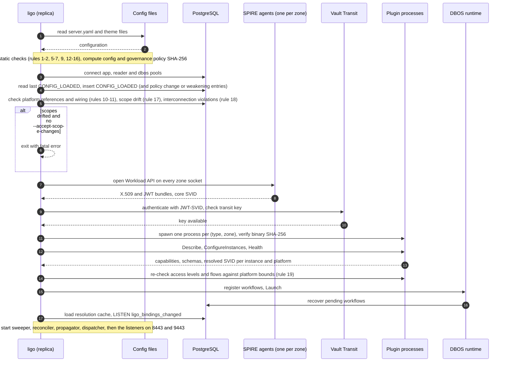

| Message | Information carried | Protection |
| :--- | :--- | :--- |
| Read configuration | `server.yaml`, theme files | Root-owned, read-only for `ligo` (T-22, T-27) |
| `CONFIG_LOADED` and related entries | Configuration SHA-256, theme file hashes, governance policy and its SHA-256, list of loosening changes | Hash-chained audit (§4.3) |
| Drift and violation checks | Stored platform references, wiring, scopes and regexes compared with configuration; lists of affected resources; access levels outside privilege bounds | No secrets |
| SPIRE Workload API | Trust bundles of every accepted trust domain; `ligo`'s own SVID and private key | Unix socket; private key held in memory only (**secret**) |
| Vault Transit check | JWT-SVID (**secret**, short-lived) and key metadata | TLS |
| Plugin start | Binary checksum check; `ConfigureInstances` with instance configuration (no secrets; bootstrap credentials are fetched by the plugin itself, §5.5) | AutoMTLS |
| DBOS launch and recovery | Workflow journal | `dbos` schema, own role (EXT-08) |
| Cache load | Active bindings from `v_active_bindings` | `reader` pool, view-only role |

### E.2 Administrator authentication

People sign in to the UI with LDAP credentials and get a server-side session; automation calls the API with an X.509-SVID (§7.2.1, §7.3).

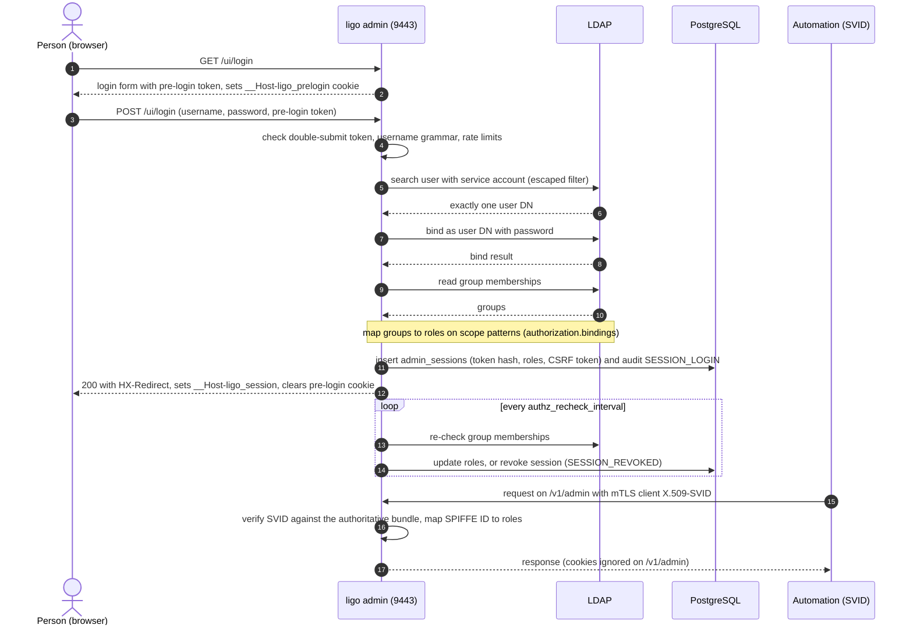

| Message | Information carried | Protection |
| :--- | :--- | :--- |
| Login form | Pre-login token (random 32 bytes) in a hidden field and a cookie | `__Host-`, `Secure`, `HttpOnly`, `SameSite=Strict` (T-06) |
| `POST /ui/login` | Username, password (**secret**), pre-login token | TLS; password never stored or logged; rate limits (T-04) |
| LDAP search and bind | Escaped user filter; user DN; password (**secret**) | `ldaps://` with configured CA; exactly one match required |
| Group read | Group DNs | `ldaps://` |
| Session insert | SHA-256 of the session token, roles with scopes, CSRF token, client IP | The token itself is only in the cookie |
| Session cookie | Opaque session token (**secret**) | `__Host-ligo_session`, `Secure`, `HttpOnly`, `SameSite=Strict`; idle 30 min, absolute 8 h |
| Automation request | Client X.509-SVID; request body | mTLS (SVID); Basic credentials only if `allow_basic_auth` is enabled |

### E.3 Create a binding applied at creation

A same-scope binding in a scope that does not require approval, filed by an operator of that scope: the source and the target are already registered, the request's only side is approved automatically, and the change is applied in the request (§7.2.3, §6.2.2). E.5 shows the workflow that follows.

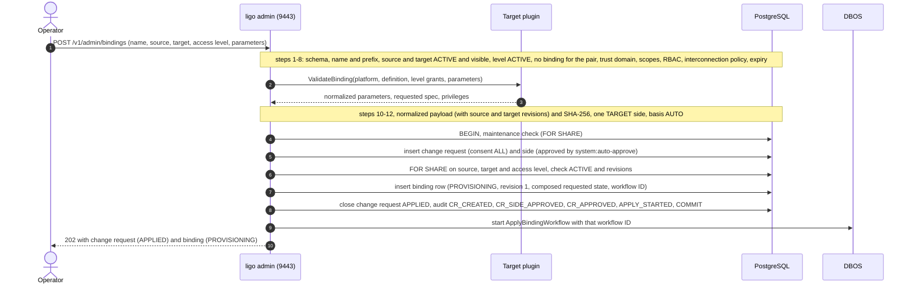

| Message | Information carried | Protection |
| :--- | :--- | :--- |
| `POST /v1/admin/bindings` | Binding name, source and target names, access level, parameters, purpose, labels, optional expiry, optional `approvalReference` and `automationContext` | TLS, authenticated principal; no secrets are ever submitted |
| `ValidateBinding` | Platform name, normalized target definition, the level's grants, parameters; back: normalized parameters, requested spec, privileges | AutoMTLS; plugin data rendered only as plain data (INV-12); parameters cannot add privilege (§5.8 rule 8) |
| Database transaction | Change request with normalized payload and its SHA-256, consent rule, governance policy SHA-256, side, binding requested state composed from the source and target revisions, audit entries | No secrets; lock order and audit insert last (§4.3) |
| Workflow start | Workflow ID (`ligo:apply:<id>:r1:a1`), binding ID, revision, wiring | DBOS journal; sweeper starts it if this call is lost (E.11) |
| `202` response | Change request and binding representations | Admin view only; never returned to workloads |

### E.4 Cross-scope binding with two-sided consent

A developer of the cloud tenancy `cloud/fin-01/payments` (a self-service scope, here not approval-required) found `ledger-schema` in the catalog (E.17) and requests the `write` level for the source `payments-ledger-workers`. The target is owned by `dc/corp-prod/ledger`. Rule `cloud-to-dc` allows the pair and requires Information Security. The request needs three sides; it is applied when the last one approves (ADR-13, ADR-14, §7.2.3).

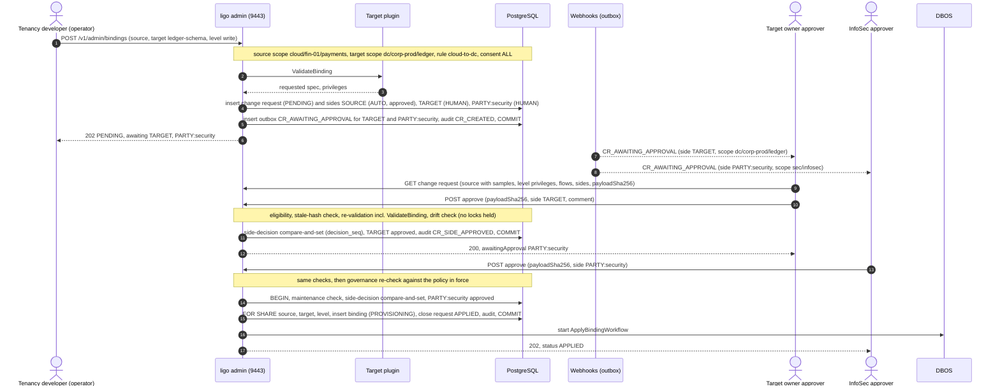

**Variants.**
- **Offer by the target owner.** A ledger operator offers the binding to the source instead (scenario 14): the `TARGET` side is then the automatic one and the `SOURCE` side waits for a tenancy lead (in an approval-required tenancy), which preserves the protection against credential injection (T-28).
- **Inline source.** If the developer registers the source in the same wizard, a source `CREATE` and a binding `CREATE` depending on it are filed together; the binding cannot be approved before the source is registered (§7.2.4).
- **Veto.** Any approver of a pending side can decline (`/decline`); a request with consent `ALL` is then `REJECTED` at once.
- **One approver for several sides.** If the target owner approver were also an InfoSec approver, an approval without `side` would get `400 side-required`, and a second approval by the same person `403 distinct-approver-required` (INV-18), unless the rule sets `distinct_approvers: false`.
- **Concurrent approvals.** If both approvers approve at the same moment, the `decision_seq` compare-and-set serializes them; the second sees the first's decision and applies the change (§4.3, AC-50).
- **Policy tightened, or target changed, meanwhile.** The final approval moves the request to `FAILED_TO_APPLY` with `409 governance-policy-changed`, respectively `409 normalization-drift` (ADR-14 rule 5, §7.2.3).
- **Denied pair.** If no rule allows the pair, the `POST` returns `403 interconnect-denied` and only `CR_INTERCONNECT_DENIED` is stored; the catalog would not have offered the target to this developer (ADR-14 rule 7).

| Message | Information carried | Protection |
| :--- | :--- | :--- |
| `POST /v1/admin/bindings` | As E.3 | TLS, authenticated principal |
| Change request and sides | Normalized payload and SHA-256; consent rule; source, target and platform scopes; matched rule; policy SHA-256; `distinct_approvers_required`; one row per side with scope, basis and decision | Per-side four-eyes as row checks; structure, completeness and distinctness checked at commit (§4.2) |
| `CR_AWAITING_APPROVAL` | Event ID, change request ID, resource, side, side scope, the request's scopes, requester | HMAC-signed, TLS; no credential locations (§7.5); a webhook with `scopes` receives only its own sides |
| `GET` change request | Source identity and samples, target, level privileges, effective flows, sides, `payloadSha256` | Visible only to principals with a role on one of the request's scopes (else `404`) |
| `POST approve` | `payloadSha256` the approver reviewed, side, comment | TLS; hash must match (`409 payload-mismatch` otherwise) |
| Side decision | Side, decider, time, comment; `decision_seq` increment | Compare-and-set on `status = 'PENDING'` and the payload hash |
| Final transaction | Binding requested state, request status `APPLIED`, audit entries | Lock order: request, sides, source, target, level, binding (§4.3); audit last |

### E.5 Apply and reapply workflow

`ApplyBindingWorkflow` converges the identity, target and secret store stages in order, seals inter-stage secrets, and promotes the new snapshot atomically (§6.4). The diagram shows a static-secret identity mode (`EXTERNAL_DIR`), the case where a secret crosses stages.

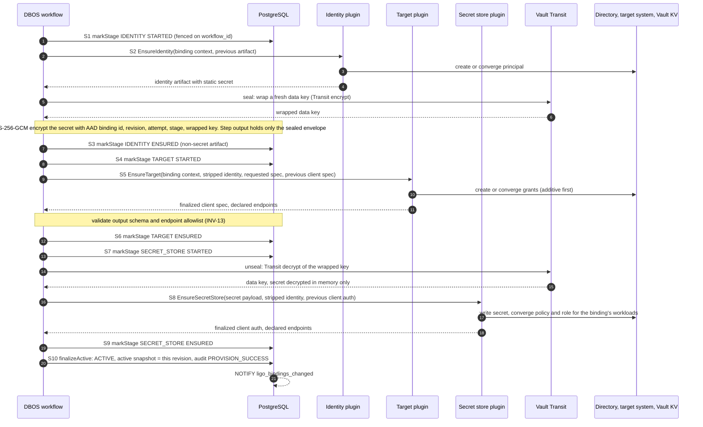

On a terminal error in S2–S9, the workflow runs `markFailed` (phase `FAILED`, audit `PROVISION_FAILURE`); workloads keep the previous active snapshot (§4.4). A reapply (reconciliation or rotation, E.10) runs the same steps for the same revision. In `SVID` mode there is no secret and no sealing; in `TARGET_LOCAL` mode the secret comes from S5 instead of S2; in `DELEGATED_DYNAMIC` mode S5 returns role statements and Vault generates credentials on demand (§5.6).

| Message | Information carried | Protection |
| :--- | :--- | :--- |
| `markStage` | Stage, status, provider wiring, revision, workflow ID, non-secret artifact | Fenced on `bindings.workflow_id` (ADR-08) |
| `EnsureIdentity` | Binding context (ID, derived principal name, revision, attempt), previous non-secret artifact; back: artifact and **secret** | AutoMTLS; plugin authenticates to the directory with its own SVID or bootstrap credential |
| Transit encrypt and decrypt | Data key (**secret**), wrapped key | TLS; `ligo`'s JWT-SVID; key not exportable (T-23) |
| Sealed envelope | Wrapped key, nonce, ciphertext, AAD (Appendix C) | Only ciphertext reaches DBOS step outputs (INV-03) |
| `EnsureTarget` | Stripped identity (no secret), requested spec, previous finalized client spec; back: client spec (host, port, service, roles), endpoints | AutoMTLS; output validated before persistence (INV-13) |
| `EnsureSecretStore` | Secret payload (**secret**, in memory only), stripped identity, previous client auth; back: client auth (where and how workloads fetch the secret) | AutoMTLS; endpoints allowlisted |
| `finalizeActive` | Active revision, regex, auth config, spec; `last_rotated_at`; audit snapshot | Single fenced transaction; audit last |
| `NOTIFY` | Binding ID only | Triggers cache refresh on every replica |

### E.6 Workload resolution and credential retrieval

A workload discovers its bindings from `ligo`, then fetches the credential itself from the secret store, following the `auth` instructions (§7.1, §4.5). `ligo` never hands out the secret.

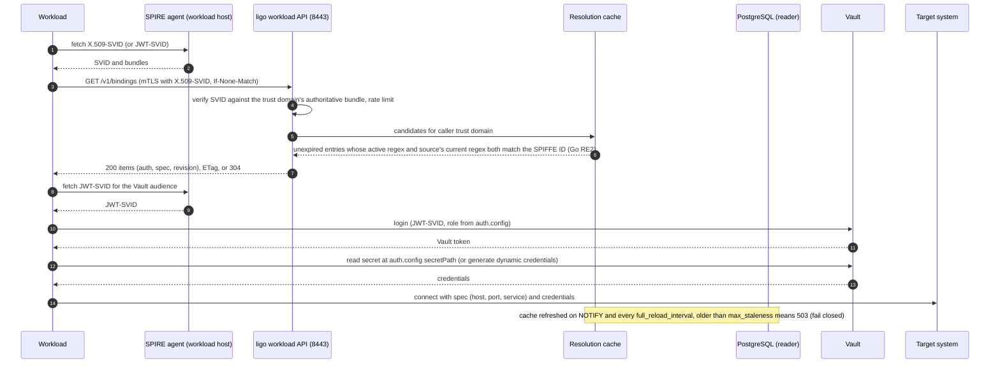

| Message | Information carried | Protection |
| :--- | :--- | :--- |
| SVID fetch | X.509-SVID and private key (**secret**), trust bundles | Local Unix socket, workload attestation |
| `GET /v1/bindings` | Caller's SVID (mTLS) or JWT-SVID (**secret**, bearer), optional `target` filter, ETag | TLS 1.3; JWT checks on audience, `iat`, TTL (T-01); headers redacted from logs |
| Response | For each matching binding: ID, name, source, target, access level, platform and its type, active revision, `auth` (secret storage strategy, secret store, Vault address, role, secret path, CA) and `spec` (connection coordinates); ETag | No secret values; only bindings whose active regex and source's current regex fully match the caller (INV-01) |
| Vault login and read | JWT-SVID (**secret**), Vault token (**secret**), credentials (**secret**) | Between workload and Vault only; Vault's role constrains the subject (see OI-1) |
| Target connection | Credentials (**secret**) | Target's own TLS |
| Cache refresh | Active binding rows | `reader` role limited to `v_active_bindings`; regex re-validated on load (INV-15) |

### E.7 Revocation (delete) and delete workflow

The source, target or platform owner can revoke a binding alone. Here the ledger DBA (target owner) revokes a cloud workload's access: the request has consent `ANY` and only the `TARGET` side, decided by a ledger approver; the tenancy cannot block it (ADR-13 rules 4–5, INV-20). The delete workflow then cleans the stages in reverse order (§6.5).

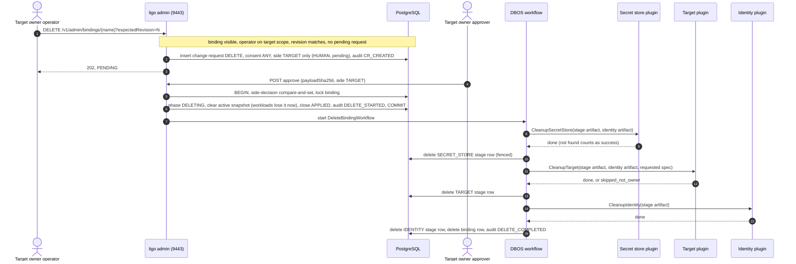

If the tenancy's own operator had filed the delete instead, the request would have only a `SOURCE` side; in a self-service tenancy that side is approved automatically and the delete starts at once. A central DBA of `dc/corp-prod` (the platform owner) could also revoke it, with a `PLATFORM` side. Lowering the access level follows the same path, with an `UPDATE` and a re-apply instead of the delete workflow, and `BINDING_REVOKED` is announced to the other scopes in both cases.

| Message | Information carried | Protection |
| :--- | :--- | :--- |
| `DELETE` request | Binding name, expected revision, optional `approvalReference` | TLS, authenticated principal |
| Change request | Empty payload (`{}`), consent `ANY`, sides of the requester only | No plugin call at creation (§7.2.3) |
| Start transaction | Phase `DELETING`; active snapshot cleared in the same transaction | Workloads stop receiving the binding at commit (T-10, AC-12) |
| `Cleanup*` | Stored provider wiring (not current configuration), non-secret artifacts, requested spec | AutoMTLS; ownership tags checked, foreign resources skipped (T-18) |
| Final transaction | Binding row removed (stage rows cascade), `DELETE_COMPLETED` | Fenced; audit last |

### E.8 Delegated approval by trusted automation

An AWX job, approved in the organisation's change process (`CHG0012345`), creates a binding between a source and a target of `dc/corp-prod/ledger`. The runner's SPIFFE ID holds `trusted_automation` for `dc/corp-prod/*` and the platform `oracle-prod`, so the target side is decided by delegation (ADR-11). The same job could register the source first, with its `OWNER` side delegated in the same way. For a cross-scope binding, only the sides inside the automation's scopes would be delegated; the others would wait as in E.4.

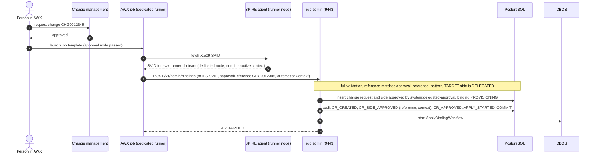

| Message | Information carried | Protection |
| :--- | :--- | :--- |
| Change approval | Change number and its human approval, outside `ligo` | Upstream process (R-06) |
| SVID fetch | Automation SVID and key (**secret**) | Issued only on dedicated automation nodes to a non-interactive context (§10.6) |
| `POST` | Binding request, `approvalReference`, `automationContext` (self-asserted: platform, job ID, template, launching user) | mTLS (SVID); `automationContext` is never used for authorization |
| Side and audit | Basis `DELEGATED`, decider `system:delegated-approval`, reference, context | `chk_side_basis` requires a SPIFFE requester; delegated side requires a reference (§4.2); rate limit per principal |

### E.9 Break-glass: use, ratification and expiry

During an incident with no approver reachable, a person in the break-glass groups of **every** side applies an emergency change at once. It is reverted at expiry unless each side is ratified by an approver of that side (ADR-12, §6.3).

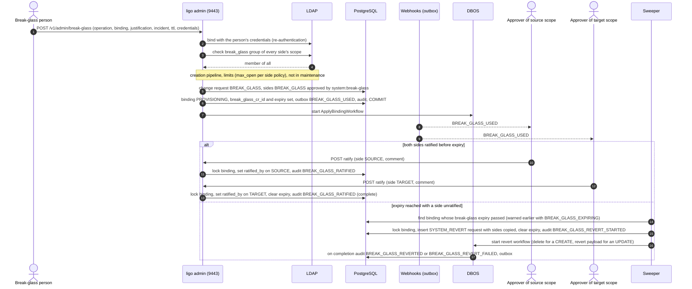

| Message | Information carried | Protection |
| :--- | :--- | :--- |
| `POST /v1/admin/break-glass` | Operation, binding request (or name and expected revision), justification, incident reference, TTL; LDAP credentials (**secret**) on the request itself | TLS; Basic credentials only on this endpoint when enabled; UI requires password re-entry |
| LDAP bind and group check | User DN, password (**secret**), groups of every side's scope | `ldaps://`; checked at the moment of use, not from the session |
| Change request and sides | Kind `BREAK_GLASS`, justification, incident reference, TTL, revert payload (for an update), sides with basis `BREAK_GLASS` | `chk_break_glass` (people only), `chk_side_basis` |
| `BREAK_GLASS_USED` | Requester, binding, scopes, justification, incident reference, expiry | HMAC-signed webhook; never blocks the change |
| Ratify | Side, ratifier, comment | Binding row locked; ratifier ≠ requester and distinct per side (`chk_side_ratification`, INV-18) |
| Revert | `SYSTEM_REVERT` request referencing the break-glass change; revert payload re-validated | Runs even in maintenance mode; a failed revert is alerted (INV-16) |

### E.10 Scheduled reconciliation and rotation

A singleton reconciler re-applies every active binding at a jittered interval, repairing drift and rotating static secrets when they are due (§6.6, ADR-10).

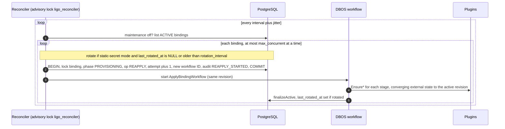

Busy bindings are skipped until the next run. A manual rotation (`POST /v1/admin/bindings/{name}/rotate`) starts the same reapply with `rotate_static_secrets = true`.

| Message | Information carried | Protection |
| :--- | :--- | :--- |
| Binding list and start | Binding IDs, phases, `last_rotated_at`, rotation flag, workflow ID | Advisory lock: one reconciler in the cluster |
| `Ensure*` | As E.5, for the same revision | Convergent, idempotent plugins (INV-07) |
| Finalize | Unchanged active snapshot or rotated secret location, `last_rotated_at` | `ligo_rotation_overdue` gauge alerts on missed rotations |

### E.11 Sweeper recovery after a crash

If a replica crashes after committing a start transaction but before starting the workflow, or a workflow ends without settling the binding, the sweeper repairs it (§6.3, ADR-08).

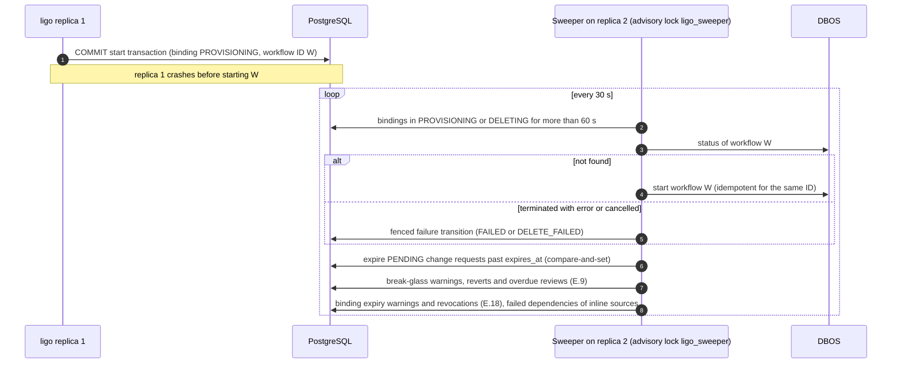

| Message | Information carried | Protection |
| :--- | :--- | :--- |
| Stale binding query | Binding IDs, workflow IDs, phases | Advisory lock: one sweeper in the cluster |
| Workflow status and start | Workflow ID and input | Workflow IDs are never reused (INV-09); DBOS start is idempotent (EXT-02) |
| Failure transition and expiry | Phase, status message; change request status `EXPIRED` | Fenced on `workflow_id`; compare-and-set on `status = 'PENDING'` |

### E.12 Notification delivery

Events are written to a transactional outbox in the same transaction as the change they announce, and delivered by a singleton dispatcher (§7.5).

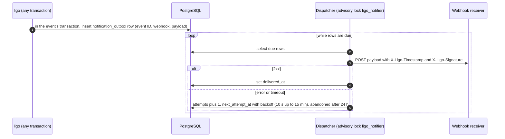

| Message | Information carried | Protection |
| :--- | :--- | :--- |
| Outbox insert | Event ID (UUIDv7), webhook name, event type, payload (event, time, zone, scopes, side, binding, change request, actor, and for break-glass the justification, incident and expiry) | Same transaction as the event: never lost, never announced if rolled back; no secrets or credential locations |
| Webhook `POST` | Payload, timestamp, HMAC-SHA256 signature over timestamp and body | TLS verified against `ca_cert_file`; receivers check signature and age, and deduplicate on `eventId` |

### E.13 Maintenance mode and upgrade

Maintenance mode is a cluster-wide setting that stops new work while in-flight work drains (§10.3).

```mermaid
sequenceDiagram
    autonumber
    actor Ad as Administrator (admin.full_access)
    participant A as ligo admin (any replica)
    participant PG as PostgreSQL
    actor Op as Operator
    Ad->>A: PUT /v1/admin/maintenance (enabled, reason)
    A->>PG: update system_settings, audit SYSTEM_MAINTENANCE_ENABLED (waits for transactions holding the FOR SHARE check)
    Op->>A: POST /v1/admin/bindings (or approve, retry, rotate, break-glass)
    A->>PG: start transaction checks maintenance_mode FOR SHARE
    A-->>Op: 503 maintenance
    loop until inFlight is 0
        Ad->>A: GET /v1/admin/maintenance
        A-->>Ad: maintenanceMode true, inFlight N
    end
    Note over Ad,A: roll out the new version, run forward-only migrations
    Ad->>A: PUT /v1/admin/maintenance (enabled false)
    A->>PG: update system_settings, audit SYSTEM_MAINTENANCE_DISABLED
```

| Message | Information carried | Protection |
| :--- | :--- | :--- |
| `PUT /v1/admin/maintenance` | Enabled flag, reason, actor | Only `admin.full_access`; audited with the number of in-flight bindings |
| Refused changes | Problem `503 maintenance` with `Retry-After` | Authoritative check inside the start transaction (§6.2) |
| Status | `maintenanceMode`, reason, who and when, `inFlight` | Readable by every role |

### E.14 Register and narrow a source

A tenancy developer registers the workloads of the ledger batch as a source. The scope comes from the regex; the tenancy lead reviews which workloads it covers, using the sample IDs (§3.2, §7.2.3). Later the developer narrows the regex; the change takes effect for resolution at once and is propagated to the bindings (E.16).

*Registration:*
```mermaid
sequenceDiagram
    autonumber
    actor Dev as Tenancy developer
    participant A as ligo admin (9443)
    actor Lead as Tenancy lead (approver)
    participant PG as PostgreSQL
    Dev->>A: POST /v1/admin/sources/test (trust domain, regex, sample IDs)
    A-->>Dev: Appendix A result, scope cloud/fin-01/payments, matches, overlaps
    Dev->>A: POST /v1/admin/sources (name, identity, samples, metadata, visibility)
    Note over Dev,A: name and prefix, trust domain, Appendix A, scope (3.9), samples match, RBAC
    A->>PG: change request SOURCE CREATE, side OWNER pending, audit CR_CREATED
    A-->>Dev: 202, PENDING
    Lead->>A: GET change request (regex, scope, samples, overlaps)
    Lead->>A: POST approve (payloadSha256)
    A->>PG: side decision, insert source ACTIVE r1, close APPLIED, audit SOURCE_REGISTERED
```

*Narrowing:*
```mermaid
sequenceDiagram
    autonumber
    actor Dev as Tenancy developer
    participant A as ligo admin (9443)
    actor Lead as Tenancy lead (approver)
    participant PG as PostgreSQL
    participant C as Resolution caches
    Dev->>A: PUT /v1/admin/sources/{name} (narrower regex, sample ledger-12 removed, expectedRevision 1)
    Note over Dev,A: Appendix A, same scope, narrowing check (D.3), samples match
    A->>PG: change request SOURCE UPDATE, side OWNER pending
    Lead->>A: POST approve (payloadSha256)
    A->>PG: lock source, re-check narrowing, update regex (r2)
    A->>PG: enqueue its bindings (priority 0), audit SOURCE_UPDATED, PROPAGATION_ENQUEUED, COMMIT
    PG-->>C: NOTIFY source id
    Note over C: reload the source's bindings, ledger-12 no longer matches
```

| Message | Information carried | Protection |
| :--- | :--- | :--- |
| Regex test | Trust domain, regex, SPIFFE IDs to test; back: validation, scope, matches, overlaps, narrowing verdict with witness | Stores nothing; same Go code as production |
| Source change request | Normalized source body and SHA-256; one `OWNER` side | Structure checked at commit (`change_request_check`) |
| Approval view | Regex, derived scope, samples, overlaps, for an update the dropped samples | Visible only to roles on the source's scope |
| Narrowing apply | New regex, revision; queue rows for every binding | Re-checked under the row lock; refused if it widens (INV-21) |
| `NOTIFY` | `source:<id>` | Caches apply the new regex to every binding of the source immediately (INV-01) |

### E.15 Publish a target

A ledger DBA publishes the `LEDGER_APP` schema on `oracle-prod` as a target, with two access levels and a dedicated listener. The platform owner (central DBAs) confirms it. Publishing does not create the schema (ADR-15).

```mermaid
sequenceDiagram
    autonumber
    actor Own as Ledger DBA (operator)
    participant A as ligo admin (9443)
    participant TP as Target plugin (oracle-prod)
    participant DB as Oracle (read-only check)
    participant PG as PostgreSQL
    actor TL as Ledger lead (approver)
    actor PO as Platform approver (central DBAs)
    Own->>A: POST /v1/admin/targets (platform oracle-prod, scope dc/corp-prod/ledger, definition, levels, flows)
    Note over Own,A: name and prefix, scope within target_scopes, flows within allowed_endpoints, RBAC
    A->>TP: ValidateTarget(definition, levels, flows, check_existence)
    TP->>DB: does schema LEDGER_APP exist, do the granted roles exist
    DB-->>TP: yes
    TP-->>A: normalized definition, grants and privileges per level
    A->>PG: change request TARGET CREATE, sides OWNER and PLATFORM pending
    TL->>A: POST approve (side OWNER)
    A->>PG: OWNER approved, COMMIT
    PO->>A: POST approve (side PLATFORM)
    Note over A,TP: re-validation incl. ValidateTarget, drift check
    A->>PG: insert target, levels and flows (r1), close APPLIED, audit TARGET_PUBLISHED
```

Later changes follow §3.7: a description or visibility change needs only the `OWNER` side; a new level, a narrowed level, a new definition or new flows also need the `PLATFORM` side. A narrowed level or a new definition is propagated to the bindings that use it (E.16); flows are served at once.

| Message | Information carried | Protection |
| :--- | :--- | :--- |
| `POST /v1/admin/targets` | Target body: platform, scope, definition, levels with grants, flows, visibility, metadata | TLS; authenticated principal |
| `ValidateTarget` | Definition, grants, flows, `check_existence`; back: normalized values and canonical privileges | AutoMTLS; read-only (§5.8 rule 7); grants within the platform's bounds |
| Existence check | Schema and role names | The plugin's bootstrap credential, read-only use (§5.5) |
| Change request and sides | Normalized target and SHA-256; `OWNER` and `PLATFORM` sides | Different scopes required for two sides; distinct approvers (INV-18) |
| Apply | Target, levels and flows rows | Flows re-checked against `allowed_endpoints` (INV-24); audit last |

### E.16 Propagation of a source or target change

After the narrowing of E.14 (or a change of a target's definition or of a level's grants), the propagator re-applies every affected binding at a new revision, narrowings first (§6.8).

```mermaid
sequenceDiagram
    autonumber
    participant PR as Propagator (advisory lock ligo_propagator)
    participant PG as PostgreSQL
    participant TP as Target plugin
    participant D as DBOS workflow
    loop every propagation interval
        PR->>PG: due queue rows ordered by priority, enqueued_at
        loop each row, at most max_concurrent workflows
            PR->>PG: binding phase?
            alt binding busy (PROVISIONING or DELETING)
                PR->>PG: attempts plus 1, audit PROPAGATION_DEFERRED (first time)
            else stable (ACTIVE or FAILED)
                PR->>TP: ValidateBinding with the current definition and level
                TP-->>PR: requested spec
                PR->>PG: BEGIN, FOR SHARE source and target, lock binding
                PR->>PG: revision plus 1 composed from current revisions, rotate if regex changed, delete queue row
                PR->>PG: audit PROPAGATION_STARTED (cause, change request), APPLY_STARTED, COMMIT
                PR->>D: start ApplyBindingWorkflow (as E.5)
            end
        end
    end
```

| Message | Information carried | Protection |
| :--- | :--- | :--- |
| Queue read | Binding IDs, cause, priority, attempts | Rows written in the same transaction as the approved change (INV-26) |
| `ValidateBinding` | As E.3 | Runs before the transaction; revisions re-checked under the locks |
| Start transaction | New revision with the source and target revisions it was composed from | Actor `system:propagator`; no change request: nothing is added that the sides did not consent to (§6.8) |
| Failure | `PROVISION_FAILURE`, `PROPAGATION_FAILED` to the binding's scopes | Workloads keep the last snapshot, filtered by the current regex (INV-01) |

### E.17 Catalog and network pre-flight check

Before requesting access, the developer browses the catalog and runs the organisation's verification tool on a workload host against the target's flows. After the binding exists, the tool asks the workload API for the effective flows with the host's own SVID (ADR-16).

```mermaid
sequenceDiagram
    autonumber
    actor Dev as Tenancy developer
    participant A as ligo admin (9443)
    participant VT as Verification tool (workload host)
    participant WA as SPIRE agent (workload host)
    participant L as ligo workload API (8443)
    participant NET as Network (target, Vault, ligo)
    Dev->>A: GET /v1/admin/catalog/targets?q=ledger&forSource=payments-ledger-workers
    A-->>Dev: visible targets allowed by the interconnection policy
    Dev->>A: GET /v1/admin/catalog/targets/ledger-schema/flows
    A-->>Dev: target and platform flows (JSON)
    Dev->>VT: run with the flows file
    VT->>NET: check each destination, protocol, port and TLS server name
    NET-->>VT: reachable or not
    VT-->>Dev: report before any binding is requested
    Note over Dev,A: the binding is requested and approved (E.4)
    VT->>WA: fetch X.509-SVID
    WA-->>VT: host or workload SVID
    VT->>L: GET /v1/flows (mTLS)
    L-->>VT: effective flows of every binding of this identity (target, platform, Vault, ligo)
    VT->>NET: check each flow, report
```

| Message | Information carried | Protection |
| :--- | :--- | :--- |
| Catalog search | Query, filters, the caller's source | Visibility rules and interconnection filter (ADR-14 rule 7, T-33) |
| Catalog flows | Target and platform flows; no secret store (it depends on the binding) | Only for targets visible to the caller |
| Verification | Destinations, ports, TLS names | Performed by the external tool from the workload's network position; `ligo` never connects to flows |
| `GET /v1/flows` | Caller's SVID; back: flows per binding with `declaredBy` | mTLS; same resolution as `/v1/bindings` (INV-01); no `auth` or `spec` |

### E.18 Binding expiry

A binding created for a migration has an expiry. Its owners are warned beforehand; at expiry it stops being served at once, and the sweeper revokes it (§6.3, INV-25).

```mermaid
sequenceDiagram
    autonumber
    participant S as Sweeper (advisory lock ligo_sweeper)
    participant PG as PostgreSQL
    participant N as Webhooks (outbox)
    participant C as Resolution cache
    participant D as DBOS
    S->>PG: bindings with expires_at within expiry_warning and expiry_warned_at NULL
    S->>PG: set expiry_warned_at, outbox BINDING_EXPIRING, audit BINDING_EXPIRY_WARNED
    N-->>N: deliver to the source, target and platform scopes
    Note over C: at expires_at the cache stops serving the binding (expires_at checked per request)
    S->>PG: bindings past expires_at, not busy
    S->>PG: BEGIN, insert change request DELETE, kind SYSTEM_EXPIRY, consent ANY, side TARGET approved by system:expiry
    S->>PG: lock binding, phase DELETING, clear active snapshot, close APPLIED, audit BINDING_EXPIRED, DELETE_STARTED, COMMIT
    S->>D: start DeleteBindingWorkflow (as E.7)
```

| Message | Information carried | Protection |
| :--- | :--- | :--- |
| Warning | Binding, expiry, scopes | Emitted once (`expiry_warned_at`); HMAC-signed webhook |
| Expiry revocation | `SYSTEM_EXPIRY` change request with one `TARGET` side, basis `SYSTEM_EXPIRY` | Database allows this kind only for a binding `DELETE` with consent `ANY` (`chk_system_kinds`, `chk_side_basis`); runs during maintenance |
| Delete workflow | As E.7 | Workloads already stopped receiving the binding at `expires_at` |
