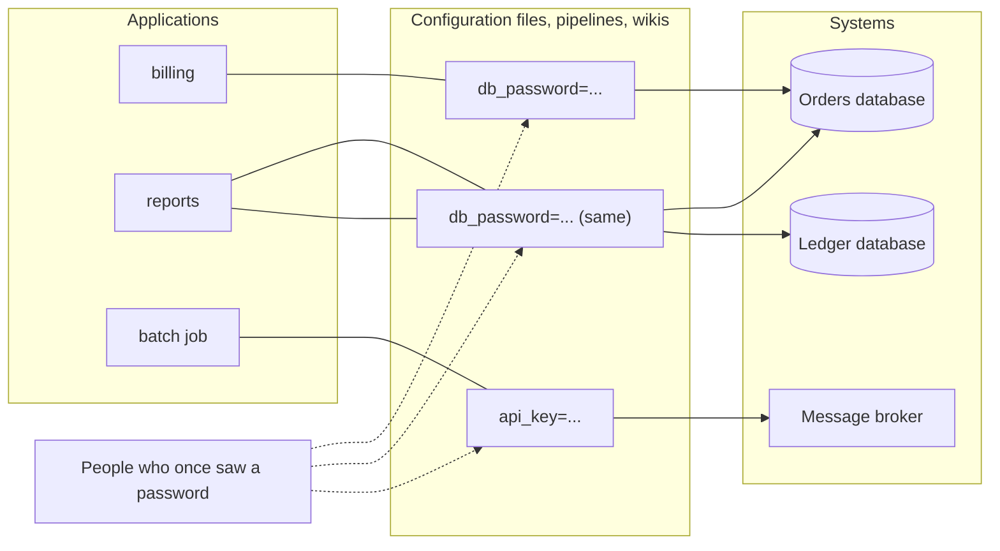
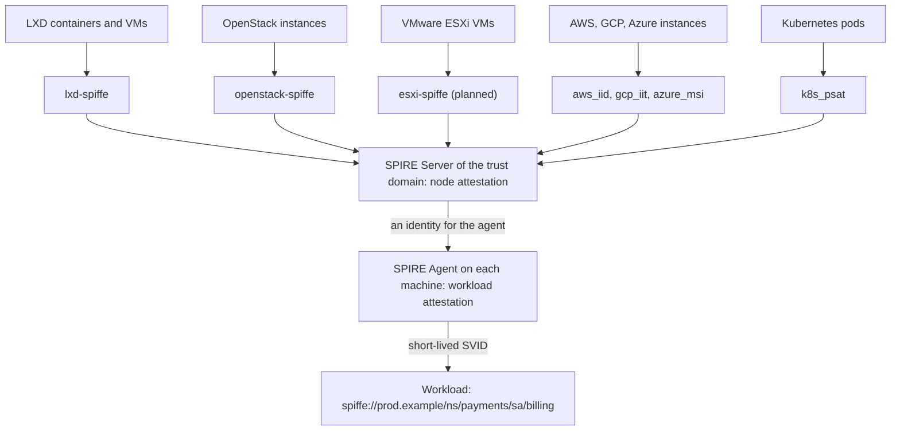
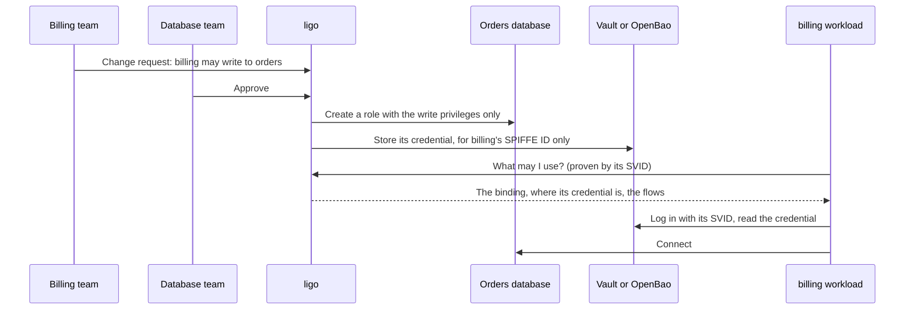
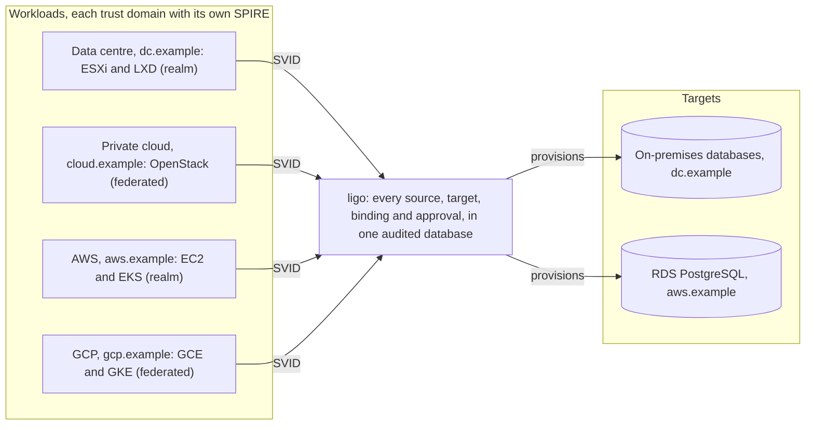

# ligo

`ligo` (pronounced "lee-go"; Latin for "I bind") is the SPIFFE binding lifecycle service. It manages sources, targets and the bindings that link them.

> **Early release.** Until 1.0.0, `ligo` makes no compatibility promise: interfaces, configuration and the database schema may still change between releases. Known limits are listed under [Status](#status), and each is tracked in the [backlog](.specs/ligo-backlog.md).

## Why ligo?

Applications reach databases, brokers and APIs with passwords copied into configuration files. Nobody knows who holds them, they are rarely changed, and taking access away is guesswork. Every technology (the cloud's IAM, Kubernetes, local accounts, LDAP) is an island, with no one place that shows who may reach what.



Three pieces replace that with verifiable workload identity:

1. **SPIFFE**, an open standard: every workload gets a name, its SPIFFE ID (`spiffe://prod.example/ns/payments/sa/billing`), and short-lived proofs of it, its SVIDs (an X.509 certificate or a signed JWT), issued by its **trust domain**.
2. **SPIRE** issues the SVIDs, after **attestation**: the platform, not the machine, vouches for what the machine is. SPIRE ships attestors for AWS, GCP, Azure and Kubernetes; the companion projects cover the private cloud and the data centre:
   - [`lxd-spiffe`](https://github.com/dihedron/lxd-spiffe) attests LXD containers and virtual machines through the LXD API;
   - [`openstack-spiffe`](https://github.com/dihedron/openstack-spiffe) attests OpenStack instances with a token checked against Keystone and Nova;
   - `esxi-spiffe`, planned, will attest virtual machines on VMware ESXi.
3. **`ligo`** turns identities into access. A **binding** says that a **source** (a group of workloads, by SPIFFE ID) may use a **target** (a database, a schema, a topic) at one access level. The owners of both sides approve it; `ligo` creates a role with only that level's privileges, puts its credential in Vault or OpenBao, released only to the workload's SPIFFE ID, then repairs drift, rotates it, and revokes it at once when any owner asks.





`ligo` works across trust domains. In a **realm** it runs a SPIRE Agent of that domain and provisions targets there; a domain whose workloads only call `ligo` is verified through **federation**. A workload in GCP can be bound to a database in the data centre, with both owners' consent, and recorded in the same place as two containers on one LXD server.



What this brings to security:

- **No person handles a credential.** It is generated per binding, kept in the store, released only to one SPIFFE ID proven by an SVID, rotated on a schedule, or issued as a short-lived lease.
- **Least privilege and consent by construction**: one principal per binding, only the approved level's privileges, approved by every owner concerned.
- **Visibility across technologies**: one inventory of which workload may use which target, at which level, approved by whom, through which network flows, for the data centre, the private cloud, AWS and GCP alike; every change in a hash-chained audit log.
- **Fast containment**: revoking a binding, or every binding of a compromised source on a target, is one command.
- **What still needs care**: the SPIRE Server can issue any identity in its domain, so protect it like a certificate authority; registration entries must rest on selectors the platform maintains.

The leaflet *Why ligo?*, published with every release, tells the same story at more length.

## What it does

- A **source** is a group of client workloads, defined by a SPIFFE ID regex in one trust domain.
- A **target** is one resource on a **platform**, for example a PostgreSQL database, an Oracle schema or a Kafka topic. It has named access levels and the network flows needed to reach it.
- A **binding** says that a source may use a target at one of its access levels.

Every change is a change request. Each jurisdiction involved must approve it (maker-checker), as the charter requires. `ligo` then provisions an approved binding with a durable, checkpointed three-stage pipeline of plugins: an identity provider, the platform provider and a secret store.

The pipeline runs on DBOS and PostgreSQL. Plugins create the principal, grant the privileges on the target and set up credential delivery through Vault or OpenBao. Housekeeping loops repair drift, rotate static secrets, propagate source and target changes, and revoke expired bindings. Attested workloads then ask `ligo` which targets they may use and how to get their credentials.

## Status

Working:
- the core engine and storage;
- the plugin host;
- change requests, and the charter that every jurisdiction complies with;
- accounts, registered at run time through the API, the CLI or the web UI, each with its own operators and approvers, and tenancies whose namespace is checked on the platform ([.specs/ligo-tenancy.md](.specs/ligo-tenancy.md));
- platforms, identity provider instances and secret store instances, managed at run time through the API, `ligo apply` and the web UI, each change approved by a second person of their jurisdiction and applied by every replica with no restart; `server.yaml` keeps the plugin types and the limits on where their instances connect ([.specs/ligo-instances.md](.specs/ligo-instances.md));
- the binding workflows, including break-glass, with failures from a retryable cause retried automatically, and deletes that remove access first;
- the hash-chained audit log, with checkpoints signed by a key outside the database (Vault or OpenBao Transit), verified in batches, exported to files that verify offline, and pruned after a retention, only once exported, with the change requests it names ([.specs/ligo-pruning.md](.specs/ligo-pruning.md), [.specs/ligo-cr-pruning.md](.specs/ligo-cr-pruning.md));
- `ligo serve` with the admin API (`api/openapi/admin.v1alpha1.yaml`), the `ligo` CLI and webhook notifications;
- the workload API (REST and gRPC), which attested workloads use to find their bindings and network flows, and the Go client SDK (`pkg/client`) that wraps it: bindings, credentials from Vault or OpenBao, and a watch for changes, rotations and revocations ([.specs/ligo-client-sdk.md](.specs/ligo-client-sdk.md));
- the lease of a credential that a store makes on demand, set per platform or for the installation, with the one hour and 24 hours of before as the default;
- the web UI (htmx), including the binding wizard, approvals and break-glass, with operator theming;
- Prometheus metrics on their own listener (`server.metrics_listener`, default `127.0.0.1:9090`);
- the external plugins, each with its own package: `ligo-plugin-openldap` (identity provider), `ligo-plugin-postgres` (platform provider) and `ligo-plugin-vault` (secret store, for Vault and OpenBao).

Known limits of v0.5.0:
- the client SDK is for Go only: SDKs for Java, Python and JavaScript/TypeScript are not written yet (backlog item 7); `pkg/client`'s API may change between minor versions until 1.0.0;
- the SDK's `Watch` polls (every 30 s by default), as the workload API has no stream, so a revocation reaches a watching workload within one poll; and every `Credential` call on a `vault-dynamic` binding makes a new database user, which the SDK does not cache;
- the SDK reads credentials from Vault and OpenBao only; a binding applied before v0.5.0 has no `audience` (and no `namespace`) in its `auth` until its next apply or reconciliation, and the SDK reports that as an error;
- a Vault namespace in a binding is tested on OpenBao only (Vault Community has no namespaces);
- PostgreSQL is the only platform provider, and workloads cannot connect to it with an SVID directly (`.specs/ligo-postgres-plugin.md` §10);
- the Vault store releases a credential to one exact SPIFFE ID, so a source covering many workloads cannot use it (`.specs/ligo-vault-plugin.md` §4);
- there is no conformance suite that every plugin must pass; each plugin is tested on its own (`.specs/ligo-acceptance-matrix.md`, INV-07);
- audit checkpoints are signed with ed25519, not with a post-quantum algorithm: neither OpenBao 2.7.1 nor Vault Community 2.2.1 offers ML-DSA keys (backlog item 14);
- the incremental audit verification, every 10 minutes, does not detect an entry before the newest checkpoint whose content was changed without re-hashing; the full pass, at startup and every 24 hours, does (spec §4.3);
- a compromised `ligo_app` can record an audit export it never took, and so prune entries early down to a day old; the gap shows in `ligo_audit_oldest_entry_timestamp_seconds`, and the SIEM's forwarded copy stays the authoritative record (spec T-13);
- the change requests in an audit export are outside the hash chain and the checkpoints: only the file's SHA-256, recorded with the export, fixes them (spec §4.3);
- the daily prune's age rules are tested against PostgreSQL, but on the lab only through a backdated checkpoint, as a lab is hours old (`.specs/ligo-pruning.md`);
- an instance's database row that someone rolls back to an earlier approved revision, with that revision's signature, is not detected once the audit no longer holds the newer one (`.specs/ligo-instances.md` T-22b);
- a new instance's SPIRE registration entry is created by hand: `ligo` refuses the instance until the plugin can select its SVID (`.specs/ligo-instances.md` §14);
- the Accounts web page has not yet been tested by hand in a browser (manual test A-1, backlog item 4);
- some account scenarios are not yet tested on the lab: a group removal ending a role at the session re-check, break-glass through an account group, hostile DNs against a real OpenLDAP, and account workloads attested by a real SPIRE agent (backlog item 5).

Everything is tested on a lab that reproduces the production architecture (two SPIRE trust domains, OpenBao, LDAP, PostgreSQL and target systems; see [.specs/ligo-test-environment.md](.specs/ligo-test-environment.md)). The lab suite passes against OpenBao 2.7.1 and HashiCorp Vault 2.2.1. An overnight soak ([.specs/ligo-soak.md](.specs/ligo-soak.md)) runs hours of load with faults injected one at a time and in pairs, judged by an invariant checker that is itself proven against reintroduced bugs. The lab also runs a toy echo service for trying bindings by hand from the CLI or the web UI ([.specs/ligo-echo-target.md](.specs/ligo-echo-target.md)).

The specification is in [.specs/ligo_specification.md](.specs/ligo_specification.md).

## Build

```bash
make          # lint, then build into dist/
make help     # list the targets
```

## Install

Each release has deb and rpm packages and archives of `ligo` and of each plugin, and six documents, as PDF files: the **Why ligo?** leaflet, the **Setup Guide**, the **Operator's Guide**, **Architecture and Design**, the **Planning for Deployment Guide**, and the **Developer's Guide**, which shows how to write a workload with the Go client SDK and how to develop a plugin. Their sources are in [docs/](docs).

### Verify a release

Releases are signed with the project's packaging key, [packaging/signing-key.asc](packaging/signing-key.asc), fingerprint `FB7DE97BAAFAA2A676CEE59A1B34E6A2A14CD06A`. Get the key from this repository, not from the release you are verifying.

- **The checksums file** covers every archive, package and SBOM of the release, and its signature (`.asc`) covers it:

  ```bash
  gpg --import signing-key.asc
  gpg --verify checksums.txt.asc checksums.txt
  sha256sum --check --ignore-missing checksums.txt
  ```

- **rpm packages** carry their own signature, which `rpm` and `dnf` check once the key is imported:

  ```bash
  sudo rpm --import signing-key.asc
  rpm --checksig ligo_<version>_linux_amd64.rpm   # must report "digests signatures OK"
  ```

- **deb packages** carry a `debsig` origin signature. `apt` and `dpkg` do not check it on a standalone package, so verify it with `debsig-verify`, after installing its policy for the key:

  ```bash
  sudo apt-get install debsig-verify
  sudo mkdir -p /usr/share/debsig/keyrings/1B34E6A2A14CD06A /etc/debsig/policies/1B34E6A2A14CD06A
  gpg --dearmor < signing-key.asc | sudo tee /usr/share/debsig/keyrings/1B34E6A2A14CD06A/debsig.gpg > /dev/null
  sudo tee /etc/debsig/policies/1B34E6A2A14CD06A/ligo.pol > /dev/null <<'POLICY'
  <?xml version="1.0"?>
  <!DOCTYPE Policy SYSTEM "https://www.debian.org/debsig/1.0/policy.dtd">
  <Policy xmlns="https://www.debian.org/debsig/1.0/">
    <Origin Name="ligo" id="1B34E6A2A14CD06A" Description="ligo packages"/>
    <Selection><Required Type="origin" File="debsig.gpg" id="1B34E6A2A14CD06A"/></Selection>
    <Verification MinOptional="0"><Required Type="origin" File="debsig.gpg" id="1B34E6A2A14CD06A"/></Verification>
  </Policy>
  POLICY
  debsig-verify ligo_<version>_linux_amd64.deb
  ```

Each release also carries `evidence-<commit>.tar.gz`, the logs and component versions of the lab run for that commit.
